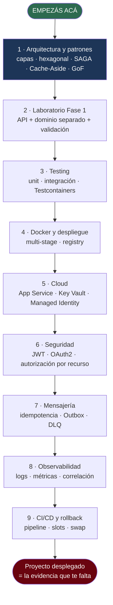
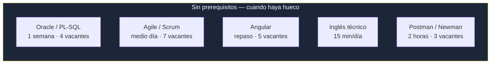
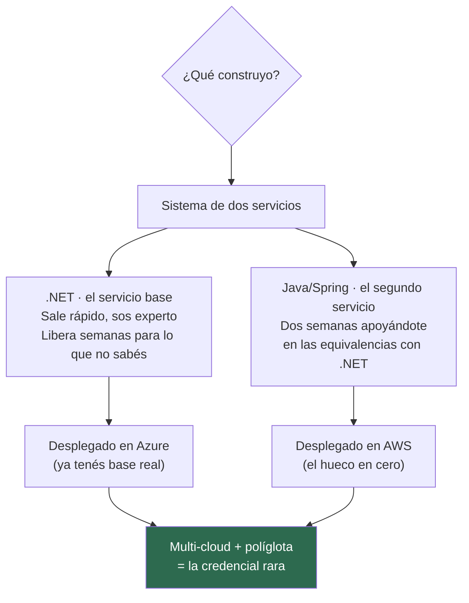
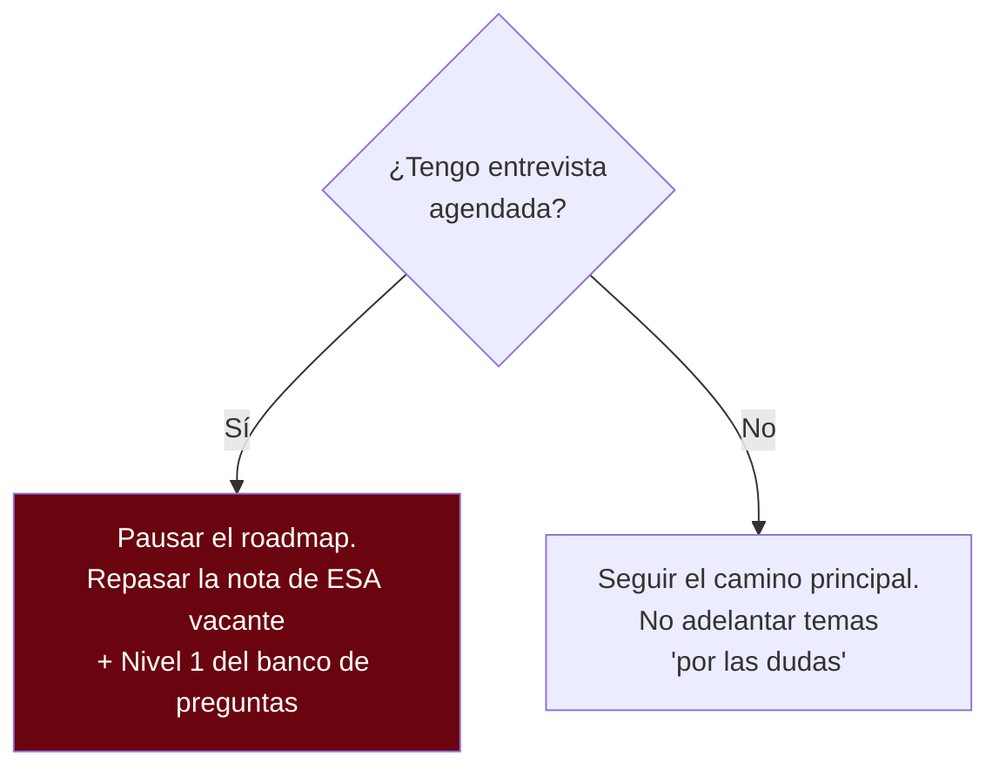

---
tags:
  - Estudio
  - Roadmap
Creado: 2026-08-31
Relacionado:
  - PLAN DE CAPACITACION
---

# Por dónde empezar — mapa de dependencias

Las otras notas dicen **cuándo** (calendario). Esta dice **en qué orden y por qué**, que es lo que importa cuando el calendario se corre.

---

# La respuesta, en una línea

> **Empezá por arquitectura y patrones. Una semana. Después arrancá el laboratorio y no lo sueltes hasta terminarlo.**

Todo lo demás cuelga de ahí.

## Por qué arquitectura primero y no algo "más útil"

Tres razones, en orden de peso:

1. **Es lo que realmente preguntaron** en la entrevista que compartiste (SAGA, hexagonal, capas, Circuit Breaker, Factory, Singleton, Repository, Strategy). No es una estimación: es evidencia.
2. **No depende de nada.** Podés empezarla hoy sin instalar ni configurar nada.
3. **Sin ella, el laboratorio te sale mal.** Si arrancás a codear sin criterio de capas y dependencias, después hay que rehacerlo — y el laboratorio es tu única fuente de evidencia.

Es la única semana de teoría pura del plan. Después todo es construir.

---

# El camino principal

Cada paso **necesita** el anterior. No es preferencia: es dependencia real.

## Por qué ese orden es obligatorio y no negociable

| Paso | No podés hacerlo antes porque… |
|---|---|
| **Testing** | necesitás algo que probar |
| **Docker** | necesitás algo que empaquetar |
| **Cloud** | necesitás una imagen que desplegar |
| **Seguridad** | necesitás endpoints que proteger |
| **Mensajería** | necesitás una operación de negocio que dispare el evento |
| **Observabilidad** | necesitás **varios** servicios para que correlacionar signifique algo |
| **CI/CD** | necesitás tests que correr y un destino donde desplegar |

Saltear un paso no acelera: obliga a volver. Es el error que hunde la mayoría de los roadmaps —incluido el de DevOps de 2025, que empezaba por herramientas en vez de por algo que construir.

---

# Lo que corre en paralelo

Esto **no depende de nada** y no bloquea a nadie. Metelo en los huecos, no le des una semana entera salvo Oracle:

**Scrum y Postman son los de mejor relación esfuerzo/retorno de todo el plan:** medio día y dos horas respectivamente, y cubren 7 y 3 vacantes. Si un día no tenés cabeza para algo pesado, hacé uno de estos.

---

# Los dos puntos de decisión

## Decisión 1 — ¿en qué stack construyo? · **Resuelta el 31/08/2026**

La respuesta ya no es "uno u otro": **es un sistema con los dos.**

**Por qué así:** hacer todo en Java gastaba un mes en la brecha que solo desbloquea **una** vacante alcanzable, mientras AWS —que piden 3 de 5 avisos, dos como experiencia práctica— quedaba en "vocabulario". Con .NET como base el laboratorio sale rápido, y las semanas liberadas van a AWS y a un servicio Java real.

Además, dos servicios que se hablan **son** la demostración de arquitectura: responde en la práctica la pregunta 52 de tu banco (*"¿cómo integrás un servicio Java con uno .NET?"*), que es justo lo que preguntan TCS y Stefanini en teoría.

## Decisión 2 — ¿y si aparece una entrevista antes de terminar?

---

# Dónde estás parado hoy

| Paso | Estado |
|---|---|
| 1 · Arquitectura y patrones | ⬜ **Acá empezás** |
| 2 · Laboratorio fase 1 | ⬜ |
| 3 · Testing | ⬜ |
| 4 · Docker y despliegue | ⬜ |
| 5 · Cloud | ⬜ |
| 6 · Seguridad | ⬜ |
| 7 · Mensajería | ⬜ |
| 8 · Observabilidad | ⬜ |
| 9 · CI/CD y rollback | ⬜ |
| ⟋ Oracle | ⬜ |
| ⟋ Scrum | ⬜ |
| ⟋ Postman | ⬜ |
| ⟋ Angular | ⬜ |
| ⟋ Inglés | ⬜ |

Marcá acá, no en el calendario. **El calendario se corre; el orden no.**

---

# Cómo se conecta con las otras notas

| Si querés… | Andá a |
|---|---|
| El orden y las dependencias | **esta nota** |
| Las fechas de cada paso | [[02 - Roadmap Semanal Backend con Cultura DevOps]] |
| Por qué cada tema está en la lista | [[01 - Mapa de Capacitacion (set-dic 2026)]] |
| Qué hago hoy a las 6:45 | [[03 - Horario Diario Realista (8am-8pm)]] |
| Qué construyo exactamente | [[06 - Laboratorio Integrado - API de Ordenes]] |

> [!tip] La regla si te perdés
> Mirá la tabla de "dónde estás parado", encontrá el primer ⬜ del camino principal, y hacé eso. Ignorá las fechas.
