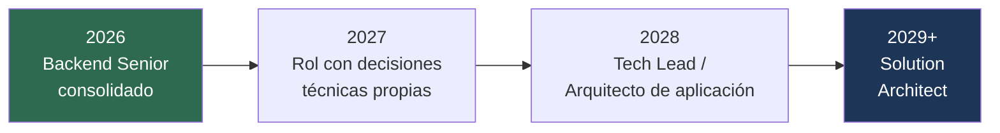

---
tags:
  - Estudio
  - Carrera
  - Arquitectura
Creado: 2026-08-31
Relacionado:
  - PLAN DE CAPACITACION
  - 16 - Radar acumulativo de vacantes
---

# Norte de carrera — camino a Solution Architect

Referencia: **Solution Architect de Stefanini** (agosto 2026). No es una vacante para postular ahora: es el puesto que querés dentro de unos años. Esta nota traduce ese aviso en un camino.

> [!tip] Lo más importante del aviso
> *"No se busca un arquitecto exclusivamente teórico: se requiere una persona que **haya sido desarrollador** y que conserve la capacidad de revisar, modificar y construir código."*
>
> Ese rol **no** es un salto a otra profesión: es la continuación natural de la tuya. Los años que estás poniendo en backend no se descartan cuando llegues — son el requisito de entrada.

## Distancia real, hoy

| Requisito | Dónde estás | Tipo de brecha |
|---|---|---|
| Mínimo **6 años** de desarrollo | ~5 (o ~7 contando prácticas) | ⏳ **Tiempo** — se cumple solo |
| Experiencia **progresiva en diseño de soluciones** | Aplicás Clean Architecture y CQRS, pero no diseñás soluciones de punta a punta | 🔨 **Ejercicio** — no se estudia |
| Microservicios, APIs, integraciones, cloud, DevSecOps | En el plan set-dic | 📚 **Estudio** — en curso |
| **AWS y Azure, ambos prácticos** | Azure sí (labs), AWS solo el apéndice | 📚 Estudio |
| Patrones de diseño y arquitectura limpia | 16 notas + semana 1 y 11 | ✅ Cubierto |
| Conversar con usuarios de negocio, negociar decisiones | Sin evidencia | 🔨 Ejercicio |
| **Estimar horas y costos**, definir entregables | Sin evidencia | 🔨 Ejercicio |
| FinOps / optimización de costos cloud | Cero | 📚 Estudio (más adelante) |
| Visio / Draw.io para diagramas | Trivial | 📚 Una tarde |
| SonarQube, Postman, Azure DevOps, Jira, Git, Swagger | Tenés 4 de 6 por trabajo | ✅ Casi cubierto |

**La brecha real no es técnica.** De la columna de estudio, casi todo está en el plan de set-dic. Lo que falta es lo marcado 🔨: **experiencia de arquitectura, que no se lee — se ejerce.**

## Lo que el plan actual ya aporta a este norte

Más de lo que parece. El roadmap de set-dic no es solo para conseguir el próximo trabajo:

| Lo que hacés en el plan | Lo que construye para el norte |
|---|---|
| Arquitectura hexagonal, capas, SAGA, DDD (S1, S11) | El vocabulario del rol |
| **Escribir 2-3 ADR** del laboratorio (S11) | La habilidad central: documentar decisiones y alternativas descartadas |
| Diagrama de arquitectura del laboratorio (S8) | Exactamente lo que pide "elaborar diagramas de arquitectura" |
| Atributos de calidad en el lab: resiliencia, observabilidad, seguridad | "Definir atributos de calidad" es una responsabilidad textual del aviso |
| Azure práctico + apéndice AWS | "Experiencia práctica con AWS **y** Azure" |
| Idempotencia, DLQ, circuit breaker | "Reducir riesgos en producción" |

El laboratorio, mirado desde acá, **es una maqueta de arquitectura de solución de punta a punta**. Cuando lo termines vas a tener un caso completo que contar: requerimiento → diseño → implementación → despliegue → operación. Que es literalmente la "trazabilidad" que el aviso pide asegurar.

## Lo que NO se estudia — y cómo empezar a ejercerlo desde ahora

Acá está la parte que ningún roadmap de tecnología resuelve. Y podés empezar **esta semana, en Pluxee**, sin cambiar de trabajo:

| Práctica de arquitecto | Cómo la ejercés hoy |
|---|---|
| **Documentar decisiones** | Cada vez que elijas algo no obvio en Pluxee, escribí 10 líneas: contexto, opciones, qué elegiste, qué descartaste y por qué. Un ADR. Empezá con uno por mes |
| **Diagramar antes de codear** | Antes de un módulo nuevo, hacé el diagrama en Draw.io. Aunque nadie te lo pida |
| **Estimar** | Antes de una tarea, escribí tu estimación de horas. Después compará con lo real. Estimar bien se aprende midiendo el error, no leyendo |
| **Explicar trade-offs a no técnicos** | Cuando propongas algo, practicá decirlo en términos de riesgo, costo y tiempo — no de tecnología |
| **Pensar en atributos de calidad** | Ante cada feature, preguntate: ¿qué pasa si falla? ¿si se duplica la carga? ¿quién puede acceder? |
| **Revisar código de otros** | Si hay code review en tu equipo, tomá el rol activamente. Si no lo hay, proponelo |

Ninguna requiere permiso ni un puesto nuevo. Y todas producen **evidencia** — que es lo que hoy te falta y lo que ningún curso da.

## Las certificaciones — corrección de lo que te dije antes

En [[01 - Mapa de Capacitacion (set-dic 2026)]] descarté las certificaciones. **Para el objetivo de diciembre 2026 eso sigue siendo correcto**: no sustituyen un proyecto desplegado y consumen el tiempo del laboratorio.

Pero para **este** norte cambian de rol. El aviso pide otras, y sí pesan para un puesto de arquitecto:

| Certificación | Cuándo tendría sentido |
|---|---|
| **AWS Solutions Architect Associate** | 2027, después de tener AWS práctico |
| **Azure Solutions Architect Expert (AZ-305)** | 2027-2028, requiere base de Azure sólida |
| **TOGAF Foundation** | Solo si apuntás a arquitectura empresarial |
| **ITIL Foundation** | Barata y rápida; suma en entornos corporativos |
| ~~AZ-104 / AZ-400~~ | Siguen descartadas: son de DevOps, no de arquitectura de soluciones |

Orden: **primero la experiencia, después la certificación que la respalda.** Al revés no funciona — una certificación sin casos que contar se nota en la primera pregunta de diseño.

## Línea de tiempo realista

| Etapa | Qué la habilita |
|---|---|
| **2026 — cerrar el ciclo actual** | El plan set-dic + un trabajo donde toques arquitectura, no solo tickets |
| **2027 — ejercer decisiones** | ADRs reales, diseño de features completas, mentoría, code review. AWS SAA |
| **2028 — liderar técnicamente** | Definir estándares para un equipo, hablar con negocio, estimar. AZ-305 |
| **2029+ — Solution Architect** | Ya tenés los 6+ años y, más importante, los casos para contarlos |

No son plazos fijos: dependen mucho más del **tipo de trabajo** que consigas que de cuánto estudies. Un puesto donde tomás decisiones acelera esto más que dos años de cursos.

> [!important] El filtro al elegir el próximo trabajo
> Si este es el norte, entonces al evaluar ofertas en diciembre no mires solo el sueldo y el stack. Preguntá: **¿en este puesto voy a tomar decisiones técnicas o solo a ejecutar tickets?**
>
> Un trabajo donde diseñás, decidís y documentás te acerca al objetivo aunque pague algo menos. Uno donde solo implementás lo que otro definió te deja donde estás, aunque el stack sea moderno. Esa pregunta va en la lista de [[13 - Sistema de postulación por vacante]].

## Qué revisar de esta nota, y cuándo

Volvé acá **cada seis meses**, no cada semana. Preguntas:

- [ ] ¿Escribí al menos 3 ADR reales en los últimos 6 meses?
- [ ] ¿Diseñé alguna solución de punta a punta, no solo un módulo?
- [ ] ¿Expliqué una decisión técnica a alguien de negocio?
- [ ] ¿Mi estimación de esfuerzo se acercó a lo real?
- [ ] ¿Mi trabajo actual me deja tomar decisiones, o solo ejecutar?

Si la última respuesta es "solo ejecutar" dos revisiones seguidas, el problema no es tu formación: es el puesto.
