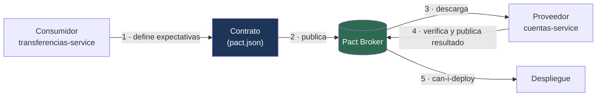

---
tags:
  - Java
  - Testing
  - Microservicios
Creado: 2026-09-08
Relacionado:
  - Testing en Java
  - Microservicios
Palabras clave:
  - Pact, contrato, consumidor, proveedor, broker, can-i-deploy, estados
---

## 🧠 Concepto

Cuando dos servicios se despliegan por separado, un cambio de contrato rompe al otro **en producción**. El *contract testing* mueve esa detección al pipeline.

```
Sin contract testing:
  cuentas-service cambia un campo → despliega → transferencias-service falla
  → se descubre por una alerta, con usuarios afectados

Con contract testing:
  cuentas-service cambia un campo → su build FALLA
  → se descubre antes de desplegar
```

> [!warning] Los tests de integración con servicios reales no escalan
> Levantar los cinco servicios para probar cada uno es lento, frágil y requiere que todos estén desplegados en la misma versión. El contract testing verifica la compatibilidad **sin levantar el otro servicio**.

## 🤝 Cómo funciona



**Dirigido por el consumidor**: el que consume declara qué necesita, y el proveedor demuestra que lo cumple. No al revés.

> [!tip] Por qué lo define el consumidor
> Un proveedor puede exponer cincuenta campos y cada consumidor usar cinco distintos. Si el proveedor definiera el contrato, tendría que mantener compatibilidad con todo lo que expone, aunque nadie lo use.
> Con contratos del consumidor, el proveedor sabe **exactamente qué está en uso** y puede cambiar el resto con libertad.

## 1️⃣ El lado del consumidor

```xml
<dependency>
    <groupId>au.com.dius.pact.consumer</groupId>
    <artifactId>junit5</artifactId>
    <scope>test</scope>
</dependency>
```

```java
@ExtendWith(PactConsumerTestExt.class)
@PactTestFor(providerName = "cuentas-service")
class CuentasClientPactTest {

    @Pact(consumer = "transferencias-service")
    public V4Pact reservaExitosa(PactDslWithProvider builder) {
        return builder
            .given("existe la cuenta ACC-001 con saldo disponible de 1000")  // ← estado
            .uponReceiving("una solicitud de reserva de 500")
                .path("/internal/cuentas/ACC-001/reservas")
                .method("POST")
                .headers(Map.of("Idempotency-Key", "clave-123"))
                .body(new PactDslJsonBody()
                    .decimalType("monto", 500.00)
                    .stringType("moneda", "PEN"))
            .willRespondWith()
                .status(201)
                .body(new PactDslJsonBody()
                    .uuid("reservaId")
                    .decimalType("monto", 500.00)
                    .stringType("estado", "ACTIVA"))
            .toPact(V4Pact.class);
    }

    @Test
    @PactTestFor(pactMethod = "reservaExitosa")
    void reserva_fondos(MockServer servidor) {
        var cliente = new CuentasClient(servidor.getUrl());

        var respuesta = cliente.reservar("ACC-001", "clave-123", new ReservaRequest(
            new BigDecimal("500.00"), "PEN"));

        assertNotNull(respuesta.reservaId());
        assertEquals("ACTIVA", respuesta.estado());
    }
}
```

> [!danger] Usá matchers de tipo, no valores exactos
> ```java
> .stringValue("estado", "ACTIVA")    // ❌ exige ese valor literal exacto
> .stringType("estado", "ACTIVA")     // ✅ exige que sea un String; el valor es un ejemplo
> ```
> Con valores exactos, el contrato se rompe cada vez que el proveedor devuelve datos distintos —lo cual es normal—. Los matchers verifican **la forma**, que es lo que importa: el consumidor necesita saber que hay un campo `estado` de tipo texto, no que diga exactamente "ACTIVA".

## 2️⃣ El lado del proveedor

```java
@Provider("cuentas-service")
@PactBroker(url = "https://pact.miempresa.com")
@SpringBootTest(webEnvironment = RANDOM_PORT)
class CuentasServiceContractTest {

    @LocalServerPort int puerto;

    @BeforeEach
    void configurar(PactVerificationContext ctx) {
        ctx.setTarget(new HttpTestTarget("localhost", puerto));
    }

    @TestTemplate
    @ExtendWith(PactVerificationInvocationContextProvider.class)
    void verificarContratos(PactVerificationContext ctx) {
        ctx.verifyInteraction();
    }

    // Prepara el estado que el consumidor declaró en el .given(...)
    @State("existe la cuenta ACC-001 con saldo disponible de 1000")
    void prepararCuentaConSaldo() {
        cuentaRepo.deleteAll();
        var cuenta = cuentaRepo.save(new CuentaEntity("ACC-001", "PEN"));
        libro.registrar(depositoDe(cuenta.getId(), new BigDecimal("1000")));
    }
}
```

> [!tip] Los estados (`@State`) son el punto de encuentro
> El consumidor dice *"asumo que existe una cuenta con saldo 1000"* y el proveedor implementa cómo se llega a ese estado. Es el único acuerdo semántico entre los dos equipos, y conviene que los nombres sean descriptivos y estables.

## 📦 El broker

```yaml
# Consumidor: publica el contrato tras generarlo
- run: ./mvnw test
- run: ./mvnw pact:publish -Dpact.consumer.version=${{ github.sha }} -Dpact.tag=main

# Proveedor: descarga todos los contratos y los verifica
- run: ./mvnw test -Dtest=CuentasServiceContractTest
- run: ./mvnw pact:publish-verification-results
```

| Qué guarda el broker | Para qué |
|---|---|
| Contratos por versión | historial |
| Resultados de verificación | quién cumple con quién |
| Etiquetas de entorno | qué versión hay en cada ambiente |
| Matriz de compatibilidad | `can-i-deploy` |

## 🚦 `can-i-deploy`

La pieza que convierte todo esto en una barrera real de despliegue.

```bash
pact-broker can-i-deploy \
  --pacticipant cuentas-service \
  --version $COMMIT_SHA \
  --to-environment produccion
```

```
✅ Computer says yes \o/
   cuentas-service 3f9a1c es compatible con:
     transferencias-service 1.4.2 (produccion)
     notificaciones-service 2.1.0 (produccion)

❌ Computer says no ¯\_(ツ)_/¯
   cuentas-service 3f9a1c NO es compatible con:
     transferencias-service 1.4.2 (produccion) — verificación fallida
```

> [!tip] Es la pregunta que realmente importa antes de desplegar
> No *"¿mis tests pasan?"* sino **"¿lo que voy a desplegar es compatible con lo que hay corriendo en producción?"**. Es la única verificación que responde eso sin levantar todo el sistema.

```yaml
- name: ¿Puedo desplegar?
  run: |
    pact-broker can-i-deploy --pacticipant cuentas-service \
      --version ${{ github.sha }} --to-environment produccion
- name: Desplegar
  run: ./deploy.sh
```

## 🔁 El flujo completo

```
1 · El consumidor agrega una expectativa nueva
2 · Su build genera y publica el contrato
3 · El build del PROVEEDOR se dispara y verifica
4 · Si falla → el proveedor sabe que rompió a alguien, antes de desplegar
5 · Si pasa → publica el resultado
6 · can-i-deploy autoriza el despliegue
```

> [!warning] Un contrato nuevo puede fallar el build del proveedor
> Y está bien: significa que el consumidor pide algo que el proveedor todavía no ofrece. La conversación entre equipos ocurre en el pipeline, no en producción.
> Para evitar bloquear, se usan ramas y etiquetas: los contratos de `main` bloquean, los de una rama de trabajo solo informan.

## 🎯 Qué cubre y qué no

| Cubre ✅ | No cubre ❌ |
|---|---|
| Forma de la petición y la respuesta | que la lógica de negocio sea correcta |
| Campos obligatorios y sus tipos | rendimiento |
| Códigos de estado | autenticación real |
| Cabeceras relevantes | comportamiento bajo carga |
| Compatibilidad entre versiones | integración de punta a punta |

> [!danger] No reemplaza a los tests de integración
> Verifica que el **contrato** se cumple, no que el sistema funcione. Un proveedor puede devolver la forma correcta con datos incorrectos y el contrato pasa.
> Es una capa más: unidad → integración → **contrato** → de punta a punta (pocos).

## 📨 Contratos de mensajería

También aplica a eventos asíncronos, donde el problema es igual de real.

```java
@Pact(consumer = "notificaciones-service")
public V4Pact eventoDeTransferencia(MessagePactBuilder builder) {
    return builder
        .expectsToReceive("una transferencia completada")
        .withContent(new PactDslJsonBody()
            .uuid("asientoId")
            .uuid("cuentaOrigen")
            .decimalType("monto", 500.00)
            .stringType("moneda", "PEN")
            .integerType("version", 1))
        .toPact(V4Pact.class);
}
```

> [!tip] Los contratos de eventos importan tanto o más que los HTTP
> Un evento publicado es un contrato con consumidores que no controlás y que quizá ni conocés. Cambiar un campo rompe a todos en silencio: no hay código de error, simplemente dejan de procesar bien.
> Ver el versionado de eventos en [[05 - Transactional Outbox]].

## ⚠️ Errores Comunes

> [!warning] Los que hacen inútil el esfuerzo
> - **Valores exactos en vez de matchers de tipo**: el contrato se rompe con datos normales.
> - **Contratos que cubren todo el modelo**: hay que declarar solo lo que el consumidor **usa**.
> - **Estados (`@State`) mal definidos**: el proveedor no sabe qué preparar.
> - **No publicar los resultados de verificación**: `can-i-deploy` no tiene información.
> - **Sin `can-i-deploy` en el pipeline**: los contratos existen y nadie los hace cumplir.
> - **Creer que reemplaza los tests de integración.**
> - **Ignorar los eventos**: solo se versionan los contratos HTTP.

## 📌 Notas Rápidas
- La idea central es que **el consumidor define y el proveedor demuestra**. Eso evita que el proveedor tenga que mantener compatibilidad con campos que nadie usa.
- `can-i-deploy` es lo que transforma los contratos de documentación en una barrera efectiva. Sin ese paso en el pipeline, el resto es opcional y se termina ignorando.
- Los matchers de tipo son la diferencia entre un contrato útil y uno que se rompe todos los días. Es el error de principiante más frecuente con Pact.
- Se implementa en [[Fase 6 - Microservicios y SAGA]].

## 🔗 Relaciones
- **Módulo**: [[Testing en Java]]
- **Anterior**: [[07 - ArchUnit]]
- **Siguiente**: [[09 - Mutation Testing]]
- **Se conecta con**: [[Microservicios]], [[03 - APIs a Escala]], [[04 - Garantias de Entrega]]

---

## ✍️ Mis apuntes
<!-- Tus dudas, ejemplos propios, cómo lo aplicaste -->

