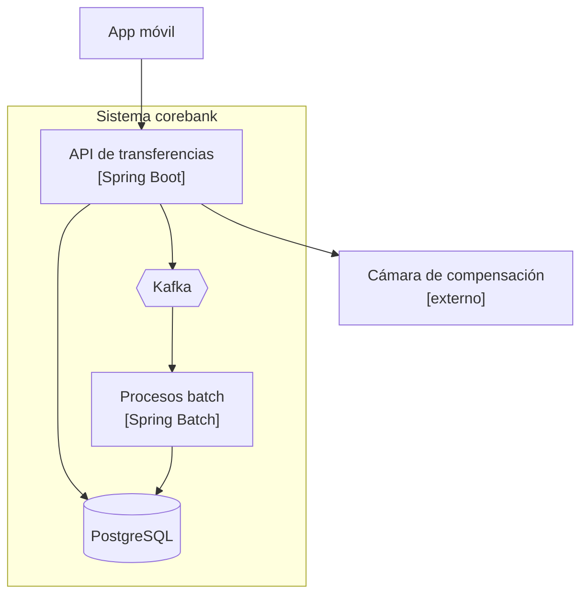

---
tags:
  - Java
  - Senior
  - Arquitectura
Creado: 2026-09-08
Relacionado:
  - Senior Java Engineer
  - 09 - Tradeoffs
Palabras clave:
  - ADR, decision, documentacion, C4, README, contexto, revision
---

## 🧠 Concepto

Un **ADR** (Architecture Decision Record) es un documento corto que registra una decisión técnica importante: **qué se decidió, por qué, qué se descartó y qué cuesta**.

El problema que resuelve es concreto y todos lo vivieron:

```
Seis meses después:
  — ¿Por qué usamos bloqueo pesimista acá y no optimista?
  — Ni idea, ya estaba cuando llegué.
  — ¿Lo cambiamos?
  — ...¿y si había una razón?
```

> [!tip] El código dice **qué** hace; el ADR dice **por qué**
> El código es la mejor documentación de la implementación y la peor de la intención. Un `SELECT FOR UPDATE` es evidente en el código; que se eligió porque el bloqueo optimista generaba demasiados reintentos con cuentas corporativas, no aparece en ninguna parte.

## 📄 El formato

```markdown
# ADR-012: Bloqueo pesimista para transferencias

## Estado
Aceptada — 2026-09-08

## Contexto
Las transferencias deben garantizar que no se pueda gastar dos veces.
La contención sobre una misma cuenta es realista: las cuentas de recaudación
de clientes corporativos reciben cientos de operaciones por minuto.
Medimos que el bloqueo optimista producía ~18% de reintentos en ese escenario.

## Decisión
Usamos bloqueo pesimista (`SELECT ... FOR UPDATE`) sobre las cuentas involucradas,
tomando los bloqueos en orden determinista por UUID.

## Consecuencias

### Positivas
- Elimina la condición de carrera sobre el saldo.
- El orden determinista hace imposible el deadlock, no solo improbable.
- Comportamiento predecible bajo contención.

### Negativas
- Las operaciones sobre una misma cuenta se serializan.
- Exige transacciones cortas: queda prohibido llamar a servicios externos
  con el bloqueo tomado.
- Una cuenta muy activa se convierte en un cuello de botella.

## Alternativas consideradas

| Alternativa | Por qué se descartó |
|---|---|
| Bloqueo optimista (`@Version`) | 18% de reintentos con cuentas de alta contención |
| Aislamiento `SERIALIZABLE` | más simple de escribir, pero abortos frecuentes y peor rendimiento |
| Cola serializada por cuenta | resuelve la contención, pero agrega latencia e infraestructura |

## Cuándo revisar
Si el p99 de transferencias supera 1 s por contención sobre una sola cuenta,
o si aparece un cliente con más de 500 operaciones por minuto sobre la misma cuenta.
```

> [!tip] "Cuándo revisar" es la sección que más se olvida y más vale
> Convierte el documento en algo vivo: define la **señal concreta** que indica que la decisión dejó de ser válida. Sin eso, los ADR se leen una vez y se archivan.
> Además evita la discusión eterna: cuando alguien propone cambiar, la pregunta es si se cumplió la condición, no quién tiene mejor intuición.

## 🔄 Ciclo de vida

```
Propuesta  →  Aceptada  →  Reemplazada por ADR-027
                        →  Obsoleta (ya no aplica)
```

```markdown
# ADR-012: Bloqueo pesimista para transferencias

## Estado
~~Aceptada — 2026-09-08~~
**Reemplazada por [ADR-027](adr-027-modelo-de-reservas.md) — 2027-03-15**
```

> [!danger] Un ADR nunca se edita ni se borra
> Se marca como reemplazado y se escribe uno nuevo. El valor está justamente en el **historial**: poder ver que en 2026 se eligió bloqueo pesimista por razones válidas, y que en 2027 esas razones cambiaron.
> Editarlo destruye la información más útil que tiene. Es el mismo principio del ledger de [[03 - Ledger y Partida Doble]]: los hechos no se modifican, se agregan.

## 🎯 Qué merece un ADR

| Merece ✅ | No merece ❌ |
|---|---|
| Elección de motor de base | biblioteca de logging |
| Clave de partición | nombre de una variable |
| Monolito vs microservicios | formato del código |
| Estrategia de autenticación | qué versión menor de una dependencia |
| Modelo de consistencia | estructura de un endpoint |
| Formato de eventos publicados | detalle de implementación interno |

> [!tip] El criterio: ¿es una puerta de ida?
> Si revertir la decisión en seis meses cuesta una tarde, no hace falta ADR: probá y ajustá. Si cuesta meses —clave de partición, contrato público, motor de base—, escribilo.
> Es la clasificación de [[09 - Tradeoffs]] aplicada a la documentación.

## 📁 Dónde viven

```
docs/
└── adr/
    ├── 0001-usar-adr.md
    ├── 0002-postgresql-como-base-principal.md
    ├── 0012-bloqueo-pesimista-transferencias.md
    ├── 0018-outbox-para-eventos.md
    └── README.md          ← índice con estados
```

> [!tip] En el repositorio, no en un wiki
> Van versionados con el código, se revisan en el pull request que introduce la decisión, y evolucionan con la rama. Un wiki aparte se desactualiza porque nadie lo abre al programar.
> `adr-tools` o `log4brains` automatizan la numeración y generan un sitio navegable.

## 📚 El resto de la documentación

Un ADR cubre decisiones. El resto se reparte así:

| Documento | Responde | Audiencia |
|---|---|---|
| **README** | ¿cómo lo levanto y lo corro? | quien llega hoy |
| **ADR** | ¿por qué se decidió así? | quien va a cambiarlo |
| **Diagrama C4** | ¿cómo se conecta con lo demás? | quien lo integra |
| **OpenAPI** | ¿cómo lo consumo? | otros equipos |
| **Runbook** | ¿qué hago si falla a las 3am? | quien está de guardia |
| **Código y tests** | ¿qué hace exactamente? | quien lo modifica |

### El README que sirve

```markdown
# corebank-api

Motor de transferencias del core bancario.

## Levantarlo en local
    docker compose up -d
    ./mvnw spring-boot:run -Dspring-boot.run.profiles=local
    # http://localhost:8080/swagger

## Correr los tests
    ./mvnw test                      # unitarios: ~8 s
    ./mvnw verify -Pintegracion      # con Testcontainers: ~2 min

## Arquitectura
Hexagonal. El dominio no conoce frameworks (verificado por ArchUnit).
Detalle en [docs/adr](docs/adr/README.md).

## Decisiones importantes
- [ADR-002](docs/adr/0002-postgresql.md) · PostgreSQL como base principal
- [ADR-012](docs/adr/0012-bloqueo-pesimista.md) · Bloqueo pesimista en transferencias
- [ADR-018](docs/adr/0018-outbox.md) · Outbox para publicar eventos

## Si algo falla
Ver [runbook](docs/runbook.md).
```

> [!warning] Un README que no permite levantar el proyecto es un README roto
> Es la primera prueba de que la documentación sirve: alguien que llega hoy tiene que poder correr el proyecto siguiendo los pasos, sin preguntarle a nadie. Si hace falta preguntar, faltan pasos.

### El runbook

```markdown
# Runbook · corebank-api

## Alerta: outbox con eventos pendientes

**Qué significa:** el publicador no está drenando la tabla `outbox`.
Las transferencias funcionan pero nadie recibe notificaciones.

**Diagnóstico**
1. ¿El publicador está vivo? `kubectl get pods -l app=publicador`
2. ¿Kafka responde? `kubectl exec ... -- kafka-topics --list`
3. ¿Hay eventos con muchos intentos?
       SELECT id, tipo_evento, intentos, ultimo_error
       FROM outbox WHERE publicado_en IS NULL ORDER BY intentos DESC LIMIT 10;

**Acciones**
- Kafka caído → escalar a la guardia de plataforma. Los eventos se acumulan sin pérdida.
- Evento envenenado → moverlo a `outbox_muertos` y registrar una excepción.
- Publicador caído → reiniciar. Es idempotente: no duplica.

**Escalar a:** guardia de backend si supera los 30 min o los 10.000 pendientes.
```

> [!tip] Un runbook se escribe después del primer incidente, no antes
> Escribirlo especulativamente produce documentos genéricos que no sirven. Escribirlo justo después de resolver un incidente real captura exactamente lo que la próxima persona va a necesitar — y mientras el conocimiento está fresco.

## 🖼️ Diagramas C4

Cuatro niveles de zoom, y en la práctica alcanzan los dos primeros.

| Nivel | Muestra | ¿Vale mantenerlo? |
|---|---|---|
| **1 · Contexto** | el sistema y con quién habla | ✅ cambia poco |
| **2 · Contenedores** | servicios, bases, colas | ✅ el más útil |
| 3 · Componentes | módulos internos | ⚠️ se desactualiza rápido |
| 4 · Código | clases | ❌ para eso está el IDE |



> [!tip] El diagrama va en el repositorio, como texto
> Mermaid o PlantUML se versionan, se revisan en el pull request y se actualizan con el código. Una imagen exportada de una herramienta de dibujo queda desactualizada la primera semana y nadie la corrige.

## 🚫 Documentación que no vale la pena

```java
// ❌ Comentario que repite el código
/** Obtiene el saldo. */
public Dinero obtenerSaldo() { ... }

// ✅ Comentario que explica el porqué
/**
 * El saldo se deriva sumando los apuntes en vez de leerse de una columna.
 * Ver ADR-004: garantiza reconstruibilidad y saldo histórico.
 * Para cuentas con más de 100k movimientos usa el snapshot diario.
 */
public Dinero obtenerSaldo() { ... }
```

| Evitar | Por qué |
|---|---|
| Javadoc que repite la firma | ruido |
| Diagramas de clases mantenidos a mano | se desactualizan solos |
| Wikis paralelos al repositorio | nadie los abre |
| Documentos de 80 páginas | nadie los lee |
| Comentar el **qué** | el código ya lo dice |

> [!warning] La documentación desactualizada es peor que la ausencia de documentación
> Sin documentación, alguien lee el código. Con documentación mentirosa, alguien toma una decisión equivocada confiando en ella.
> Regla práctica: **si no se puede mantener actualizada con poco esfuerzo, no la escribas.**

## ✅ Lo mínimo indispensable

Para un servicio de producción:

- [ ] README que permita levantarlo y testearlo.
- [ ] ADR de las decisiones que son puertas de ida.
- [ ] Diagrama de contenedores (C4 nivel 2) en el repositorio.
- [ ] OpenAPI generado desde el código, no escrito a mano.
- [ ] Runbook de las alertas que existen.
- [ ] Comentarios que expliquen el **porqué** donde no sea obvio.

## 📌 Notas Rápidas
- El ADR responde la pregunta que más se hace en un proyecto con años: *"¿por qué esto está así?"*. Sin él, la respuesta es arqueología de commits o adivinanza.
- La sección "cuándo revisar" convierte al ADR de documento histórico en herramienta viva. Es lo que lo diferencia de un acta de reunión.
- Escribir ADR es una habilidad de senioridad: obliga a articular el trade-off, y articularlo suele mejorar la decisión antes de tomarla.
- La disciplina de no editar los ADR viejos es la misma que la del ledger contable: los hechos no se modifican, se agregan.

## 🔗 Relaciones
- **Módulo**: [[Senior Java Engineer]] — última nota del módulo
- **Anterior**: [[08 - Criptografia en Java]]
- **Se conecta con**: [[09 - Tradeoffs]], [[08 - ADR y Tradeoffs]], [[06 - Liderazgo Tecnico]]

---

## ✍️ Mis apuntes
<!-- Tus dudas, ejemplos propios, cómo lo aplicaste -->

