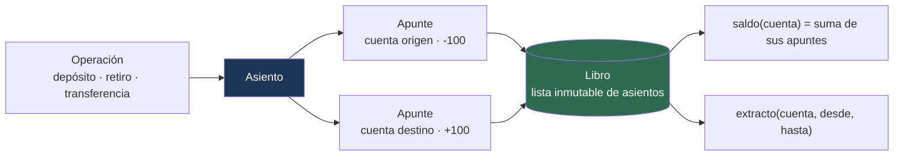

---
tags:
  - Java
  - Proyecto
  - Banca
  - corebank
Creado: 2026-09-08
Relacionado:
  - Proyectos Java
  - Java Fundamentos
  - Java Intermedio
Palabras clave:
  - ledger, partida doble, BigDecimal, value object, record, JUnit, CLI
Estado:
  - Pendiente
Nivel: Básico-Intermedio
Prerequisitos: Java Fundamentos, Java Intermedio
---

# Fase 0 · Ledger en Java puro

## 🎯 Objetivo

Un programa de consola que lleva las cuentas de un banco **sin frameworks, sin base de datos y sin red**. Solo Java, colecciones y JUnit.

Suena poco ambicioso y es justo lo contrario: acá se decide el modelo de dominio que vas a arrastrar durante las 8 fases siguientes. Si el dinero está mal representado en la Fase 0, lo vas a pagar en la 8.

> [!info] Por qué empezar sin Spring
> Spring resuelve el 80% de los problemas de infraestructura y esconde el 100% de los de dominio. Si arrancás con `@Entity` y `@RestController`, nunca vas a enfrentarte a la pregunta de qué **es** un saldo. Acá no hay dónde esconderse.

## 🧠 Los tres conceptos que tenés que sacar de esta fase

### 1. El dinero no es un número

`double` pierde centavos. `BigDecimal` sin escala fija los pierde igual, más despacio. El dinero es **importe + moneda + escala + política de redondeo**, y eso es un objeto, no un `long`.

### 2. El saldo no se guarda, se deriva

Un saldo es la suma de los movimientos hasta un instante. Si lo guardás como campo y lo pisás, tenés dos fuentes de verdad que van a divergir — y cuando diverjan, no vas a saber cuál está bien.

### 3. Toda operación mueve dinero de algún lado a algún lado

Ese es el principio de **partida doble**: nada aparece ni desaparece. Un depósito no es "sumar 100 a la cuenta", es "debitar 100 de la caja del banco y acreditar 100 a la cuenta del cliente". La suma de todos los apuntes del sistema debe dar cero, siempre.

## 🧱 Modelo de dominio

```
Moneda        enum · PEN, USD · decimales y símbolo
Dinero        value object · BigDecimal + Moneda · inmutable
CuentaId      value object · identidad tipada, no String suelto
Cuenta        titular, moneda, tipo, estado
Apunte        un lado del asiento: cuenta + Dinero + signo
Asiento       operación completa: N apuntes que suman cero + motivo + fecha
Libro         colección de asientos · calcula saldos y extractos
```



## 💻 El núcleo

### Moneda y Dinero

```java
public enum Moneda {
    PEN("S/", 2),
    USD("$", 2);

    private final String simbolo;
    private final int decimales;

    Moneda(String simbolo, int decimales) {
        this.simbolo = simbolo;
        this.decimales = decimales;
    }

    public String simbolo()  { return simbolo; }
    public int decimales()   { return decimales; }
}
```

```java
public record Dinero(BigDecimal monto, Moneda moneda) implements Comparable<Dinero> {

    // Constructor compacto: normaliza la escala y valida
    public Dinero {
        Objects.requireNonNull(monto, "monto");
        Objects.requireNonNull(moneda, "moneda");
        monto = monto.setScale(moneda.decimales(), RoundingMode.HALF_UP);
    }

    public static Dinero de(String monto, Moneda moneda) {
        return new Dinero(new BigDecimal(monto), moneda);   // SIEMPRE desde String
    }

    public static Dinero cero(Moneda moneda) {
        return new Dinero(BigDecimal.ZERO, moneda);
    }

    public Dinero mas(Dinero otro) {
        exigirMismaMoneda(otro);
        return new Dinero(monto.add(otro.monto), moneda);
    }

    public Dinero menos(Dinero otro) {
        exigirMismaMoneda(otro);
        return new Dinero(monto.subtract(otro.monto), moneda);
    }

    public Dinero negado() {
        return new Dinero(monto.negate(), moneda);
    }

    public boolean esPositivo() { return monto.signum() > 0; }
    public boolean esCero()     { return monto.signum() == 0; }
    public boolean esNegativo() { return monto.signum() < 0; }

    public boolean mayorQue(Dinero otro) {
        exigirMismaMoneda(otro);
        return monto.compareTo(otro.monto) > 0;
    }

    private void exigirMismaMoneda(Dinero otro) {
        if (moneda != otro.moneda) {
            throw new MonedaIncompatibleException(moneda, otro.moneda);
        }
    }

    @Override
    public int compareTo(Dinero otro) {
        exigirMismaMoneda(otro);
        return monto.compareTo(otro.monto);
    }

    @Override
    public String toString() {
        return moneda.simbolo() + " " + monto.toPlainString();
    }
}
```

> [!danger] El detalle que más se pasa por alto
> `record` genera `equals` comparando campos con `equals`. Y `BigDecimal.equals` compara **escala**, no valor: `1.0` no es igual a `1.00`. Por eso el constructor compacto normaliza la escala — sin eso, dos `Dinero` del mismo valor pueden salir distintos.

### Apunte y Asiento

```java
public record Apunte(CuentaId cuenta, Dinero importe) {
    public Apunte {
        if (importe.esCero()) {
            throw new IllegalArgumentException("un apunte no puede ser cero");
        }
    }
}
```

```java
public record Asiento(
        UUID id,
        Instant fecha,
        String motivo,
        List<Apunte> apuntes
) {
    public Asiento {
        Objects.requireNonNull(motivo, "motivo");
        if (apuntes == null || apuntes.size() < 2) {
            throw new AsientoInvalidoException("un asiento necesita al menos 2 apuntes");
        }
        apuntes = List.copyOf(apuntes);          // copia defensiva: inmutable de verdad
        exigirQueCuadre(apuntes);
    }

    // La invariante central del sistema: los apuntes suman cero por moneda
    private static void exigirQueCuadre(List<Apunte> apuntes) {
        Map<Moneda, BigDecimal> porMoneda = apuntes.stream()
            .collect(Collectors.groupingBy(
                a -> a.importe().moneda(),
                Collectors.reducing(BigDecimal.ZERO,
                                    a -> a.importe().monto(),
                                    BigDecimal::add)));

        porMoneda.forEach((moneda, suma) -> {
            if (suma.signum() != 0) {
                throw new AsientoInvalidoException(
                    "el asiento no cuadra en " + moneda + ": descuadre de " + suma);
            }
        });
    }

    public static Asiento de(String motivo, Apunte... apuntes) {
        return new Asiento(UUID.randomUUID(), Instant.now(), motivo, List.of(apuntes));
    }
}
```

> [!tip] Acá está el corazón de la fase
> `exigirQueCuadre` hace **imposible** construir un asiento descuadrado. No es una validación que se ejecuta "si alguien se acuerda de llamarla": es una invariante del constructor. Si el objeto existe, cuadra.

### El Libro

```java
public class Libro {

    private final List<Asiento> asientos = new ArrayList<>();

    public void registrar(Asiento asiento) {
        asientos.add(asiento);
    }

    public Dinero saldo(CuentaId cuenta, Moneda moneda) {
        return asientos.stream()
            .flatMap(a -> a.apuntes().stream())
            .filter(ap -> ap.cuenta().equals(cuenta))
            .filter(ap -> ap.importe().moneda() == moneda)
            .reduce(Dinero.cero(moneda), (acc, ap) -> acc.mas(ap.importe()), Dinero::mas);
    }

    // El saldo a una fecha pasada sale gratis: solo se filtra
    public Dinero saldoAl(CuentaId cuenta, Moneda moneda, Instant corte) {
        return asientos.stream()
            .filter(a -> !a.fecha().isAfter(corte))
            .flatMap(a -> a.apuntes().stream())
            .filter(ap -> ap.cuenta().equals(cuenta))
            .filter(ap -> ap.importe().moneda() == moneda)
            .reduce(Dinero.cero(moneda), (acc, ap) -> acc.mas(ap.importe()), Dinero::mas);
    }

    public List<Asiento> extracto(CuentaId cuenta, Instant desde, Instant hasta) {
        return asientos.stream()
            .filter(a -> !a.fecha().isBefore(desde) && !a.fecha().isAfter(hasta))
            .filter(a -> a.apuntes().stream().anyMatch(ap -> ap.cuenta().equals(cuenta)))
            .toList();
    }

    public List<Asiento> todos() {
        return List.copyOf(asientos);
    }
}
```

### Las operaciones

```java
public class Banco {

    private static final CuentaId CAJA = new CuentaId("BANCO-CAJA");

    private final Libro libro;

    public Banco(Libro libro) { this.libro = libro; }

    public void depositar(CuentaId cuenta, Dinero importe) {
        exigirPositivo(importe);
        libro.registrar(Asiento.de("DEPOSITO",
            new Apunte(CAJA,   importe.negado()),
            new Apunte(cuenta, importe)));
    }

    public void retirar(CuentaId cuenta, Dinero importe) {
        exigirPositivo(importe);
        exigirSaldoSuficiente(cuenta, importe);
        libro.registrar(Asiento.de("RETIRO",
            new Apunte(cuenta, importe.negado()),
            new Apunte(CAJA,   importe)));
    }

    public void transferir(CuentaId origen, CuentaId destino, Dinero importe) {
        exigirPositivo(importe);
        if (origen.equals(destino)) {
            throw new OperacionInvalidaException("origen y destino son la misma cuenta");
        }
        exigirSaldoSuficiente(origen, importe);
        libro.registrar(Asiento.de("TRANSFERENCIA",
            new Apunte(origen,  importe.negado()),
            new Apunte(destino, importe)));
    }

    // Un error NO se borra: se compensa con el asiento inverso
    public void reversar(Asiento original, String motivo) {
        List<Apunte> invertidos = original.apuntes().stream()
            .map(ap -> new Apunte(ap.cuenta(), ap.importe().negado()))
            .toList();
        libro.registrar(new Asiento(
            UUID.randomUUID(), Instant.now(),
            "REVERSA[" + original.id() + "] " + motivo, invertidos));
    }

    private void exigirPositivo(Dinero importe) {
        if (!importe.esPositivo()) {
            throw new OperacionInvalidaException("el importe debe ser positivo");
        }
    }

    private void exigirSaldoSuficiente(CuentaId cuenta, Dinero importe) {
        Dinero disponible = libro.saldo(cuenta, importe.moneda());
        if (disponible.compareTo(importe) < 0) {
            throw new SaldoInsuficienteException(cuenta, disponible, importe);
        }
    }
}
```

## 🧪 Tests que tienen que existir

```java
class DineroTest {

    @Test
    void mismo_valor_distinta_escala_es_el_mismo_dinero() {
        assertEquals(Dinero.de("1.0", PEN), Dinero.de("1.00", PEN));
    }

    @Test
    void no_se_pueden_sumar_monedas_distintas() {
        assertThrows(MonedaIncompatibleException.class,
            () -> Dinero.de("10", PEN).mas(Dinero.de("10", USD)));
    }

    @Test
    void la_suma_de_centavos_no_pierde_precision() {
        Dinero total = IntStream.range(0, 10)
            .mapToObj(i -> Dinero.de("0.10", PEN))
            .reduce(Dinero.cero(PEN), Dinero::mas);
        assertEquals(Dinero.de("1.00", PEN), total);   // con double daría 0.9999999999999999
    }
}
```

```java
class AsientoTest {

    @Test
    void un_asiento_descuadrado_no_puede_construirse() {
        assertThrows(AsientoInvalidoException.class, () ->
            Asiento.de("MAL",
                new Apunte(new CuentaId("A"), Dinero.de("-100", PEN)),
                new Apunte(new CuentaId("B"), Dinero.de("90", PEN))));
    }
}
```

```java
class BancoTest {

    @Test
    void el_sistema_completo_siempre_cuadra_en_cero() {
        // después de N operaciones cualquiera...
        BigDecimal totalGlobal = libro.todos().stream()
            .flatMap(a -> a.apuntes().stream())
            .map(ap -> ap.importe().monto())
            .reduce(BigDecimal.ZERO, BigDecimal::add);

        assertEquals(0, totalGlobal.signum());
    }

    @Test
    void la_reversa_deja_el_saldo_como_estaba() {
        Dinero antes = libro.saldo(cuenta, PEN);
        banco.depositar(cuenta, Dinero.de("500", PEN));
        banco.reversar(ultimoAsiento(), "error de digitación");
        assertEquals(antes, libro.saldo(cuenta, PEN));
    }
}
```

> [!tip] El test que más vale
> `el_sistema_completo_siempre_cuadra_en_cero`. Es una **propiedad invariante**: no importa qué operaciones se hagan ni en qué orden, el total tiene que dar cero. Si algún día falla, hay un bug de dominio, no de código.

## 🖥️ La CLI

```
> abrir ACC-001 PEN AHORRO
Cuenta ACC-001 abierta.

> depositar ACC-001 1500.50
OK · saldo ACC-001: S/ 1500.50

> transferir ACC-001 ACC-002 200
OK · ACC-001: S/ 1300.50 · ACC-002: S/ 200.00

> saldo ACC-001
S/ 1300.50

> extracto ACC-001
2026-09-08T14:02:11Z  DEPOSITO        +1500.50   S/ 1500.50
2026-09-08T14:03:40Z  TRANSFERENCIA    -200.00   S/ 1300.50

> cuadre
Total del sistema: 0.00 ✅
```

Un `switch` sobre el comando y un `Scanner` alcanzan. La CLI no es el punto — es la excusa para ejercitar el dominio.

## ✅ Criterios de aceptación

- [ ] `Dinero` es inmutable, se construye desde `String` y normaliza escala.
- [ ] Sumar o restar monedas distintas lanza excepción.
- [ ] `Asiento` no puede construirse si no cuadra.
- [ ] El saldo se calcula desde los apuntes, no se almacena.
- [ ] `saldoAl(fecha)` devuelve el saldo histórico correcto.
- [ ] Retirar más de lo disponible lanza `SaldoInsuficienteException`.
- [ ] La reversa deja el saldo idéntico al previo y **conserva ambos asientos**.
- [ ] Existe un test de cuadre global que suma cero.
- [ ] Cobertura del paquete de dominio por encima del 90%.
- [ ] Cero `double` o `float` en todo el proyecto.
- [ ] El proyecto compila y corre con `mvn test` y `mvn exec:java`.

## ⚠️ Trampas de esta fase

> [!warning] Las que te van a pasar
> - **Usar `BigDecimal.equals`** para comparar importes en un test y volverte loco porque `1.0 != 1.00`. Por eso `Dinero` normaliza en el constructor.
> - **Guardar el saldo como campo de `Cuenta`** "para que sea más rápido". No hay nada que optimizar todavía: son objetos en memoria.
> - **Modelar el depósito como un solo apunte.** Si el dinero aparece de la nada, no hay partida doble y el cuadre global nunca va a dar cero.
> - **Devolver la lista interna del `Libro`** sin copiar: cualquiera puede modificarla desde afuera y el ledger deja de ser confiable.

## 🔁 Retrospectiva

Antes de pasar a la Fase 1, escribí las respuestas:

- ¿Por qué el saldo se deriva en vez de guardarse? ¿Cuándo dejaría de ser viable?
- ¿Qué pasa si dos hilos llaman a `transferir` sobre la misma cuenta al mismo tiempo? *(spoiler: se rompe — se arregla en la Fase 2)*
- ¿Qué representa la cuenta `BANCO-CAJA` y por qué su saldo es negativo?
- ¿Qué te costó más: el modelo o la CLI?

## 🔗 Relaciones
- **Índice del laboratorio**: [[Proyectos Java]]
- **Teoría que aplica**: [[Java Fundamentos]], [[Java Intermedio]], [[09 - Records y Sealed Classes]], [[01 - JUnit 5]]
- **Dominio**: [[Banca y Fintech]], [[01 - Dinero en Software]], [[03 - Ledger y Partida Doble]]
- **Siguiente**: [[Fase 1 - API de Cuentas]]

## 📌 Notas Rápidas
- El `Libro` en memoria es un `ArrayList`, y está bien: en la Fase 1 se reemplaza por Postgres sin tocar el dominio. Ese es el punto de tener el dominio aislado.
- La cuenta `BANCO-CAJA` es la contrapartida de todo lo que entra y sale del sistema. Su saldo negativo equivale al pasivo del banco con sus clientes — que es literalmente cómo funciona un balance real.
- Si terminás esta fase y el modelo te parece "demasiado" para un CRUD, es la señal correcta: no estás haciendo un CRUD.

---

## ✍️ Mis apuntes
<!-- Tus dudas, ejemplos propios, cómo lo aplicaste -->

