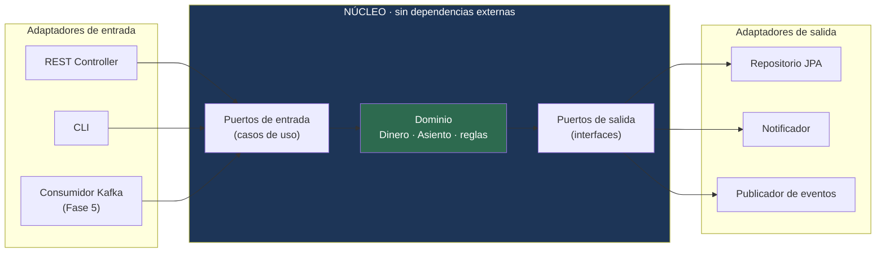

---
tags:
  - Java
  - Proyecto
  - Banca
  - corebank
  - Arquitectura
Creado: 2026-09-08
Relacionado:
  - Proyectos Java
  - Arquitectura Java
  - Testing en Java
Palabras clave:
  - hexagonal, puertos y adaptadores, ArchUnit, Testcontainers, mutation testing, refactor
Estado:
  - Pendiente
Nivel: Avanzado
Prerequisitos: Fase 3, Arquitectura Java, Testing en Java
---

# Fase 4 · Hexagonal y testing

## 🎯 Objetivo

Ninguna funcionalidad nueva. Esta fase **reorganiza** lo que ya existe y lo blinda con una suite de pruebas seria.

Es la fase que más se saltea y la que más se nota en una entrevista: refactorizar código propio que ya funciona, sin romperlo, es exactamente lo que hace un senior en su día a día.

> [!info] Por qué recién ahora y no en la Fase 1
> Aplicar hexagonal desde el principio hubiera sido cargo cult: capas copiadas de un tutorial sin entender qué separan. Después de tres fases ya tenés el dolor concreto — el servicio de transferencia sabe de JPA, de HTTP y de reglas de negocio al mismo tiempo. **El refactor es el aprendizaje.**

## 🧠 Qué problema resuelve

Hoy `ServicioTransferencia` depende de `CuentaRepository`, que es una interfaz de Spring Data, que depende de JPA, que depende de Postgres. Consecuencias:

- No podés testear la regla de negocio sin levantar una base.
- Cambiar de Postgres a otra cosa toca el servicio.
- La regla "no se puede transferir a la misma cuenta" vive mezclada con `@Transactional` y `findByIdParaActualizar`.

La arquitectura hexagonal invierte esa dependencia: **el dominio no conoce a nadie; todos conocen al dominio.**



## 🧱 La estructura destino

```
com.corebank/
├── dominio/                          ← CERO imports de Spring, JPA o Jackson
│   ├── modelo/                       Dinero · Moneda · Cuenta · Asiento · Apunte
│   ├── excepcion/                    SaldoInsuficiente · AsientoInvalido
│   └── servicio/                     PoliticaDeLimites · CalculadoraDeSaldo
│
├── aplicacion/
│   ├── puerto/
│   │   ├── entrada/                  TransferirUseCase · ConsultarSaldoUseCase
│   │   └── salida/                   LibroPort · CuentaPort · PublicadorPort
│   └── servicio/                     TransferirService  (implementa el caso de uso)
│
└── infraestructura/
    ├── entrada/rest/                 Controllers · DTOs · ManejadorDeErrores
    ├── salida/persistencia/          Entidades JPA · Repositorios · Mappers
    ├── salida/mensajeria/            (Fase 5)
    └── config/                       Beans de Spring
```

**La regla de dependencia, en una línea:** las flechas de import apuntan siempre hacia adentro. `dominio` no importa nada de `aplicacion` ni de `infraestructura`.

## 💻 Cómo queda el caso de uso

### El puerto de entrada

```java
public interface TransferirUseCase {
    ResultadoTransferencia ejecutar(ComandoTransferir comando);
}

public record ComandoTransferir(
        CuentaId origen,
        CuentaId destino,
        Dinero importe,
        String motivo
) {}
```

### El puerto de salida — lo define el núcleo, no la infraestructura

```java
public interface LibroPort {
    void registrar(Asiento asiento);
    Dinero saldo(CuentaId cuenta, Moneda moneda);
    Optional<Asiento> buscar(UUID asientoId);
}

public interface CuentaPort {
    Optional<Cuenta> buscarBloqueando(CuentaId id);
}
```

> [!tip] Acá está la inversión de dependencias
> `LibroPort` vive en `aplicacion.puerto.salida` y está escrito **en el lenguaje del dominio**: recibe `Asiento` y `Dinero`, no `AsientoEntity` ni `BigDecimal`. La implementación JPA vive afuera y se adapta a esta interfaz — no al revés.

### El servicio: solo reglas

```java
@Service
public class TransferirService implements TransferirUseCase {

    private final CuentaPort cuentas;
    private final LibroPort libro;
    private final PoliticaDeLimites limites;

    public TransferirService(CuentaPort cuentas, LibroPort libro, PoliticaDeLimites limites) {
        this.cuentas = cuentas;
        this.libro   = libro;
        this.limites = limites;
    }

    @Override
    @Transactional
    public ResultadoTransferencia ejecutar(ComandoTransferir cmd) {

        if (cmd.origen().equals(cmd.destino())) {
            throw new OperacionInvalidaException("origen y destino coinciden");
        }

        var origen  = cuentas.buscarBloqueando(menor(cmd)).orElseThrow(...);
        var destino = cuentas.buscarBloqueando(mayor(cmd)).orElseThrow(...);

        origen.exigirOperable();
        destino.exigirOperable();

        Dinero disponible = libro.saldo(origen.id(), cmd.importe().moneda());
        if (disponible.compareTo(cmd.importe()) < 0) {
            throw new SaldoInsuficienteException(origen.id(), disponible, cmd.importe());
        }

        limites.verificar(origen, cmd.importe());

        Asiento asiento = Asiento.de(cmd.motivo(),
            new Apunte(origen.id(),  cmd.importe().negado()),
            new Apunte(destino.id(), cmd.importe()));

        libro.registrar(asiento);
        return ResultadoTransferencia.de(asiento);
    }
}
```

Se lee como el enunciado del negocio. No aparece JPA, ni HTTP, ni SQL.

### El adaptador de salida

```java
@Component
public class LibroJpaAdapter implements LibroPort {

    private final AsientoJpaRepository repo;
    private final AsientoMapper mapper;

    @Override
    public void registrar(Asiento asiento) {
        repo.save(mapper.aEntidad(asiento));      // dominio → entidad
    }

    @Override
    public Dinero saldo(CuentaId cuenta, Moneda moneda) {
        BigDecimal suma = repo.sumarApuntes(cuenta.valor(), moneda.name());
        return new Dinero(suma, moneda);          // entidad → dominio
    }
}
```

> [!warning] El mapper no es burocracia
> Es el punto exacto donde el modelo interno deja de estar acoplado al esquema. Cuesta escribirlo y paga cada vez que la base cambia sin que el dominio se entere. MapStruct genera la parte aburrida.

## 🧪 La suite de pruebas

### Nivel 1 — Dominio, sin Spring

```java
class TransferirServiceTest {          // JUnit puro, milisegundos

    private final LibroPort libro = new LibroEnMemoria();       // fake, no mock
    private final CuentaPort cuentas = new CuentasEnMemoria();
    private final TransferirService service =
        new TransferirService(cuentas, libro, new PoliticaDeLimites());

    @Test
    void no_permite_transferir_a_la_misma_cuenta() {
        assertThrows(OperacionInvalidaException.class, () ->
            service.ejecutar(new ComandoTransferir(acc1, acc1, Dinero.de("10", PEN), "test")));
    }

    @Test
    void no_permite_transferir_desde_una_cuenta_bloqueada() { ... }
}
```

> [!tip] Fakes antes que mocks
> `LibroEnMemoria` es una implementación real y simple del puerto. Un mock verifica llamadas; un fake verifica **comportamiento**. Con mocks los tests se rompen al refactorizar aunque el comportamiento no cambie.

### Nivel 2 — Integración con Testcontainers

```java
@SpringBootTest
@Testcontainers
class TransferenciaIT {

    @Container
    static PostgreSQLContainer<?> db = new PostgreSQLContainer<>("postgres:16-alpine");

    @DynamicPropertySource
    static void props(DynamicPropertyRegistry r) {
        r.add("spring.datasource.url", db::getJdbcUrl);
        r.add("spring.datasource.username", db::getUsername);
        r.add("spring.datasource.password", db::getPassword);
    }

    @Test
    void la_transferencia_persiste_y_el_saldo_queda_correcto() { ... }

    @Test
    void las_migraciones_de_flyway_aplican_sobre_base_limpia() { ... }
}
```

### Nivel 3 — Arquitectura con ArchUnit

Estas reglas son las que **impiden que el refactor se degrade con el tiempo**:

```java
@AnalyzeClasses(packages = "com.corebank")
class ReglasDeArquitectura {

    @ArchTest
    static final ArchRule el_dominio_no_conoce_frameworks =
        noClasses().that().resideInAPackage("..dominio..")
            .should().dependOnClassesThat()
            .resideInAnyPackage("org.springframework..", "jakarta.persistence..",
                                "com.fasterxml.jackson..");

    @ArchTest
    static final ArchRule el_dominio_no_conoce_la_infraestructura =
        noClasses().that().resideInAPackage("..dominio..")
            .should().dependOnClassesThat().resideInAPackage("..infraestructura..");

    @ArchTest
    static final ArchRule los_controladores_no_tocan_repositorios =
        noClasses().that().resideInAPackage("..infraestructura.entrada.rest..")
            .should().dependOnClassesThat().resideInAPackage("..salida.persistencia..");

    @ArchTest
    static final ArchRule las_entidades_jpa_no_salen_de_persistencia =
        classes().that().areAnnotatedWith(Entity.class)
            .should().resideInAPackage("..salida.persistencia..");

    @ArchTest
    static final ArchRule ningun_importe_usa_double =
        noFields().should().haveRawType(double.class)
            .orShould().haveRawType(Double.class)
            .because("todo importe debe ser BigDecimal");

    @ArchTest
    static final ArchRule sin_ciclos_entre_paquetes =
        slices().matching("com.corebank.(*)..").should().beFreeOfCycles();
}
```

> [!tip] La regla que más vale
> `ningun_importe_usa_double`. Convierte la regla número uno del laboratorio en algo que **falla la compilación de la suite** si alguien la olvida. Una convención escrita en el README se ignora; un test que se pone rojo, no.

### Nivel 4 — Mutation testing

```xml
<plugin>
    <groupId>org.pitest</groupId>
    <artifactId>pitest-maven</artifactId>
    <configuration>
        <targetClasses><param>com.corebank.dominio.*</param>
                       <param>com.corebank.aplicacion.*</param></targetClasses>
        <mutationThreshold>75</mutationThreshold>
    </configuration>
</plugin>
```

PIT modifica tu código a propósito (cambia un `>` por `>=`, invierte un `if`, borra una línea) y verifica que **algún test se ponga rojo**. Si ninguno se rompe, ese test no estaba probando nada.

| Métrica | Qué mide | Se puede falsear |
|---|---|---|
| Cobertura de líneas | qué se ejecutó | ✅ trivialmente (test sin asserts) |
| Cobertura de ramas | qué caminos se recorrieron | ✅ con esfuerzo |
| **Mutation score** | qué errores se **detectan** | ❌ |

## ✅ Criterios de aceptación

- [ ] `dominio` no importa Spring, JPA ni Jackson — verificado por ArchUnit, no a ojo.
- [ ] Los puertos están definidos en el núcleo y las implementaciones afuera.
- [ ] Los casos de uso se testean sin levantar Spring ni base de datos.
- [ ] Ninguna entidad JPA sale del paquete de persistencia.
- [ ] Los tests de integración usan Testcontainers, no una base compartida.
- [ ] Todas las reglas de ArchUnit pasan en verde.
- [ ] Mutation score ≥ 75% en dominio y aplicación.
- [ ] Los tests de dominio corren en menos de 2 segundos.
- [ ] **El comportamiento externo no cambió**: los tests de la Fase 3 pasan sin modificarse.

> [!danger] El último criterio es el que define el refactor
> Si tuviste que cambiar los tests de integración de fases anteriores, no refactorizaste: reescribiste. Un refactor cambia la estructura interna preservando el comportamiento observable.

## ⚠️ Trampas de esta fase

> [!warning] Las que arruinan el refactor
> - **Hacer el refactor sin red de seguridad.** Los tests de integración van primero. Sin ellos no sabés si rompiste algo.
> - **Refactorizar todo de una.** Empezá por un solo caso de uso — la transferencia. Cuando ese esté, el resto es mecánico.
> - **Puertos que filtran la infraestructura.** Un `LibroPort` que devuelve `Page<AsientoEntity>` no invirtió nada: solo agregó una interfaz.
> - **Un puerto por cada método del repositorio.** El puerto lo define la **necesidad del caso de uso**, no la capacidad de la base.
> - **Mockear todo.** Los tests quedan atados a la implementación y se rompen en cada refactor.

## 🔁 Retrospectiva

- ¿Qué clase te costó más ubicar? ¿Por qué era ambigua?
- ¿Cuántas líneas de mapper agregaste y qué te compra ese costo?
- ¿Qué regla de ArchUnit falló primero al escribirlas? ¿Qué revela eso del código previo?
- ¿Qué mutante sobrevivió que no esperabas? ¿Qué test faltaba?
- Si mañana hubiera que cambiar Postgres por otra base, ¿cuántos archivos tocarías?

## 🔗 Relaciones
- **Anterior**: [[Fase 3 - Seguridad y Auditoria]]
- **Siguiente**: [[Fase 5 - Eventos y Outbox]]
- **Teoría que aplica**: [[03 - Arquitectura Hexagonal]], [[02 - Clean Architecture en Java]], [[05 - DTOs Mappers y Contratos]], [[07 - ArchUnit]], [[05 - TestContainers]], [[09 - Mutation Testing]]
- **Índice**: [[Proyectos Java]]

## 📌 Notas Rápidas
- Después de esta fase, el consumidor Kafka de la Fase 5 entra como un adaptador de entrada más, sin tocar el núcleo. Ese es el retorno concreto del refactor.
- Hexagonal, Clean Architecture y Puertos y Adaptadores son en la práctica el mismo principio con distinto vocabulario: dependencias hacia el dominio.
- Poder decir en una entrevista "refactoricé de capas a hexagonal con los tests como red y las reglas congeladas en ArchUnit" vale más que enumerar los patrones de memoria.

---

## ✍️ Mis apuntes
<!-- Tus dudas, ejemplos propios, cómo lo aplicaste -->

