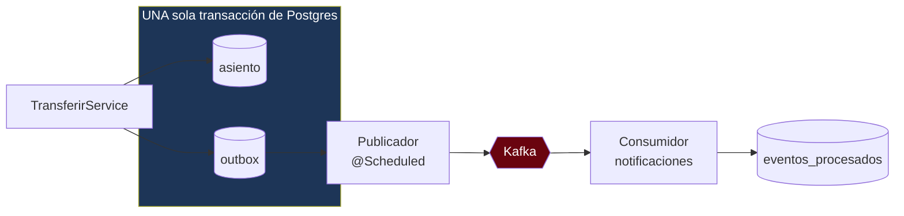

---
tags:
  - Java
  - Proyecto
  - Banca
  - corebank
  - Kafka
Creado: 2026-09-08
Relacionado:
  - Proyectos Java
  - Mensajeria
  - Sistemas Distribuidos
Palabras clave:
  - Kafka, outbox, dual-write, inbox, idempotencia, DLQ, eventos de dominio
Estado:
  - Pendiente
Nivel: Avanzado
Prerequisitos: Fase 4, Mensajeria, Sistemas Distribuidos
---

# Fase 5 · Eventos y Outbox

## 🎯 Objetivo

Cuando ocurre un movimiento, hay que notificar al cliente. Hacerlo dentro de la transferencia es una mala idea: si el servicio de notificaciones está caído, la transferencia falla — y una transferencia válida nunca debería fallar porque no se pudo mandar un correo.

La solución es publicar un **evento de dominio** y que otro consumidor se ocupe. En el camino aparece el problema más importante de los sistemas distribuidos: **el dual-write**.

## 🧠 El problema del dual-write

```java
@Transactional
public void transferir(...) {
    libro.registrar(asiento);                        // 1 · escribe en Postgres
    kafka.send("movimientos", new MovimientoEvent()); // 2 · publica en Kafka
}
```

Esto **está roto**, y falla de las dos formas posibles:

```
Caso A · Kafka falla después del commit
  ✅ asiento guardado
  ❌ evento nunca publicado
  → el dinero se movió y el cliente nunca se enteró

Caso B · Kafka responde pero la transacción hace rollback
  ❌ asiento no guardado
  ✅ evento publicado
  → se notificó una transferencia que NUNCA ocurrió
```

> [!danger] No hay forma de arreglarlo con `@Transactional`
> Postgres y Kafka son sistemas distintos, con transacciones distintas. No hay commit atómico entre los dos. Las transacciones XA/2PC existen pero son lentas, frágiles y Kafka las soporta mal.
> **La solución no es hacer el dual-write atómico: es eliminarlo.**

## 📤 El patrón Outbox

La idea: escribir el evento **en la misma base y en la misma transacción** que el dato. Si el asiento se guarda, el evento también — atómicamente. Un proceso aparte lee esa tabla y publica a Kafka.



### La tabla

```sql
-- V5__outbox.sql
CREATE TABLE outbox (
    id              UUID PRIMARY KEY,
    agregado_tipo   VARCHAR(40)  NOT NULL,     -- ASIENTO, CUENTA
    agregado_id     VARCHAR(60)  NOT NULL,     -- clave de partición en Kafka
    tipo_evento     VARCHAR(60)  NOT NULL,     -- MovimientoRegistrado
    payload         JSONB        NOT NULL,
    creado_en       TIMESTAMPTZ  NOT NULL DEFAULT now(),
    publicado_en    TIMESTAMPTZ,
    intentos        SMALLINT     NOT NULL DEFAULT 0,
    ultimo_error    TEXT
);

-- Índice parcial: solo las pendientes, que son pocas
CREATE INDEX idx_outbox_pendientes ON outbox(creado_en)
    WHERE publicado_en IS NULL;
```

### Escribir el evento

```java
@Transactional
public ResultadoTransferencia ejecutar(ComandoTransferir cmd) {
    ...
    libro.registrar(asiento);

    // Misma transacción: o se guardan los dos, o ninguno
    outbox.encolar(new EventoOutbox(
        "ASIENTO",
        asiento.id().toString(),               // clave de partición
        "MovimientoRegistrado",
        new MovimientoRegistrado(
            asiento.id(), origen.id(), destino.id(),
            cmd.importe().monto(), cmd.importe().moneda(), asiento.fecha())));

    return ResultadoTransferencia.de(asiento);
}
```

### Publicar

```java
@Component
public class PublicadorOutbox {

    @Scheduled(fixedDelay = 500)
    @Transactional
    public void publicarPendientes() {

        // SKIP LOCKED permite varias instancias sin pisarse
        List<EventoOutbox> pendientes = repo.tomarPendientes(100);

        for (EventoOutbox evento : pendientes) {
            try {
                kafka.send(topicoDe(evento.tipoEvento()),
                           evento.agregadoId(),        // clave → orden por cuenta
                           evento.payload())
                     .get(5, TimeUnit.SECONDS);
                repo.marcarPublicado(evento.id());

            } catch (Exception e) {
                repo.registrarFallo(evento.id(), e.getMessage());
                log.warn("fallo publicando {} (intento {})", evento.id(), evento.intentos(), e);
            }
        }
    }
}
```

```sql
-- tomarPendientes
SELECT * FROM outbox
WHERE publicado_en IS NULL
ORDER BY creado_en
LIMIT :n
FOR UPDATE SKIP LOCKED;
```

> [!tip] `FOR UPDATE SKIP LOCKED` es la clave de la escalabilidad
> Sin él, dos instancias del publicador leen las mismas filas y publican duplicados. Con él, cada instancia toma un lote distinto y salta lo que otra ya tiene bloqueado. Es lo que permite correr N réplicas del servicio sin coordinación adicional.

## 📥 El lado del consumidor: Inbox

El Outbox garantiza que el evento se publica **al menos una vez**. Nunca exactamente una: si Kafka confirma pero el `marcarPublicado` falla, el evento se reenvía.

Por eso el consumidor **debe** ser idempotente.

```sql
CREATE TABLE eventos_procesados (
    evento_id     UUID PRIMARY KEY,          -- ← la unicidad la impone la base
    consumidor    VARCHAR(60) NOT NULL,
    procesado_en  TIMESTAMPTZ NOT NULL DEFAULT now()
);
```

```java
@KafkaListener(topics = "movimientos", groupId = "notificaciones")
@Transactional
public void alRecibir(MovimientoRegistrado evento, Acknowledgment ack) {
    try {
        procesados.registrar(evento.id(), "notificaciones");   // falla si ya existe
    } catch (DataIntegrityViolationException e) {
        log.debug("evento {} ya procesado, se ignora", evento.id());
        ack.acknowledge();
        return;
    }

    notificador.enviar(evento);
    ack.acknowledge();
}
```

> [!warning] Que el consumidor sea idempotente no es opcional
> Es la única forma real de acercarse a *exactly-once*. Kafka ofrece semántica *exactly-once* dentro de Kafka, pero el efecto externo —mandar un correo, cobrar una tarjeta— queda fuera de esa garantía.

## 📮 Eventos del sistema

| Evento | Se emite cuando | Consumidores |
|---|---|---|
| `MovimientoRegistrado` | se registra cualquier asiento | notificaciones, proyección de saldos |
| `TransferenciaCompletada` | una transferencia termina bien | notificaciones, antifraude |
| `TransferenciaReversada` | se registra una reversa | notificaciones, auditoría |
| `CuentaAbierta` | alta de cuenta | bienvenida, CRM |
| `LimiteExcedido` | se rechaza por límite | antifraude |

```java
public record MovimientoRegistrado(
        UUID id,                 // id del EVENTO, no del asiento
        UUID asientoId,
        UUID cuentaOrigen,
        UUID cuentaDestino,
        BigDecimal monto,
        Moneda moneda,
        Instant ocurridoEn,
        int version              // versionado desde el día uno
) {}
```

> [!tip] Versioná los eventos desde el principio
> Un evento publicado es un contrato con consumidores que no controlás. Agregar campos opcionales es compatible; renombrar o quitar, no. El campo `version` permite evolucionar sin romper.

## ☠️ Dead Letter Queue

```java
@Bean
public DefaultErrorHandler errorHandler(KafkaTemplate<String, Object> template) {
    var recoverer = new DeadLetterPublishingRecoverer(template,
        (record, ex) -> new TopicPartition(record.topic() + ".DLT", record.partition()));

    // 3 reintentos con backoff exponencial; después va a la DLT
    var backoff = new ExponentialBackOffWithMaxRetries(3);
    backoff.setInitialInterval(1000);
    backoff.setMultiplier(2.0);

    var handler = new DefaultErrorHandler(recoverer, backoff);
    handler.addNotRetryableExceptions(EventoMalFormadoException.class);  // no tiene sentido reintentar
    return handler;
}
```

| Tipo de error | Qué hacer |
|---|---|
| Transitorio (red, servicio caído) | reintentar con backoff |
| Permanente (payload inválido) | directo a DLT, sin reintentar |
| Envenenado (rompe siempre) | DLT + alerta |

> [!danger] Una DLQ sin monitoreo no sirve
> Los mensajes se acumulan ahí en silencio y nadie se entera hasta que un cliente reclama. Necesitás una métrica de profundidad de la DLT con alerta.

## 🐳 Infraestructura

```yaml
  kafka:
    image: confluentinc/cp-kafka:7.6.0
    environment:
      KAFKA_PROCESS_ROLES: broker,controller
      KAFKA_LISTENERS: PLAINTEXT://:9092,CONTROLLER://:9093
      KAFKA_AUTO_CREATE_TOPICS_ENABLE: "false"     # los topics se declaran, no se improvisan
    healthcheck:
      test: ["CMD", "kafka-topics", "--bootstrap-server", "localhost:9092", "--list"]
```

```yaml
spring:
  kafka:
    producer:
      acks: all                    # espera confirmación de todas las réplicas
      properties:
        enable.idempotence: true   # evita duplicados por reintento del productor
    consumer:
      auto-offset-reset: earliest
      enable-auto-commit: false    # el commit lo controlamos nosotros
    listener:
      ack-mode: manual
```

## 🧪 Tests

```java
@Test
void si_falla_la_transaccion_no_queda_evento_en_outbox() {
    assertThrows(SaldoInsuficienteException.class, () -> service.ejecutar(comandoImposible));
    assertEquals(0, outboxRepo.count());        // atomicidad real
}

@Test
void el_mismo_evento_entregado_dos_veces_notifica_una_sola_vez() {
    consumidor.alRecibir(evento, ack);
    consumidor.alRecibir(evento, ack);          // reentrega de Kafka
    verify(notificador, times(1)).enviar(any());
}

@Test
void dos_publicadores_concurrentes_no_publican_el_mismo_evento() {
    // gracias a FOR UPDATE SKIP LOCKED
}

@Test
void un_evento_que_falla_siempre_termina_en_la_DLT() { ... }
```

Con Testcontainers también para Kafka:

```java
@Container
static KafkaContainer kafka = new KafkaContainer(
    DockerImageName.parse("confluentinc/cp-kafka:7.6.0"));
```

## ✅ Criterios de aceptación

- [ ] No queda ningún `kafka.send()` dentro de una transacción de negocio.
- [ ] El evento y el asiento se escriben en la misma transacción.
- [ ] Si la transacción falla, no queda rastro en `outbox`.
- [ ] El publicador usa `FOR UPDATE SKIP LOCKED` y tolera múltiples instancias.
- [ ] El consumidor es idempotente por restricción única en base.
- [ ] Reentregar un evento no duplica la notificación (test explícito).
- [ ] Los eventos llevan `version` y `id` propio.
- [ ] Existe DLT con reintentos y backoff exponencial.
- [ ] Los errores permanentes no se reintentan.
- [ ] Los topics se crean explícitamente; `auto-create` desactivado.
- [ ] Hay métrica de eventos pendientes en outbox y de profundidad de DLT.

## ⚠️ Trampas de esta fase

> [!warning] Las que definen la fase
> - **Publicar dentro de la transacción "porque Spring lo permite".** Es el dual-write completo.
> - **Publicar en `@TransactionalEventListener(AFTER_COMMIT)`.** Mejor que lo anterior, pero si el proceso muere entre el commit y el envío, el evento se pierde igual. Solo el Outbox lo resuelve.
> - **Consumidor sin deduplicación.** Kafka reentrega; sin inbox, se notifica dos veces.
> - **Clave de partición aleatoria.** Se pierde el orden por cuenta. La clave debe ser el agregado.
> - **Borrar filas del outbox al publicarlas.** Mejor marcarlas y archivarlas después: sirven para diagnosticar.

## 🔁 Retrospectiva

- ¿Por qué `@TransactionalEventListener(AFTER_COMMIT)` no resuelve el problema del todo?
- ¿Qué pasa si Kafka está caído 3 horas? ¿Se pierde algo?
- ¿Por qué la clave de partición es el id del agregado y no algo aleatorio?
- ¿Cuál es la latencia real entre la transferencia y la notificación? ¿Es aceptable para el negocio?
- Si un evento queda en la DLT, ¿cuál es el procedimiento para reprocesarlo?

## 🔗 Relaciones
- **Anterior**: [[Fase 4 - Hexagonal y Testing]]
- **Siguiente**: [[Fase 6 - Microservicios y SAGA]]
- **Teoría que aplica**: [[05 - Transactional Outbox]], [[04 - Garantias de Entrega]], [[03 - Idempotencia y Deduplicacion]], [[02 - Kafka con Spring Boot]]
- **Índice**: [[Proyectos Java]]

## 📌 Notas Rápidas
- Existe una variante del Outbox con **CDC** (Debezium leyendo el WAL de Postgres) que evita el polling. Es más eficiente y bastante más compleja de operar: conocer que existe alcanza para una entrevista.
- Sigue siendo un monolito. Los eventos son internos por ahora — eso es deliberado: se prueba la mensajería antes de sumar la complejidad de la red. La separación viene en la Fase 6.
- "¿Cómo garantizás que el evento se publique si la base commitea?" es una pregunta de entrevista frecuentísima. La respuesta es Outbox, y saber explicar *por qué* el dual-write falla vale más que nombrar el patrón.

---

## ✍️ Mis apuntes
<!-- Tus dudas, ejemplos propios, cómo lo aplicaste -->

