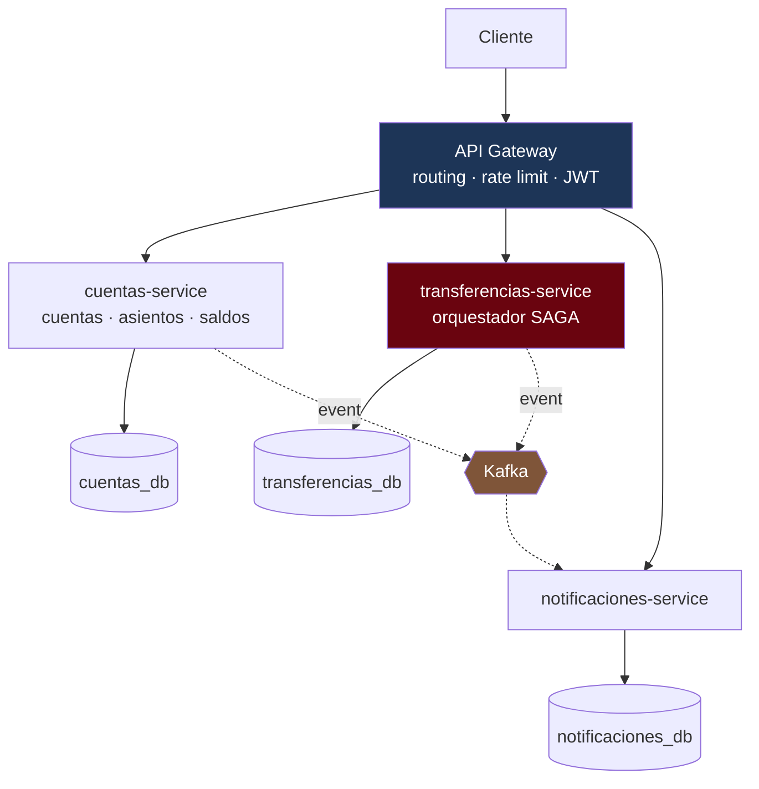

---
tags:
  - Java
  - Proyecto
  - Banca
  - corebank
  - Microservicios
Creado: 2026-09-08
Relacionado:
  - Proyectos Java
  - Microservicios
  - Sistemas Distribuidos
Palabras clave:
  - SAGA, orquestacion, compensacion, API Gateway, circuit breaker, contract testing
Estado:
  - Pendiente
Nivel: Avanzado
Prerequisitos: Fase 5, Microservicios, Sistemas Distribuidos
---

# Fase 6 · Microservicios y SAGA

## 🎯 Objetivo

Separar el monolito en servicios independientes y resolver el problema que aparece de inmediato: **una transferencia interbancaria toca dos bases de datos distintas, y no hay transacción que las abarque**.

Ahí entra SAGA.

> [!warning] Leé esto antes de empezar
> Si el monolito de la Fase 5 funciona bien, **partirlo lo va a empeorar**: más latencia, más puntos de falla, despliegue más complejo, debugging más difícil.
> Se hace igual, porque el objetivo es aprender a resolver los problemas de la distribución. Pero la conclusión honesta de esta fase suele ser *"no hacía falta"* — y llegar a esa conclusión **con evidencia propia** vale más que cualquier tutorial. La alternativa seria está en [[07 - Modular Monolith]].

## 🧱 El corte



| Servicio | Responsabilidad | Base propia |
|---|---|---|
| `cuentas-service` | cuentas, asientos, saldos, ledger | ✅ |
| `transferencias-service` | orquesta la SAGA, guarda su estado | ✅ |
| `notificaciones-service` | consume eventos y notifica | ✅ |
| `gateway` | ruteo, rate limiting, validación de JWT | — |

> [!danger] Una base por servicio, sin excepciones
> Si dos servicios comparten base, no son dos servicios: es un monolito con más latencia. La base compartida es el antipatrón que anula todos los beneficios de separar.

## 🔄 El problema que resuelve SAGA

Transferencia interbancaria: debitar en el banco A, acreditar en el banco B. Dos bases, dos servicios, sin transacción común.

```
Paso 1 · reservar fondos en origen     ✅
Paso 2 · debitar en origen             ✅
Paso 3 · acreditar en destino          ❌ el banco destino rechaza la cuenta

El dinero salió de origen y nunca llegó a destino. Se evaporó.
```

Sin transacción distribuida, la única salida es **deshacer lo hecho con operaciones inversas**: eso es una SAGA.

```
Camino feliz        reservar → debitar → acreditar → confirmar
Camino de fallo     acreditar falla → compensar débito → liberar reserva → marcar FALLIDA
```

### Orquestación vs coreografía

| | Orquestación | Coreografía |
|---|---|---|
| Quién decide | un orquestador central | cada servicio reacciona a eventos |
| El flujo se ve | en un solo lugar | disperso entre servicios |
| Acoplamiento | el orquestador conoce a todos | bajo |
| Depurar | fácil | difícil |
| Riesgo | el orquestador se vuelve un monolito | ciclos y efectos imprevistos |

**Para dinero: orquestación.** Necesitás saber en qué paso está cada transferencia y poder auditarla. Con coreografía, reconstruir el estado exige rastrear eventos por cinco servicios.

## 💻 La SAGA

```sql
-- transferencias_db · V1
CREATE TABLE saga_transferencia (
    id                UUID PRIMARY KEY,
    estado            VARCHAR(30) NOT NULL,
    paso_actual       VARCHAR(40),
    cuenta_origen     UUID        NOT NULL,
    cuenta_destino    VARCHAR(60) NOT NULL,
    banco_destino     VARCHAR(20) NOT NULL,
    monto             NUMERIC(19,4) NOT NULL,
    moneda            VARCHAR(3)  NOT NULL,
    reserva_id        UUID,
    asiento_debito_id UUID,
    referencia_externa VARCHAR(60),
    motivo_fallo      TEXT,
    intentos          SMALLINT    NOT NULL DEFAULT 0,
    creado_en         TIMESTAMPTZ NOT NULL DEFAULT now(),
    actualizado_en    TIMESTAMPTZ NOT NULL DEFAULT now()
);

CREATE INDEX idx_saga_en_curso ON saga_transferencia(estado, actualizado_en)
    WHERE estado NOT IN ('COMPLETADA', 'FALLIDA');
```

```java
public enum EstadoSaga {
    INICIADA,
    FONDOS_RESERVADOS,
    DEBITADA,
    ACREDITADA,
    COMPLETADA,          // final feliz
    COMPENSANDO,
    FALLIDA              // final compensado
}
```

```java
@Service
public class OrquestadorTransferencia {

    @Transactional
    public SagaTransferencia iniciar(ComandoTransferenciaInterbancaria cmd) {
        var saga = SagaTransferencia.nueva(cmd);
        repo.save(saga);
        avanzar(saga.getId());
        return saga;
    }

    public void avanzar(UUID sagaId) {
        SagaTransferencia saga = repo.findById(sagaId).orElseThrow();

        try {
            switch (saga.getEstado()) {
                case INICIADA          -> reservarFondos(saga);
                case FONDOS_RESERVADOS -> debitar(saga);
                case DEBITADA          -> acreditar(saga);
                case ACREDITADA        -> confirmar(saga);
                case COMPENSANDO       -> compensar(saga);
                default -> { }         // estados finales
            }
        } catch (ErrorRecuperable e) {
            saga.registrarIntento(e.getMessage());   // reintento posterior
            repo.save(saga);
        } catch (ErrorPermanente e) {
            saga.pasarACompensando(e.getMessage());
            repo.save(saga);
            compensar(saga);
        }
    }

    private void acreditar(SagaTransferencia saga) {
        var resultado = bancoExterno.acreditar(new SolicitudAcreditacion(
            saga.getCuentaDestino(), saga.getMonto(), saga.getId().toString()));  // ← idempotencia

        if (resultado.esRechazoDefinitivo()) {
            throw new ErrorPermanente("destino rechazó: " + resultado.motivo());
        }
        saga.acreditada(resultado.referencia());
        repo.save(saga);
        avanzar(saga.getId());
    }

    /** Deshace en ORDEN INVERSO lo que ya se hizo */
    private void compensar(SagaTransferencia saga) {
        if (saga.getAsientoDebitoId() != null) {
            cuentasClient.reversar(saga.getAsientoDebitoId(),
                                   "compensación SAGA " + saga.getId());
            saga.debitoCompensado();
        }
        if (saga.getReservaId() != null) {
            cuentasClient.liberarReserva(saga.getReservaId());
            saga.reservaLiberada();
        }
        saga.fallida();
        repo.save(saga);
    }
}
```

> [!tip] Cada paso es idempotente y el estado se persiste tras cada uno
> Si el orquestador muere en medio de una SAGA, al reiniciar lee el estado y continúa desde ahí. Sin esa persistencia, un reinicio deja transferencias colgadas y dinero en el limbo.

### El recuperador

```java
@Component
public class RecuperadorSagas {

    @Scheduled(fixedDelay = 30_000)
    public void reanudarAtascadas() {
        repo.enCursoDesdeHace(Duration.ofMinutes(2))
            .forEach(saga -> {
                if (saga.getIntentos() >= 5) {
                    alertas.escalar(saga);        // intervención manual
                } else {
                    orquestador.avanzar(saga.getId());
                }
            });
    }
}
```

> [!danger] Toda SAGA necesita un recuperador y un tope de reintentos
> Sin recuperador, un fallo transitorio deja la transferencia congelada para siempre. Sin tope, una SAGA imposible reintenta eternamente. Cuando se agota el tope, **un humano tiene que verlo** — en banca eso es un procedimiento operativo, no un log.

## 🚪 Gateway y resiliencia

```yaml
spring:
  cloud:
    gateway:
      routes:
        - id: cuentas
          uri: lb://cuentas-service
          predicates: [Path=/api/v1/cuentas/**]
          filters:
            - name: CircuitBreaker
              args: { name: cuentasCB, fallbackUri: forward:/fallback/cuentas }
            - name: RequestRateLimiter
              args:
                redis-rate-limiter.replenishRate: 100
                redis-rate-limiter.burstCapacity: 200
```

```java
@FeignClient(name = "cuentas-service", configuration = FeignConfig.class)
public interface CuentasClient {

    @PostMapping("/internal/cuentas/{id}/reservas")
    ReservaResponse reservar(@PathVariable UUID id,
                             @RequestHeader("Idempotency-Key") String clave,
                             @RequestBody ReservaRequest request);
}
```

> [!warning] La idempotencia de la Fase 2 ahora es obligatoria, no opcional
> Con Feign y reintentos, cada llamada entre servicios puede repetirse. Sin `Idempotency-Key` en las operaciones que mueven dinero, un reintento por timeout duplica el débito. Toda la Fase 2 existía para este momento.

## 🤝 Contract testing

Con servicios desplegándose por separado, un cambio de contrato rompe al otro en producción. Pact lo detecta en CI.

```java
// Consumidor: transferencias-service declara qué espera
@Pact(consumer = "transferencias-service", provider = "cuentas-service")
public RequestResponsePact reservaExitosa(PactDslWithProvider builder) {
    return builder
        .given("existe la cuenta ACC-001 con saldo 1000")
        .uponReceiving("una solicitud de reserva de 500")
            .path("/internal/cuentas/ACC-001/reservas")
            .method("POST")
        .willRespondWith()
            .status(201)
            .body(new PactDslJsonBody()
                .uuid("reservaId")
                .decimalType("monto", 500.00))
        .toPact();
}
```

El proveedor verifica ese contrato en su propio pipeline. Si `cuentas-service` cambia la respuesta, su build falla — antes de desplegar.

## 🧪 Tests

```java
@Test
void si_el_banco_destino_rechaza_el_dinero_vuelve_al_origen() {
    when(bancoExterno.acreditar(any())).thenThrow(new ErrorPermanente("cuenta inexistente"));

    var saga = orquestador.iniciar(comando);

    assertEquals(FALLIDA, repo.findById(saga.getId()).get().getEstado());
    assertEquals(saldoInicial, cuentas.saldo(origen, PEN));    // ← lo que importa
}

@Test
void si_el_orquestador_muere_a_mitad_la_saga_se_reanuda() {
    // se corta después de DEBITADA; el recuperador la continúa
}

@Test
void reintentar_el_mismo_paso_no_duplica_el_debito() { ... }
```

## ✅ Criterios de aceptación

- [ ] Cada servicio tiene su propia base; ninguna se comparte.
- [ ] El gateway rutea, valida el JWT y aplica rate limiting.
- [ ] Toda llamada entre servicios lleva `Idempotency-Key` si mueve dinero.
- [ ] La SAGA persiste su estado tras **cada** paso.
- [ ] Existe un test que prueba la compensación completa y el saldo restaurado.
- [ ] Un reinicio del orquestador reanuda las sagas en curso.
- [ ] Hay tope de reintentos con escalado a intervención manual.
- [ ] Circuit breaker configurado en toda llamada saliente.
- [ ] Contract tests entre consumidor y proveedor corren en CI.
- [ ] `docker compose up` levanta el sistema completo.
- [ ] Una petición se puede seguir de punta a punta por su `traceId`.

## ⚠️ Trampas de esta fase

> [!warning] Las caras
> - **Base compartida entre servicios.** Anula el punto de separar.
> - **Compensaciones sin probar.** El camino feliz siempre anda; el de reversa nunca se testea hasta que falla en producción.
> - **SAGA sin estado persistido.** Un reinicio deja transferencias colgadas.
> - **Compensar en el mismo orden.** Se deshace en orden **inverso** al de ejecución.
> - **Suponer que compensar siempre se puede.** Si el destino ya retiró el dinero, no hay reversa técnica: escala a un proceso humano.
> - **Partir por entidad y no por capacidad de negocio.** `cuenta-service`, `cliente-service`, `direccion-service` es un monolito distribuido: cada operación llama a los tres.

## 🔁 Retrospectiva

- ¿Qué se volvió más difícil respecto del monolito? Sé específico.
- ¿Cuánta latencia agregó una transferencia interbancaria?
- ¿Qué pasa si la compensación **también** falla?
- ¿Habrías podido resolver lo mismo con un monolito modular? ¿Qué te habrías perdido?
- Cuando algo falla, ¿cuánto tardás en encontrar en qué servicio fue?

## 🔗 Relaciones
- **Anterior**: [[Fase 5 - Eventos y Outbox]]
- **Siguiente**: [[Fase 7 - Observabilidad y Despliegue]]
- **Teoría que aplica**: [[06 - SAGA]], [[07 - Compensacion y Reversas]], [[04 - API Gateway]], [[05 - Circuit Breaker - Resilience4j]], [[08 - Contract Testing]]
- **Alternativa seria**: [[07 - Modular Monolith]]
- **Índice**: [[Proyectos Java]]

## 📌 Notas Rápidas
- Una SAGA no da atomicidad: da **consistencia eventual con compensación**. Entre el débito y la acreditación hay una ventana en la que el dinero no está en ningún lado. El negocio tiene que aceptar esa ventana explícitamente.
- La última pregunta de la retrospectiva es la más valiosa: si tardás mucho en localizar un fallo, te falta la Fase 7.
- En una entrevista, decir "implementé una SAGA orquestada, con estado persistido, compensación en orden inverso y recuperador con escalado" es una respuesta de senior. Decir "usé SAGA" no.

---

## ✍️ Mis apuntes
<!-- Tus dudas, ejemplos propios, cómo lo aplicaste -->

