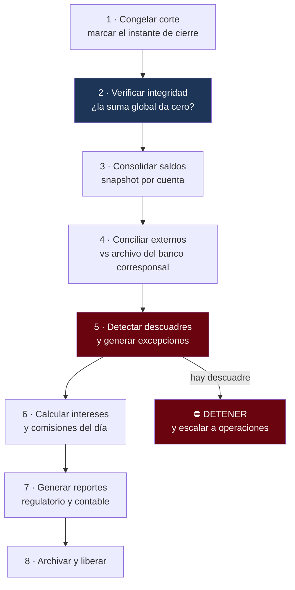

---
tags:
  - Java
  - Proyecto
  - Banca
  - corebank
  - Performance
Creado: 2026-09-08
Relacionado:
  - Proyectos Java
  - Performance Java
  - Banca y Fintech
Palabras clave:
  - Spring Batch, cierre de dia, conciliacion, cuadre, pruebas de carga, profiling, indices
Estado:
  - Pendiente
Nivel: Avanzado
Prerequisitos: Fase 7, Performance Java
---

# Fase 8 · Batch, cierre de día y performance

## 🎯 Objetivo

La fase final. Dos cosas que todo sistema bancario real tiene y que ningún tutorial cubre:

1. **El cierre de día**: el proceso nocturno que consolida, concilia y verifica que todo cuadre.
2. **Performance con datos reales**: lo que funciona con 100 movimientos y se cae con 10 millones.

> [!info] Por qué el cierre de día es el examen final
> Es el momento en que el banco se pregunta *"¿el dinero que dice mi sistema es el dinero que realmente hay?"*. Si algo se hizo mal en cualquiera de las 8 fases anteriores, **acá aparece**. Un descuadre de un centavo detiene el cierre.

## 🌙 Qué hace un cierre de día



## 🗄️ Snapshot de saldos

Hasta ahora el saldo se calcula sumando **todos** los apuntes de la cuenta. Con 10 millones de movimientos eso deja de ser viable.

```sql
CREATE TABLE saldo_diario (
    cuenta_id       UUID          NOT NULL,
    fecha_corte     DATE          NOT NULL,
    moneda          VARCHAR(3)    NOT NULL,
    saldo           NUMERIC(19,4) NOT NULL,
    ultimo_apunte   BIGINT        NOT NULL,   -- desde dónde seguir sumando
    calculado_en    TIMESTAMPTZ   NOT NULL DEFAULT now(),
    PRIMARY KEY (cuenta_id, fecha_corte, moneda)
);
```

```java
public Dinero saldoActual(CuentaId cuenta, Moneda moneda) {
    // snapshot del último cierre + solo los apuntes posteriores
    var snapshot = saldoDiarioRepo.ultimoDe(cuenta, moneda);

    BigDecimal desdeSnapshot = apunteRepo.sumarDesde(
        cuenta.valor(), moneda.name(), snapshot.ultimoApunte());

    return new Dinero(snapshot.saldo().add(desdeSnapshot), moneda);
}
```

> [!tip] Ahora sí se materializa el saldo — y recién ahora
> En la Fase 1 la nota decía explícitamente que no lo hicieras. La diferencia es que ahora **tenés el problema medido**: sabés cuántos movimientos hay y cuánto tarda la consulta.
> El snapshot no reemplaza al ledger: lo acelera. La verdad sigue siendo la suma de apuntes, y el snapshot se puede reconstruir desde cero en cualquier momento. Esa es la diferencia entre un caché y una segunda fuente de verdad.

## ⚙️ Spring Batch

```java
@Configuration
public class JobCierreDiario {

    @Bean
    public Job cierreDiario(JobRepository repo, Step... pasos) {
        return new JobBuilder("cierreDiario", repo)
            .incrementer(new RunIdIncrementer())
            .start(verificarIntegridad)
            .next(consolidarSaldos)
            .next(conciliarExternos)
            .next(detectarDescuadres)
            .next(calcularIntereses)
            .next(generarReportes)
            .build();
    }

    @Bean
    public Step consolidarSaldos(JobRepository repo, PlatformTransactionManager tx) {
        return new StepBuilder("consolidarSaldos", repo)
            .<CuentaConSaldo, SaldoDiario>chunk(500, tx)
            .reader(lectorCuentasPaginado())      // NUNCA findAll()
            .processor(calculadoraDeSaldo())
            .writer(escritorSaldoDiario())
            .faultTolerant()
                .retryLimit(3).retry(TransientDataAccessException.class)
                .skipLimit(0)                     // ⛔ en dinero NO se saltea nada
            .taskExecutor(new SimpleAsyncTaskExecutor())
            .build();
    }
}
```

> [!danger] `skipLimit(0)` en procesos de dinero
> Spring Batch permite saltear registros con error y seguir. En un cierre contable eso es inaceptable: saltear una cuenta significa que el cierre queda mal y nadie se entera. **Se detiene y se escala.**

### Lectura paginada

```java
@Bean
public JdbcPagingItemReader<CuentaConSaldo> lectorCuentasPaginado() {
    return new JdbcPagingItemReaderBuilder<CuentaConSaldo>()
        .name("lectorCuentas")
        .dataSource(dataSource)
        .selectClause("SELECT c.id, c.moneda")
        .fromClause("FROM cuenta c")
        .whereClause("WHERE c.estado = 'ACTIVA'")
        .sortKeys(Map.of("id", Order.ASCENDING))     // orden estable, obligatorio
        .pageSize(500)
        .rowMapper(new CuentaConSaldoRowMapper())
        .build();
}
```

> [!warning] `findAll()` en un batch es una bomba
> Un millón de cuentas en memoria satura el heap y tira `OutOfMemoryError` a mitad del cierre. El lector paginado trae 500 por vez y las libera.

## 🔍 Conciliación

Comparar lo que dice tu sistema contra lo que dice el banco corresponsal.

```java
public ResultadoConciliacion conciliar(LocalDate fecha, Path archivoExterno) {

    Map<String, MovimientoExterno> externos = leerArchivo(archivoExterno);
    Map<String, Movimiento> propios = movimientoRepo.deLaFechaIndexadosPorReferencia(fecha);

    var diferencias = new ArrayList<Diferencia>();

    // 1 · Está en ambos: ¿coincide el importe?
    propios.forEach((ref, propio) -> {
        MovimientoExterno externo = externos.get(ref);
        if (externo == null) {
            diferencias.add(Diferencia.faltaEnExterno(propio));
        } else if (propio.monto().compareTo(externo.monto()) != 0) {
            diferencias.add(Diferencia.importeDistinto(propio, externo));
        }
    });

    // 2 · Está afuera y no acá
    externos.keySet().stream()
        .filter(ref -> !propios.containsKey(ref))
        .forEach(ref -> diferencias.add(Diferencia.faltaEnPropio(externos.get(ref))));

    return new ResultadoConciliacion(fecha, propios.size(), externos.size(), diferencias);
}
```

| Tipo de diferencia | Causa habitual | Acción |
|---|---|---|
| Falta en externo | operación no llegó al corresponsal | reclamar, no reprocesar |
| Falta en propio | operación entrante no registrada | investigar y registrar |
| Importe distinto | comisión o tipo de cambio | ajustar con asiento |
| Duplicado en propio | falló la idempotencia | ⚠️ bug grave, reversar |

> [!danger] Un duplicado detectado en conciliación es un bug de la Fase 2
> Si la idempotencia estuviera bien implementada, no puede haber duplicados. Encontrar uno acá significa que hay una ruta que no pasa por la clave de idempotencia.

## ✅ El cuadre

```java
@Component
public class VerificadorDeIntegridad {

    /** La invariante de la Fase 0, ahora sobre millones de filas */
    public void verificar(Instant corte) {
        List<DescuadrePorMoneda> descuadres = apunteRepo.sumaGlobalPorMoneda(corte);

        var conError = descuadres.stream()
            .filter(d -> d.suma().signum() != 0)
            .toList();

        if (!conError.isEmpty()) {
            alertas.critica("DESCUADRE CONTABLE", conError);
            throw new DescuadreContableException(conError);   // ⛔ detiene el cierre
        }
        log.atInfo().addKeyValue("evento", "cuadre_ok").log("el sistema cuadra");
    }
}
```

```sql
SELECT moneda, SUM(monto) AS suma
FROM apunte a JOIN asiento s ON s.id = a.asiento_id
WHERE s.fecha <= :corte
GROUP BY moneda
HAVING SUM(monto) <> 0;      -- si devuelve filas, hay descuadre
```

> [!tip] Es el mismo test de la Fase 0
> `el_sistema_completo_siempre_cuadra_en_cero` empezó como un test unitario con tres asientos en memoria. Ocho fases después es un control contable sobre millones de filas. La invariante nunca cambió — eso es lo que significa modelar bien el dominio desde el principio.

## ⚡ Performance

### Índices que faltan

```sql
-- El extracto ordena por fecha descendente: el índice debe reflejarlo
CREATE INDEX idx_apunte_cuenta_fecha
    ON apunte(cuenta_id, asiento_id DESC) INCLUDE (monto, moneda);

-- Solo lo pendiente: índice parcial, mucho más chico
CREATE INDEX idx_outbox_pendientes ON outbox(creado_en) WHERE publicado_en IS NULL;

-- Particionado por mes: las consultas recientes solo tocan la partición actual
CREATE TABLE apunte_2026_09 PARTITION OF apunte
    FOR VALUES FROM ('2026-09-01') TO ('2026-10-01');
```

```sql
EXPLAIN (ANALYZE, BUFFERS)
SELECT ... FROM apunte WHERE cuenta_id = '...' ORDER BY id DESC LIMIT 50;
```

Buscá `Seq Scan` sobre tablas grandes: casi siempre es un índice faltante.

### Pruebas de carga

```javascript
// k6 · carga.js
import http from 'k6/http';
import { check } from 'k6';

export const options = {
  stages: [
    { duration: '2m', target: 100 },   // rampa
    { duration: '5m', target: 100 },   // sostenido
    { duration: '2m', target: 300 },   // pico
    { duration: '2m', target: 0 },
  ],
  thresholds: {
    http_req_duration: ['p(95)<500', 'p(99)<1500'],
    http_req_failed:   ['rate<0.01'],
  },
};

export default function () {
  const res = http.post(`${__ENV.URL}/api/v1/transferencias`,
    JSON.stringify(payload()),
    { headers: { 'Idempotency-Key': uuid(), 'Content-Type': 'application/json' } });

  check(res, { 'creada': (r) => r.status === 201 });
}
```

### Qué medir mientras corre

| Señal | Herramienta | Síntoma de |
|---|---|---|
| Latencia p95/p99 | k6 | degradación real |
| Conexiones activas del pool | Micrometer | pool subdimensionado |
| Pausas de GC | `jvm.gc.pause` | heap mal configurado |
| Queries lentas | `pg_stat_statements` | índice faltante |
| Bloqueos y esperas | `pg_locks` | contención por el `FOR UPDATE` |

> [!warning] El cuello de botella casi nunca está donde creés
> Antes de optimizar código, medí. En una app Spring típica el orden habitual de culpables es: **query sin índice → pool de conexiones → N+1 → serialización → GC**. El código Java rara vez encabeza la lista.

## ✅ Criterios de aceptación

- [ ] El job de cierre corre completo y es re-ejecutable sin duplicar efectos.
- [ ] La verificación de integridad **detiene** el cierre ante cualquier descuadre.
- [ ] `skipLimit(0)` en todos los pasos que tocan dinero.
- [ ] Los lectores paginan; no hay `findAll()` en ningún batch.
- [ ] El snapshot de saldos se puede reconstruir desde cero y da idéntico resultado.
- [ ] La conciliación detecta los cuatro tipos de diferencia y emite reporte.
- [ ] Un duplicado en conciliación genera alerta crítica.
- [ ] Prueba de carga con p95 < 500 ms y tasa de error < 1%.
- [ ] Ningún `Seq Scan` sobre tablas grandes en las consultas del extracto.
- [ ] El cierre de 1 millón de cuentas termina dentro de la ventana definida.
- [ ] Hay dataset de prueba con volumen realista (≥ 1M de movimientos).

## ⚠️ Trampas de esta fase

> [!warning] Las que arruinan un cierre
> - **`findAll()` en el batch.** OOM a mitad del proceso, con el cierre a medias.
> - **Job no idempotente.** Si se corta y se relanza, calcula intereses dos veces.
> - **Saltear registros con error.** El cierre "termina bien" y los números están mal.
> - **Probar con 100 filas.** Todo anda. El problema aparece con volumen real.
> - **Optimizar sin medir.** Se pierde una semana en el lugar equivocado.
> - **Materializar el saldo sin poder reconstruirlo.** Si el snapshot se corrompe y no hay forma de regenerarlo, perdiste la fuente de verdad.

## 🔁 Retrospectiva del laboratorio completo

Esta es la última fase — la retrospectiva es de todo el recorrido:

- ¿Qué decisión de la Fase 0 te salvó más adelante? ¿Cuál te complicó?
- ¿En qué fase entendiste algo que creías saber?
- El sistema cuadra hoy: ¿qué mecanismo concreto lo garantiza?
- Si tuvieras que rehacerlo, ¿qué harías distinto y qué mantendrías igual?
- ¿Qué parte podrías explicar en una pizarra ahora mismo, sin mirar?
- ¿Qué quedó a medias y sabés que quedó a medias?

## 🎓 Cierre

Con esta fase `corebank` es un sistema bancario completo: modelado con rigor, seguro, testeado, distribuido, observable, desplegado y verificado contablemente.

Más importante: es **una historia que podés contar**. Cada fase resolvió un problema concreto con una decisión que podés defender. Eso es exactamente lo que se evalúa en una entrevista senior — y lo que ningún curso te da.

## 🔗 Relaciones
- **Anterior**: [[Fase 7 - Observabilidad y Despliegue]]
- **Teoría que aplica**: [[10 - Cierre de Dia y Batch]], [[09 - Conciliacion y Cuadre]], [[11 - Jobs Programados y Spring Batch]], [[01 - Profiling y Diagnostico]], [[10 - Pruebas de Carga]], [[03 - Indices y Queries Lentas]]
- **Siguiente paso**: [[System Design]] — llevar todo esto a una pizarra
- **Índice**: [[Proyectos Java]]

## 📌 Notas Rápidas
- El cierre de día real de un banco corre en una ventana de horas y tiene procedimiento de contingencia si no termina. Simularlo con una ventana ajustada es parte del ejercicio.
- La reconstrucción del snapshot desde cero es la prueba de que el ledger sigue siendo la fuente de verdad. Corré esa reconstrucción periódicamente: es la red de seguridad de todo el modelo.
- Cuando termines, el paso natural es [[System Design]]: los casos [[C5 - Motor de Transferencias]] y [[C9 - Cierre de Dia]] son literalmente lo que acabás de construir, pero explicado en 45 minutos frente a un entrevistador.

---

## ✍️ Mis apuntes
<!-- Tus dudas, ejemplos propios, cómo lo aplicaste -->

