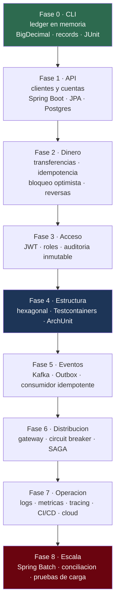

---
tags:
  - Java
  - Proyectos
  - Banca
Creado: 2026-05-21
Actualizado: 2026-09-08
Relacionado:
  - Java
  - Banca y Fintech
  - System Design
Categoria: Práctica
Estado:
  - Pendiente
Progreso: 0
Prioridad: Alta
---

#Principal

## 🎯 La idea

**Un solo producto que crece durante todo el roadmap.** No seis proyectos sueltos que se abandonan al terminar.

Construís un **core bancario simplificado** que arranca como un ledger de consola en Java puro y termina siendo un sistema de microservicios con eventos, SAGA, observabilidad y despliegue en la nube. Cada fase reusa el código de la anterior y le agrega exactamente lo que acabás de estudiar.

Por qué así y no proyectos separados:

- **Se ve la evolución arquitectónica.** El refactor de capas a hexagonal en la Fase 4 solo tiene sentido si hay código previo que refactorizar. Ese refactor *es* el aprendizaje.
- **Un repo, no seis.** Termina siendo la única pieza de evidencia que un entrevistador va a abrir de verdad.
- **Los problemas aparecen solos.** El N+1, el descuadre de centavos y la transferencia duplicada surgen del propio sistema al crecer, no de un ejercicio artificial.

> [!info] El dominio es bancario a propósito
> Es lo que más se pregunta en las entrevistas que te interesan, y obliga a resolver problemas que un CRUD de blog nunca plantea: dinero exacto, idempotencia, auditoría, cuadre.

## 🗺️ Las fases

| Fase | Qué construís | Módulos que aplica | Estado | Nota |
|------|---------------|--------------------|--------|------|
| 0 | Ledger de consola en Java puro | [[Java Fundamentos]] · [[Java Intermedio]] | ⬜ | [[Fase 0 - Ledger en Java Puro]] |
| 1 | API REST de clientes y cuentas | [[Spring Boot]] · [[Spring Data]] | ⬜ | [[Fase 1 - API de Cuentas]] |
| 2 | Transferencias con idempotencia y reversas | [[Banca y Fintech]] · [[Bases de Datos Java]] | ⬜ | [[Fase 2 - Transferencias e Idempotencia]] |
| 3 | Seguridad, roles y auditoría | [[Spring Security]] | ⬜ | [[Fase 3 - Seguridad y Auditoria]] |
| 4 | Refactor a hexagonal + suite de tests | [[Arquitectura Java]] · [[Testing en Java]] | ⬜ | [[Fase 4 - Hexagonal y Testing]] |
| 5 | Eventos de dominio con Kafka y Outbox | [[Mensajeria]] · [[Sistemas Distribuidos]] | ⬜ | [[Fase 5 - Eventos y Outbox]] |
| 6 | Separación en microservicios + SAGA | [[Microservicios]] | ⬜ | [[Fase 6 - Microservicios y SAGA]] |
| 7 | Observabilidad, CI/CD y despliegue | [[DevOps con Java]] · [[Cloud para Java]] | ⬜ | [[Fase 7 - Observabilidad y Despliegue]] |
| 8 | Cierre de día, batch y performance | [[Performance Java]] | ⬜ | [[Fase 8 - Batch y Cierre de Dia]] |

## 📈 Cómo crece el sistema

## 🧱 Qué se construye, en concreto

El producto se llama **`corebank`**. Al final del recorrido soporta:

- Alta de clientes con validación de documento de identidad.
- Cuentas de ahorro y corriente, en soles y dólares.
- Depósitos, retiros y transferencias entre cuentas propias y de terceros.
- Reverso de operaciones con asiento de compensación (nunca borrado).
- Estado de cuenta con saldo a cualquier fecha pasada.
- Notificación de movimientos por evento asíncrono.
- Transferencia interbancaria con SAGA y compensación.
- Límites diarios por cliente y bloqueo por sospecha de fraude.
- Cierre de día con cuadre y reporte de conciliación.

## ✅ Reglas del laboratorio

Se aplican a **todas** las fases, sin excepción:

- [ ] Todo importe es `BigDecimal`. Ningún `double` en el proyecto, nunca.
- [ ] Ningún movimiento se borra ni se edita: se compensa con otro asiento.
- [ ] Toda operación que modifica dinero acepta `Idempotency-Key`.
- [ ] Cada fase cierra con tests que pasan y README actualizado.
- [ ] Cada fase deja una **nota de retrospectiva**: qué costó, qué se rompió, qué haría distinto.
- [ ] Todo corre con `docker compose up` desde la Fase 1.
- [ ] Un commit por unidad de trabajo, con mensaje que explique el *por qué*.

## 🎓 Criterio de "terminado" por fase

Una fase está cerrada cuando podés **explicarla en voz alta en 5 minutos** a alguien que no la vio: qué problema resolvía, qué decidiste y qué descartaste. Si no podés, el código está pero el aprendizaje no.

## 🔗 Relaciones
- **Dominio**: [[Banca y Fintech]]
- **Se conecta con**: [[System Design]], [[Sistemas Distribuidos]], [[Senior Java Engineer]]
- **Roadmap general**: [[JAVA]]

## 📌 Notas Rápidas
- Las notas `01`–`06` anteriores (CLI de tareas, API CRUD, sistema de pedidos, API JWT, microservicios, senior final) quedaron **reemplazadas** por estas fases: cubrían lo mismo pero sin dominio ni continuidad. Se pueden borrar.
- Si una fase se hace muy larga, partila — pero no la saltes: cada una es prerequisito real de la siguiente.
- El valor del laboratorio no es el código: es poder contar las decisiones. Por eso la retrospectiva es obligatoria.

---

## ✍️ Mis apuntes
> 📓 Apuntes del módulo → [[Apuntes - Laboratorio corebank]]

<!-- Anotaciones rápidas sobre el módulo en general -->

