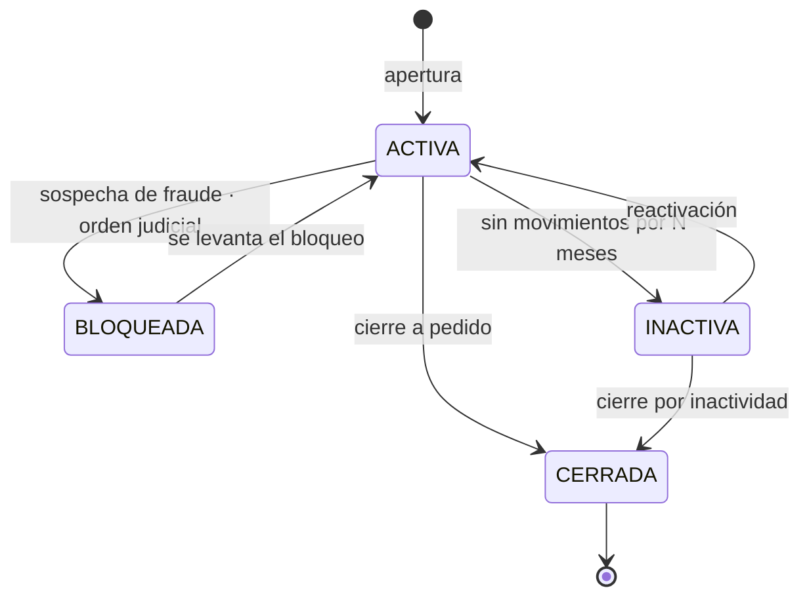

---
tags:
  - Java
  - Banca
  - Dominio
Creado: 2026-09-08
Relacionado:
  - Banca y Fintech
  - 03 - Ledger y Partida Doble
Palabras clave:
  - saldo contable, saldo disponible, retencion, hold, sobregiro, extracto, estados de cuenta
---

## 🧠 Concepto

"El saldo de la cuenta" no es un número: son **varios números distintos** que coexisten y que el cliente ve en momentos diferentes. Confundirlos es la causa de una familia entera de bugs y reclamos.

## 💰 Los tres saldos

| Saldo | Qué es | Quién lo usa |
|---|---|---|
| **Contable** (book balance) | suma de todos los apuntes registrados | contabilidad, cierre |
| **Disponible** (available balance) | contable − retenciones + línea de crédito | validar operaciones |
| **Diferido** (float) | fondos acreditados pero no liberados | cheques, transferencias en tránsito |

```
Saldo contable:        S/ 1.500,00
− Retención por compra:    -200,00   (consumo con tarjeta sin liquidar)
− Retención judicial:      -300,00
+ Línea de crédito:        +500,00
─────────────────────────────────
Saldo disponible:      S/ 1.500,00
```

> [!danger] Validar contra el saldo equivocado es un bug caro
> Si validás una transferencia contra el **contable**, dejás pasar operaciones que no deberían: el cliente gasta plata que está retenida y la cuenta queda en descubierto no autorizado. Toda operación de salida se valida contra el **disponible**.

## 🔒 Retenciones (holds)

Cuando pagás con tarjeta de débito, el comercio pide una **autorización**: el banco no mueve el dinero todavía, pero lo bloquea. Días después llega la liquidación real y recién ahí se genera el asiento.

```
Día 1 · autorización     retención de S/ 200 · saldo contable NO cambia
Día 3 · liquidación      asiento de -S/ 200 · se libera la retención
```

```sql
CREATE TABLE retencion (
    id              UUID PRIMARY KEY,
    cuenta_id       UUID          NOT NULL REFERENCES cuenta(id),
    monto           NUMERIC(19,4) NOT NULL CHECK (monto > 0),
    moneda          VARCHAR(3)    NOT NULL,
    motivo          VARCHAR(40)   NOT NULL,   -- AUTORIZACION | JUDICIAL | GARANTIA
    referencia      VARCHAR(60),              -- código de autorización
    estado          VARCHAR(20)   NOT NULL,   -- ACTIVA | LIBERADA | APLICADA
    creada_en       TIMESTAMPTZ   NOT NULL DEFAULT now(),
    expira_en       TIMESTAMPTZ,              -- caducidad automática
    liberada_en     TIMESTAMPTZ
);

CREATE INDEX idx_retencion_activa ON retencion(cuenta_id)
    WHERE estado = 'ACTIVA';
```

```java
public Dinero saldoDisponible(CuentaId cuenta, Moneda moneda) {
    Dinero contable   = libro.saldo(cuenta, moneda);
    Dinero retenido   = retenciones.totalActivo(cuenta, moneda);
    Dinero linea      = cuentas.lineaDeCredito(cuenta, moneda);

    return contable.menos(retenido).mas(linea);
}
```

> [!warning] Las retenciones tienen que caducar
> Si una autorización nunca llega a liquidarse (el comercio no la cobra), la retención queda activa para siempre y el cliente tiene plata bloqueada sin motivo. Toda retención necesita `expira_en` y un job que libere las vencidas.
> Es un reclamo clásico: *"tengo saldo pero no puedo usarlo"*.

Diferencia clave entre liberar y aplicar:

| Acción | Qué pasa | Genera asiento |
|---|---|---|
| **Liberar** | la retención desaparece, el dinero vuelve a estar disponible | ❌ |
| **Aplicar** | la operación se liquida | ✅ el asiento real |

## 🏦 La cuenta

```java
public record Cuenta(
        CuentaId id,
        String numero,          // el que ve el cliente
        ClienteId titular,
        Moneda moneda,
        TipoCuenta tipo,
        EstadoCuenta estado,
        Dinero lineaDeCredito,  // 0 si no tiene sobregiro autorizado
        Instant abiertaEn,
        Instant cerradaEn
) {
    public void exigirOperable() {
        if (estado != ACTIVA) throw new CuentaNoOperableException(id, estado);
    }
}
```

### Estados



| Estado | Entra dinero | Sale dinero | Se consulta |
|---|---|---|---|
| `ACTIVA` | ✅ | ✅ | ✅ |
| `INACTIVA` | ✅ | ❌ | ✅ |
| `BLOQUEADA` | ✅ | ❌ | ✅ |
| `CERRADA` | ❌ | ❌ | ✅ histórico |

> [!warning] Una cuenta bloqueada sigue recibiendo
> Bloquear no significa aislar: un embargo judicial impide **sacar**, no impide que entre el sueldo. Modelar el bloqueo como "no se puede tocar" es incorrecto y genera devoluciones indebidas.

> [!danger] Una cuenta cerrada nunca se borra
> Sus movimientos históricos deben seguir consultables por el período de retención legal (habitualmente 10 años). Cerrar es un cambio de estado, no un `DELETE`.

## 📉 Sobregiro

```java
public void validarSalida(Cuenta cuenta, Dinero importe) {
    Dinero disponible = saldoDisponible(cuenta.id(), importe.moneda());

    if (disponible.compareTo(importe) < 0) {
        throw new SaldoInsuficienteException(cuenta.id(), disponible, importe);
    }
}
```

Como `saldoDisponible` ya suma la línea de crédito, el sobregiro autorizado funciona solo. Lo que hay que evitar es el **descubierto no autorizado**: que el saldo quede negativo sin línea que lo respalde.

```sql
-- Control de integridad: ninguna cuenta sin línea puede quedar negativa
SELECT c.id, SUM(a.monto) AS saldo
FROM cuenta c JOIN apunte a ON a.cuenta_id = c.id
WHERE c.linea_credito = 0
GROUP BY c.id
HAVING SUM(a.monto) < 0;
```

Esta consulta debería devolver **cero filas siempre**. Si devuelve algo, hubo una operación que no validó bien.

## 📄 El extracto

```java
public record MovimientoExtracto(
        Instant fecha,
        String descripcion,
        Dinero importe,
        Dinero saldoResultante,   // saldo DESPUÉS de este movimiento
        String referencia,
        boolean esReversa
) {}
```

El **saldo corrido** (running balance) es lo que el cliente espera ver y no se puede calcular fila por fila con una consulta ingenua. Con función de ventana:

```sql
SELECT
    s.fecha,
    s.motivo,
    a.monto,
    SUM(a.monto) OVER (ORDER BY a.id
                       ROWS BETWEEN UNBOUNDED PRECEDING AND CURRENT ROW) AS saldo_corrido
FROM apunte a
JOIN asiento s ON s.id = a.asiento_id
WHERE a.cuenta_id = :cuenta AND a.moneda = :moneda
ORDER BY a.id DESC
LIMIT 50 OFFSET :offset;
```

> [!danger] El saldo corrido y la paginación se pelean
> Si paginás con `OFFSET` y ordenás descendente, la ventana solo ve la página actual y el saldo corrido sale mal. Dos salidas:
> 1. Calcular el saldo hasta el inicio de la página y acumular desde ahí.
> 2. Guardar `saldo_resultante` en cada apunte al escribirlo (denormalización), que es lo que hacen la mayoría de los core bancarios.

> [!warning] Paginá siempre por cursor, no por `OFFSET`
> `OFFSET 10000` obliga a la base a leer y descartar 10.000 filas. Con cursor (`WHERE id < :ultimoId`) el costo es constante. En cuentas con años de movimientos la diferencia es de segundos a milisegundos.

## 🔢 El número de cuenta

```java
public record NumeroCuenta(String valor) {
    private static final Pattern FORMATO = Pattern.compile("^\\d{3}-\\d{3}-\\d{10}-\\d{2}$");

    public NumeroCuenta {
        if (!FORMATO.matcher(valor).matches())
            throw new NumeroCuentaInvalidoException(valor);
        if (!digitoVerificadorValido(valor))
            throw new DigitoVerificadorInvalidoException(valor);
    }
}
```

> [!tip] El dígito verificador atrapa errores de tipeo
> Es el mismo principio que el algoritmo de Luhn en tarjetas: un dígito calculado a partir de los otros. Si alguien se equivoca en un número al transferir, se detecta **antes** de mandar el dinero a una cuenta que existe pero no es la correcta.

El **CCI** (Código de Cuenta Interbancario, 20 dígitos en Perú) y el **IBAN** (internacional) cumplen la misma función a nivel interbancario: identifican unívocamente la cuenta incluyendo entidad y oficina, y llevan dígitos de control.

## 🧪 Tests

```java
@Test
void no_se_puede_retirar_dinero_retenido() {
    depositar(cuenta, Dinero.de("1000", PEN));
    retener(cuenta, Dinero.de("800", PEN), "AUTORIZACION");

    assertThrows(SaldoInsuficienteException.class,
        () -> retirar(cuenta, Dinero.de("500", PEN)));   // hay 1000 contable, 200 disponible
}

@Test
void una_retencion_vencida_se_libera_automaticamente() { ... }

@Test
void una_cuenta_bloqueada_recibe_pero_no_envia() {
    bloquear(cuenta);
    assertDoesNotThrow(() -> depositar(cuenta, Dinero.de("100", PEN)));
    assertThrows(CuentaNoOperableException.class, () -> retirar(cuenta, Dinero.de("50", PEN)));
}

@Test
void ninguna_cuenta_sin_linea_queda_en_negativo() {
    // property-based sobre operaciones aleatorias
}
```

## ⚠️ Errores Comunes

> [!warning] Los que generan reclamos
> - **Validar contra el saldo contable** en vez del disponible.
> - **Retenciones sin caducidad**: el cliente queda con dinero bloqueado indefinidamente.
> - **Confundir liberar con aplicar**: liberar una retención no mueve dinero; aplicarla sí.
> - **Bloquear la cuenta en las dos direcciones**: un embargo no impide que entre el sueldo.
> - **Borrar cuentas cerradas** y perder el histórico exigido por normativa.
> - **Paginar con `OFFSET`** y romper el saldo corrido.
> - **Número de cuenta sin dígito verificador**: los errores de tipeo llegan a producción.

## 📌 Notas Rápidas
- La distinción entre saldo contable y disponible es de las preguntas más frecuentes en entrevistas de banca, y una de las que más gente responde mal por no conocer el concepto de retención.
- Cuando un cliente dice *"la app me muestra un saldo y el cajero otro"*, casi siempre es que una pantalla lee el contable y la otra el disponible.
- Denormalizar `saldo_resultante` en el apunte contradice "el saldo se deriva", pero es una decisión pragmática habitual: sigue siendo reconstruible desde los apuntes, así que la fuente de verdad no cambia.
- Se implementa en [[Fase 1 - API de Cuentas]] y [[Fase 2 - Transferencias e Idempotencia]].

## 🔗 Relaciones
- **Módulo**: [[Banca y Fintech]]
- **Anterior**: [[03 - Ledger y Partida Doble]]
- **Siguiente**: [[05 - Idempotencia Financiera]]
- **Se conecta con**: [[13 - Antifraude y Limites]], [[07 - Medios de Pago y ISO 8583]]

---

## ✍️ Mis apuntes
<!-- Tus dudas, ejemplos propios, cómo lo aplicaste -->

