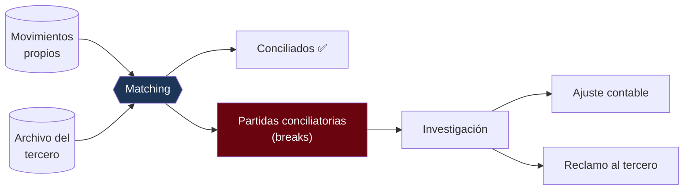

---
tags:
  - Java
  - Banca
  - Dominio
Creado: 2026-09-08
Relacionado:
  - Banca y Fintech
  - 03 - Ledger y Partida Doble
Palabras clave:
  - conciliacion, cuadre, descuadre, partidas conciliatorias, matching, break, cuenta puente
---

## 🧠 Concepto

Dos controles distintos que se confunden todo el tiempo:

| | **Cuadre** | **Conciliación** |
|---|---|---|
| Compara | el sistema contra sí mismo | el sistema contra un tercero |
| Pregunta | ¿la contabilidad es consistente? | ¿coincide con lo que dice el otro? |
| Frecuencia | continua, y en cada cierre | diaria, por archivo o API |
| Si falla | bug grave: se creó o destruyó dinero | diferencia a investigar |

El cuadre es interno y **nunca** debería fallar. La conciliación es externa y **siempre** tiene diferencias — la pregunta es si son explicables.

## ✅ Cuadre interno

Es la invariante de [[03 - Ledger y Partida Doble]], verificada sobre todo el sistema:

```sql
SELECT moneda, SUM(monto) AS descuadre
FROM apunte a JOIN asiento s ON s.id = a.asiento_id
WHERE s.fecha <= :corte
GROUP BY moneda
HAVING SUM(monto) <> 0;
```

**Cero filas = todo cuadra.** Cualquier fila es un incidente que detiene el cierre.

```java
public void verificarCuadre(Instant corte) {
    List<Descuadre> descuadres = apunteRepo.sumaPorMoneda(corte);

    if (!descuadres.isEmpty()) {
        alertas.critica("DESCUADRE CONTABLE", descuadres);
        throw new DescuadreContableException(descuadres);   // ⛔ detiene el cierre
    }
}
```

### Controles complementarios

```sql
-- 1 · Ningún asiento individual descuadrado
SELECT asiento_id, moneda, SUM(monto)
FROM apunte GROUP BY asiento_id, moneda HAVING SUM(monto) <> 0;

-- 2 · Ninguna cuenta sin línea de crédito en negativo
SELECT c.id, SUM(a.monto) FROM cuenta c JOIN apunte a ON a.cuenta_id = c.id
WHERE c.linea_credito = 0 GROUP BY c.id HAVING SUM(a.monto) < 0;

-- 3 · Cuentas puente en cero al cierre
SELECT cuenta_id, SUM(monto) FROM apunte
WHERE cuenta_id IN (SELECT id FROM cuenta WHERE tipo = 'PUENTE')
GROUP BY cuenta_id HAVING SUM(monto) <> 0;

-- 4 · Ningún apunte huérfano
SELECT a.id FROM apunte a LEFT JOIN asiento s ON s.id = a.asiento_id WHERE s.id IS NULL;
```

> [!warning] El control 3 es el que más cosas encuentra
> Una cuenta puente con saldo distinto de cero significa **operaciones a medio camino**: SAGAs que no completaron ni compensaron, transferencias en tránsito que se colgaron, conversiones a las que les falta una pata.
> Es la alerta más útil del cierre porque detecta problemas que ninguna otra prueba ve.

## 🔍 Conciliación externa

Comparar tus registros contra los de un tercero: el adquirente de tarjetas, la cámara de compensación, el banco corresponsal.



### Los cuatro tipos de diferencia

| Tipo | Qué significa | Acción típica |
|---|---|---|
| **Falta en el externo** | lo registraste, el tercero no lo tiene | reclamar; **no** reprocesar |
| **Falta en el propio** | el tercero lo tiene, vos no | investigar y registrar |
| **Importe distinto** | ambos lo tienen, distinto monto | comisión o tipo de cambio: ajustar |
| **Duplicado** | aparece dos veces de un lado | ⚠️ bug de idempotencia |

> [!danger] Un duplicado es un bug, no una diferencia
> Si la idempotencia de [[05 - Idempotencia Financiera]] estuviera bien implementada, no puede haber duplicados. Encontrar uno significa que existe una ruta que no pasa por la clave de idempotencia. Es hallazgo de severidad alta, no una partida a ajustar.

### El algoritmo de matching

```java
public ResultadoConciliacion conciliar(LocalDate fecha, List<MovimientoExterno> externos) {

    Map<String, Movimiento> propios = movimientoRepo.deLaFecha(fecha).stream()
        .collect(Collectors.toMap(Movimiento::referencia, identity()));

    Map<String, MovimientoExterno> ajenos = externos.stream()
        .collect(Collectors.toMap(MovimientoExterno::referencia, identity()));

    var diferencias = new ArrayList<Diferencia>();

    // 1 · Recorrer lo propio
    propios.forEach((ref, propio) -> {
        MovimientoExterno externo = ajenos.get(ref);
        if (externo == null) {
            diferencias.add(Diferencia.faltaEnExterno(propio));
        } else if (propio.monto().compareTo(externo.monto()) != 0) {
            diferencias.add(Diferencia.importeDistinto(propio, externo));
        }
    });

    // 2 · Lo que está afuera y no acá
    ajenos.keySet().stream()
        .filter(ref -> !propios.containsKey(ref))
        .forEach(ref -> diferencias.add(Diferencia.faltaEnPropio(ajenos.get(ref))));

    return new ResultadoConciliacion(fecha, propios.size(), ajenos.size(), diferencias);
}
```

### Matching por niveles

No siempre hay una referencia común. Se intenta en cascada, del más confiable al más laxo:

| Nivel | Criterio | Confianza |
|---|---|---|
| 1 | referencia única exacta | ✅ automático |
| 2 | importe + fecha + cuenta | ✅ automático |
| 3 | importe + fecha ± 1 día | ⚠️ revisión |
| 4 | importe aproximado (tolerancia de comisión) | ⚠️ revisión |
| 5 | sin coincidencia | ❌ manual |

```java
public Optional<Match> emparejar(Movimiento propio, List<MovimientoExterno> candidatos) {
    return porReferencia(propio, candidatos)
        .or(() -> porImporteFechaYCuenta(propio, candidatos))
        .or(() -> porImporteConVentana(propio, candidatos, Duration.ofDays(1)))
        .or(() -> porImporteConTolerancia(propio, candidatos, new BigDecimal("0.50")));
}
```

> [!tip] Diseñá para que el nivel 1 cubra casi todo
> Si tu sistema **envía** la referencia (`EndToEndId` en ISO 20022, RRN en tarjetas) y el tercero la devuelve, el matching es exacto y automático. Los niveles 3-5 existen para integraciones donde no controlás el formato. Cuantas más partidas caen en manual, más costosa es la operación.

## 📁 Leer el archivo del tercero

Casi siempre es un archivo de ancho fijo o CSV, subido por SFTP en la madrugada:

```java
@Bean
public FlatFileItemReader<MovimientoExterno> lectorArchivo() {
    return new FlatFileItemReaderBuilder<MovimientoExterno>()
        .name("conciliacion")
        .resource(new FileSystemResource(rutaDelDia()))
        .linesToSkip(1)                              // cabecera
        .fixedLength()
        .columns(new Range(1, 12), new Range(13, 20), new Range(21, 35), new Range(36, 38))
        .names("referencia", "fecha", "monto", "moneda")
        .fieldSetMapper(this::mapear)
        .build();
}

private MovimientoExterno mapear(FieldSet fs) {
    // El monto suele venir sin punto decimal, igual que en ISO 8583
    BigDecimal monto = new BigDecimal(fs.readString("monto").trim()).movePointLeft(2);
    return new MovimientoExterno(fs.readString("referencia").trim(), monto, ...);
}
```

> [!warning] Validá el archivo antes de procesarlo
> Comprobá el registro de control (totales y cantidad de registros que suele traer el pie) contra lo que realmente leíste. Un archivo truncado por una transferencia interrumpida produce cientos de falsas "faltas en el externo" y horas de investigación inútil.

```java
if (registrosLeidos != control.cantidadDeclarada()
        || sumaLeida.compareTo(control.montoDeclarado()) != 0) {
    throw new ArchivoInconsistenteException(...);   // no procesar
}
```

## 🗄️ Persistir el resultado

```sql
CREATE TABLE conciliacion (
    id              UUID PRIMARY KEY,
    fecha           DATE        NOT NULL,
    origen          VARCHAR(40) NOT NULL,       -- ADQUIRENTE_X, CCE, ...
    total_propios   INTEGER     NOT NULL,
    total_externos  INTEGER     NOT NULL,
    conciliados     INTEGER     NOT NULL,
    estado          VARCHAR(20) NOT NULL,       -- EN_PROCESO | CERRADA | CON_DIFERENCIAS
    ejecutada_en    TIMESTAMPTZ NOT NULL DEFAULT now(),
    UNIQUE (fecha, origen)
);

CREATE TABLE partida_conciliatoria (
    id              UUID PRIMARY KEY,
    conciliacion_id UUID          NOT NULL REFERENCES conciliacion(id),
    tipo            VARCHAR(30)   NOT NULL,
    referencia      VARCHAR(60),
    monto_propio    NUMERIC(19,4),
    monto_externo   NUMERIC(19,4),
    estado          VARCHAR(20)   NOT NULL,     -- ABIERTA | EN_ANALISIS | RESUELTA
    resolucion      TEXT,
    asiento_ajuste  UUID REFERENCES asiento(id),
    resuelta_por    VARCHAR(60),
    resuelta_en     TIMESTAMPTZ
);

CREATE INDEX idx_partida_abierta ON partida_conciliatoria(conciliacion_id)
    WHERE estado <> 'RESUELTA';
```

> [!danger] Una partida abierta nunca se cierra sola
> Cada diferencia necesita resolución explícita: quién la analizó, qué concluyó y —si corresponde— con qué asiento se ajustó. Cerrarlas en masa "porque son viejas" es exactamente lo que un auditor busca.

### Antigüedad

```sql
SELECT
    CASE WHEN age <= 3 THEN '0-3 días'
         WHEN age <= 7 THEN '4-7 días'
         WHEN age <= 30 THEN '8-30 días'
         ELSE 'más de 30 días' END AS antiguedad,
    COUNT(*), SUM(COALESCE(monto_propio, monto_externo))
FROM (SELECT *, EXTRACT(DAY FROM now() - creada_en) AS age
      FROM partida_conciliatoria WHERE estado <> 'RESUELTA') t
GROUP BY 1;
```

Partidas de más de 30 días abiertas son un hallazgo de auditoría por sí solas.

## 📊 Métricas

| Métrica | Objetivo | Señal |
|---|---|---|
| Tasa de conciliación automática | > 99% | si baja, hay un problema de integración |
| Partidas abiertas | tendencia a cero | si crece, el equipo no da abasto |
| Antigüedad promedio | < 5 días | investigación lenta |
| Monto neto sin conciliar | acotado | exposición real |
| Duplicados detectados | **0** | cualquier valor es un bug |

## 🧪 Tests

```java
@Test
void detecta_los_cuatro_tipos_de_diferencia() { ... }

@Test
void un_archivo_truncado_es_rechazado_antes_de_procesar() {
    assertThrows(ArchivoInconsistenteException.class,
        () -> servicio.conciliar(fecha, archivoIncompleto()));
}

@Test
void una_comision_dentro_de_tolerancia_concilia_automaticamente() { ... }

@Test
void un_duplicado_genera_alerta_critica() {
    servicio.conciliar(fecha, conDuplicado());
    verify(alertas).critica(eq("DUPLICADO_DETECTADO"), any());
}

@Test
void reconciliar_el_mismo_dia_dos_veces_no_duplica_partidas() {
    // idempotencia del propio proceso
}
```

## ⚠️ Errores Comunes

> [!warning] Los que se pagan en el cierre
> - **Confundir cuadre con conciliación**: son controles distintos, con distinta severidad.
> - **Cuadrar globalmente en multi-moneda**: hay que agrupar por moneda.
> - **Procesar el archivo sin validar el registro de control**: cientos de falsos positivos.
> - **Cerrar partidas en masa** sin resolución documentada.
> - **Tratar un duplicado como una diferencia más**: es un bug de severidad alta.
> - **Conciliación no idempotente**: re-ejecutarla duplica las partidas.
> - **No conciliar las cuentas puente**: ahí es donde se esconden las operaciones colgadas.

## 📌 Notas Rápidas
- La conciliación es de los procesos que más horas humanas consume en un banco. Cada punto de automatización que ganás tiene retorno directo y medible — es un buen argumento en una entrevista.
- Si controlás las dos puntas de la integración, poné una referencia única desde el diseño. El matching por importe y fecha es un parche para cuando no se pudo.
- Que el cuadre interno nunca falle no significa que no haya que verificarlo: se verifica **porque** nunca debería fallar. Es la red que detecta que algo se rompió en cualquiera de las capas anteriores.
- Se implementa en [[Fase 8 - Batch y Cierre de Dia]].

## 🔗 Relaciones
- **Módulo**: [[Banca y Fintech]]
- **Anterior**: [[08 - ISO 20022 y SWIFT]]
- **Siguiente**: [[10 - Cierre de Dia y Batch]]
- **Se conecta con**: [[03 - Ledger y Partida Doble]], [[12 - Auditoria y Trazabilidad]]

---

## ✍️ Mis apuntes
<!-- Tus dudas, ejemplos propios, cómo lo aplicaste -->

