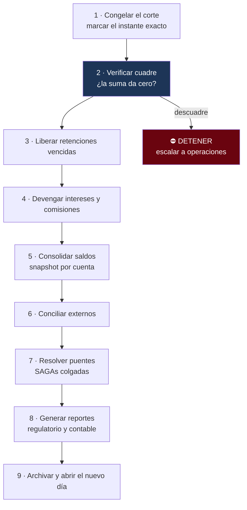

---
tags:
  - Java
  - Banca
  - Batch
Creado: 2026-09-08
Relacionado:
  - Banca y Fintech
  - 09 - Conciliacion y Cuadre
Palabras clave:
  - cierre de dia, EOD, batch, Spring Batch, ventana, corte, devengo, contingencia
---

## 🧠 Concepto

El **cierre de día** (EOD, *end of day*) es el proceso nocturno que consolida la jornada: verifica que todo cuadre, calcula lo que hay que calcular, concilia contra terceros y deja el sistema listo para el día siguiente.

Es el momento de la verdad. Si algo se hizo mal en cualquier parte del sistema, **acá aparece**.

## ⏰ La fecha contable

El concepto que hay que entender antes que ningún otro: **la fecha contable no es la fecha del reloj**.

```
Operación del sábado 20:00  →  fecha contable: lunes
Operación del lunes 00:30   →  fecha contable: lunes
Operación del lunes 23:50   →  fecha contable: martes (si el corte es a las 18:00)
```

| Concepto | Qué es |
|---|---|
| **Fecha de operación** | cuándo ocurrió realmente (timestamp) |
| **Fecha contable / valor** | a qué día se imputa contablemente |
| **Corte** | la hora que separa un día contable del siguiente |
| **Día hábil** | excluye fines de semana y feriados |

```java
public LocalDate fechaContable(Instant momento, CalendarioBancario calendario) {
    ZonedDateTime local = momento.atZone(ZONA_ENTIDAD);
    LocalDate fecha = local.toLocalDate();

    if (local.toLocalTime().isAfter(HORA_CORTE)) {
        fecha = fecha.plusDays(1);
    }
    return calendario.siguienteHabil(fecha);    // salta feriados y fines de semana
}
```

> [!danger] Guardá las dos fechas, siempre
> `fecha_operacion` (el instante real, en UTC) y `fecha_contable` (el día de imputación). Si solo tenés una, no podés responder ni "¿cuándo pasó?" ni "¿en qué día cerró?", y son preguntas distintas que hacen personas distintas.

> [!warning] El calendario de feriados es un dato, no una constante
> Los feriados cambian por año y por país, y algunos son móviles. Va en una tabla mantenible, nunca en código. Un feriado mal cargado desplaza toda la contabilidad de ese día.

## 🌙 Las fases del cierre



> [!tip] El orden no es negociable
> El cuadre va **segundo**, justo después de congelar. No tiene sentido calcular intereses sobre una contabilidad que no cierra: si hay descuadre, todo lo que se calcule después está mal.

## ⚙️ Spring Batch

```java
@Bean
public Job cierreDiario(JobRepository repo) {
    return new JobBuilder("cierreDiario", repo)
        .incrementer(new RunIdIncrementer())
        .validator(validarParametros())          // exige fechaContable
        .start(congelarCorte)
        .next(verificarCuadre)
        .next(liberarRetencionesVencidas)
        .next(devengarIntereses)
        .next(consolidarSaldos)
        .next(conciliarExternos)
        .next(resolverPuentes)
        .next(generarReportes)
        .listener(notificadorDeCierre())
        .build();
}
```

### Un paso tipo

```java
@Bean
public Step consolidarSaldos(JobRepository repo, PlatformTransactionManager tx) {
    return new StepBuilder("consolidarSaldos", repo)
        .<CuentaConSaldo, SaldoDiario>chunk(500, tx)
        .reader(lectorCuentasPaginado())
        .processor(calculadoraDeSaldo())
        .writer(escritorSaldoDiario())
        .faultTolerant()
            .retryLimit(3).retry(TransientDataAccessException.class)
            .skipLimit(0)                        // ⛔ en dinero NO se saltea nada
        .build();
}
```

> [!danger] `skipLimit(0)` en todo paso que toque dinero
> Spring Batch permite saltear registros con error y continuar. En un cierre contable eso es inaceptable: saltear una cuenta significa que el cierre termina "bien" con números mal, y nadie se entera. **Se detiene y se escala.**

### Lectura paginada, nunca `findAll()`

```java
@Bean
public JdbcPagingItemReader<CuentaConSaldo> lectorCuentasPaginado() {
    return new JdbcPagingItemReaderBuilder<CuentaConSaldo>()
        .name("lectorCuentas")
        .dataSource(dataSource)
        .selectClause("SELECT c.id, c.moneda")
        .fromClause("FROM cuenta c")
        .whereClause("WHERE c.estado IN ('ACTIVA','INACTIVA')")
        .sortKeys(Map.of("id", Order.ASCENDING))   // orden estable, obligatorio
        .pageSize(500)
        .rowMapper(new CuentaConSaldoRowMapper())
        .build();
}
```

> [!warning] Un millón de cuentas en memoria es un `OutOfMemoryError`
> Y no ocurre al principio: ocurre a mitad del cierre, con el proceso a medias y la ventana consumida. El lector paginado trae lotes y los libera.
> El `sortKeys` es obligatorio: sin orden estable, la paginación puede repetir u omitir filas.

## 🔁 Idempotencia del job

Un cierre puede fallar a la mitad. Al relanzarlo **no puede duplicar efectos**: calcular intereses dos veces sería un desastre.

```java
@Bean
public Step devengarIntereses() {
    return new StepBuilder("devengarIntereses", repo)
        .tasklet((contribution, chunkContext) -> {

            LocalDate fecha = fechaContableDelJob(chunkContext);

            // Marca de ejecución con restricción única
            if (ejecuciones.yaEjecutado("devengarIntereses", fecha)) {
                log.info("paso ya ejecutado para {}, se omite", fecha);
                return RepeatStatus.FINISHED;
            }

            devengador.calcular(fecha);
            ejecuciones.marcar("devengarIntereses", fecha);
            return RepeatStatus.FINISHED;
        }, tx).build();
}
```

```sql
CREATE TABLE ejecucion_paso (
    paso           VARCHAR(60) NOT NULL,
    fecha_contable DATE        NOT NULL,
    ejecutado_en   TIMESTAMPTZ NOT NULL DEFAULT now(),
    PRIMARY KEY (paso, fecha_contable)     -- ← la base impide la doble ejecución
);
```

Es la misma idea de [[05 - Idempotencia Financiera]], aplicada a procesos batch: la unicidad la impone la base, no un `if`.

## 📸 Consolidación de saldos

Calcular el saldo sumando todos los apuntes deja de ser viable con millones de filas. El cierre genera un **snapshot**:

```sql
CREATE TABLE saldo_diario (
    cuenta_id      UUID          NOT NULL,
    fecha_contable DATE          NOT NULL,
    moneda         VARCHAR(3)    NOT NULL,
    saldo          NUMERIC(19,4) NOT NULL,
    ultimo_apunte  BIGINT        NOT NULL,     -- desde dónde seguir
    PRIMARY KEY (cuenta_id, fecha_contable, moneda)
);
```

```java
public Dinero saldoActual(CuentaId cuenta, Moneda moneda) {
    var snapshot = saldoDiarioRepo.ultimoDe(cuenta, moneda);
    BigDecimal posteriores = apunteRepo.sumarDesde(cuenta, moneda, snapshot.ultimoApunte());
    return new Dinero(snapshot.saldo().add(posteriores), moneda);
}
```

> [!tip] El snapshot es un caché, no una segunda fuente de verdad
> La verdad sigue siendo la suma de apuntes. La prueba es que **el snapshot se puede reconstruir desde cero** y dar exactamente lo mismo. Correr esa reconstrucción periódicamente es la red de seguridad de todo el modelo — si un día no coincide, sabés que hay un problema.

## ⏳ La ventana

El cierre tiene un tiempo límite: si a las 6 AM no terminó, la sucursal abre con el sistema en un estado inconsistente.

```java
@Component
public class VigilanteDeVentana {

    @Scheduled(fixedDelay = 60_000)
    public void verificar() {
        ejecucionRepo.enCurso().forEach(ej -> {
            Duration transcurrido = Duration.between(ej.inicio(), Instant.now());

            if (transcurrido.compareTo(VENTANA_MAXIMA) > 0) {
                alertas.critica("CIERRE FUERA DE VENTANA", ej);
            } else if (transcurrido.compareTo(VENTANA_ALERTA) > 0) {
                alertas.advertencia("cierre demorado", ej);
            }
        });
    }
}
```

| Señal | Umbral típico |
|---|---|
| Duración total | vs. la media de los últimos 30 días |
| Paso más lento | detecta degradación progresiva |
| Crecimiento del volumen | anticipa cuándo la ventana no va a alcanzar |

> [!warning] Medí la tendencia, no solo el resultado
> Un cierre que tardaba 40 minutos y ahora tarda 2 horas todavía "funciona" — pero te avisa que en unos meses no va a entrar en la ventana. Es una alerta que hay que atender antes de que sea urgente.

## 🚨 Contingencia

Todo cierre necesita un plan documentado para cuando falla:

| Situación | Procedimiento |
|---|---|
| Descuadre contable | ⛔ detener, escalar, **no continuar** |
| Archivo externo no llegó | continuar sin conciliar, marcar pendiente |
| Un paso falla por causa transitoria | reintentar desde ese paso |
| Ventana excedida | decisión del negocio: abrir igual o retrasar |
| Corrupción de datos | restaurar y reprocesar |

> [!danger] Reanudar desde el paso que falló, no desde el principio
> Spring Batch lo soporta de forma nativa: los pasos completados no se re-ejecutan. Pero solo funciona si cada paso es idempotente y el `JobRepository` persiste el estado. Sin eso, un fallo obliga a rehacer todo — y la ventana no alcanza.

## 🧪 Tests

```java
@Test
void el_cierre_se_detiene_si_hay_descuadre() {
    introducirDescuadre();
    var ejecucion = launcher.run(cierreDiario, parametros(fecha));
    assertEquals(BatchStatus.FAILED, ejecucion.getStatus());
    assertFalse(pasoEjecutado("devengarIntereses"));   // no siguió
}

@Test
void ejecutar_el_cierre_dos_veces_no_duplica_intereses() {
    launcher.run(cierreDiario, parametros(fecha));
    launcher.run(cierreDiario, parametros(fecha));
    assertEquals(unaVez, asientos.contarPorMotivo("DEVENGO_INTERES", fecha));
}

@Test
void el_snapshot_reconstruido_coincide_con_el_original() {
    var original = saldoDiarioRepo.todos(fecha);
    saldoDiarioRepo.borrarTodo();
    reconstructor.reconstruirDesdeCero(fecha);
    assertEquals(original, saldoDiarioRepo.todos(fecha));
}

@Test
void el_cierre_de_un_millon_de_cuentas_entra_en_la_ventana() {
    // con dataset de volumen realista
}

@Test
void una_operacion_posterior_al_corte_se_imputa_al_dia_siguiente() { ... }
```

## ⚠️ Errores Comunes

> [!warning] Los que arruinan un cierre
> - **`findAll()` en el batch**: OOM a mitad del proceso.
> - **Paginar sin orden estable**: filas repetidas u omitidas.
> - **Job no idempotente**: relanzar duplica intereses.
> - **`skipLimit` > 0 en pasos de dinero**: termina "bien" con números mal.
> - **Confundir fecha de operación con fecha contable**.
> - **Feriados hardcodeados** en vez de en tabla.
> - **Probar solo con volumen chico**: el problema aparece con datos reales.
> - **Snapshot no reconstruible**: si se corrompe, perdiste la fuente de verdad.
> - **Sin plan de contingencia**: improvisar a las 4 AM sale mal.

## 📌 Notas Rápidas
- El cierre de día es de los pocos procesos donde **fallar rápido y ruidosamente es lo correcto**. Un cierre que termina con datos mal es mucho peor que uno que no termina.
- Muchas entidades tienen además un cierre mensual y uno anual, con reportes regulatorios propios. La estructura es la misma, cambia el alcance.
- La reconstrucción periódica del snapshot desde cero es lo que distingue un caché legítimo de una segunda fuente de verdad. Si nunca la corrés, no sabés si tu snapshot sigue siendo correcto.
- Se implementa en [[Fase 8 - Batch y Cierre de Dia]].

## 🔗 Relaciones
- **Módulo**: [[Banca y Fintech]]
- **Anterior**: [[09 - Conciliacion y Cuadre]]
- **Siguiente**: [[11 - PCI-DSS y HSM]]
- **Se conecta con**: [[11 - Jobs Programados y Spring Batch]], [[03 - Ledger y Partida Doble]]

---

## ✍️ Mis apuntes
<!-- Tus dudas, ejemplos propios, cómo lo aplicaste -->

