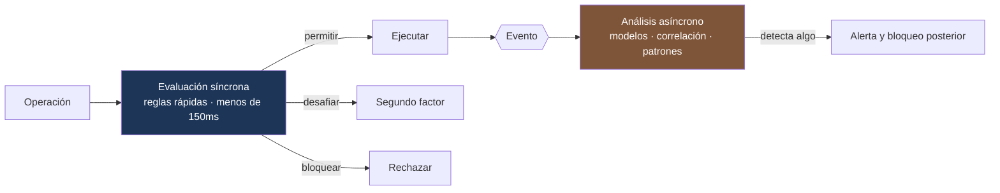

---
tags:
  - Java
  - Banca
  - Seguridad
Creado: 2026-09-08
Relacionado:
  - Banca y Fintech
  - 04 - Cuentas Saldos y Movimientos
Palabras clave:
  - antifraude, limites, velocity, scoring, reglas, falsos positivos, AML, KYC, pulverizacion
---

## 🧠 Concepto

Dos controles que se implementan juntos pero responden a preguntas distintas:

| | **Límites** | **Antifraude** |
|---|---|---|
| Pregunta | ¿está permitido? | ¿parece legítimo? |
| Naturaleza | determinista | probabilística |
| Resultado | permite o rechaza | puntaje de riesgo |
| Se explica al cliente | ✅ "excede su límite diario" | ⚠️ con cuidado |

Los límites son reglas duras del producto. El antifraude estima si **quien opera es realmente el titular**.

## 🚧 Límites

### Las dimensiones

| Dimensión | Ejemplo |
|---|---|
| Por operación | máximo S/ 5.000 por transferencia |
| Por día | máximo S/ 15.000 diarios |
| Por mes | máximo S/ 100.000 mensuales |
| Por cantidad | máximo 20 transferencias por día |
| Por canal | la app permite menos que la sucursal |
| Por destino | más alto a cuentas propias que a terceros |
| Por antigüedad | un destinatario nuevo tiene límite reducido |

```sql
CREATE TABLE limite (
    id             UUID PRIMARY KEY,
    ambito         VARCHAR(20)   NOT NULL,   -- PRODUCTO | CLIENTE | CUENTA
    ambito_id      VARCHAR(60),
    tipo           VARCHAR(30)   NOT NULL,   -- POR_OPERACION | DIARIO | MENSUAL | CANTIDAD_DIARIA
    canal          VARCHAR(20),              -- null = todos
    monto          NUMERIC(19,4),
    cantidad       INTEGER,
    moneda         VARCHAR(3),
    vigente_desde  TIMESTAMPTZ   NOT NULL,
    vigente_hasta  TIMESTAMPTZ
);

-- Consumo acumulado, para no recalcular sobre el ledger completo
CREATE TABLE consumo_limite (
    cuenta_id      UUID          NOT NULL,
    fecha          DATE          NOT NULL,
    canal          VARCHAR(20)   NOT NULL,
    monto_usado    NUMERIC(19,4) NOT NULL DEFAULT 0,
    cantidad_usada INTEGER       NOT NULL DEFAULT 0,
    PRIMARY KEY (cuenta_id, fecha, canal)
);
```

### La evaluación

```java
@Service
public class PoliticaDeLimites {

    @Transactional
    public void verificarYConsumir(Cuenta cuenta, Dinero importe, Canal canal) {

        List<Limite> aplicables = repo.vigentesPara(cuenta, canal);

        // El más restrictivo gana: producto, cliente y cuenta se acumulan
        for (Limite limite : aplicables) {
            switch (limite.tipo()) {
                case POR_OPERACION -> verificarPorOperacion(limite, importe);
                case DIARIO        -> verificarAcumulado(limite, cuenta, importe, canal, hoy());
                case MENSUAL       -> verificarAcumulado(limite, cuenta, importe, canal, mes());
                case CANTIDAD_DIARIA -> verificarCantidad(limite, cuenta, canal);
            }
        }

        consumoRepo.acumular(cuenta.id(), hoy(), canal, importe);   // en la MISMA transacción
    }
}
```

> [!danger] Verificar y consumir tienen que ser atómicos
> Si consultás el consumo, validás y después acumulás en operaciones separadas, dos transferencias simultáneas pasan las dos aunque juntas excedan el límite. Es la misma condición de carrera del saldo en [[06 - Transferencias y Consistencia]], y se resuelve igual: misma transacción y bloqueo sobre la fila de consumo.

```sql
-- Acumulación atómica: el UPDATE hace la verificación
UPDATE consumo_limite
SET monto_usado = monto_usado + :importe,
    cantidad_usada = cantidad_usada + 1
WHERE cuenta_id = :cuenta AND fecha = :hoy AND canal = :canal
  AND monto_usado + :importe <= :limiteDiario      -- ← si no cumple, afecta 0 filas
RETURNING monto_usado;
```

> [!warning] El consumo se libera al reversar
> Si una transferencia se reversa, su monto debe descontarse del consumo del día. Si no, el cliente queda con límite consumido por una operación que se deshizo — y es un reclamo justo.

### Comunicarlo bien

```json
{
  "type": "https://corebank/errores/limite-excedido",
  "title": "Límite diario excedido",
  "status": 422,
  "detail": "La operación supera su límite diario de transferencias",
  "limiteDiario": 15000.00,
  "consumidoHoy": 13500.00,
  "disponibleHoy": 1500.00,
  "seRenuevaEn": "2026-09-09T00:00:00-05:00"
}
```

> [!tip] Un límite se explica; un bloqueo antifraude no
> Decir "excede su límite diario, le quedan S/ 1.500" es útil y no ayuda a ningún atacante. Decir "operación bloqueada porque el monto supera 3 veces su promedio histórico" **le enseña al defraudador cómo evadir la regla**. Los mensajes antifraude son deliberadamente genéricos.

## 🕵️ Antifraude

### Reglas de velocidad (velocity)

Detectan patrones anómalos en ventanas de tiempo:

```java
public List<Senal> evaluarVelocidad(Operacion op) {
    var senales = new ArrayList<Senal>();

    if (contarOperaciones(op.cuenta(), Duration.ofMinutes(5)) > 5)
        senales.add(Senal.de("MUCHAS_OPERACIONES_SEGUIDAS", 30));

    if (contarDestinatariosDistintos(op.cuenta(), Duration.ofHours(1)) > 10)
        senales.add(Senal.de("MUCHOS_DESTINOS_DISTINTOS", 40));

    if (contarIntentosFallidos(op.cuenta(), Duration.ofMinutes(10)) > 3)
        senales.add(Senal.de("INTENTOS_FALLIDOS_PREVIOS", 25));

    if (dispositivoNuevo(op) && op.monto().compareTo(UMBRAL_ALTO) > 0)
        senales.add(Senal.de("DISPOSITIVO_NUEVO_MONTO_ALTO", 50));

    if (paisDistintoAlHabitual(op) && !viajeDeclarado(op.cliente()))
        senales.add(Senal.de("GEOGRAFIA_INUSUAL", 45));

    // Imposibilidad física: dos operaciones lejanas en poco tiempo
    if (velocidadGeograficaImposible(op))
        senales.add(Senal.de("VIAJE_IMPOSIBLE", 70));

    return senales;
}
```

### Del puntaje a la decisión

```java
public Decision decidir(Operacion op) {
    int puntaje = evaluarVelocidad(op).stream().mapToInt(Senal::peso).sum()
                + evaluarPerfil(op)
                + evaluarListas(op);

    return switch (nivel(puntaje)) {
        case BAJO   -> Decision.permitir();
        case MEDIO  -> Decision.desafiar(SegundoFactor.OTP);   // fricción, no bloqueo
        case ALTO   -> Decision.revisionManual();
        case CRITICO-> Decision.bloquear();
    };
}
```

| Puntaje | Acción | Efecto en el cliente |
|---|---|---|
| 0-30 | permitir | ninguno |
| 31-60 | pedir segundo factor | fricción leve |
| 61-85 | revisión manual | demora |
| 86+ | bloquear y alertar | rechazo |

> [!tip] Desafiar es mejor que bloquear
> Pedir un segundo factor convierte un falso positivo en una molestia de diez segundos, en vez de una operación rechazada y una llamada al centro de atención. La mayoría de las señales de riesgo medio se resuelven así.

### El costo de equivocarse

|  | Fraude real | Legítima |
|---|---|---|
| **Bloqueada** | ✅ acierto | ❌ **falso positivo** |
| **Permitida** | ❌ **falso negativo** | ✅ acierto |

> [!warning] Los falsos positivos también cuestan dinero
> Un falso negativo cuesta el monto defraudado. Un falso positivo cuesta un cliente frustrado, una llamada al call center y, si se repite, un cliente que se va.
> Un sistema calibrado solo para minimizar fraude bloquea demasiado. El umbral es una decisión de negocio con números de ambos lados, no una decisión técnica.

## ⚡ La restricción de latencia

El antifraude corre **en el camino crítico**: el cliente está esperando.

```java
public Decision evaluarConPresupuesto(Operacion op) {
    try {
        return CompletableFuture
            .supplyAsync(() -> motor.evaluar(op), executor)
            .get(150, TimeUnit.MILLISECONDS);          // presupuesto estricto

    } catch (TimeoutException e) {
        metricas.contar("antifraude.timeout");
        // Política explícita ante indisponibilidad
        return op.monto().compareTo(UMBRAL_SEGURO) < 0
            ? Decision.permitir()                       // fail-open para montos bajos
            : Decision.revisionManual();                // fail-closed para altos
    }
}
```

> [!danger] Definí qué pasa si el motor no responde
> Es una decisión de negocio que hay que tomar **antes** del incidente. *Fail-open* (dejar pasar) mantiene el servicio pero abre una ventana de riesgo; *fail-closed* (rechazar) protege pero rompe la operación de todos los clientes. La política mixta por monto suele ser el equilibrio razonable.

### Arquitectura en dos tiempos



Las reglas rápidas y deterministas van en línea; los modelos pesados y la correlación entre clientes corren sobre los eventos de [[Fase 5 - Eventos y Outbox]], sin bloquear al usuario.

## 🌍 AML — prevención de lavado

Distinto del fraude: acá el titular **es** quien dice ser, pero el origen o destino del dinero es el problema.

| Control | Qué hace |
|---|---|
| **KYC** | verificar identidad al dar de alta |
| **Screening de listas** | contrastar contra sanciones y PEP |
| **Perfil transaccional** | comparar la actividad con lo declarado |
| **Umbrales de reporte** | operaciones sobre cierto monto se informan |
| **Detección de estructuración** | muchas operaciones bajo el umbral, a propósito |

```java
public List<Alerta> evaluarAml(Cliente cliente, Operacion op) {
    var alertas = new ArrayList<Alerta>();

    if (listas.esSancionado(cliente) || listas.esSancionado(op.beneficiario()))
        alertas.add(Alerta.critica("COINCIDENCIA_EN_LISTA"));

    if (cliente.esPep() && op.monto().compareTo(UMBRAL_PEP) > 0)
        alertas.add(Alerta.alta("OPERACION_ALTA_DE_PEP"));

    // Pulverización: fraccionar para quedar bajo el umbral de reporte
    Dinero suma = sumaEnVentana(cliente, Duration.ofDays(7));
    long cantidad = contarEnVentana(cliente, Duration.ofDays(7));
    if (suma.compareTo(UMBRAL_REPORTE) > 0 && cantidad > 10
            && todasBajoElUmbral(cliente, Duration.ofDays(7)))
        alertas.add(Alerta.alta("POSIBLE_ESTRUCTURACION"));

    if (op.monto().compareTo(perfil.montoEsperado(cliente).multiply(FACTOR)) > 0)
        alertas.add(Alerta.media("FUERA_DEL_PERFIL_DECLARADO"));

    return alertas;
}
```

> [!danger] Nunca le digas al cliente que se generó una alerta AML
> En muchas jurisdicciones informar al titular que su operación fue reportada como sospechosa es un delito en sí mismo (*tipping off*). El mensaje al cliente, si lo hay, es genérico. Esto no es una convención de UX: es una obligación legal.

## 🧪 Tests

```java
@Test
void dos_transferencias_simultaneas_no_superan_el_limite_diario() {
    configurarLimiteDiario("10000");
    var r = ejecutarEnParalelo(2, () -> transferir("6000"));
    assertEquals(1, r.exitosas());        // solo una entra
}

@Test
void reversar_una_operacion_libera_el_consumo_del_limite() {
    transferir("5000");
    reversarUltima();
    assertEquals(Dinero.cero(PEN), consumo.deHoy(cuenta));
}

@Test
void el_mensaje_de_limite_indica_cuanto_queda() { ... }

@Test
void el_mensaje_antifraude_no_revela_la_regla() {
    var e = assertThrows(OperacionBloqueadaException.class, () -> transferirSospechosa());
    assertFalse(e.getMessage().toLowerCase().contains("promedio"));
    assertFalse(e.getMessage().toLowerCase().contains("dispositivo"));
}

@Test
void si_el_motor_no_responde_se_aplica_la_politica_definida() {
    when(motor.evaluar(any())).thenAnswer(lento(500));
    assertEquals(PERMITIR, servicio.evaluar(operacionDeMontoBajo()).tipo());
    assertEquals(REVISION_MANUAL, servicio.evaluar(operacionDeMontoAlto()).tipo());
}
```

## ⚠️ Errores Comunes

> [!warning] Los que se pagan de los dos lados
> - **Verificar y consumir el límite en operaciones separadas**: condición de carrera.
> - **No liberar el consumo al reversar**: el cliente pierde límite por una operación deshecha.
> - **Explicar la regla antifraude** en el mensaje de error: le enseñás a evadirla.
> - **Antifraude sin presupuesto de tiempo**: un motor lento tumba todas las transferencias.
> - **No definir el comportamiento ante indisponibilidad** del motor.
> - **Calibrar solo contra fraude**, ignorando el costo de los falsos positivos.
> - **Reglas hardcodeadas**: cambiar un umbral no puede requerir un despliegue.
> - **Avisar al cliente de una alerta AML**: puede ser delito.

## 📌 Notas Rápidas
- Las reglas y umbrales van en base de datos con vigencia, no en código: el área de riesgos necesita ajustarlos sin esperar un release.
- La distinción entre fraude (alguien se hace pasar por el titular) y AML (el titular es real pero el dinero es problemático) es una pregunta habitual de entrevista en banca, y mucha gente las mezcla.
- El "viaje imposible" —dos operaciones presenciales a 3.000 km con una hora de diferencia— es de las señales más confiables y baratas de calcular.
- Se aplica en [[Fase 2 - Transferencias e Idempotencia]] y se analiza de forma asíncrona con los eventos de [[Fase 5 - Eventos y Outbox]].

## 🔗 Relaciones
- **Módulo**: [[Banca y Fintech]]
- **Anterior**: [[12 - Auditoria y Trazabilidad]]
- **Siguiente**: [[14 - Open Banking]]
- **Se conecta con**: [[04 - Cuentas Saldos y Movimientos]], [[07 - Rate Limiting]]

---

## ✍️ Mis apuntes
<!-- Tus dudas, ejemplos propios, cómo lo aplicaste -->

