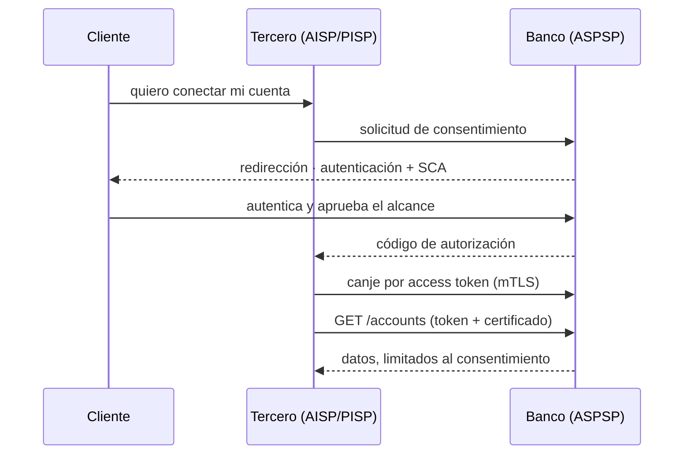

---
tags:
  - Java
  - Banca
  - APIs
Creado: 2026-09-08
Relacionado:
  - Banca y Fintech
  - Spring Security
Palabras clave:
  - Open Banking, PSD2, AISP, PISP, SCA, FAPI, consentimiento, mTLS, OAuth2, webhooks
---

## 🧠 Concepto

**Open Banking** es la idea de que los datos bancarios pertenecen al cliente, no al banco: si el cliente lo consiente, un tercero autorizado puede consultar sus cuentas o iniciar pagos en su nombre, a través de APIs estandarizadas.

Para un backend, esto significa exponer APIs con requisitos de seguridad, consentimiento y disponibilidad mucho más estrictos que los de una API interna.

## 👥 Los roles

| Rol | Qué hace | Ejemplo |
|---|---|---|
| **ASPSP** | el banco que custodia la cuenta y expone las APIs | tu banco |
| **AISP** | consulta información de cuentas | app de finanzas personales |
| **PISP** | inicia pagos en nombre del cliente | pagar sin tarjeta en un e-commerce |
| **CBPII** | consulta disponibilidad de fondos | emisor de tarjeta de terceros |



> [!tip] El banco nunca ve las credenciales del tercero, y el tercero nunca ve las del cliente
> Es el punto entero del diseño: el cliente se autentica **en el banco**, y el tercero recibe un token de alcance limitado. Cualquier esquema donde el tercero pide usuario y contraseña del banco (*screen scraping*) es exactamente lo que Open Banking vino a eliminar.

## 📜 El marco normativo

| Región | Norma | Estado |
|---|---|---|
| Unión Europea | PSD2 (y PSD3 en trámite) | maduro |
| Reino Unido | Open Banking Standard | maduro |
| Brasil | Open Finance Brasil (BCB) | maduro, muy completo |
| México | Ley Fintech | en desarrollo |
| Chile | Ley Fintech (2023) | en implementación |
| Perú | en desarrollo | incipiente |

> [!warning] Cada jurisdicción define su propio perfil
> Los conceptos (consentimiento, SCA, alcances, mTLS) son comunes, pero los endpoints, formatos y certificados cambian. **Siempre hay que leer la especificación local**, no asumir que lo de PSD2 aplica igual.

## 🔐 SCA — autenticación reforzada

PSD2 exige **Strong Customer Authentication**: al menos dos factores de categorías distintas.

| Categoría | Qué es | Ejemplo |
|---|---|---|
| **Conocimiento** | algo que sabés | contraseña, PIN |
| **Posesión** | algo que tenés | teléfono, token, tarjeta |
| **Inherencia** | algo que sos | huella, rostro |

```java
public boolean cumpleSca(List<FactorUsado> factores) {
    long categorias = factores.stream()
        .map(FactorUsado::categoria)
        .distinct()
        .count();
    return categorias >= 2;      // ⚠️ DOS CATEGORÍAS, no dos factores
}
```

> [!danger] Contraseña + pregunta de seguridad no es SCA
> Las dos son conocimiento. Son dos factores de **la misma categoría**, y no cumplen. Es el error de interpretación más común.

### Exenciones

SCA no siempre se exige. Las exenciones típicas:

| Exención | Condición |
|---|---|
| Monto bajo | por debajo de un umbral, con topes acumulados |
| Beneficiario de confianza | el cliente lo agregó a su lista |
| Pago recurrente | mismo monto y beneficiario |
| Análisis de riesgo (TRA) | el proveedor tiene tasas de fraude bajas y evalúa la operación |

```java
public boolean requiereSca(Operacion op, Cliente cliente) {
    if (op.monto().compareTo(UMBRAL_BAJO) < 0
            && acumuladoSinSca(cliente).compareTo(TOPE_ACUMULADO) < 0) return false;
    if (cliente.beneficiariosDeConfianza().contains(op.beneficiario())) return false;
    if (op.esRecurrenteIdentica()) return false;
    return true;
}
```

> [!warning] Las exenciones por monto bajo tienen tope acumulado
> No es "siempre que sea menor a X": es menor a X **y** con un acumulado desde el último SCA por debajo de otro umbral. Implementar solo la primera condición incumple.

## 📝 El consentimiento

El objeto central del modelo. No es un `boolean`: tiene alcance, vigencia, estado y trazabilidad.

```sql
CREATE TABLE consentimiento (
    id             UUID PRIMARY KEY,
    cliente_id     UUID         NOT NULL,
    tercero_id     VARCHAR(60)  NOT NULL,      -- identificador del TPP
    tipo           VARCHAR(20)  NOT NULL,      -- CUENTAS | PAGOS | FONDOS
    alcances       TEXT[]       NOT NULL,      -- ReadAccountsBasic, ReadBalances, ...
    cuentas        UUID[],                     -- qué cuentas exactamente
    estado         VARCHAR(20)  NOT NULL,      -- PENDIENTE | AUTORIZADO | REVOCADO | EXPIRADO
    otorgado_en    TIMESTAMPTZ,
    expira_en      TIMESTAMPTZ  NOT NULL,
    revocado_en    TIMESTAMPTZ,
    revocado_por   VARCHAR(20),                -- CLIENTE | BANCO | TERCERO
    sca_evidencia  JSONB                       -- prueba de la autenticación
);

CREATE INDEX idx_consent_vigente ON consentimiento(cliente_id, tercero_id)
    WHERE estado = 'AUTORIZADO';
```

```java
@Component
public class ValidadorDeConsentimiento {

    public void exigirVigente(String consentimientoId, Alcance alcance, UUID cuenta) {
        Consentimiento c = repo.findById(consentimientoId)
            .orElseThrow(ConsentimientoNoEncontradoException::new);

        if (c.estado() != AUTORIZADO)          throw new ConsentimientoNoAutorizadoException();
        if (c.expiraEn().isBefore(Instant.now())) throw new ConsentimientoExpiradoException();
        if (!c.alcances().contains(alcance))   throw new AlcanceInsuficienteException(alcance);
        if (!c.cuentas().contains(cuenta))     throw new CuentaFueraDelConsentimientoException();
    }
}
```

> [!danger] El consentimiento se valida en **cada** petición
> No basta con haberlo validado al emitir el token: el cliente puede revocarlo en cualquier momento desde su banca, y esa revocación tiene que surtir efecto de inmediato. Un token válido con consentimiento revocado **no da acceso**.

> [!tip] El cliente debe poder revocar desde el banco, no solo desde el tercero
> Es un requisito normativo y de sentido común: si el tercero desaparece o deja de funcionar, el cliente necesita poder cortar el acceso igual.

## 🛡️ FAPI — el perfil de seguridad

Las APIs financieras usan **FAPI** (Financial-grade API), un perfil endurecido de OAuth 2.0 y OpenID Connect publicado por la OpenID Foundation.

| Mecanismo | Qué resuelve |
|---|---|
| **mTLS** | autenticación mutua con certificados |
| **Tokens ligados al emisor** | un token robado no sirve sin el certificado |
| **PAR** (Pushed Authorization Requests) | los parámetros no viajan por el navegador |
| **PKCE** | protege el código de autorización |
| **`private_key_jwt`** | el cliente se autentica firmando, sin secreto compartido |
| **JARM** | respuestas de autorización firmadas |

```yaml
server:
  ssl:
    client-auth: need                      # mTLS obligatorio
    trust-store: classpath:tpp-truststore.p12
    trust-store-password: ${TRUSTSTORE_PASSWORD}
```

```java
@Component
public class FiltroCertificadoTpp extends OncePerRequestFilter {

    @Override
    protected void doFilterInternal(HttpServletRequest req, HttpServletResponse res,
                                    FilterChain chain) throws Exception {

        var certs = (X509Certificate[]) req.getAttribute("jakarta.servlet.request.X509Certificate");
        if (certs == null || certs.length == 0) {
            res.sendError(401, "certificado de cliente requerido");
            return;
        }

        String tppId = extraerIdentificadorDelCertificado(certs[0]);

        // El token debe estar ligado a ESTE certificado
        if (!tokenLigadoA(req, certs[0])) {
            res.sendError(401, "token no corresponde al certificado presentado");
            return;
        }

        // Y el TPP debe seguir autorizado por el regulador
        if (!registroRegulatorio.estaVigente(tppId)) {
            res.sendError(403, "tercero no habilitado");
            return;
        }

        MDC.put("tppId", tppId);
        chain.doFilter(req, res);
    }
}
```

> [!warning] La habilitación del tercero se consulta contra el registro del regulador
> Un TPP puede perder su licencia. Cachear esa validación indefinidamente significa seguir dando acceso a alguien que ya no está autorizado. Se consulta periódicamente y se cachea con TTL corto.

En Europa los certificados son **eIDAS**: QWAC para el canal TLS y QSEAL para firmar mensajes. Otras jurisdicciones usan sus propias autoridades certificadoras.

## 🌐 Diseño de la API

```
GET  /open-banking/v1/accounts
GET  /open-banking/v1/accounts/{id}/balances
GET  /open-banking/v1/accounts/{id}/transactions?fromDate=&toDate=&page=
POST /open-banking/v1/payment-consents
POST /open-banking/v1/payments
GET  /open-banking/v1/payments/{id}
```

| Cabecera | Uso |
|---|---|
| `Authorization: Bearer` | token con alcance |
| `x-fapi-interaction-id` | correlación punta a punta |
| `x-fapi-auth-date` | cuándo se autenticó el cliente |
| `x-fapi-customer-ip-address` | IP real del cliente |
| `x-idempotency-key` | en pagos, obligatoria |

> [!tip] Devolvé siempre el `x-fapi-interaction-id` en la respuesta
> Es el identificador que el tercero usa para rastrear la petición cuando reclama. Sin él, diagnosticar un problema entre dos organizaciones distintas es imposible.

### Cuotas y disponibilidad

```java
@Bean
public KeyResolver resolutorPorTpp() {
    return exchange -> Mono.just(exchange.getRequest()
        .getHeaders().getFirst("x-tpp-id"));      // cuota por tercero, no global
}
```

> [!warning] La normativa suele exigir niveles de servicio
> Open Banking no es "publicamos una API y listo": hay obligaciones de disponibilidad, tiempo de respuesta y reporte de métricas al regulador. Un endpoint lento no es solo mala experiencia: puede ser un incumplimiento.

Y las cuotas se aplican **por tercero**: si un TPP hace un uso abusivo, no puede degradar el servicio de los demás.

## 🔔 Notificaciones

En vez de que el tercero consulte en bucle, el banco notifica:

```java
public void notificarCambioDeEstado(Pago pago) {
    var evento = new EventoWebhook(pago.id(), pago.estado(), Instant.now());

    // Firma para que el receptor pueda verificar el origen
    String firma = firmar(evento, clavePrivadaDelBanco);

    webhookClient.enviar(tercero.urlWebhook(), evento,
        Map.of("x-signature", firma,
               "x-signature-algorithm", "RS256"));
}
```

> [!danger] Firmá los webhooks
> El receptor debe poder verificar que la notificación viene del banco y no de un atacante que descubrió la URL. Sin firma, cualquiera puede enviar un "pago completado" falso.

## 🧪 Tests

```java
@Test
void un_token_valido_con_consentimiento_revocado_no_da_acceso() {
    var token = autorizar(consentimiento);
    revocarConsentimiento(consentimiento);
    assertEquals(403, api.conToken(token).get("/accounts").status());
}

@Test
void no_se_puede_leer_una_cuenta_fuera_del_consentimiento() { ... }

@Test
void password_mas_pregunta_de_seguridad_no_cumple_sca() {
    assertFalse(sca.cumple(List.of(CONTRASENA, PREGUNTA_SECRETA)));
    assertTrue(sca.cumple(List.of(CONTRASENA, OTP_SMS)));
}

@Test
void sin_certificado_de_cliente_la_peticion_es_rechazada() { ... }

@Test
void un_token_presentado_con_otro_certificado_es_rechazado() { ... }

@Test
void la_respuesta_devuelve_el_interaction_id_recibido() { ... }

@Test
void el_consentimiento_expirado_deja_de_dar_acceso_sin_intervencion() { ... }
```

## ⚠️ Errores Comunes

> [!warning] Los que fallan una certificación
> - **Validar el consentimiento solo al emitir el token** y no en cada petición.
> - **Dos factores de la misma categoría** creyendo que es SCA.
> - **Exención por monto bajo sin tope acumulado.**
> - **No permitir revocar desde el banco**, solo desde el tercero.
> - **Cachear indefinidamente** la habilitación del TPP.
> - **Tokens no ligados al certificado**: un token robado funciona desde cualquier lado.
> - **Webhooks sin firma.**
> - **Rate limiting global** en vez de por tercero.
> - **Devolver más datos de los que el alcance permite** "porque ya los teníamos a mano".

## 📌 Notas Rápidas
- Open Banking convierte al banco en proveedor de APIs para terceros que no controla: los requisitos de versionado, documentación, disponibilidad y compatibilidad hacia atrás son mucho más estrictos que en una API interna. Una ruptura de contrato afecta a decenas de empresas.
- Open Finance Brasil es probablemente la implementación más completa de la región y su documentación pública es una buena referencia para entender el modelo entero.
- FAPI no es solo para Open Banking: es un buen perfil de seguridad para cualquier API que maneje datos sensibles. Conocerlo se transfiere.
- El principio de minimización —devolver solo lo que el alcance autoriza— parece obvio y es de los que más se incumplen por comodidad.

## 🔗 Relaciones
- **Módulo**: [[Banca y Fintech]] — última nota del módulo
- **Anterior**: [[13 - Antifraude y Limites]]
- **Se conecta con**: [[03 - OAuth2 y OpenID Connect]], [[08 - ISO 20022 y SWIFT]], [[04 - Diseno de APIs Senior]]

---

## ✍️ Mis apuntes
<!-- Tus dudas, ejemplos propios, cómo lo aplicaste -->

