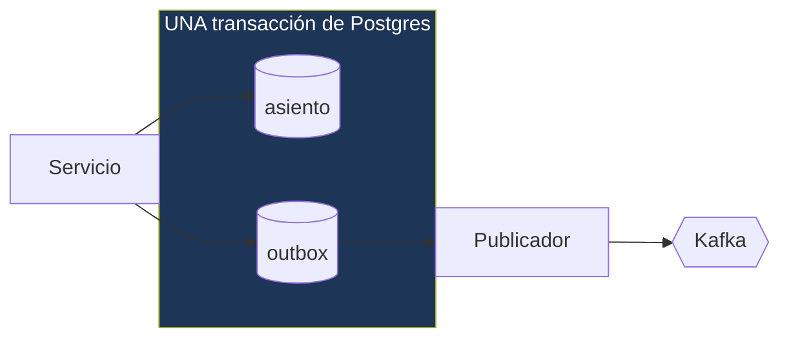

---
tags:
  - Java
  - Distribuido
  - Patrones
Creado: 2026-09-08
Relacionado:
  - Sistemas Distribuidos
  - 04 - Garantias de Entrega
Palabras clave:
  - outbox, dual-write, CDC, Debezium, inbox, SKIP LOCKED, polling publisher, atomicidad
---

## 🧠 El problema: dual-write

```java
@Transactional
public void transferir(ComandoTransferir cmd) {
    libro.registrar(asiento);                                  // 1 · Postgres
    kafka.send("movimientos", new MovimientoRegistrado(...));  // 2 · Kafka
}
```

Parece atómico porque está dentro de `@Transactional`. **No lo es.** Postgres y Kafka son sistemas distintos con transacciones distintas, y `@Transactional` solo cubre el primero.

Falla de las dos formas posibles:

```
Caso A · Kafka falla, la transacción commitea
  ✅ asiento guardado
  ❌ evento no publicado
  → el dinero se movió y nadie se enteró

Caso B · Kafka acepta, la transacción hace rollback
  ❌ asiento no guardado
  ✅ evento publicado
  → se notificó una transferencia que NUNCA ocurrió
```

> [!danger] No se arregla cambiando el orden
> Publicar primero y guardar después produce el caso B. Guardar primero y publicar después produce el caso A. **No hay orden que funcione**, porque el problema no es el orden: es que no hay atomicidad entre dos sistemas.

### ¿Y las transacciones distribuidas (2PC/XA)?

Existen, y casi nadie las usa:

| Problema | Detalle |
|---|---|
| Bloqueo | los recursos quedan tomados durante todo el protocolo |
| Coordinador único | si cae en el momento equivocado, las transacciones quedan "en duda" |
| Soporte | Kafka no implementa XA |
| Rendimiento | dos rondas de red por transacción |

> [!warning] `@TransactionalEventListener(AFTER_COMMIT)` tampoco alcanza
> Es mejor que el dual-write ingenuo —publica solo si el commit tuvo éxito— pero si el proceso muere entre el commit y el envío, el evento **se pierde para siempre** y nada queda registrado de que faltaba. Reduce la ventana, no la elimina.

## 📤 La solución: Outbox

La idea es eliminar el segundo sistema del camino crítico: **escribir el evento en la misma base y la misma transacción** que el dato. Un proceso aparte lo publica después.



Si la transacción commitea, están los dos. Si hace rollback, no está ninguno. **Atomicidad real, con un solo sistema transaccional.**

### La tabla

```sql
CREATE TABLE outbox (
    id             UUID PRIMARY KEY,
    agregado_tipo  VARCHAR(40)  NOT NULL,
    agregado_id    VARCHAR(60)  NOT NULL,     -- clave de partición
    tipo_evento    VARCHAR(60)  NOT NULL,
    payload        JSONB        NOT NULL,
    cabeceras      JSONB,                     -- traceId, versión, etc.
    creado_en      TIMESTAMPTZ  NOT NULL DEFAULT now(),
    publicado_en   TIMESTAMPTZ,
    intentos       SMALLINT     NOT NULL DEFAULT 0,
    ultimo_error   TEXT
);

-- Índice PARCIAL: solo lo pendiente, que es un conjunto chico
CREATE INDEX idx_outbox_pendientes ON outbox(creado_en)
    WHERE publicado_en IS NULL;
```

> [!tip] El índice parcial importa mucho
> La tabla acumula millones de filas publicadas, pero las pendientes son decenas. Un índice sobre toda la tabla sería enorme e inútil; el parcial solo indexa lo que el publicador consulta, y se mantiene diminuto.

### Escribir

```java
@Transactional
public ResultadoTransferencia ejecutar(ComandoTransferir cmd) {
    Asiento asiento = Asiento.de("TRANSFERENCIA", apunteOrigen, apunteDestino);
    libro.registrar(asiento);

    outbox.encolar(EventoOutbox.de(
        "ASIENTO",
        asiento.id().toString(),                 // clave de partición
        "MovimientoRegistrado",
        new MovimientoRegistrado(asiento.id(), origen, destino, monto, moneda, ahora, 1),
        Map.of("traceId", MDC.get("traceId"))));

    return ResultadoTransferencia.de(asiento);
}
```

## 📮 Publicar

### Opción A — Polling publisher

```java
@Component
public class PublicadorOutbox {

    @Scheduled(fixedDelay = 500)
    @Transactional
    public void publicarPendientes() {
        List<EventoOutbox> lote = repo.tomarPendientes(100);

        for (EventoOutbox evento : lote) {
            try {
                kafka.send(topicoDe(evento), evento.agregadoId(), evento.payload())
                     .get(5, TimeUnit.SECONDS);
                repo.marcarPublicado(evento.id());
            } catch (Exception e) {
                repo.registrarFallo(evento.id(), e.getMessage());
                break;      // ⚠️ cortar el lote preserva el orden
            }
        }
    }
}
```

```sql
SELECT * FROM outbox
WHERE publicado_en IS NULL
ORDER BY creado_en
LIMIT :n
FOR UPDATE SKIP LOCKED;
```

> [!tip] `FOR UPDATE SKIP LOCKED` es lo que permite escalar
> Sin él, dos instancias del publicador leen las mismas filas y publican duplicados. Con él, cada una toma un lote distinto y **salta** las filas que otra ya bloqueó — sin esperar y sin coordinación externa. Es la forma más simple de tener un publicador con N réplicas.

> [!warning] Si un evento falla, cortá el lote
> Continuar con los siguientes publica eventos posteriores antes que uno anterior de la misma cuenta, y rompe el orden. `break` es lo correcto: se reintenta el mismo evento en la siguiente pasada.

| Ventaja | Desventaja |
|---|---|
| Simple, sin infraestructura extra | latencia = intervalo de polling |
| Fácil de depurar y observar | carga constante sobre la base |
| Control total del comportamiento | hay que operar el scheduler |

### Opción B — CDC con Debezium

En vez de consultar la tabla, se lee el **log de escritura de la base** (el WAL de Postgres) y se publica cada inserción.

```json
{
  "name": "outbox-connector",
  "config": {
    "connector.class": "io.debezium.connector.postgresql.PostgresConnector",
    "plugin.name": "pgoutput",
    "table.include.list": "public.outbox",
    "transforms": "outbox",
    "transforms.outbox.type":
        "io.debezium.transforms.outbox.EventRouter",
    "transforms.outbox.route.by.field": "agregado_tipo",
    "transforms.outbox.table.field.event.key": "agregado_id",
    "transforms.outbox.table.field.event.payload": "payload"
  }
}
```

| Ventaja | Desventaja |
|---|---|
| Latencia de milisegundos | Kafka Connect + Debezium que operar |
| Cero carga de consulta sobre la base | requiere replicación lógica habilitada |
| No pierde eventos ni con caídas | más piezas que pueden fallar |

> [!tip] Empezá con polling
> El polling cada 500 ms es suficiente para la mayoría de los casos y no agrega infraestructura. Migrá a CDC cuando la latencia o la carga lo justifiquen — no antes.

## 📥 El otro extremo: Inbox

El Outbox garantiza **al menos una vez**. Si Kafka confirma pero el `marcarPublicado` falla, el evento se reenvía. Por eso el consumidor necesita deduplicar:

```sql
CREATE TABLE eventos_procesados (
    evento_id    UUID        NOT NULL,
    consumidor   VARCHAR(60) NOT NULL,
    procesado_en TIMESTAMPTZ NOT NULL DEFAULT now(),
    PRIMARY KEY (evento_id, consumidor)
);
```

Ver [[03 - Idempotencia y Deduplicacion]] para el detalle.

```
Productor          Transporte           Consumidor
Outbox        →    at-least-once   →    Inbox
(no pierde)                             (no duplica)
              = efecto exactamente una vez
```

## 🧹 Mantenimiento

```java
@Scheduled(cron = "0 0 3 * * *")
public void archivar() {
    // No borrar de inmediato: sirven para diagnosticar
    repo.archivarPublicadosAnterioresA(Instant.now().minus(Duration.ofDays(7)));
}
```

### Métricas imprescindibles

| Métrica | Alerta |
|---|---|
| Eventos pendientes | > 1000 sostenido |
| Antigüedad del más viejo | > 5 minutos |
| Eventos con intentos > 5 | cualquiera |
| Latencia de publicación (p95) | según SLA |

> [!danger] "Pendientes creciendo" es la señal de que el publicador murió
> Y es silenciosa: la aplicación sigue respondiendo normal, las transferencias funcionan, nadie nota nada. Lo único que falla es que **nada se está publicando** — y se descubre horas después, cuando alguien pregunta por qué no llegan las notificaciones.

## 🧪 Tests

```java
@Test
void si_la_transaccion_falla_no_queda_evento_en_outbox() {
    assertThrows(SaldoInsuficienteException.class, () -> servicio.ejecutar(comandoImposible));
    assertEquals(0, outboxRepo.count());
}

@Test
void el_evento_y_el_asiento_se_escriben_atomicamente() {
    servicio.ejecutar(comandoValido);
    assertEquals(1, asientoRepo.count());
    assertEquals(1, outboxRepo.count());
}

@Test
void dos_publicadores_concurrentes_no_publican_el_mismo_evento() {
    encolar(100);
    ejecutarEnParalelo(2, () -> publicador.publicarPendientes());
    assertEquals(100, mensajesEnKafka());       // no 200
}

@Test
void si_kafka_esta_caido_los_eventos_quedan_pendientes_y_se_publican_al_volver() {
    kafkaContainer.stop();
    servicio.ejecutar(comando);
    publicador.publicarPendientes();
    assertEquals(1, outboxRepo.contarPendientes());

    kafkaContainer.start();
    publicador.publicarPendientes();
    assertEquals(0, outboxRepo.contarPendientes());
}

@Test
void el_orden_por_agregado_se_preserva_aunque_falle_uno() { ... }
```

## ⚠️ Errores Comunes

> [!warning] Los que anulan el patrón
> - **Publicar dentro de la transacción de negocio**: es el dual-write completo.
> - **`@TransactionalEventListener(AFTER_COMMIT)`** creyendo que resuelve: reduce la ventana, no la cierra.
> - **Publicador sin `SKIP LOCKED`**: duplicados con más de una instancia.
> - **Continuar el lote tras un fallo**: rompe el orden.
> - **Borrar la fila al publicar** en vez de marcarla: se pierde la capacidad de diagnosticar.
> - **Sin índice parcial**: la consulta del publicador se degrada con el tiempo.
> - **Sin métrica de pendientes**: el fallo es silencioso.
> - **Clave de partición aleatoria**: se pierde el orden por agregado.
> - **Consumidor sin Inbox**: el Outbox garantiza at-least-once, no exactly-once.

## 📌 Notas Rápidas
- Outbox es probablemente el patrón más útil de todo este módulo: aparece en cualquier sistema que tenga una base transaccional y un broker, que son casi todos.
- La pregunta de entrevista *"¿cómo garantizás que el evento se publique si la base commitea?"* espera exactamente esta respuesta. Y saber explicar **por qué el dual-write falla** vale más que nombrar el patrón.
- El patrón inverso, **Inbox**, es simétrico y se olvida más seguido. Outbox sin Inbox deja el problema resuelto a medias.
- Se implementa en [[Fase 5 - Eventos y Outbox]].

## 🔗 Relaciones
- **Módulo**: [[Sistemas Distribuidos]]
- **Anterior**: [[04 - Garantias de Entrega]]
- **Siguiente**: [[06 - SAGA]]
- **Se conecta con**: [[03 - Idempotencia y Deduplicacion]], [[02 - Kafka con Spring Boot]]

---

## ✍️ Mis apuntes
<!-- Tus dudas, ejemplos propios, cómo lo aplicaste -->

