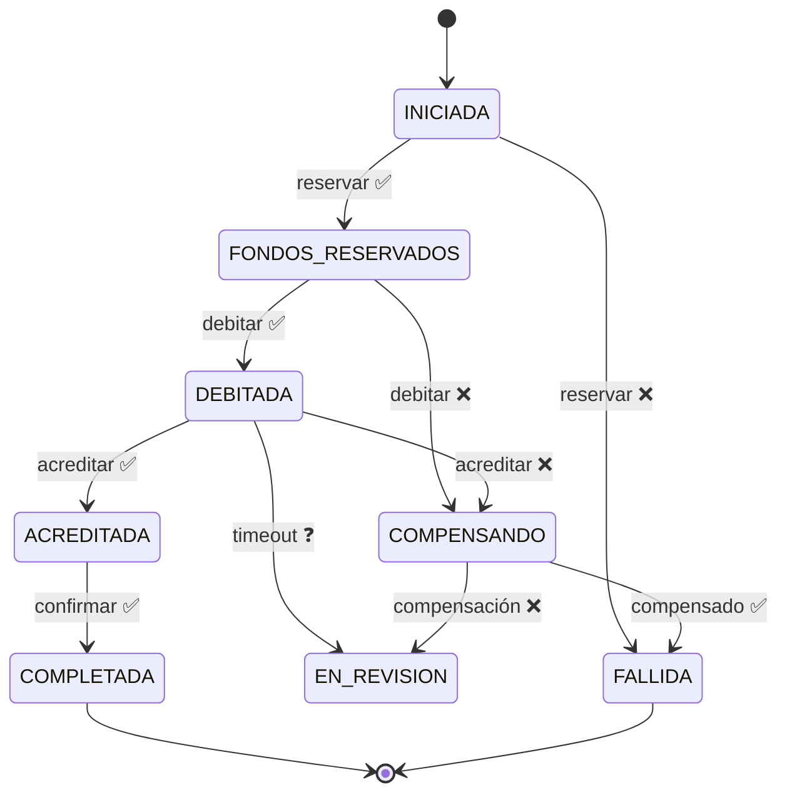

---
tags:
  - Java
  - Distribuido
  - Patrones
Creado: 2026-09-08
Relacionado:
  - Sistemas Distribuidos
  - 07 - Compensacion y Reversas
Palabras clave:
  - SAGA, orquestacion, coreografia, compensacion, ACD, aislamiento, maquina de estados
---

## 🧠 Concepto

Una **SAGA** es una secuencia de transacciones locales donde cada paso publica un resultado y, si algún paso falla, se ejecutan **transacciones compensatorias** que deshacen los pasos ya aplicados.

El concepto es de 1987 (Hector Garcia-Molina y Kenneth Salem), pensado originalmente para transacciones de larga duración en una sola base. Los microservicios lo recuperaron porque enfrentan el mismo problema: **una operación de negocio que abarca varios límites transaccionales**.

## 🎯 El problema

```
Transferencia interbancaria:
  1 · reservar fondos en origen      (base A)
  2 · debitar origen                 (base A)
  3 · acreditar destino              (base B)  ← otra entidad, otra base
  4 · confirmar                      (base A)
```

No hay transacción que abarque A y B. Si el paso 3 falla, los pasos 1 y 2 **ya están aplicados y confirmados**. La única salida es deshacerlos con operaciones inversas.

## ⚖️ ACID vs ACD

Una SAGA sacrifica exactamente una letra:

| Propiedad | Transacción ACID | SAGA |
|---|---|---|
| **A**tomicidad | ✅ real | ⚠️ simulada con compensaciones |
| **C**onsistencia | ✅ | ✅ eventual |
| **I**solation | ✅ | ❌ **no existe** |
| **D**urabilidad | ✅ | ✅ |

> [!danger] La falta de aislamiento es la consecuencia que nadie anticipa
> Durante una SAGA, los estados intermedios **son visibles para todo el mundo**. Otro proceso puede leer el saldo entre el débito y la acreditación, y ver dinero que "no está en ningún lado". O peor: puede modificar un dato que la compensación después intenta deshacer.
>
> Esto no es un detalle teórico: es el origen de la mayoría de los bugs difíciles en sistemas con SAGA.

### Contramedidas para la falta de aislamiento

Garcia-Molina y quienes siguieron el tema catalogaron varias:

| Contramedida | Cómo funciona |
|---|---|
| **Bloqueo semántico** | marcar el registro como "en proceso" para que otros lo respeten |
| **Actualizaciones conmutativas** | diseñar operaciones cuyo orden no importe (sumar y restar) |
| **Vista pesimista** | reordenar los pasos para que lo riesgoso ocurra lo más tarde posible |
| **Relectura de valor** | antes de actualizar, verificar que el dato no cambió |
| **Archivo de versiones** | registrar las operaciones para poder reordenarlas |
| **Por valor** | usar SAGA solo para casos de bajo riesgo; ACID para los críticos |

```java
// Bloqueo semántico: el estado impide que otros operen sobre lo reservado
public enum EstadoFondos { DISPONIBLE, RESERVADO, APLICADO }

public Dinero saldoDisponible(CuentaId cuenta) {
    return saldoContable(cuenta).menos(reservas.totalActivo(cuenta));  // ← lo reservado no se puede usar
}
```

> [!tip] Es la misma retención de [[04 - Cuentas Saldos y Movimientos]]
> Reservar fondos antes de debitarlos es exactamente un bloqueo semántico: hace visible para el resto del sistema que ese dinero está comprometido, aunque el débito todavía no ocurrió.

## 🎭 Orquestación vs coreografía

### Coreografía — cada servicio reacciona a eventos

```
transferencias → publica  TransferenciaIniciada
cuentas        → escucha, debita, publica  FondosDebitados
externos       → escucha, acredita, publica  FondosAcreditados
transferencias → escucha, marca completada
```

```java
@KafkaListener(topics = "transferencias")
public void alIniciarse(TransferenciaIniciada evento) {
    try {
        cuentas.debitar(evento.origen(), evento.monto());
        eventos.publicar(new FondosDebitados(evento.id()));
    } catch (SaldoInsuficienteException e) {
        eventos.publicar(new DebitoRechazado(evento.id(), e.getMessage()));
    }
}
```

### Orquestación — un coordinador dirige

```java
@Service
public class OrquestadorTransferencia {

    public void avanzar(UUID sagaId) {
        SagaTransferencia saga = repo.findById(sagaId).orElseThrow();

        switch (saga.estado()) {
            case INICIADA          -> reservar(saga);
            case FONDOS_RESERVADOS -> debitar(saga);
            case DEBITADA          -> acreditar(saga);
            case ACREDITADA        -> confirmar(saga);
            case COMPENSANDO       -> compensar(saga);
            default -> { }         // estados finales
        }
    }
}
```

### Comparación

| | Orquestación | Coreografía |
|---|---|---|
| El flujo se lee | en un solo archivo | disperso en N servicios |
| Acoplamiento | el orquestador conoce a todos | bajo |
| Depurar | fácil: consultás el estado | difícil: hay que rastrear eventos |
| Auditar | directo | reconstruir desde el log |
| Agregar un paso | tocar el orquestador | tocar dos servicios |
| Riesgo | el orquestador crece como un monolito | ciclos y efectos imprevistos |
| Cantidad de pasos | escala bien | se vuelve incomprensible pasando de 3-4 |

> [!tip] Para dinero: orquestación, sin dudarlo
> Necesitás poder responder "¿en qué paso está esta transferencia?" en cualquier momento, y auditarla después. Con coreografía esa respuesta exige rastrear eventos por varios servicios y reconstruir el estado mentalmente.
> La coreografía es razonable para flujos simples y de bajo riesgo, donde el desacoplamiento vale más que la trazabilidad.

## 🏗️ Implementación

### El estado, persistido

```sql
CREATE TABLE saga_transferencia (
    id                 UUID PRIMARY KEY,
    estado             VARCHAR(30)   NOT NULL,
    paso_actual        VARCHAR(40),
    cuenta_origen      UUID          NOT NULL,
    cuenta_destino     VARCHAR(60)   NOT NULL,
    monto              NUMERIC(19,4) NOT NULL,
    moneda             VARCHAR(3)    NOT NULL,
    reserva_id         UUID,                     -- para compensar
    asiento_debito_id  UUID,                     -- para compensar
    referencia_externa VARCHAR(60),
    intentos           SMALLINT      NOT NULL DEFAULT 0,
    motivo_fallo       TEXT,
    creado_en          TIMESTAMPTZ   NOT NULL DEFAULT now(),
    actualizado_en     TIMESTAMPTZ   NOT NULL DEFAULT now()
);

CREATE INDEX idx_saga_en_curso ON saga_transferencia(estado, actualizado_en)
    WHERE estado NOT IN ('COMPLETADA', 'FALLIDA');
```

> [!danger] El estado se persiste después de **cada** paso
> Si el orquestador muere a mitad de una SAGA, al reiniciar lee el estado y continúa desde donde quedó. Sin esa persistencia, un reinicio deja transferencias colgadas y dinero en el limbo — y no hay forma automática de saber en qué punto estaban.

### La máquina de estados



> [!warning] `EN_REVISION` no es opcional
> Es el estado para cuando el sistema **no puede decidir**: un timeout del que no se sabe el resultado, o una compensación que falló. Sin ese estado, el código se ve forzado a adivinar — y adivinar con dinero termina mal.

### Los pasos

```java
private void acreditar(SagaTransferencia saga) {
    try {
        var resultado = bancoExterno.acreditar(new SolicitudAcreditacion(
            saga.cuentaDestino(), saga.monto(),
            saga.id().toString()));            // ← clave de idempotencia

        saga.acreditada(resultado.referencia());
        repo.save(saga);
        avanzar(saga.id());

    } catch (RechazoDefinitivoException e) {
        saga.pasarACompensando(e.getMessage());
        repo.save(saga);
        compensar(saga);

    } catch (TimeoutException e) {
        // ❌ NO compensar: pudo haber acreditado
        consultarEstadoReal(saga);
    }
}
```

> [!danger] Cada paso debe ser idempotente
> Un paso puede ejecutarse dos veces: por reintento, por reinicio del orquestador, o porque el recuperador lo reanudó. Sin idempotencia en cada llamada, la SAGA duplica efectos — ver [[03 - Idempotencia y Deduplicacion]].

### La compensación

```java
private void compensar(SagaTransferencia saga) {
    // ORDEN INVERSO al de ejecución
    if (saga.asientoDebitoId() != null) {
        cuentas.reversar(saga.asientoDebitoId(), "compensación SAGA " + saga.id());
        saga.debitoCompensado();
    }
    if (saga.reservaId() != null) {
        cuentas.liberarReserva(saga.reservaId());
        saga.reservaLiberada();
    }
    saga.fallida();
    repo.save(saga);
}
```

> [!warning] Se deshace en orden inverso
> Si ejecutaste reservar → debitar, compensás debitar → liberar reserva. Compensar en el mismo orden puede dejar estados inconsistentes: liberarías la reserva mientras el débito sigue aplicado.

### El recuperador

```java
@Scheduled(fixedDelay = 30_000)
public void reanudarAtascadas() {
    repo.enCursoDesdeHace(Duration.ofMinutes(2)).forEach(saga -> {
        if (saga.intentos() >= MAX_INTENTOS) {
            saga.pasarAEnRevision("agotados los reintentos");
            alertas.escalar(saga);              // ← humano
        } else {
            orquestador.avanzar(saga.id());
        }
    });
}
```

> [!danger] Sin recuperador, un fallo transitorio congela la SAGA para siempre
> Y sin tope de reintentos, una SAGA imposible reintenta eternamente consumiendo recursos. Los dos controles son obligatorios, y cuando se agota el tope **alguien tiene que mirarlo**.

## 🚫 Cuándo NO usar SAGA

| Situación | Alternativa |
|---|---|
| Todo ocurre en una base | transacción ACID normal |
| Los pasos no son compensables | rediseñar el flujo |
| Los estados intermedios no son tolerables | no distribuir |
| Menos de 3 pasos y baja criticidad | llamada síncrona con reintento |

> [!warning] Hay operaciones que no se pueden compensar
> Enviar un correo, imprimir un documento, disparar un pago irrevocable, entregar mercadería. Si un paso tiene un efecto que no se puede deshacer, **ponelo al final** — cuando ya no queda nada que pueda fallar después.
> Es la contramedida de "vista pesimista": reordenar para que lo irreversible ocurra último.

## 🧪 Tests

```java
@Test
void si_el_destino_rechaza_el_dinero_vuelve_al_origen() {
    when(bancoExterno.acreditar(any())).thenThrow(new RechazoDefinitivoException("cuenta inexistente"));

    var saga = orquestador.iniciar(comando);

    assertEquals(FALLIDA, repo.findById(saga.id()).get().estado());
    assertEquals(saldoInicial, cuentas.saldo(origen, PEN));    // ← lo que importa
    assertEquals(Dinero.cero(PEN), reservas.totalActivo(origen));
}

@Test
void si_el_orquestador_muere_a_mitad_la_saga_se_reanuda() {
    simularMuerteEn(DEBITADA);
    recuperador.reanudarAtascadas();
    assertEquals(COMPLETADA, repo.findById(sagaId).get().estado());
}

@Test
void reintentar_un_paso_no_duplica_el_efecto() {
    orquestador.avanzar(sagaId);
    orquestador.avanzar(sagaId);
    verify(cuentas, times(1)).debitar(any(), any());
}

@Test
void tras_agotar_reintentos_la_saga_queda_en_revision() {
    when(bancoExterno.acreditar(any())).thenThrow(new TimeoutException());
    IntStream.range(0, 10).forEach(i -> recuperador.reanudarAtascadas());
    assertEquals(EN_REVISION, repo.findById(sagaId).get().estado());
    verify(alertas).escalar(any());
}

@Test
void si_la_compensacion_falla_se_escala_y_no_se_da_por_cerrada() { ... }
```

> [!tip] El test que casi nadie escribe
> `si_la_compensacion_falla_...`. El camino feliz siempre está probado; el de compensación a veces; el de "la compensación también falló" casi nunca — y es el que aparece en producción a las 3 de la mañana.

## ⚠️ Errores Comunes

> [!warning] Los que rompen sagas en producción
> - **No persistir el estado tras cada paso**: un reinicio deja todo colgado.
> - **Compensar en el mismo orden** en vez de inverso.
> - **Pasos no idempotentes**: reintentos que duplican.
> - **Compensar tras un timeout** sin consultar el estado real.
> - **Sin recuperador**: fallos transitorios congelan sagas.
> - **Sin tope de reintentos**: bucles infinitos.
> - **Sin estado `EN_REVISION`**: el sistema se ve obligado a adivinar.
> - **Ignorar la falta de aislamiento**: nadie protege los estados intermedios.
> - **Efectos irreversibles en medio del flujo** en vez de al final.
> - **Coreografía con 8 pasos**: nadie entiende el flujo completo.

## 📌 Notas Rápidas
- SAGA no da atomicidad: da **consistencia eventual con compensación**. Entre el débito y la acreditación hay una ventana en la que el dinero no está en ningún lado, y el negocio tiene que aceptarla explícitamente.
- La falta de aislamiento es la propiedad menos comentada y la que más problemas causa. Mencionarla —y nombrar el bloqueo semántico como contramedida— es lo que distingue una respuesta de senior en una entrevista.
- Antes de implementar una SAGA, preguntate si el problema se resuelve con una transacción local. La respuesta es que sí más seguido de lo que parece — ver [[07 - Modular Monolith]].
- Se implementa en [[Fase 6 - Microservicios y SAGA]].

## 🔗 Relaciones
- **Módulo**: [[Sistemas Distribuidos]]
- **Anterior**: [[05 - Transactional Outbox]]
- **Siguiente**: [[07 - Compensacion y Reversas]]
- **Se conecta con**: [[06 - Transferencias y Consistencia]], [[13 - Command]]

---

## ✍️ Mis apuntes
<!-- Tus dudas, ejemplos propios, cómo lo aplicaste -->

