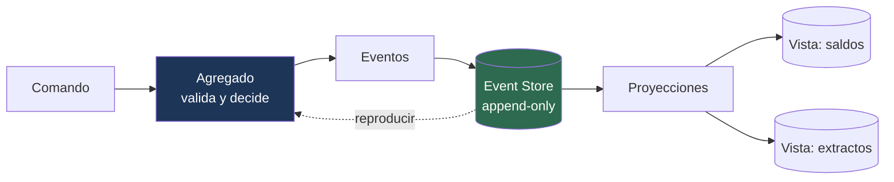

---
tags:
  - Java
  - Distribuido
  - Patrones
Creado: 2026-09-08
Relacionado:
  - Sistemas Distribuidos
  - 03 - Ledger y Partida Doble
Palabras clave:
  - event sourcing, event store, snapshot, proyeccion, replay, upcasting, versionado
---

## 🧠 Concepto

En un modelo tradicional, la base guarda el **estado actual** y cada cambio lo sobrescribe:

```sql
UPDATE cuenta SET saldo = 800 WHERE id = 'ACC-001';
-- el 1000 anterior desapareció para siempre
```

Con **Event Sourcing**, se guardan los **hechos** y el estado se deriva de ellos:

```
CuentaAbierta(ACC-001, PEN)
DineroDepositado(ACC-001, 1000)
DineroRetirado(ACC-001, 200)
─────────────────────────────
estado = reduce(eventos) → saldo 800
```

> [!tip] Ya conocés el patrón
> Es exactamente lo que hace un ledger contable: guardar asientos y derivar el saldo — ver [[03 - Ledger y Partida Doble]]. Event Sourcing es la generalización de esa idea a cualquier dominio.
> La contabilidad lo hace desde hace 500 años porque resuelve el mismo problema: necesitás poder demostrar cómo llegaste al número.

## ✅ Qué se gana

| Beneficio | Por qué |
|---|---|
| **Historia completa** | nada se pierde, todo cambio es un hecho registrado |
| **Auditoría gratis** | el registro de eventos *es* la traza |
| **Estado a cualquier fecha** | reproducís hasta el evento que quieras |
| **Depuración temporal** | podés reconstruir el estado exacto de un bug |
| **Proyecciones nuevas sobre datos viejos** | agregás una vista y la llenás reproduciendo |
| **Integración natural** | los eventos ya existen para publicar |

> [!tip] El beneficio menos obvio y más valioso
> Poder responder preguntas que **nadie había pensado cuando se escribió el sistema**. Si dentro de un año alguien pregunta "¿cuántos clientes retiraron todo su saldo en las 24 h posteriores a un depósito grande?", con Event Sourcing la respuesta está en los datos históricos. Con estado actual, esa información nunca existió.

## ❌ Qué cuesta

| Costo | Detalle |
|---|---|
| Complejidad | mucho mayor que un CRUD |
| Consultas | no podés hacer `WHERE saldo > 1000` sobre eventos |
| Versionado de eventos | son inmutables: evolucionar el esquema es difícil |
| Volumen | crece indefinidamente |
| Curva de aprendizaje | el equipo tiene que entenderlo entero |
| Herramientas | menos maduras que el stack relacional clásico |

> [!danger] Event Sourcing no es un patrón por defecto
> Es una decisión con costo alto que se justifica cuando **la historia es parte del dominio**: finanzas, seguros, salud, logística, cumplimiento normativo. Para un CRUD de productos es sobreingeniería pura.

## 🏗️ Las piezas



### El evento

```java
public sealed interface EventoCuenta
        permits CuentaAbierta, DineroDepositado, DineroRetirado, CuentaBloqueada {

    UUID cuentaId();
    Instant ocurridoEn();
    long version();
}

public record DineroDepositado(
        UUID eventoId,
        UUID cuentaId,
        BigDecimal monto,
        String moneda,
        Instant ocurridoEn,
        long version,
        int esquemaVersion            // ← desde el día uno
) implements EventoCuenta {}
```

> [!warning] Los eventos se nombran en pasado
> `DineroDepositado`, no `DepositarDinero`. Un evento es un hecho que **ya ocurrió** y no se puede rechazar ni deshacer. Un comando es una intención que sí se puede rechazar. Confundirlos lleva a diseños donde alguien intenta "cancelar" un evento.

### El agregado

```java
public class Cuenta {

    private UUID id;
    private Dinero saldo;
    private EstadoCuenta estado;
    private long version;

    private final List<EventoCuenta> pendientes = new ArrayList<>();

    /** Reconstruye el estado reproduciendo el historial */
    public static Cuenta desde(List<EventoCuenta> historial) {
        Cuenta cuenta = new Cuenta();
        historial.forEach(cuenta::aplicar);
        return cuenta;
    }

    /** COMANDO: valida y produce eventos. No muta directamente. */
    public void retirar(Dinero monto) {
        if (estado != ACTIVA)               throw new CuentaNoOperableException(id, estado);
        if (saldo.compareTo(monto) < 0)     throw new SaldoInsuficienteException(id, saldo, monto);

        emitir(new DineroRetirado(UUID.randomUUID(), id, monto.monto(),
                                  monto.moneda().name(), Instant.now(), version + 1, 1));
    }

    /** APLICACIÓN: muta el estado. Nunca valida ni lanza excepciones. */
    private void aplicar(EventoCuenta evento) {
        switch (evento) {
            case CuentaAbierta e     -> { id = e.cuentaId(); saldo = Dinero.cero(...); estado = ACTIVA; }
            case DineroDepositado e  -> saldo = saldo.mas(dineroDe(e));
            case DineroRetirado e    -> saldo = saldo.menos(dineroDe(e));
            case CuentaBloqueada e   -> estado = BLOQUEADA;
        }
        version = evento.version();
    }

    private void emitir(EventoCuenta evento) {
        aplicar(evento);
        pendientes.add(evento);
    }
}
```

> [!danger] `aplicar` nunca valida
> Al reproducir el historial se aplican eventos que **ya ocurrieron**: son hechos, no propuestas. Si `aplicar` lanzara una excepción, no podrías reconstruir el agregado.
> Toda la validación vive en los métodos de comando. Es la separación que más cuesta interiorizar y la que hace que el patrón funcione.

### El Event Store

```sql
CREATE TABLE evento (
    id              UUID PRIMARY KEY,
    stream_id       UUID         NOT NULL,     -- el agregado
    stream_tipo     VARCHAR(40)  NOT NULL,
    version         BIGINT       NOT NULL,
    tipo_evento     VARCHAR(60)  NOT NULL,
    esquema_version SMALLINT     NOT NULL DEFAULT 1,
    payload         JSONB        NOT NULL,
    metadata        JSONB,                     -- traceId, usuario, IP
    ocurrido_en     TIMESTAMPTZ  NOT NULL DEFAULT now(),
    posicion        BIGSERIAL,                 -- orden global

    UNIQUE (stream_id, version)               -- ← control de concurrencia
);

CREATE INDEX idx_evento_stream   ON evento(stream_id, version);
CREATE INDEX idx_evento_posicion ON evento(posicion);

REVOKE UPDATE, DELETE ON evento FROM app;     -- append-only, impuesto por la base
```

> [!tip] `UNIQUE (stream_id, version)` es el bloqueo optimista
> Si dos procesos cargan la cuenta en la versión 5 y ambos intentan escribir la versión 6, **uno falla con violación de unicidad**. No hace falta ningún otro mecanismo de concurrencia: la base es el árbitro.

```java
@Transactional
public void guardar(Cuenta cuenta) {
    try {
        eventoRepo.insertarTodos(cuenta.pendientes());
    } catch (DataIntegrityViolationException e) {
        throw new ConflictoDeConcurrenciaException(cuenta.id(), cuenta.version());
    }
    outbox.encolarTodos(cuenta.pendientes());   // publicación vía [[05 - Transactional Outbox]]
    cuenta.limpiarPendientes();
}
```

## 📸 Snapshots

Reproducir 500.000 eventos para saber un saldo es inviable.

```sql
CREATE TABLE snapshot (
    stream_id  UUID   PRIMARY KEY,
    version    BIGINT NOT NULL,
    estado     JSONB  NOT NULL,
    creado_en  TIMESTAMPTZ NOT NULL DEFAULT now()
);
```

```java
public Cuenta cargar(UUID cuentaId) {
    var snapshot = snapshotRepo.findById(cuentaId);

    Cuenta cuenta = snapshot.map(s -> deserializar(s.estado()))
                            .orElseGet(Cuenta::nueva);

    long desde = snapshot.map(Snapshot::version).orElse(0L);
    eventoRepo.desde(cuentaId, desde).forEach(cuenta::aplicarSinRegistrar);

    return cuenta;
}
```

> [!warning] El snapshot es una optimización, no la verdad
> Se puede borrar entero y regenerar reproduciendo los eventos. Si algún día no coincide, **manda el historial**. Un snapshot que no se puede reconstruir dejó de ser un caché y se convirtió en una segunda fuente de verdad — que es exactamente lo que el patrón buscaba evitar.

## 🔄 Versionado de eventos

El problema práctico más difícil: los eventos son inmutables y viven años, pero el modelo evoluciona.

```java
// v1
record DineroDepositado(UUID cuentaId, BigDecimal monto) {}

// v2: se agrega moneda
record DineroDepositado(UUID cuentaId, BigDecimal monto, String moneda) {}
// ...pero hay 3 millones de eventos v1 sin ese campo
```

### Estrategias

| Estrategia | Cómo | Cuándo |
|---|---|---|
| **Campos opcionales** | agregar con default | cambios aditivos ✅ |
| **Upcasting** | transformar v1 → v2 al leer | cambios estructurales |
| **Versión en el tipo** | `DineroDepositadoV2` | cambios grandes |
| **Migración del store** | reescribir eventos | ⚠️ último recurso |

```java
@Component
public class UpcasterDineroDepositado implements Upcaster {

    @Override
    public JsonNode subir(JsonNode payload, int desde) {
        if (desde == 1) {
            ((ObjectNode) payload).put("moneda", "PEN");   // default histórico
            return subir(payload, 2);
        }
        return payload;
    }
}
```

> [!danger] Reescribir el event store contradice el patrón
> El store es append-only e inmutable: si lo reescribís, perdés la garantía que justificaba usarlo. El upcasting resuelve el problema **en lectura**, sin tocar lo escrito.

> [!tip] Diseñá los eventos pensando en diez años
> Incluí desde el primer evento: identificador propio, versión de esquema, timestamp y metadata de contexto. Agregar esos campos después obliga a hacer upcasting de todo el historial.

## 🚫 Cuándo NO usarlo

| Situación | Por qué no |
|---|---|
| CRUD sin reglas de negocio | complejidad sin beneficio |
| La historia no importa | el costo no se paga |
| Consultas ad-hoc complejas | necesitás proyecciones para todo |
| Equipo sin experiencia | curva pronunciada, errores caros |
| Mucho volumen y poco valor histórico | el store crece sin retorno |

> [!warning] Se puede aplicar a un solo agregado
> No es todo o nada. En `corebank`, el ledger es naturalmente *event-sourced* (los asientos son los eventos) mientras que los datos del cliente son un CRUD normal. **Aplicalo donde la historia es parte del dominio, y no en el resto.**

## 🧪 Tests

```java
@Test
void el_estado_se_reconstruye_desde_el_historial() {
    var cuenta = Cuenta.desde(List.of(
        new CuentaAbierta(id, "PEN", 1),
        new DineroDepositado(id, new BigDecimal("1000"), "PEN", 2),
        new DineroRetirado(id, new BigDecimal("200"), "PEN", 3)));

    assertEquals(Dinero.de("800", PEN), cuenta.saldo());
}

@Test
void aplicar_un_evento_nunca_lanza_excepcion() {
    var cuenta = Cuenta.desde(List.of(abierta(), retiroMayorAlSaldo()));
    assertDoesNotThrow(cuenta::saldo);      // reproducir hechos no valida
}

@Test
void dos_escrituras_concurrentes_sobre_la_misma_version_chocan() {
    var a = repo.cargar(id);
    var b = repo.cargar(id);
    a.retirar(Dinero.de("100", PEN));  repo.guardar(a);
    b.retirar(Dinero.de("100", PEN));
    assertThrows(ConflictoDeConcurrenciaException.class, () -> repo.guardar(b));
}

@Test
void el_snapshot_borrado_se_regenera_identico() {
    var conSnapshot = repo.cargar(id);
    snapshotRepo.borrarTodo();
    assertEquals(conSnapshot.saldo(), repo.cargar(id).saldo());
}

@Test
void un_evento_v1_se_lee_correctamente_tras_agregar_campos() {
    insertarEventoCrudo(payloadV1SinMoneda());
    assertEquals("PEN", repo.cargar(id).moneda());     // upcasting
}

@Test
void el_saldo_a_una_fecha_pasada_es_correcto() { ... }
```

## ⚠️ Errores Comunes

> [!warning] Los que arruinan un event store
> - **Validar dentro de `aplicar`**: rompe la reproducción del historial.
> - **Nombrar eventos en imperativo**: son hechos, van en pasado.
> - **Snapshot que no se puede regenerar**: se volvió fuente de verdad.
> - **Reescribir eventos** para "arreglar" datos: contradice el patrón entero.
> - **Sin versión de esquema** desde el primer evento.
> - **Sin `UNIQUE (stream_id, version)`**: pierde el control de concurrencia.
> - **Eventos gigantes** con todo el estado: son hechos, no fotos.
> - **Aplicarlo a todo el sistema** en vez de a los agregados donde aporta.

## 📌 Notas Rápidas
- Event Sourcing y CQRS suelen ir juntos pero **son independientes**: podés tener CQRS sin eventos, y Event Sourcing sin separar lecturas. Ver [[09 - CQRS Distribuido]].
- Un ledger contable es Event Sourcing con otro nombre. Si ya entendiste [[03 - Ledger y Partida Doble]], entendiste el 80% de este patrón.
- La pregunta útil para decidir: *"¿alguien va a preguntar alguna vez cómo llegamos a este valor?"*. Si la respuesta es sí y es importante, el patrón se paga.
- `EventStoreDB` y `Axon Framework` son las herramientas de referencia en Java, pero una tabla en Postgres alcanza y sobra para empezar — y es más fácil de operar.

## 🔗 Relaciones
- **Módulo**: [[Sistemas Distribuidos]]
- **Anterior**: [[07 - Compensacion y Reversas]]
- **Siguiente**: [[09 - CQRS Distribuido]]
- **Se conecta con**: [[06 - CQRS en Java]], [[03 - Ledger y Partida Doble]], [[09 - Records y Sealed Classes]]

---

## ✍️ Mis apuntes
<!-- Tus dudas, ejemplos propios, cómo lo aplicaste -->

