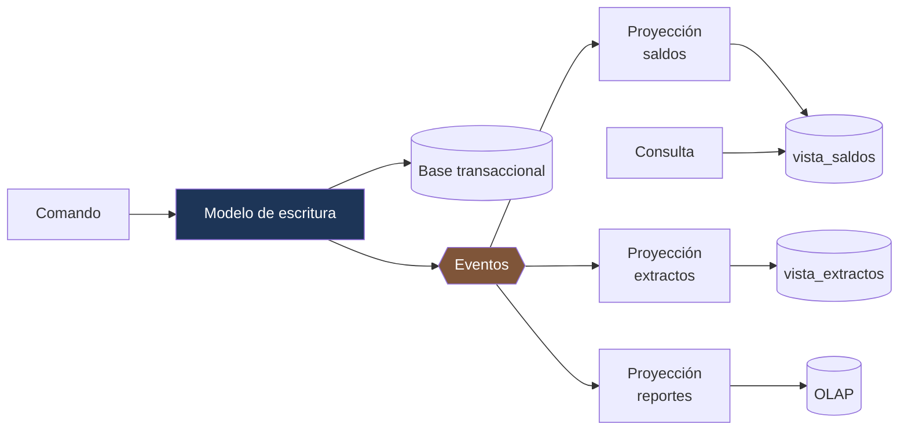

---
tags:
  - Java
  - Distribuido
  - Patrones
Creado: 2026-09-08
Relacionado:
  - Sistemas Distribuidos
  - 08 - Event Sourcing
Palabras clave:
  - CQRS, proyeccion, modelo de lectura, reconstruccion, lag, consistencia eventual
---

## 🧠 Concepto

**CQRS** (Command Query Responsibility Segregation) separa el modelo que **escribe** del modelo que **lee**.

La observación de fondo es simple: los dos tienen requisitos opuestos.

| | Modelo de escritura | Modelo de lectura |
|---|---|---|
| Optimizado para | consistencia e invariantes | velocidad de consulta |
| Forma | normalizado, orientado al dominio | desnormalizado, orientado a la pantalla |
| Volumen | bajo | alto (10-100× más lecturas) |
| Validación | toda | ninguna |

Forzar un solo modelo para ambos termina en el peor compromiso: entidades con relaciones lazy que hay que traer con `JOIN FETCH` para una pantalla, y consultas que arrastran campos que nadie usa.

> [!warning] CQRS y Event Sourcing son independientes
> Se mencionan juntos tan seguido que parecen el mismo patrón. No lo son:
> - CQRS **sin** Event Sourcing: dos modelos sobre la misma base relacional. Muy común y mucho más simple.
> - Event Sourcing **sin** CQRS: posible, aunque incómodo (consultar sobre eventos es difícil).
>
> Empezá por CQRS solo. Agregá Event Sourcing si el dominio lo pide.

## 📶 Los niveles

CQRS no es una decisión binaria: es un espectro, y casi siempre conviene quedarse en los primeros escalones.

| Nivel | Qué separa | Complejidad |
|---|---|---|
| **1** | métodos distintos en el mismo servicio | ninguna |
| **2** | modelos distintos: entidad para escribir, DTO/proyección SQL para leer | baja |
| **3** | tablas distintas en la misma base, actualizadas transaccionalmente | media |
| **4** | bases distintas, sincronizadas por eventos | alta |
| **5** | servicios distintos | muy alta |

```java
// Nivel 2: el 90% de los casos se resuelve acá
public interface CuentaRepository extends JpaRepository<CuentaEntity, UUID> {

    // Escritura: la entidad completa, con sus invariantes
    Optional<CuentaEntity> findById(UUID id);

    // Lectura: proyección directa a un record, sin cargar la entidad
    @Query("""
        SELECT new com.corebank.query.ResumenCuenta(
            c.id, c.numero, c.moneda, COALESCE(SUM(a.monto), 0))
        FROM CuentaEntity c LEFT JOIN ApunteEntity a ON a.cuentaId = c.id
        WHERE c.clienteId = :cliente
        GROUP BY c.id, c.numero, c.moneda
        """)
    List<ResumenCuenta> resumenPorCliente(@Param("cliente") UUID cliente);
}
```

> [!tip] El nivel 2 no tiene desventajas
> No agrega latencia, ni inconsistencia, ni infraestructura. Solo dejás de usar la entidad de dominio como DTO de consulta — que es una buena práctica por sí sola.
> Los niveles 4 y 5 son los que traen consistencia eventual y sus problemas. **No subas de nivel sin un motivo medido.**

## 🔨 Proyecciones

Cuando sí hace falta un modelo de lectura separado, se construye con **proyecciones**: consumidores que escuchan eventos y mantienen una vista.



```java
@Component
public class ProyeccionSaldos {

    @KafkaListener(topics = "movimientos", groupId = "proyeccion-saldos")
    @Transactional
    public void alRecibir(MovimientoRegistrado evento, Acknowledgment ack) {

        // Deduplicación: los eventos llegan al menos una vez
        try {
            procesados.registrar(evento.id(), "proyeccion-saldos");
        } catch (DataIntegrityViolationException e) {
            ack.acknowledge();
            return;
        }

        vista.actualizarSaldo(evento.cuentaId(), evento.monto(), evento.moneda());
        vista.registrarPosicion(evento.posicion());     // ← para reanudar
        ack.acknowledge();
    }
}
```

```sql
CREATE TABLE vista_saldos (
    cuenta_id       UUID PRIMARY KEY,
    numero          VARCHAR(20)   NOT NULL,
    titular_nombre  VARCHAR(120)  NOT NULL,    -- desnormalizado a propósito
    moneda          VARCHAR(3)    NOT NULL,
    saldo           NUMERIC(19,4) NOT NULL,
    ultimo_mov      TIMESTAMPTZ,
    actualizado_en  TIMESTAMPTZ   NOT NULL DEFAULT now(),
    ultima_posicion BIGINT        NOT NULL     -- hasta dónde procesó
);
```

> [!tip] La proyección guarda hasta dónde llegó
> Es lo que permite reanudar tras una caída sin reprocesar todo, y lo que hace medible el lag. Sin ese dato, no sabés si la vista está al día ni desde dónde continuar.

## ⏱️ El lag: el costo real de CQRS

```
t=0    se ejecuta la transferencia y se guarda en el modelo de escritura
t=0.1  se publica el evento
t=0.3  la proyección lo procesa
t=0.3  la vista queda actualizada

Entre t=0 y t=0.3 la vista muestra el saldo ANTERIOR.
```

> [!danger] El usuario que acaba de operar es el único que nota el lag
> Porque es el único que sabe qué escribió. Transfiere, ve la pantalla y su saldo no cambió. Reclama.

### Las mitigaciones

```java
// 1 · Leer del modelo de escritura tras una escritura reciente (read-your-writes)
public ResumenCuenta consultar(UUID cuentaId, UUID usuario) {
    if (escriturasRecientes.tuvo(usuario, Duration.ofSeconds(5))) {
        return consultaDirecta.desdeEscritura(cuentaId);
    }
    return vistaRepo.porId(cuentaId);
}

// 2 · Devolver la posición procesada y que el cliente espere
public RespuestaConVersion consultar(UUID cuentaId, Long posicionMinima) {
    var vista = vistaRepo.porId(cuentaId);
    if (posicionMinima != null && vista.ultimaPosicion() < posicionMinima) {
        throw new VistaDesactualizadaException(vista.ultimaPosicion(), posicionMinima);  // 409
    }
    return RespuestaConVersion.de(vista);
}
```

| Estrategia | Cuándo |
|---|---|
| Leer del modelo de escritura tras escribir | UI de la propia operación |
| Que el comando devuelva el estado resultante | evita la lectura posterior |
| Actualización optimista en el cliente | apps móviles |
| Esperar posición mínima | consistencia crítica |
| Aceptar el lag | dashboards, reportes |

> [!tip] Lo más simple: que el comando devuelva el resultado
> Si `POST /transferencias` devuelve el saldo actualizado, el cliente no necesita consultar después. Elimina el problema en el caso más frecuente, sin infraestructura adicional.

### Medir el lag

```java
@Scheduled(fixedRate = 10_000)
public void medirLag() {
    long posicionEscritura = eventoRepo.ultimaPosicion();
    long posicionVista     = vistaRepo.ultimaPosicion();

    metricas.gauge("cqrs.lag.eventos", posicionEscritura - posicionVista);
    metricas.gauge("cqrs.lag.segundos", segundosDeAtraso());
}
```

> [!danger] Una proyección caída es un fallo silencioso
> La aplicación responde normal, las escrituras funcionan, las consultas devuelven datos. Solo que **los datos se van quedando viejos**, y cada vez más. Sin métrica de lag con alerta, se descubre por un reclamo.

## 🔄 Reconstrucción

La capacidad que justifica buena parte del patrón: **borrar la vista y regenerarla**.

```java
@Service
public class ReconstructorDeProyeccion {

    public void reconstruir(String proyeccion) {
        // 1 · Construir en una tabla nueva, sin tocar la que está sirviendo
        String tablaNueva = crearTablaTemporal(proyeccion);

        // 2 · Reproducir desde el principio
        long posicion = 0;
        while (true) {
            var lote = eventoRepo.desde(posicion, 1000);
            if (lote.isEmpty()) break;
            lote.forEach(e -> aplicarEn(tablaNueva, e));
            posicion = lote.getLast().posicion();
        }

        // 3 · Alcanzar los eventos nuevos y cambiar el nombre
        alcanzarEventosRecientes(tablaNueva);
        intercambiarTablas(proyeccion, tablaNueva);
    }
}
```

> [!tip] Reconstruir sin cortar el servicio
> Se construye en una tabla paralela y se intercambia al final. Los usuarios siguen leyendo la vista vieja hasta que la nueva está lista. Es lo que permite agregar una proyección nueva o corregir un bug de proyección sin ventana de mantenimiento.

Casos en los que se usa:

- Se corrigió un bug en la lógica de proyección.
- Se agrega un campo a la vista.
- Se crea una vista nueva sobre datos históricos.
- La proyección se corrompió.

> [!warning] Reconstruir solo funciona si los eventos siguen ahí
> Es el vínculo con [[08 - Event Sourcing]]: si guardaste eventos, podés reconstruir cualquier vista. Si solo guardaste el estado actual, la reconstrucción es imposible y una proyección corrupta es una pérdida de datos.

## 🎯 Cuándo aplicarlo

| Situación | Nivel recomendado |
|---|---|
| CRUD simple | 1-2 |
| Consultas complejas sobre el modelo transaccional | 2-3 |
| Lecturas 100× las escrituras | 3-4 |
| Vistas muy distintas del modelo de dominio | 4 |
| Consultas analíticas que degradan lo transaccional | 4 |
| Equipos distintos para lectura y escritura | 5 |

> [!danger] El error más caro es empezar en el nivel 4
> Adoptar CQRS distribuido "porque es la arquitectura correcta" mete consistencia eventual, proyecciones, deduplicación y lag en un sistema que se resolvía con una consulta SQL bien escrita.
> **Subí de nivel cuando tengas el dolor medido**, no antes.

## 🧪 Tests

```java
@Test
void la_proyeccion_refleja_el_evento() {
    publicar(new MovimientoRegistrado(cuenta, new BigDecimal("500"), "PEN", 1L));
    esperarQue(() -> vistaRepo.porId(cuenta).saldo().compareTo(new BigDecimal("500")) == 0);
}

@Test
void el_mismo_evento_dos_veces_no_duplica_el_saldo() {
    proyeccion.alRecibir(evento, ack);
    proyeccion.alRecibir(evento, ack);
    assertEquals(new BigDecimal("500.0000"), vistaRepo.porId(cuenta).saldo());
}

@Test
void la_vista_reconstruida_coincide_con_la_original() {
    var original = vistaRepo.todas();
    vistaRepo.borrarTodo();
    reconstructor.reconstruir("saldos");
    assertEquals(original, vistaRepo.todas());
}

@Test
void tras_escribir_el_usuario_lee_su_propio_valor() {
    servicio.transferir(cmd, usuario);
    assertEquals(saldoEsperado, consulta.consultar(cuenta, usuario).saldo());
}

@Test
void una_proyeccion_caida_se_reanuda_desde_su_posicion() {
    proyeccion.detener();
    publicar(10);
    proyeccion.iniciar();
    esperarQue(() -> vistaRepo.ultimaPosicion() == posicionEsperada);
}

@Test
void el_lag_se_expone_como_metrica() { ... }
```

## ⚠️ Errores Comunes

> [!warning] Los que se pagan en producción
> - **Empezar en el nivel 4** sin necesidad medida.
> - **Proyección sin deduplicación**: los eventos llegan al menos una vez y el saldo queda mal.
> - **Sin registrar la posición procesada**: no se puede reanudar ni medir el lag.
> - **Sin métrica de lag**: la proyección muere en silencio.
> - **Vista no reconstruible**: un bug de proyección es una pérdida de datos.
> - **Ignorar read-your-writes**: reclamos garantizados del usuario que acaba de operar.
> - **Validar en el modelo de lectura**: la validación vive en la escritura.
> - **Vistas genéricas** que sirven a diez pantallas: se vuelven tan complejas como el modelo que reemplazaban.

## 📌 Notas Rápidas
- Una proyección se diseña **por pantalla**, no por entidad. Si una vista sirve para muchas cosas distintas, dejó de ser una proyección y volvió a ser un modelo genérico.
- El nivel 2 —proyecciones SQL a records en vez de entidades— es CQRS legítimo, gratis y probablemente lo que necesitás. Decirlo en una entrevista demuestra criterio: el patrón es un espectro, no un salto.
- La capacidad de reconstruir es lo que vuelve seguro el patrón: sabés que cualquier error de proyección es reparable. Si no podés reconstruir, cada bug es permanente.
- Se aplica en [[Fase 5 - Eventos y Outbox]].

## 🔗 Relaciones
- **Módulo**: [[Sistemas Distribuidos]]
- **Anterior**: [[08 - Event Sourcing]]
- **Siguiente**: [[10 - Locks y Bloqueo Optimista]]
- **Se conecta con**: [[06 - CQRS en Java]], [[05 - Transactional Outbox]], [[03 - Idempotencia y Deduplicacion]]

---

## ✍️ Mis apuntes
<!-- Tus dudas, ejemplos propios, cómo lo aplicaste -->

