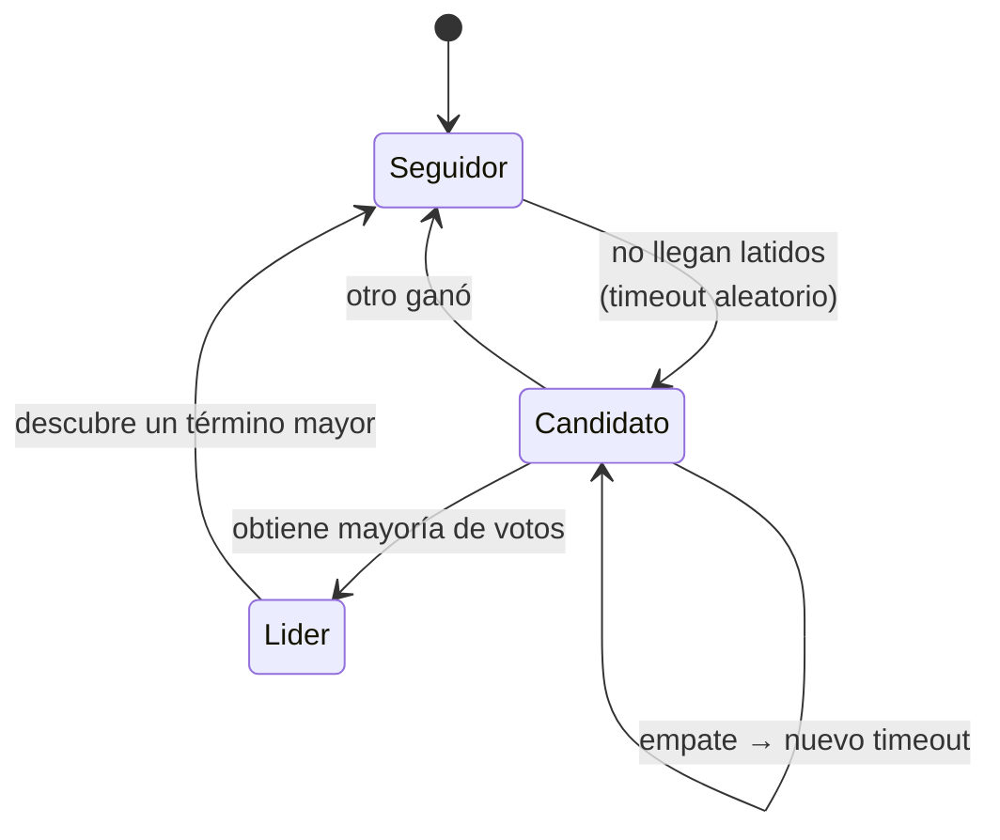

---
tags:
  - Java
  - Distribuido
  - Fundamentos
Creado: 2026-09-08
Relacionado:
  - Sistemas Distribuidos
  - 02 - CAP PACELC y Consistencia
Palabras clave:
  - consenso, Raft, Paxos, quorum, lider, split brain, FLP, etcd, ZooKeeper
---

## 🧠 Concepto

**Consenso** es el problema de lograr que varios nodos se pongan de acuerdo sobre un valor, aunque algunos fallen y la red no sea confiable.

Suena abstracto y está debajo de casi todo lo que usás: quién es el líder de una partición de Kafka, qué nodo de Postgres es el primario, si una configuración cambió, si un bloqueo distribuido está tomado.

> [!tip] Casi nunca vas a implementar consenso
> Vas a **usarlo**: etcd, ZooKeeper, Consul, Kafka. Lo que importa es entender qué garantiza, qué cuesta y qué pasa cuando falla — porque esas propiedades definen el comportamiento de tu sistema en los peores momentos.

## 🚫 El resultado imposible

El **teorema FLP** (Fischer, Lynch, Paterson, 1985) demuestra que en un sistema asíncrono, con al menos un nodo que puede fallar, **no existe algoritmo determinista que garantice consenso**.

El problema es que no se puede distinguir un nodo caído de uno muy lento: en un sistema asíncrono no hay cota de tiempo para un mensaje.

> [!tip] Cómo se sortea en la práctica
> Los algoritmos reales renuncian a la garantía determinista de terminación: usan **timeouts aleatorios** para que la probabilidad de no terminar tienda a cero. Raft elige tiempos de espera al azar entre 150 y 300 ms, y eso hace que dos candidatos empatados casi nunca vuelvan a empatar.
> No es una demostración: es que la probabilidad de fallar es despreciable.

## 🗳️ Quórum

La base de todo: **la mayoría decide**.

```
N nodos → se toleran ⌊(N-1)/2⌋ fallos
mayoría = ⌊N/2⌋ + 1
```

| N | Mayoría | Tolera | Comentario |
|---|---|---|---|
| 1 | 1 | 0 | sin tolerancia |
| 2 | 2 | 0 | ⚠️ **peor que 1**: cualquier caída bloquea |
| **3** | 2 | 1 | mínimo útil |
| **5** | 3 | 2 | producción seria |
| 7 | 4 | 3 | más latencia por escritura |

> [!warning] Los números pares no sirven
> Con 4 nodos la mayoría es 3, así que tolerás 1 fallo — **lo mismo que con 3**, pagando un nodo más y más latencia. Los clústeres de consenso son siempre impares.

> [!danger] Por qué la mayoría evita el cerebro dividido
> Dos grupos no pueden tener mayoría al mismo tiempo: si el clúster de 5 se parte en 3 y 2, solo el grupo de 3 puede operar. El de 2 se queda sin quórum y **se detiene**.
> Ese "detenerse" es exactamente la elección CP de [[02 - CAP PACELC y Consistencia]]: el grupo minoritario prefiere no responder antes que responder algo posiblemente incorrecto.

## ⚙️ Raft

Diseñado en 2014 explícitamente para ser **comprensible** (Paxos es correcto pero notoriamente difícil de entender e implementar bien). Divide el problema en tres piezas.

### 1 · Elección de líder



| Rol | Qué hace |
|---|---|
| **Líder** | recibe todas las escrituras y las replica |
| **Seguidor** | responde al líder, vota |
| **Candidato** | pide votos tras un timeout |

El **término** (*term*) es un contador que se incrementa en cada elección. Funciona como reloj lógico: un mensaje con término menor al actual se descarta.

> [!tip] El término es lo que hace inofensivo a un líder zombi
> Si un líder queda aislado y vuelve, sus mensajes traen un término viejo. Los seguidores los rechazan y él se degrada a seguidor. **No hace falta que sepa que perdió el liderazgo**: el sistema lo rechaza solo.
> Es el mismo mecanismo que un *fencing token* — ver [[10 - Locks y Bloqueo Optimista]].

### 2 · Replicación del log

```
Cliente → Líder: escribir X
  1 · el líder agrega X a su log (sin confirmar)
  2 · lo envía a todos los seguidores
  3 · espera confirmación de la MAYORÍA
  4 · marca X como confirmado y lo aplica
  5 · responde al cliente
  6 · los seguidores lo aplican en la siguiente ronda
```

> [!warning] Confirmado significa "replicado en la mayoría"
> No "escrito en el líder". Un dato que solo está en el líder puede perderse si este cae antes de replicar. Por eso las escrituras con consenso son más lentas: **cada una espera una ronda de red completa hacia la mayoría**.

### 3 · Seguridad

La propiedad clave: **solo puede ser líder un nodo cuyo log contenga todas las entradas confirmadas**. Durante la elección, un nodo vota únicamente por candidatos con un log al menos tan actualizado como el suyo.

Eso garantiza que un dato confirmado nunca se pierde en un cambio de líder.

## 🛠️ Dónde se usa

| Sistema | Algoritmo | Para qué |
|---|---|---|
| **etcd** | Raft | configuración de Kubernetes, bloqueos, elección de líder |
| **Consul** | Raft | descubrimiento de servicios, configuración |
| **ZooKeeper** | ZAB | coordinación (usado por Hadoop, HBase, Kafka clásico) |
| **Kafka (KRaft)** | Raft | metadatos, reemplaza a ZooKeeper |
| **CockroachDB** | Raft | replicación por rango |
| **MongoDB** | derivado de Raft | elección del primario |

### Desde Java

```java
// Elección de líder con etcd: solo un nodo ejecuta el proceso
try (Client cliente = Client.builder().endpoints("http://etcd:2379").build()) {

    long leaseId = cliente.getLeaseClient().grant(10).get().getID();

    // Renovar mientras el nodo esté vivo
    cliente.getLeaseClient().keepAlive(leaseId, observador);

    var eleccion = cliente.getElectionClient();
    eleccion.campaign(bytes("cierre-diario"), leaseId, bytes(nodoId)).get();

    // Solo el líder llega acá
    ejecutarProcesoUnico();
}
```

> [!danger] Ser líder según etcd no garantiza serlo *ahora*
> Entre que etcd te dice "sos el líder" y que hacés la escritura pueden pasar cosas: una pausa de GC, una partición de red, el vencimiento del *lease*. Es el mismo problema de [[10 - Locks y Bloqueo Optimista]].
> Si la corrección depende de que haya un solo escritor, el recurso debe validar un **fencing token**. Para tareas donde el peor caso es trabajo duplicado, el liderazgo alcanza.

## 💰 El costo

| Aspecto | Impacto |
|---|---|
| Latencia de escritura | una ronda de red hasta la mayoría |
| Rendimiento | limitado por el líder: no escala escribiendo |
| Disponibilidad | sin mayoría, el clúster **se detiene** |
| Operación | hay que dimensionar, monitorear y respaldar el clúster |
| Multi-región | el consenso entre continentes cuesta 100+ ms por escritura |

> [!warning] El consenso no escala escrituras
> Todas pasan por el líder. Sumar nodos aumenta la tolerancia a fallos y **empeora** la latencia. Si necesitás más rendimiento de escritura, la respuesta es particionar ([[12 - Particionado y Sharding]]) y tener un grupo de consenso por partición — que es exactamente lo que hacen Kafka y CockroachDB.

## 🎯 Cuándo lo necesitás

| Necesito | ¿Consenso? |
|---|---|
| Un solo nodo ejecuta un job | ⚠️ ShedLock suele alcanzar |
| Configuración consistente en todos los nodos | ✅ etcd/Consul |
| Elegir el primario de una base | ✅ (lo hace la base) |
| Bloqueo con garantía de corrección | ✅ + fencing token |
| Orden total de eventos | ✅ o particionar por clave |
| Descubrimiento de servicios | ⚠️ eventual suele alcanzar |
| Contador distribuido | ❌ usá un tipo convergente o la base |

> [!tip] Casi siempre alcanza con menos
> El consenso es la herramienta más cara del módulo. Antes de traer etcd al sistema, preguntate si el problema se resuelve con una restricción única en la base, con particionado por clave, o aceptando consistencia eventual. Muy seguido sí.

## 🧪 Cómo se prueba

```java
@Test
void con_mayoria_viva_el_cluster_sigue_operando() {
    cluster.detener("nodo-3");                       // 2 de 3 vivos
    assertDoesNotThrow(() -> cliente.escribir("k", "v"));
}

@Test
void sin_mayoria_el_cluster_deja_de_aceptar_escrituras() {
    cluster.detener("nodo-2");
    cluster.detener("nodo-3");                       // 1 de 3
    assertThrows(SinQuorumException.class, () -> cliente.escribir("k", "v"));
    // ✅ CP: prefiere no responder antes que responder mal
}

@Test
void tras_caer_el_lider_se_elige_otro_y_no_se_pierden_datos() {
    cliente.escribir("k", "v");
    cluster.detener(cluster.lider());
    esperarNuevoLider(Duration.ofSeconds(5));
    assertEquals("v", cliente.leer("k"));
}

@Test
void una_particion_no_produce_dos_lideres() {
    cluster.particionar(List.of("nodo-1"), List.of("nodo-2", "nodo-3"));
    assertEquals(1, cluster.lideresActivos());       // el aislado se degrada
}

@Test
void el_lider_aislado_que_vuelve_no_corrompe_el_estado() { ... }
```

Con `Testcontainers` y contenedores de etcd más `Toxiproxy` para las particiones, esto se prueba de verdad.

## ⚠️ Errores Comunes

> [!warning] Los que se pagan en un incidente
> - **Clúster de 2 o 4 nodos**: no mejora la tolerancia y agrega latencia.
> - **Todos los nodos en la misma zona**: la zona cae y se pierde el quórum entero.
> - **Confiar en el liderazgo para corrección** sin fencing token.
> - **Consenso entre regiones lejanas**: 100+ ms por escritura.
> - **Meter datos de aplicación en etcd**: es para metadatos, no para tu base.
> - **No monitorear la salud del quórum**: te enterás cuando ya está detenido.
> - **Usar consenso donde alcanza una restricción única en la base.**

## 📌 Notas Rápidas
- La visualización interactiva en **raft.github.io** explica el algoritmo mejor que cualquier texto: se ven las elecciones, los términos y la replicación en vivo. Vale veinte minutos.
- La frase que resume el módulo: *"la mayoría decide, y el que no tiene mayoría se detiene"*. De ahí salen el quórum impar, la prevención del cerebro dividido y la naturaleza CP de estos sistemas.
- Un clúster de consenso repartido en 3 zonas de disponibilidad tolera la caída de una zona completa. Los tres nodos en la misma zona no toleran nada — es el error de despliegue más común.
- Kafka reemplazó ZooKeeper por KRaft justamente para dejar de depender de un sistema de consenso externo. Es un buen ejemplo de por qué esta pieza importa.

## 🔗 Relaciones
- **Módulo**: [[Sistemas Distribuidos]]
- **Anterior**: [[12 - Particionado y Sharding]]
- **Siguiente**: [[14 - Multiregion y DR]]
- **Se conecta con**: [[02 - CAP PACELC y Consistencia]], [[10 - Locks y Bloqueo Optimista]], [[03 - Service Discovery - Eureka]]

---

## ✍️ Mis apuntes
<!-- Tus dudas, ejemplos propios, cómo lo aplicaste -->

