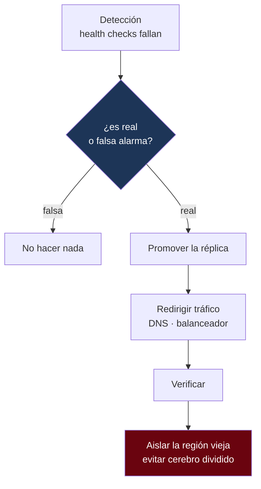

---
tags:
  - Java
  - Distribuido
  - Operacion
Creado: 2026-09-08
Relacionado:
  - Sistemas Distribuidos
  - Cloud para Java
Palabras clave:
  - RPO, RTO, DR, multiregion, activo-pasivo, activo-activo, failover, split brain, caos
---

## 🧠 Concepto

**Alta disponibilidad** es sobrevivir a la caída de un componente. **Recuperación ante desastres** (DR) es sobrevivir a la pérdida de un sitio entero: una región, un datacenter, una nube.

Todo el tema se reduce a dos números que **decide el negocio**, no la ingeniería:

| Métrica | Pregunta | Significa |
|---|---|---|
| **RPO** (Recovery Point Objective) | ¿cuántos datos podemos perder? | ventana de pérdida aceptable |
| **RTO** (Recovery Time Objective) | ¿cuánto podemos estar caídos? | tiempo máximo de recuperación |

```
        ← RPO →              ← RTO →
─────────┬─────────┬───────────────────┬────────
   último backup  DESASTRE        servicio restaurado
```

> [!danger] RPO y RTO no son decisiones técnicas
> Son decisiones de negocio con un costo asociado. RPO de 24 horas se resuelve con un respaldo diario; RPO cero exige replicación síncrona multi-sitio, que puede costar veinte veces más y agregar latencia a **cada** operación.
> Preguntá primero cuánto vale una hora de caída y cuánto vale perder una hora de transacciones. Los números salen solos.

| Nivel | RPO | RTO | Costo relativo |
|---|---|---|---|
| Respaldo diario | 24 h | horas o días | × 1 |
| Respaldo + WAL archivado | minutos | 1-4 h | × 1,5 |
| Réplica asíncrona en espera | segundos | 5-30 min | × 2 |
| Réplica síncrona | **0** | 1-5 min | × 3 |
| Activo-activo | **0** | segundos | × 4-10 |

## 🏗️ Las topologías

### Activo-pasivo

```
Región A (activa)  ──replicación──►  Región B (en espera)
   100% del tráfico                     0%, lista para tomar
```

| Ventaja | Desventaja |
|---|---|
| Simple: un solo escritor | la región pasiva se paga y no produce |
| Sin conflictos de escritura | el failover es un evento riesgoso |
| Failover conceptualmente claro | RTO de minutos |

> [!warning] Una región pasiva que nunca se prueba no existe
> Es el error más caro de DR: se paga la infraestructura durante años y el día del desastre no funciona — certificados vencidos, versiones desactualizadas, permisos faltantes, un servicio que nadie desplegó ahí.
> **Si no probaste el failover en los últimos 6 meses, no tenés DR: tenés una factura.**

### Activo-activo

```
Región A (activa) ◄──replicación bidireccional──► Región B (activa)
   50% del tráfico                                   50%
```

| Ventaja | Desventaja |
|---|---|
| Ambas regiones producen | **conflictos de escritura** |
| Menor latencia por cercanía | mucho más complejo |
| Failover casi instantáneo | la consistencia se vuelve difícil |

> [!danger] Activo-activo con escrituras en ambos lados necesita resolver conflictos
> Si un cliente actualiza su perfil en A y otra sesión lo actualiza en B al mismo tiempo, alguien tiene que decidir cuál gana. Y **no puede ser por timestamp** — ver [[11 - Relojes y Causalidad]].
>
> Las salidas realistas:
> - **Particionar por región**: cada cliente tiene una región "dueña" que acepta sus escrituras. Es lo más común y lo más simple.
> - **Tipos de datos convergentes (CRDT)**: solo aplican a estructuras específicas (contadores, conjuntos).
> - **Resolución de negocio**: alguien define la regla explícitamente.

> [!tip] "Activo-activo" casi siempre significa "activo-activo particionado"
> Las dos regiones sirven tráfico, pero cada dato tiene una única región que lo escribe. Se obtiene la mayor parte del beneficio sin el problema de los conflictos.

## 🔄 Replicación

| Tipo | RPO | Latencia de escritura | Riesgo |
|---|---|---|---|
| **Síncrona** | 0 | + latencia entre regiones | si la réplica no responde, se bloquea la escritura |
| **Asíncrona** | segundos | ninguna | se pierde lo no replicado |
| **Semi-síncrona** | ~0 | + latencia a la réplica más cercana | equilibrio |

```sql
-- Postgres: réplica síncrona local, asíncrona remota
synchronous_standby_names = 'FIRST 1 (replica_local, replica_remota)';
```

> [!danger] Replicación síncrona entre continentes
> Lima ↔ Frankfurt son ~200 ms de ida y vuelta **como piso físico**. Con replicación síncrona, cada escritura paga esos 200 ms. Una transacción con cinco escrituras tarda un segundo.
> Por eso lo habitual es: síncrona dentro de la región (entre zonas), asíncrona entre regiones.

## 🚨 El failover



### El cerebro dividido

> [!danger] El peor escenario de DR
> ```
> La red entre A y B se corta.
> B cree que A murió → se promueve a primario.
> A sigue vivo y recibiendo tráfico.
> Dos primarios aceptando escrituras sobre los mismos datos.
> Cuando la red vuelve: dos historias divergentes, sin forma automática de fusionarlas.
> ```
> En un sistema financiero esto es catastrófico: dos versiones del saldo, ambas "confirmadas".

Las defensas:

| Mecanismo | Cómo funciona |
|---|---|
| **Quórum** | promover requiere mayoría — ver [[13 - Consenso y Raft]] |
| **Testigo en tercera zona** | un nodo árbitro desempata |
| **Fencing / STONITH** | apagar el primario viejo antes de promover |
| **Failover manual** | un humano decide (RTO mayor, riesgo menor) |

> [!warning] El failover automático puede ser peor que el manual
> Un falso positivo —una partición de red transitoria, un health check mal configurado— dispara un failover innecesario y puede provocar exactamente el cerebro dividido que intentaba evitar.
> Para sistemas financieros, muchas entidades eligen **failover manual con procedimiento documentado**: el RTO sube de segundos a minutos, y a cambio nadie promueve una réplica por error.

### El regreso (failback)

Volver a la región original es tan riesgoso como el failover, y se olvida más seguido:

```
1 · Resincronizar la región original desde la actual
2 · Verificar que los datos coincidan
3 · Ventana de escritura mínima o modo de solo lectura
4 · Cambiar el tráfico
5 · Verificar
```

> [!danger] Los datos escritos durante el failover tienen que volver
> Si operaste en B durante seis horas, A está desactualizada en seis horas de transacciones. Volver a A sin resincronizar **pierde todo ese trabajo**. Y como A "estaba bien", el error puede pasar desapercibido días.

## 🌎 Consideraciones adicionales

### Residencia de datos

Muchas normativas exigen que los datos de clientes de un país no salgan de ese país. Eso restringe qué regiones pueden alojar réplicas y puede volver ilegal la topología más conveniente. **Se consulta antes de diseñar, no después.**

### El plano de control también falla

```java
// ❌ Si el servicio de secretos de la región caída no responde, no arrancás
var clave = clienteDeSecretos.obtener("db-password");

// ✅ Réplica del secreto en la región de DR
var clave = clienteDeSecretos.obtenerConFallback("db-password", regionAlternativa);
```

> [!warning] Enumerá todas las dependencias de arranque
> Secretos, certificados, DNS, registro de imágenes, configuración, servicio de identidad. Si alguno vive **solo** en la región caída, la región de DR no arranca — y ese es justo el momento en que lo vas a descubrir.

### DNS y caché

```
TTL de DNS = 300 s → hasta 5 minutos de clientes yendo a la región caída
```

El TTL bajo acelera el failover y aumenta la carga de resolución. Los balanceadores globales (Azure Front Door, AWS Global Accelerator) resuelven esto mejor que el DNS puro, porque redirigen en la capa de red.

## 🧪 Probarlo de verdad

> [!danger] Un plan de DR sin ensayar es una hipótesis
> La única forma de saber si funciona es **ejecutarlo**. En un entorno controlado, con la gente disponible, y midiendo los tiempos reales contra el RTO comprometido.

```java
@Test
@Tag("caos")
void el_sistema_sobrevive_a_la_caida_de_una_zona() {
    caos.detenerZona("zona-a");

    esperarQue(() -> salud.estaSano(), Duration.ofMinutes(2));
    assertTrue(servicio.aceptaEscrituras());
    assertEquals(datosAntes, servicio.leerTodo());        // sin pérdida
}

@Test
@Tag("caos")
void el_failover_cumple_el_RTO_comprometido() {
    var inicio = Instant.now();
    caos.detenerRegion("region-a");
    esperarQue(() -> servicioEn("region-b").aceptaEscrituras());
    assertTrue(Duration.between(inicio, Instant.now()).compareTo(RTO) < 0);
}

@Test
@Tag("caos")
void una_particion_no_produce_dos_primarios() {
    caos.particionar("region-a", "region-b");
    assertEquals(1, cluster.primariosActivos());
}
```

### El ejercicio periódico

| Frecuencia | Ejercicio |
|---|---|
| Mensual | restaurar un respaldo y verificarlo |
| Trimestral | failover en un entorno de preproducción |
| Semestral | failover real, con corte controlado |
| Continuo | ingeniería del caos en producción (cuando el sistema está maduro) |

> [!tip] Empezá por lo más barato y más olvidado
> **Restaurar un respaldo.** Es asombroso cuántas organizaciones tienen respaldos que nunca se probaron y descubren, el día que los necesitan, que están corruptos o incompletos.

## ⚠️ Errores Comunes

> [!warning] Los que se descubren en el peor momento
> - **Respaldos que nunca se restauraron**: pueden estar vacíos y nadie lo sabe.
> - **Región pasiva sin ejercitar**: no arranca el día del desastre.
> - **Failover automático sin quórum**: cerebro dividido.
> - **No planificar el regreso**: se pierden los datos del período de failover.
> - **Dependencias de arranque solo en la región primaria.**
> - **RPO/RTO definidos por ingeniería** sin validación del negocio.
> - **Replicación síncrona entre continentes**: la latencia mata la aplicación.
> - **Activo-activo con escritura libre** sin estrategia de conflictos.
> - **TTL de DNS alto**: el failover tarda aunque todo lo demás funcione.

## 📌 Notas Rápidas
- La pregunta que ordena todo el tema: *"¿cuánto cuesta una hora de caída, y cuánto cuesta perder una hora de datos?"*. Sin esos dos números, cualquier arquitectura de DR es una opinión.
- "Activo-activo" es la topología que más se menciona y menos se implementa de verdad. En la práctica casi siempre es activo-activo **particionado por región**, y está bien que así sea.
- El día que necesitás el DR es el peor día posible para descubrir que algo no estaba configurado. Por eso el valor está en el ejercicio periódico, no en el documento.
- Se relaciona con el despliegue de [[Fase 7 - Observabilidad y Despliegue]] y con las equivalencias de [[14 - Equivalencias Azure AWS]].

## 🔗 Relaciones
- **Módulo**: [[Sistemas Distribuidos]] — última nota del módulo
- **Anterior**: [[13 - Consenso y Raft]]
- **Se conecta con**: [[02 - CAP PACELC y Consistencia]], [[Cloud para Java]], [[08 - Alta Disponibilidad]]

---

## ✍️ Mis apuntes
<!-- Tus dudas, ejemplos propios, cómo lo aplicaste -->

