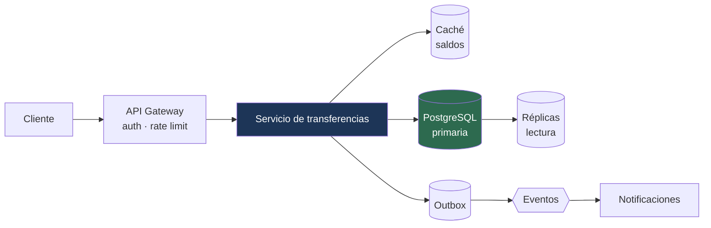

---
tags:
  - Java
  - System Design
  - Entrevistas
Creado: 2026-09-08
Relacionado:
  - System Design
Palabras clave:
  - metodo, entrevista, requisitos, acotar, profundizar, pizarra, 45 minutos
---

## 🧠 Concepto

Una entrevista de diseño **no evalúa si sabés la respuesta correcta**: evalúa cómo pensás cuando el problema es ambiguo y el tiempo es corto.

El entrevistador está mirando cuatro cosas:

| Qué mira | Cómo se ve |
|---|---|
| ¿Acotás antes de resolver? | preguntás en vez de suponer |
| ¿Justificás? | cada decisión trae su porqué y su costo |
| ¿Encontrás el cuello de botella? | lo señalás vos, no él |
| ¿Comunicás? | se entiende lo que estás pensando |

> [!danger] El error que más candidatos elimina
> Empezar a dibujar cajas en el minuto dos. Dibujar antes de acotar significa que estás resolviendo un problema que nadie te pidió — y aunque la solución sea buena, no responde a la pregunta.

## ⏱️ Los 6 pasos, con reloj

Para una entrevista de 45 minutos:

| Paso | Tiempo | Qué hacés |
|---|---|---|
| **1 · Acotar** | 5-8 min | requisitos funcionales y no funcionales |
| **2 · Escala** | 5 min | números: usuarios, RPS, datos |
| **3 · API** | 5 min | los 3-5 endpoints centrales |
| **4 · Datos** | 5-8 min | modelo, motor, clave de partición |
| **5 · Diseño** | 8-10 min | el diagrama de alto nivel |
| **6 · Profundizar** | 10-15 min | el entrevistador elige el punto |

> [!tip] Decí el plan en voz alta al empezar
> *"Voy a empezar acotando requisitos, después estimo la escala, defino la API, el modelo de datos, el diseño general, y dejamos tiempo para profundizar donde te interese."*
> Cuesta veinte segundos y cambia la dinámica entera: demostrás método antes de haber dicho nada técnico, y el entrevistador sabe que vas a llegar a lo que le importa.

## 1️⃣ Acotar

Nunca preguntes "¿qué querés que haga?". Preguntá cosas específicas que **cambien el diseño**.

```
✅ ¿El sistema es solo para clientes propios o también para terceros?
✅ ¿Las transferencias son inmediatas o pueden tardar?
✅ ¿Cuántas monedas? ¿Hay conversión?
✅ ¿Hay que soportar reversas?
✅ ¿Necesitamos historial completo o solo el saldo actual?

❌ ¿Qué tecnologías puedo usar?          (no cambia el diseño)
❌ ¿Cuánto presupuesto hay?              (rara vez relevante acá)
```

### Escribí los requisitos

```
FUNCIONALES (qué hace)
  1. Transferir dinero entre cuentas del mismo banco
  2. Consultar saldo
  3. Ver historial de movimientos

FUERA DE ALCANCE (igual de importante)
  - Transferencias interbancarias
  - Múltiples monedas
  - Préstamos, tarjetas

NO FUNCIONALES (cómo tiene que hacerlo)
  - Consistencia fuerte en el saldo (no se puede gastar dos veces)
  - p99 < 500 ms
  - 99,99% de disponibilidad
  - Trazabilidad completa para auditoría
```

> [!tip] Escribir lo que queda fuera de alcance vale tanto como lo que entra
> Demuestra que reconocés la complejidad y elegís acotar deliberadamente. Y te protege: si después el entrevistador pregunta por eso, ya dijiste que era una extensión, no un olvido.

> [!warning] Los requisitos no funcionales son los que definen la arquitectura
> "Consistencia fuerte en el saldo" descarta la consistencia eventual para esa operación. "p99 < 500 ms" descarta llamadas síncronas en cadena. **Si no los enunciás, cualquier diseño parece válido** — y no podés justificar el tuyo.

## 2️⃣ Escala

Números redondos, en voz alta. El detalle está en [[02 - Estimaciones]].

```
Usuarios activos:        10 millones
Transferencias/día:      2 millones
QPS promedio:            2M / 86.400 ≈ 23/s
QPS pico (×5):           ~120/s
Lecturas vs escrituras:  100:1  → el sistema es de lectura intensiva

Almacenamiento:
  2M movimientos/día × 200 bytes ≈ 400 MB/día ≈ 145 GB/año
  Con 10 años de retención: ~1,5 TB
```

> [!tip] La proporción lectura/escritura decide media arquitectura
> 100:1 significa que las réplicas de lectura y el caché son la palanca principal. 1:1 significa que el problema está en las escrituras y hay que pensar en particionado.
> Es la métrica que más rápido orienta el diseño, y la que muchos candidatos no calculan.

## 3️⃣ API

Antes de la infraestructura, fijá el contrato. Es lo que define qué tiene que soportar el sistema.

```
POST /api/v1/transferencias
  Idempotency-Key: {uuid}
  { origen, destino, monto, moneda }
  → 201 { transferenciaId, estado, saldoResultante }

GET  /api/v1/cuentas/{id}/saldo
  → 200 { saldo, moneda, actualizadoEn }

GET  /api/v1/cuentas/{id}/movimientos?cursor=&limit=50
  → 200 { movimientos[], siguienteCursor }
```

> [!tip] Mencionar `Idempotency-Key` acá suma puntos inmediatos
> Muestra que ya estás pensando en reintentos y duplicados antes de que te lo pregunten. Es una de esas señales que separan a alguien que diseñó sistemas reales de alguien que estudió el tema.

## 4️⃣ Datos

```sql
cuenta (id, cliente_id, moneda, estado)
movimiento (id, cuenta_id, monto, tipo, fecha, referencia)
```

Y las cuatro preguntas que hay que responder en voz alta:

| Pregunta | Ejemplo de respuesta |
|---|---|
| ¿Qué motor y por qué? | PostgreSQL: transacciones e integridad; el dominio es relacional |
| ¿Cómo se consulta? | por cuenta y rango de fechas → índice `(cuenta_id, fecha DESC)` |
| ¿Qué se particiona y por qué clave? | por `cliente_id`, para que las cuentas de un cliente queden juntas |
| ¿Se puede derivar en vez de guardar? | el saldo se deriva de los movimientos ([[03 - Ledger y Partida Doble]]) |

## 5️⃣ El diseño

**Recién acá aparecen las cajas.**



> [!warning] Dibujá de izquierda a derecha y narrá el camino
> Seguí una petición de punta a punta: *"entra por el gateway, que valida el token y aplica cuota; llega al servicio, que toma el bloqueo sobre las dos cuentas..."*.
> Un diagrama sin narración es un dibujo. La narración es lo que se evalúa.

## 6️⃣ Profundizar

El entrevistador elige un punto. Los habituales:

| Pregunta | Qué quiere ver |
|---|---|
| "¿Qué pasa si se cae la base?" | failover, degradación, RPO/RTO |
| "¿Cómo evitás el doble gasto?" | bloqueo ordenado + idempotencia |
| "¿Y si esto crece 100×?" | dónde está el cuello, cómo escala |
| "¿Cómo hacés el despliegue sin corte?" | compatibilidad, migraciones |
| "¿Cómo lo monitoreás?" | métricas de negocio, SLO |
| "¿Qué harías distinto con más tiempo?" | autocrítica y criterio |

> [!tip] Anticipate: señalá vos el cuello de botella
> *"El punto más frágil acá es el bloqueo sobre la cuenta origen: si un cliente corporativo hace mil transferencias por minuto, se serializan todas. Lo resolvería particionando por sub-cuenta o con un modelo de reservas."*
> Decirlo antes de que te lo pregunten cambia el tono de la entrevista: pasás de ser evaluado a estar diseñando con él.

## 🚩 Los cinco modos de fallar

| Fallo | Cómo se ve | Antídoto |
|---|---|---|
| **Saltar a la solución** | cajas en el minuto 2 | acotar primero, siempre |
| **Sobreingeniería** | Kafka y Kubernetes para 100 usuarios | dimensioná según los números |
| **Silencio** | pensás sin hablar | narrá el razonamiento |
| **Sin justificar** | "uso Redis" sin decir por qué | cada decisión trae su porqué |
| **Defender lo indefendible** | ignorás una objeción válida | cambiá de opinión en voz alta |

> [!danger] Cambiar de opinión ante un buen argumento es una señal positiva
> *"Tenés razón, con ese volumen la caché local no alcanza porque cada instancia tendría su copia. Lo cambio a Redis compartido."*
> Los entrevistadores plantean objeciones a propósito. Aferrarse a una decisión mala por no querer "perder" es peor que el error original.

## 🎤 Frases que funcionan

| Situación | Qué decir |
|---|---|
| No sabés algo | *"No lo conozco en profundidad; por lo que sé funciona así — ¿es por ahí?"* |
| Hay varias opciones | *"Veo dos caminos: X optimiza A, Y optimiza B. Con los requisitos que definimos elegiría X porque..."* |
| Te falta un dato | *"Esto depende de si las lecturas toleran datos de hace unos segundos. ¿Podemos asumir que sí?"* |
| Te quedaste sin tiempo | *"Con más tiempo profundizaría en la estrategia de particionado, que es lo que más impacta."* |

> [!warning] "Depende" solo vale si decís de qué
> *"Depende"* a secas no es una respuesta. *"Depende de si toleramos consistencia eventual en la lectura: si sí, uso réplicas; si no, todo va a la primaria y necesito otra estrategia para escalar"* sí lo es.

## ✅ Autoevaluación

Después de practicar un caso, revisá:

- [ ] ¿Escribí requisitos funcionales, no funcionales y fuera de alcance?
- [ ] ¿Estimé con números y dije la proporción lectura/escritura?
- [ ] ¿Definí la API antes de la infraestructura?
- [ ] ¿Justifiqué el motor de base y la clave de partición?
- [ ] ¿Narré el camino de una petición completa?
- [ ] ¿Señalé el cuello de botella antes de que me lo preguntaran?
- [ ] ¿Mencioné el costo de cada decisión, no solo el beneficio?
- [ ] ¿Dije qué haría distinto con más tiempo?

## 📌 Notas Rápidas
- Practicá **con reloj y en voz alta**. Saber el tema y poder explicarlo en 45 minutos son habilidades distintas, y solo la segunda se evalúa.
- El paso 1 es el que más candidatos saltean y el que más peso tiene. Cinco minutos acotando valen más que quince dibujando.
- Si el entrevistador te interrumpe seguido para redirigirte, es señal de que estás profundizando donde a él no le interesa. Preguntá directamente: *"¿preferís que profundice acá o en otra parte?"*.
- Los casos para practicar están en [[System Design]]: [[C1 - Acortador de URLs]] para calentar, [[C5 - Motor de Transferencias]] para tu objetivo.

## 🔗 Relaciones
- **Módulo**: [[System Design]]
- **Siguiente**: [[02 - Estimaciones]]
- **Se conecta con**: [[09 - Tradeoffs]], [[Senior Java Engineer]]

---

## ✍️ Mis apuntes
<!-- Tus dudas, ejemplos propios, cómo lo aplicaste -->

