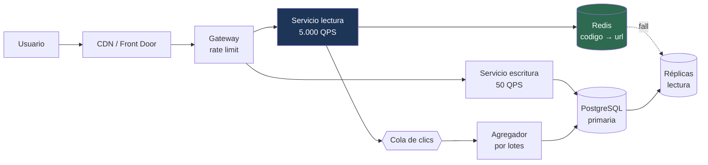

---
tags:
  - Java
  - System Design
  - Caso
Creado: 2026-09-08
Relacionado:
  - System Design
  - 01 - Metodo de Diseno
Palabras clave:
  - acortador, base62, hash, colision, redireccion, lectura intensiva, cache
Nivel: Básico
---

# C1 · Acortador de URLs

> **Enunciado del entrevistador:** *"Diseñá un servicio tipo bit.ly: recibe una URL larga y devuelve una corta. Cuando alguien entra a la corta, lo redirige a la larga."*

Es el caso de calentamiento clásico. Parece trivial y tiene tres decisiones interesantes: cómo generar el código, cómo manejar el desbalance lectura/escritura, y qué código de redirección usar.

## 1️⃣ Acotar

**Preguntas que valen la pena:**

```
¿Los usuarios pueden elegir su alias personalizado?      → sí, opcional
¿Las URLs expiran?                                        → sí, TTL configurable
¿Hace falta analítica de clics?                          → sí, básica
¿Requiere autenticación?                                  → crear sí, redirigir no
¿Alcance geográfico?                                      → global
```

```
FUNCIONALES
  1. Acortar una URL larga → código corto
  2. Redirigir del código a la URL original
  3. Alias personalizado opcional
  4. Expiración configurable
  5. Contador de clics

FUERA DE ALCANCE
  - Edición de URLs ya creadas
  - Analítica avanzada (geografía, dispositivo)
  - Vista previa del destino

NO FUNCIONALES
  - Redirección con p99 < 100 ms  ← el requisito que define el diseño
  - 99,99% de disponibilidad en la redirección
  - Códigos no adivinables secuencialmente
  - Consistencia eventual aceptable en el contador de clics
```

## 2️⃣ Escala

```
Creaciones:   1 M/día    → 1M/100.000 = 10 QPS  → pico ×5 = 50 QPS
Redirecciones: 100 M/día → 1.000 QPS            → pico ×5 = 5.000 QPS

Proporción lectura/escritura = 100:1  ← SISTEMA DE LECTURA INTENSIVA
```

```
ALMACENAMIENTO
  1 M/día × 500 bytes (URL larga + metadatos) = 500 MB/día
  × 365 × 5 años                              = 900 GB
  × 1,5 índices × 3 réplicas                  ≈ 4 TB

ESPACIO DE CÓDIGOS
  Base62 (a-z, A-Z, 0-9), 7 caracteres = 62⁷ ≈ 3,5 billones
  A 1 M/día tardaríamos ~9.500 años en agotarlo ✅
```

> **Conclusiones:**
> - 100:1 → **caché y réplicas de lectura son la palanca principal**.
> - 50 QPS de escritura → una instancia de Postgres sobra; sin sharding.
> - 7 caracteres alcanzan de sobra; con 6 (56 mil millones) también, pero deja menos margen.

## 3️⃣ API

```
POST /api/v1/urls
  { "url": "https://ejemplo.com/muy/larga", "alias": "opcional", "expiraEn": "2027-01-01" }
  → 201 { "codigo": "aB3xK9p", "urlCorta": "https://ac.me/aB3xK9p" }

GET  /{codigo}
  → 302 Location: https://ejemplo.com/muy/larga

GET  /api/v1/urls/{codigo}/estadisticas
  → 200 { "clics": 1420, "creadaEn": "...", "expiraEn": "..." }
```

> [!tip] `302` y no `301`
> `301` (permanente) hace que el navegador cachee la redirección **para siempre**: el segundo clic no llega nunca a tu servidor. Eso es excelente para la latencia y destruye la analítica y la posibilidad de expirar la URL.
> `302` (temporal) mantiene el control. Si el requisito fuera latencia por encima de todo y sin analítica, `301` sería la elección — y decir eso en voz alta es exactamente el tipo de trade-off que se evalúa.

## 4️⃣ Datos

```sql
CREATE TABLE url (
    codigo       VARCHAR(10) PRIMARY KEY,
    url_larga    TEXT        NOT NULL,
    usuario_id   UUID,
    creada_en    TIMESTAMPTZ NOT NULL DEFAULT now(),
    expira_en    TIMESTAMPTZ,
    activa       BOOLEAN     NOT NULL DEFAULT true
);

CREATE INDEX idx_url_usuario ON url(usuario_id, creada_en DESC);
CREATE INDEX idx_url_expira  ON url(expira_en) WHERE expira_en IS NOT NULL;

-- Contador separado: se actualiza muchísimo más que la URL
CREATE TABLE url_clics (
    codigo  VARCHAR(10) PRIMARY KEY REFERENCES url(codigo),
    clics   BIGINT NOT NULL DEFAULT 0
);
```

> [!tip] El contador va en otra tabla
> Si estuviera en `url`, cada clic haría `UPDATE` sobre la fila que todas las redirecciones están leyendo: contención directa entre lecturas y escrituras. Separarlo desacopla los dos accesos.

## 🔑 Generar el código

**Tres estrategias, con sus costos:**

| Estrategia | Cómo | Problema |
|---|---|---|
| **Hash de la URL** | `base62(sha256(url)[0:6])` | colisiones; URLs iguales dan el mismo código |
| **Contador + Base62** | `base62(id_autoincremental)` | **predecible**: se pueden enumerar |
| **Aleatorio** | 7 caracteres al azar | hay que verificar colisión |

```java
// Contador distribuido en bloques + Base62, con ofuscación
@Service
public class GeneradorDeCodigos {

    private static final String ALFABETO =
        "0123456789abcdefghijklmnopqrstuvwxyzABCDEFGHIJKLMNOPQRSTUVWXYZ";

    public String generar() {
        long id = secuencia.siguiente();       // bloques reservados por instancia
        return codificar(mezclar(id));         // mezclar evita que sea secuencial
    }

    private String codificar(long numero) {
        var sb = new StringBuilder();
        while (numero > 0) {
            sb.append(ALFABETO.charAt((int)(numero % 62)));
            numero /= 62;
        }
        return sb.reverse().toString();
    }
}
```

> [!danger] Un contador puro es enumerable
> Si `aB3xK9p` es el id 1000, `aB3xK9q` probablemente es el 1001. Cualquiera puede recorrer todas las URLs del servicio, incluidas las privadas.
> Se resuelve aplicando una permutación reversible (por ejemplo, multiplicar por un número coprimo módulo 62⁷) antes de codificar: sigue siendo único y determinista, pero no consecutivo.

```java
// Alternativa: aleatorio con reintento ante colisión
public String generarAleatorio() {
    for (int intento = 0; intento < 5; intento++) {
        String codigo = aleatorioBase62(7);
        try {
            repo.insertar(codigo, url);        // la restricción UNIQUE decide
            return codigo;
        } catch (DataIntegrityViolationException e) { /* colisión: reintenta */ }
    }
    throw new NoSePudoGenerarException();
}
```

> [!tip] La colisión la detecta la base, no un `SELECT` previo
> Consultar si el código existe y después insertarlo tiene una ventana de carrera. La restricción `UNIQUE` es el árbitro atómico — mismo principio que la idempotencia de [[05 - Idempotencia Financiera]].
> Con 62⁷ códigos y mil millones de URLs, la probabilidad de colisión es minúscula: reintentar es prácticamente gratis.

## 5️⃣ Diseño



**El camino de una redirección:**

```java
@GetMapping("/{codigo}")
public ResponseEntity<Void> redirigir(@PathVariable String codigo) {

    String urlLarga = cache.get(codigo);              // 1 · caché: ~0,5 ms
    if (urlLarga == null) {
        urlLarga = repoReplica.buscar(codigo)         // 2 · réplica
            .filter(u -> !u.expirada())
            .map(Url::urlLarga)
            .orElseThrow(UrlNoEncontradaException::new);
        cache.put(codigo, urlLarga, Duration.ofHours(24));
    }

    colaDeClics.publicar(new ClicRegistrado(codigo, Instant.now()));   // 3 · asíncrono

    return ResponseEntity.status(HttpStatus.FOUND)
        .location(URI.create(urlLarga))
        .build();
}
```

> [!tip] El contador de clics va fuera del camino crítico
> Incrementar en la base en cada redirección son 5.000 escrituras por segundo sobre una tabla — más que toda la carga de creación. Se publica un evento y un agregador suma por lotes cada pocos segundos.
> Es exactamente el consejo de [[06 - Colas y Backpressure]]: **lo que puede esperar, que espere**.

## 6️⃣ Profundizar

### "¿Y si Redis se cae?"

El sistema sigue: cae el caché y las lecturas van a las réplicas. Se degrada la latencia (de ~1 ms a ~10 ms), no la funcionalidad. El caché es una **optimización, no una dependencia** — ver [[04 - Estrategias de Cache]].

Riesgo real: 5.000 QPS golpeando las réplicas de golpe. Mitigación: precalentar el caché al reiniciar y usar un caché local de segundo nivel con TTL corto.

### "¿Cómo manejás una URL viral?"

Una sola clave concentrando el 40% del tráfico es una **clave caliente**. Se resuelve con caché local en cada instancia: la entrada se sirve desde memoria del proceso, sin tocar Redis siquiera.

### "¿Cómo evitás que se use para phishing?"

- Lista de bloqueo de dominios conocidos al crear.
- Verificación contra un servicio de reputación (asíncrona, marcando la URL si es maliciosa).
- Rate limiting por usuario en la creación.
- Página intermedia de advertencia para URLs marcadas.

### "¿Cómo expiran las URLs?"

Dos capas: el TTL del caché y un job que marca `activa = false`. No se borran físicamente de inmediato — un `DELETE` masivo diario es caro. Con particionado por fecha de creación, se sueltan particiones enteras.

### "¿Y si crece 100×?"

```
500.000 QPS de lectura
→ el caché ya absorbe el 95%: 25.000 QPS a la base
→ más réplicas de lectura
→ CDN cacheando las redirecciones más populares en el borde
→ el sharding recién se plantearía por almacenamiento (400 TB), no por QPS
```

La clave de partición sería el propio código: es aleatorio, así que la distribución es uniforme por construcción.

## 🎯 Qué se evalúa

| Señal positiva | Señal negativa |
|---|---|
| Notar que es 100:1 y diseñar para lectura | tratarlo como un CRUD simétrico |
| Discutir `301` vs `302` con sus costos | elegir uno sin mencionar el otro |
| Sacar el contador del camino crítico | `UPDATE` en cada redirección |
| Mencionar la enumerabilidad del contador | usar un autoincremental sin más |
| Detectar colisiones con la base | `SELECT` previo con ventana de carrera |
| Calcular el espacio de códigos | elegir la longitud al azar |

## 🔄 Variantes que puede pedir

| Variante | Qué cambia |
|---|---|
| Alias personalizados | validación, reserva de palabras, restricción de unicidad |
| Analítica por geografía | enriquecer el evento de clic; volumen mucho mayor |
| URLs privadas | autenticación en la redirección |
| Vista previa del destino | consulta al destino, caché, seguridad (SSRF) |
| Multi-región | replicación del caché, códigos únicos globales |

## 📌 Notas Rápidas
- Es el caso más usado para calentar. Practicalo hasta poder resolverlo en 20 minutos, para dejar tiempo a los casos difíciles.
- La discusión `301` vs `302` es el trade-off característico de este problema: latencia contra control. Nombrar los dos lados vale más que elegir bien.
- La enumerabilidad del contador es el detalle que separa una respuesta correcta de una buena. Casi nadie lo menciona.
- El siguiente caso agrega un problema que este no tiene: escritura intensiva y abanico — [[C2 - Feed de Novedades]].

## 🔗 Relaciones
- **Módulo**: [[System Design]]
- **Método**: [[01 - Metodo de Diseno]]
- **Siguiente caso**: [[C2 - Feed de Novedades]]
- **Se conecta con**: [[04 - Estrategias de Cache]], [[03 - APIs a Escala]]

---

## ✍️ Mis apuntes
<!-- Tus dudas, ejemplos propios, cómo lo aplicaste -->

