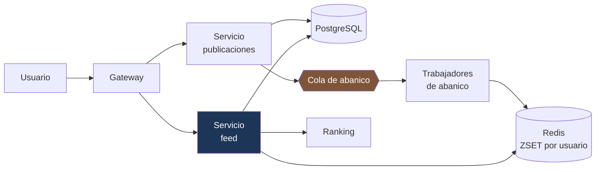

---
tags:
  - Java
  - System Design
  - Caso
Creado: 2026-09-08
Relacionado:
  - System Design
  - C1 - Acortador de URLs
Palabras clave:
  - feed, fan-out, abanico, escritura, lectura, hibrido, celebridad, ranking
Nivel: Intermedio
---

# C2 · Feed de novedades

> **Enunciado:** *"Diseñá el feed de una red social: cada usuario ve las publicaciones de quienes sigue, ordenadas por relevancia."*

El caso clásico de **abanico** (*fan-out*). Su valor está en una sola decisión: si el feed se arma al escribir o al leer. Todo lo demás se deriva de ahí.

## 1️⃣ Acotar

```
¿Orden cronológico o por relevancia?          → relevancia (con señales simples)
¿Cuántos seguidos por usuario?                 → mediana ~200, máximo ~5.000
¿Hay cuentas con millones de seguidores?       → sí ← esto define el diseño
¿El feed debe ser inmediato?                   → unos segundos de retraso es aceptable
¿Contenido multimedia?                          → sí, pero se sirve por CDN
```

```
FUNCIONALES
  1. Publicar contenido
  2. Seguir y dejar de seguir
  3. Ver el feed paginado
  4. Interactuar (me gusta, comentar)

FUERA DE ALCANCE
  - Mensajería directa
  - Historias efímeras
  - Recomendación de cuentas a seguir

NO FUNCIONALES
  - Carga del feed con p99 < 200 ms   ← define el diseño
  - Consistencia eventual aceptable (segundos)
  - Alta disponibilidad en lectura; publicar puede degradarse
```

## 2️⃣ Escala

```
Usuarios activos por día:  50 M
Publicaciones:             10 M/día    → 100 QPS   → pico ×5 = 500 QPS
Lecturas de feed:          500 M/día   → 5.000 QPS → pico ×5 = 25.000 QPS

Proporción lectura/escritura = 50:1
```

```
EL NÚMERO QUE IMPORTA — abanico al escribir:
  10 M publicaciones/día × 200 seguidores promedio = 2.000 M escrituras/día
  = 20.000 escrituras/s en promedio, 100.000 en el pico

  Pero una cuenta con 10 M de seguidores publica una vez
  → 10 M de escrituras por una sola publicación 💥
```

> **Conclusión que decide el diseño:** el abanico al escribir funciona para el usuario promedio y **es inviable para las cuentas grandes**. La respuesta correcta es un modelo híbrido.

## 3️⃣ API

```
POST /api/v1/publicaciones
  { "texto": "...", "media": ["url"] }
  → 201 { "id", "creadaEn" }

GET  /api/v1/feed?cursor=&limit=20
  → 200 { "publicaciones": [...], "siguienteCursor": "..." }

POST /api/v1/usuarios/{id}/seguir     → 204
```

> [!tip] Cursor, no `OFFSET`
> El feed cambia constantemente: con `OFFSET`, cada publicación nueva desplaza los resultados y el usuario ve elementos repetidos al bajar. El cursor es estable — ver [[03 - APIs a Escala]].

## ⚖️ La decisión central

### Opción A — Abanico al escribir (push)

Al publicar, se escribe una entrada en el feed de **cada seguidor**.

```java
public void publicar(Publicacion p) {
    repo.guardar(p);
    List<UUID> seguidores = seguidoresRepo.de(p.autorId());
    seguidores.forEach(s -> feedRepo.insertar(s, p.id(), p.creadaEn()));
}
```

| Ventaja | Desventaja |
|---|---|
| Leer el feed es una consulta simple | escribir es carísimo para cuentas grandes |
| Latencia de lectura mínima | mucho almacenamiento duplicado |
| — | seguir a alguien requiere reconstruir |

### Opción B — Abanico al leer (pull)

El feed se arma en el momento, consultando a quiénes sigue el usuario.

```java
public List<Publicacion> feed(UUID usuarioId, String cursor) {
    List<UUID> seguidos = seguimientoRepo.seguidosDe(usuarioId);
    return publicacionRepo.deAutores(seguidos, cursor, 20);
}
```

| Ventaja | Desventaja |
|---|---|
| Publicar es una sola escritura | leer es caro: consulta sobre N autores |
| Sin duplicación | latencia alta con muchos seguidos |
| Siempre actualizado | 25.000 QPS × consulta compleja |

### Opción C — Híbrido ✅

```java
public void publicar(Publicacion p) {
    repo.guardar(p);

    long seguidores = seguidoresRepo.contar(p.autorId());

    if (seguidores < UMBRAL_CELEBRIDAD) {          // ~10.000
        eventos.publicar(new PublicacionParaAbanico(p.id(), p.autorId()));  // push
    }
    // Si es celebridad: no se hace abanico. Se resuelve al leer.
}
```

```java
public List<Publicacion> feed(UUID usuarioId, String cursor) {
    // 1 · lo precalculado (usuarios normales)
    var precalculado = feedRepo.obtener(usuarioId, cursor, 20);

    // 2 · las celebridades que sigue, en el momento
    var celebridades = seguimientoRepo.celebridadesQueSigue(usuarioId);   // pocas
    var recientes = publicacionRepo.deAutores(celebridades, cursor, 20);

    // 3 · fusionar y ordenar
    return ranking.ordenar(fusionar(precalculado, recientes), usuarioId).subList(0, 20);
}
```

> [!tip] El híbrido es la respuesta esperada
> Push para el 99,9% de los usuarios (barato, porque tienen pocos seguidores) y pull para las celebridades (pocas cuentas, muchos seguidores). Se evita la escritura masiva **y** la lectura cara.
> El umbral se calibra con datos reales: normalmente entre 10.000 y 100.000 seguidores.

## 4️⃣ Datos

```sql
CREATE TABLE publicacion (
    id          UUID PRIMARY KEY,        -- UUID v7: ordenable por tiempo
    autor_id    UUID        NOT NULL,
    texto       TEXT,
    creada_en   TIMESTAMPTZ NOT NULL DEFAULT now()
);
CREATE INDEX idx_publicacion_autor ON publicacion(autor_id, id DESC);

CREATE TABLE seguimiento (
    seguidor_id UUID NOT NULL,
    seguido_id  UUID NOT NULL,
    creado_en   TIMESTAMPTZ NOT NULL DEFAULT now(),
    PRIMARY KEY (seguidor_id, seguido_id)
);
CREATE INDEX idx_seguimiento_inverso ON seguimiento(seguido_id, seguidor_id);
```

**El feed precalculado va en Redis, no en Postgres:**

```
feed:{usuarioId}  →  ZSET  { publicacionId : puntaje }
                     acotado a las últimas 800 entradas
```

```java
redis.opsForZSet().add("feed:" + seguidorId, publicacionId, puntaje);
redis.opsForZSet().removeRange("feed:" + seguidorId, 0, -801);   // poda
```

> [!tip] Acotar el feed a ~800 entradas
> Nadie baja más allá de unos cientos de publicaciones. Guardar el feed completo de cada usuario multiplica el almacenamiento sin beneficio. Si alguien pide más allá del límite, se resuelve con pull.

> [!warning] Usá UUID v7 para las publicaciones
> Un UUID v4 aleatorio fragmenta los índices y no ordena por tiempo. UUID v7 lleva el timestamp adelante: ordena naturalmente y las inserciones van al final del B-tree — ver [[11 - Relojes y Causalidad]].

## 5️⃣ Diseño



**El abanico es asíncrono:**

```java
@KafkaListener(topics = "publicaciones", concurrency = "20")
public void abanico(PublicacionParaAbanico evento, Acknowledgment ack) {

    if (procesados.yaVisto(evento.id(), "abanico")) { ack.acknowledge(); return; }

    // En lotes: 5.000 seguidores por vez
    seguidoresRepo.enLotes(evento.autorId(), 5_000).forEach(lote -> {
        var pipeline = redis.pipelined();
        lote.forEach(s -> pipeline.zAdd("feed:" + s, puntaje, evento.publicacionId()));
        pipeline.sync();
    });

    ack.acknowledge();
}
```

> [!danger] El abanico tiene que ser idempotente
> El consumidor puede reentregarse. `ZADD` sobre un `ZSET` es naturalmente idempotente (agregar el mismo miembro dos veces no lo duplica), lo cual ayuda — pero la marca en la tabla de procesados evita rehacer el trabajo completo.

## 6️⃣ Profundizar

### "¿Cómo ordenás por relevancia?"

```java
public double puntaje(Publicacion p, UUID lector) {
    double antiguedad = horasDesde(p.creadaEn());
    double decaimiento = Math.exp(-antiguedad / 12.0);          // vida media: 12 h

    double interaccion = 1 + Math.log1p(p.meGusta() + 2 * p.comentarios());
    double afinidad = afinidadRepo.entre(lector, p.autorId());   // 0,5 a 2,0

    return decaimiento * interaccion * afinidad;
}
```

El puntaje se calcula al insertar en el `ZSET`. El problema es que **cambia con el tiempo** (el decaimiento) y con las interacciones. Dos salidas: recalcular periódicamente los feeds activos, o guardar el timestamp como puntaje y aplicar el ranking al leer sobre las 200 primeras.

### "¿Qué pasa cuando alguien empieza a seguir a otro?"

El feed precalculado no tiene las publicaciones del nuevo seguido. Opciones:

1. **Backfill asíncrono**: insertar sus publicaciones recientes en el feed. Correcto pero costoso si sigue a muchos de golpe.
2. **Resolver al leer** durante un tiempo, hasta que el abanico natural lo cubra.
3. **No hacer nada**: el feed se completa con las publicaciones nuevas. Es lo que hacen varias redes, y es aceptable.

### "¿Y si un usuario sigue a 5.000 cuentas?"

Con el híbrido no es problema: el feed precalculado ya está armado. El costo estaría en el pull, y solo se hace pull de las celebridades que sigue — que son pocas por definición.

### "¿Cómo evitás que un usuario vea la misma publicación dos veces?"

El `ZSET` deduplica por miembro. Al fusionar precalculado y pull, se deduplica por id de publicación antes de ordenar.

### "¿Y si Redis se cae?"

Aquí sí es una dependencia, no una optimización: sin el feed precalculado no hay feed. Mitigaciones:
- Redis en clúster con réplicas.
- Modo degradado: armar el feed al leer solo con los últimos seguidos (más lento, feed reducido).
- Reconstruible: el feed se puede regenerar desde `publicacion` + `seguimiento`.

> [!tip] Que el feed sea reconstruible es la propiedad clave
> Convierte una pérdida de Redis en una degradación temporal en vez de una pérdida de datos. Es la misma idea que las proyecciones de [[09 - CQRS Distribuido]].

### "¿Y si crece 10×?"

```
100 M publicaciones/día × 200 = 20.000 M escrituras de abanico/día
→ el cuello es el abanico, no la lectura
→ bajar el umbral de celebridad (más cuentas resueltas al leer)
→ particionar Redis por usuario (la clave ya es el usuario ✅)
→ más trabajadores de abanico (escala horizontal)
```

## 🎯 Qué se evalúa

| Señal positiva | Señal negativa |
|---|---|
| Calcular el volumen de abanico y notar el problema | proponer push sin estimar |
| Proponer el híbrido con umbral | elegir push o pull en absoluto |
| Sacar el abanico del camino de publicación | abanico síncrono |
| Acotar el tamaño del feed | guardar el feed completo |
| Mencionar que el feed es reconstruible | tratarlo como fuente de verdad |
| Notar el problema del ranking que cambia con el tiempo | puntaje fijo sin más |

## 🔄 Variantes

| Variante | Qué cambia |
|---|---|
| Solo cronológico | desaparece el ranking; mucho más simple |
| Feed con anuncios | inserción en posiciones fijas, subasta |
| Notificaciones en tiempo real | WebSockets → [[C3 - Chat en Tiempo Real]] |
| Contenido de grupos | el abanico va a miembros, no a seguidores |

## 📌 Notas Rápidas
- La decisión push vs pull vs híbrido **es** el caso. Si llegás al híbrido con el cálculo que lo justifica, ya resolviste lo esencial.
- El umbral de celebridad es un buen ejemplo de decisión que se calibra con datos, no se elige por intuición. Decir "lo mediría" es mejor que inventar un número.
- Este caso comparte estructura con las proyecciones de [[09 - CQRS Distribuido]]: un modelo de lectura precalculado, alimentado por eventos, reconstruible desde la fuente de verdad.

## 🔗 Relaciones
- **Módulo**: [[System Design]]
- **Anterior**: [[C1 - Acortador de URLs]]
- **Siguiente**: [[C3 - Chat en Tiempo Real]]
- **Se conecta con**: [[09 - CQRS Distribuido]], [[04 - Estrategias de Cache]]

---

## ✍️ Mis apuntes
<!-- Tus dudas, ejemplos propios, cómo lo aplicaste -->

