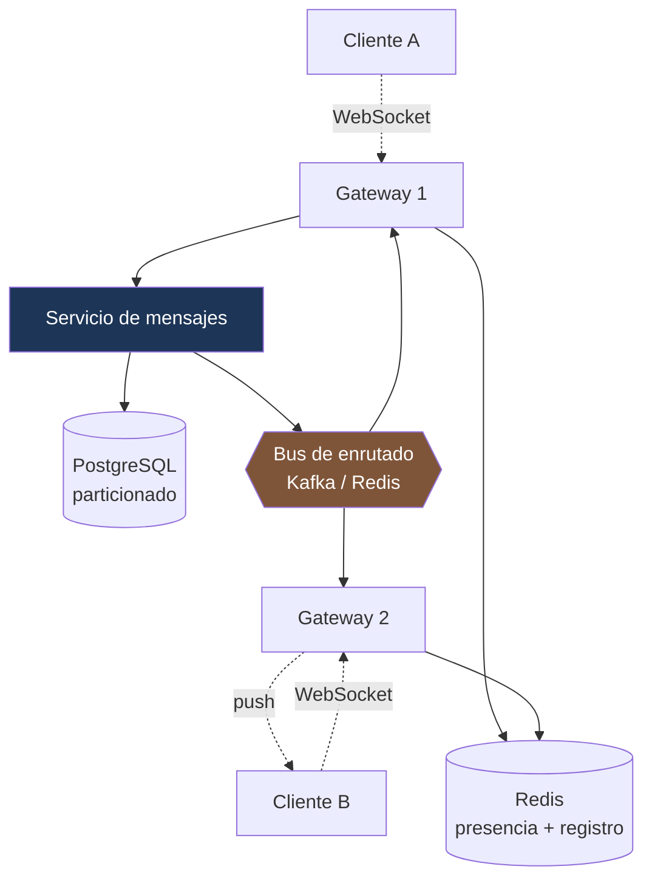

---
tags:
  - Java
  - System Design
  - Caso
Creado: 2026-09-08
Relacionado:
  - System Design
  - C2 - Feed de Novedades
Palabras clave:
  - WebSocket, presencia, orden, entrega, conexiones persistentes, enrutado, offline
Nivel: Intermedio-Avanzado
---

# C3 · Chat en tiempo real

> **Enunciado:** *"Diseñá un sistema de mensajería: conversaciones uno a uno y grupales, con confirmación de entrega y estado de conexión."*

Es el primer caso con **conexiones persistentes**, y eso cambia todo: el servidor deja de ser sin estado. La pregunta difícil no es guardar mensajes, es **encontrar a qué servidor está conectado el destinatario**.

## 1️⃣ Acotar

```
¿Uno a uno, grupos, o los dos?             → los dos; grupos hasta 500
¿Se necesita historial completo?            → sí, permanente
¿Confirmaciones de entrega y lectura?       → sí
¿Estado de conexión (en línea)?             → sí
¿Cifrado de extremo a extremo?              → fuera de alcance (cambiaría el diseño)
¿Multimedia?                                 → sí, por almacenamiento de objetos
```

```
FUNCIONALES
  1. Enviar y recibir mensajes en tiempo real
  2. Conversaciones uno a uno y grupales
  3. Historial persistente y paginado
  4. Confirmación de enviado / entregado / leído
  5. Estado de conexión y "escribiendo..."

FUERA DE ALCANCE
  - Cifrado de extremo a extremo
  - Llamadas de voz y video
  - Mensajes que se autodestruyen

NO FUNCIONALES
  - Latencia de entrega p99 < 200 ms        ← define el diseño
  - Sin pérdida de mensajes                  ← define el diseño
  - Orden consistente dentro de una conversación
  - Entrega diferida si el destinatario está desconectado
```

## 2️⃣ Escala

```
Usuarios conectados simultáneos:  1 M
Mensajes:                          500 M/día → 5.000 QPS → pico ×3 = 15.000 QPS

CONEXIONES — el número que define la infraestructura
  1 M de conexiones WebSocket simultáneas
  ÷ ~50.000 conexiones por instancia
  = 20 instancias de puerta de enlace (mínimo; con holgura, 40)
```

```
ALMACENAMIENTO
  500 M mensajes/día × 300 bytes = 150 GB/día
  × 365 = 55 TB/año  ← crece rápido: hace falta política de retención y archivado
```

> **Conclusiones:**
> - 1 M de conexiones persistentes → el problema es el **enrutado entre servidores**, no el volumen de mensajes.
> - 55 TB/año → particionado por tiempo y archivado a almacenamiento frío.
> - Sin pérdida de mensajes → persistir antes de confirmar al emisor.

## 3️⃣ API

```
WebSocket: wss://chat.ejemplo.com/ws?token={jwt}

→ { "tipo": "mensaje", "conversacionId": "...", "clienteMsgId": "uuid", "texto": "hola" }
← { "tipo": "confirmacion", "clienteMsgId": "uuid", "mensajeId": "...", "secuencia": 4471 }
← { "tipo": "mensaje", "conversacionId": "...", "de": "...", "texto": "...", "secuencia": 4472 }
← { "tipo": "presencia", "usuarioId": "...", "estado": "en_linea" }

REST para lo que no es tiempo real:
GET /api/v1/conversaciones/{id}/mensajes?antesDe={secuencia}&limit=50
GET /api/v1/conversaciones
```

> [!tip] El `clienteMsgId` lo genera el cliente
> Es la clave de idempotencia del chat: si la conexión se corta y el cliente reenvía, el servidor reconoce que es el mismo mensaje y no lo duplica. Mismo principio que [[05 - Idempotencia Financiera]], aplicado a mensajería.

## 4️⃣ Datos

```sql
CREATE TABLE conversacion (
    id          UUID PRIMARY KEY,
    tipo        VARCHAR(10) NOT NULL,       -- DIRECTA | GRUPO
    creada_en   TIMESTAMPTZ NOT NULL DEFAULT now()
);

CREATE TABLE participante (
    conversacion_id UUID NOT NULL,
    usuario_id      UUID NOT NULL,
    ultima_leida    BIGINT NOT NULL DEFAULT 0,
    PRIMARY KEY (conversacion_id, usuario_id)
);
CREATE INDEX idx_participante_usuario ON participante(usuario_id);

CREATE TABLE mensaje (
    conversacion_id UUID   NOT NULL,
    secuencia       BIGINT NOT NULL,        -- ← orden dentro de la conversación
    id              UUID   NOT NULL,
    cliente_msg_id  UUID   NOT NULL,
    autor_id        UUID   NOT NULL,
    texto           TEXT,
    creado_en       TIMESTAMPTZ NOT NULL DEFAULT now(),
    PRIMARY KEY (conversacion_id, secuencia)
) PARTITION BY RANGE (creado_en);

CREATE UNIQUE INDEX idx_mensaje_idempotencia
    ON mensaje(conversacion_id, cliente_msg_id);
```

> [!danger] El orden no se define por timestamp
> Los relojes de los clientes y de los servidores difieren. Si ordenás por `creado_en`, dos mensajes casi simultáneos pueden aparecer invertidos — y en una conversación eso se nota inmediatamente ("¿por qué respondió antes de que preguntara?").
> La solución es un **contador por conversación**: un número secuencial asignado por el servidor. Es un reloj lógico simple, exactamente lo de [[11 - Relojes y Causalidad]].

```java
// La secuencia se asigna atómicamente
@Transactional
public Mensaje guardar(UUID conversacionId, UUID clienteMsgId, String texto, UUID autor) {
    try {
        long secuencia = repo.siguienteSecuencia(conversacionId);   // UPDATE ... RETURNING
        return repo.insertar(conversacionId, secuencia, clienteMsgId, autor, texto);
    } catch (DataIntegrityViolationException e) {
        return repo.buscarPorClienteMsgId(conversacionId, clienteMsgId);   // ya existía
    }
}
```

## 5️⃣ Diseño



### El problema central: ¿dónde está el destinatario?

```
Cliente A está conectado al Gateway 1
Cliente B está conectado al Gateway 7
A le manda un mensaje a B
→ ¿cómo sabe el Gateway 1 que tiene que llegar al Gateway 7?
```

**Solución 1 — Registro de sesiones**

```java
// Al conectarse
redis.setex("sesion:" + usuarioId, TTL, gatewayId);

// Al enviar
String gatewayDestino = redis.get("sesion:" + destinatarioId);
if (gatewayDestino != null) {
    bus.enviarA(gatewayDestino, mensaje);      // dirigido
} else {
    notificaciones.push(destinatarioId, mensaje);   // desconectado
}
```

**Solución 2 — Difusión por tópico** ✅

```java
// Cada gateway se suscribe a un tópico propio
@KafkaListener(topics = "gateway-#{@gatewayId}")
public void alRecibir(MensajeParaEntregar m) {
    sesiones.buscar(m.destinatarioId())
        .ifPresent(sesion -> sesion.enviar(m));
}
```

> [!tip] El registro en Redis + tópico por gateway es el patrón habitual
> Redis dice **a qué gateway** está conectado el usuario; el bus entrega **solo a ese gateway**. Sin el registro habría que difundir a los 40 gateways por cada mensaje: 40× el tráfico interno.
> El registro tiene TTL y se renueva con los latidos de la conexión: si un gateway muere, sus entradas expiran solas.

### El camino de un mensaje

```java
public void alRecibirMensaje(SesionWs sesion, MensajeEntrante entrante) {

    // 1 · Persistir PRIMERO: "sin pérdida de mensajes" es un requisito
    Mensaje mensaje = servicio.guardar(
        entrante.conversacionId(), entrante.clienteMsgId(), entrante.texto(), sesion.usuarioId());

    // 2 · Confirmar al emisor (ya está a salvo)
    sesion.enviar(new Confirmacion(entrante.clienteMsgId(), mensaje.id(), mensaje.secuencia()));

    // 3 · Entregar a los demás participantes (asíncrono)
    participantes.de(entrante.conversacionId()).stream()
        .filter(p -> !p.equals(sesion.usuarioId()))
        .forEach(p -> enrutador.entregar(p, mensaje));
}
```

> [!danger] Persistir antes de confirmar
> Si confirmás al emisor y después falla el guardado, el usuario ve el mensaje enviado y **no existe**. El orden correcto es: persistir → confirmar → entregar.
> La entrega puede fallar y reintentarse; la persistencia no.

## 👀 Presencia

```java
// Latidos: el cliente manda un ping cada 30 s
redis.setex("presencia:" + usuarioId, Duration.ofSeconds(90), "en_linea");

// Consultar el estado de varios contactos
public Map<UUID, Boolean> estadoDe(List<UUID> usuarios) {
    return redis.multiGet(usuarios.stream().map(u -> "presencia:" + u).toList());
}
```

> [!warning] La presencia es el subsistema más caro y menos valorado
> Si cada usuario tiene 200 contactos y hay que notificar cada cambio de estado, un millón de usuarios conectándose genera 200 millones de notificaciones. Y el estado cambia constantemente (red móvil inestable).
>
> Mitigaciones estándar:
> - Notificar solo a los contactos con la conversación **abierta en ese momento**.
> - Agrupar los cambios en ventanas de unos segundos.
> - Granularidad gruesa ("en línea" / "hace un rato" / "desconectado") en vez de exacta.

El indicador de "escribiendo..." se maneja igual, con TTL muy corto (3-5 s) y sin persistir nada.

## 📬 Entrega diferida

```java
public void entregar(UUID destinatarioId, Mensaje mensaje) {
    var sesion = registro.buscarGateway(destinatarioId);

    if (sesion.isPresent()) {
        bus.enviarA(sesion.get(), mensaje);
    } else {
        // Desconectado: notificación push y espera al reconectar
        notificaciones.enviar(destinatarioId, resumenDe(mensaje));
    }
}
```

**Al reconectar, el cliente sincroniza:**

```
Cliente → { "tipo": "sincronizar", "conversaciones": { "conv-1": 4470, "conv-2": 891 } }
Servidor → todos los mensajes con secuencia > la última conocida
```

> [!tip] La sincronización por secuencia resuelve el modo desconectado sin colas por usuario
> El cliente dice hasta dónde llegó y el servidor le manda lo que falta. No hace falta mantener una cola de mensajes pendientes por usuario: **el historial persistido ya es la cola**.

## ✅ Confirmaciones

```
enviado    → el servidor lo persistió       (confirmación al emisor)
entregado  → llegó al dispositivo destino   (el receptor confirma)
leído      → el usuario abrió la conversación
```

```java
// El receptor confirma
public void alConfirmarLectura(UUID conversacionId, UUID usuarioId, long hastaSecuencia) {
    participanteRepo.actualizarUltimaLeida(conversacionId, usuarioId, hastaSecuencia);
    enrutador.notificarLectura(conversacionId, usuarioId, hastaSecuencia);
}
```

> [!tip] Guardá "hasta qué secuencia leyó", no una marca por mensaje
> Un registro por mensaje y por participante en un grupo de 500 personas son 500 filas por mensaje. Con un solo número por participante, el estado de lectura de toda la conversación cabe en una fila.

## 6️⃣ Profundizar

### "¿Qué pasa si un gateway se cae?"

Sus ~50.000 conexiones se cortan. Los clientes reconectan (con reintento y jitter, para no golpear todos a la vez) y caen en otro gateway. Las entradas del registro expiran por TTL. Ningún mensaje se pierde: están persistidos, y la sincronización por secuencia los recupera.

> [!danger] La tormenta de reconexión es el riesgo real
> 50.000 clientes reconectando simultáneamente pueden tumbar el gateway que los reciba. Es obligatorio **backoff exponencial con jitter del lado del cliente** — ver [[03 - Idempotencia y Deduplicacion]].

### "¿Cómo garantizás el orden en un grupo?"

La secuencia por conversación la asigna el servidor de forma atómica. Todos los participantes reciben los mismos números y ordenan por ellos. Si un mensaje llega fuera de orden por la red, el cliente lo reordena o pide los faltantes.

### "¿Y con 500 participantes en un grupo?"

Un mensaje son 500 entregas. Con 15.000 mensajes por segundo y grupos grandes, el abanico es el cuello — el mismo problema de [[C2 - Feed de Novedades]]. Mitigaciones: agrupar entregas por gateway (un solo envío al gateway con la lista de destinatarios locales), y para grupos muy grandes, pull en vez de push.

### "¿Cómo escalás el almacenamiento con 55 TB al año?"

Particionado por mes. Las particiones viejas se sueltan y archivan a almacenamiento frío. Las consultas de historial reciente solo tocan la partición actual — ver [[12 - Particionado y Sharding]].

### "¿Y el cifrado de extremo a extremo?"

Cambia el diseño de forma sustancial: el servidor deja de poder leer los mensajes, así que no puede buscar, moderar ni generar vistas previas. La distribución de claves (protocolos tipo Signal) es un problema en sí mismo, y el historial en un dispositivo nuevo requiere transferencia de claves. Vale reconocer el alcance en vez de improvisar.

## 🎯 Qué se evalúa

| Señal positiva | Señal negativa |
|---|---|
| Identificar el enrutado entre gateways como el problema central | asumir que todos están en el mismo servidor |
| Orden por secuencia del servidor, no por timestamp | ordenar por `created_at` |
| Persistir antes de confirmar | confirmar y después guardar |
| `clienteMsgId` para idempotencia | ignorar los reenvíos |
| Notar el costo de la presencia | tratarla como trivial |
| Sincronización por secuencia al reconectar | colas por usuario |
| Mencionar la tormenta de reconexión | — |

## 🔄 Variantes

| Variante | Qué cambia |
|---|---|
| Cifrado de extremo a extremo | distribución de claves, sin funciones del servidor |
| Mensajes efímeros | borrado programado, sin historial |
| Canales públicos masivos | pull en vez de push; se parece a un feed |
| Solo notificaciones (sin chat) | mucho más simple: sin conexiones persistentes |

## 📌 Notas Rápidas
- El giro de este caso es que el servidor **tiene estado**: las conexiones viven en un proceso concreto. El registro de sesiones es la pieza que lo resuelve, y mencionarla es lo que demuestra que entendiste el problema.
- La presencia parece un detalle y suele ser el subsistema más caro. Notarlo en voz alta es una buena señal.
- El orden por secuencia del servidor, en vez de por timestamp, es la aplicación práctica más clara de los relojes lógicos de [[11 - Relojes y Causalidad]].
- Con este caso se cierran los genéricos. Los siguientes son los bancarios, que son los que te diferencian.

## 🔗 Relaciones
- **Módulo**: [[System Design]]
- **Anterior**: [[C2 - Feed de Novedades]]
- **Siguiente**: [[C4 - Carga Masiva de Archivos]]
- **Se conecta con**: [[10 - WebSockets y Tiempo Real]], [[11 - Relojes y Causalidad]]

---

## ✍️ Mis apuntes
<!-- Tus dudas, ejemplos propios, cómo lo aplicaste -->

