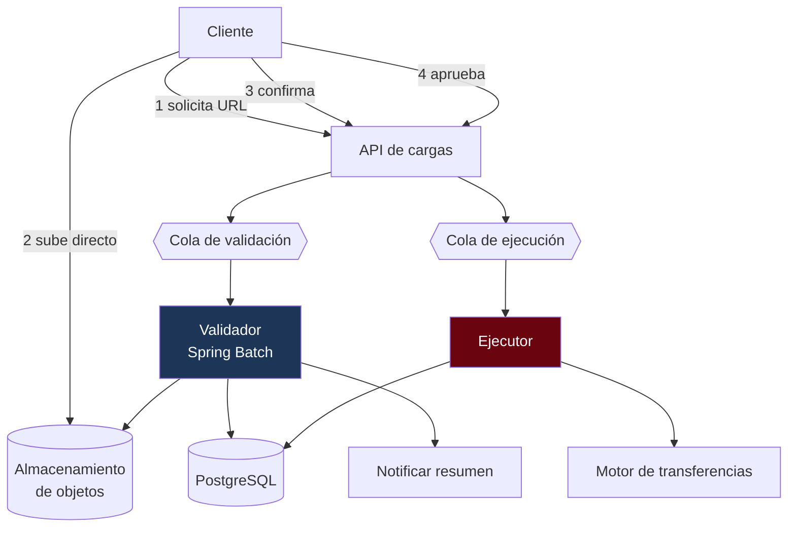

---
tags:
  - Java
  - System Design
  - Caso
Creado: 2026-09-08
Relacionado:
  - System Design
  - 08 - Almacenamiento de Objetos
Palabras clave:
  - carga masiva, URL prefirmada, validacion, idempotencia, batch, reporte de errores
Nivel: Intermedio
---

# C4 · Carga masiva de archivos

> **Enunciado:** *"Una empresa sube un archivo con 100.000 pagos de nómina. Diseñá el sistema que lo recibe, valida y procesa."*

Es el caso que más se parece a un problema real de banca y el menos "de manual". Combina almacenamiento de objetos, procesamiento por lotes, idempotencia y una parte que casi siempre se subestima: **cómo se le informan los errores al usuario**.

## 1️⃣ Acotar

```
¿Tamaño máximo del archivo?                → 100 MB, ~500.000 registros
¿Formato?                                   → CSV y el formato del banco
¿El procesamiento es inmediato?            → no, puede tardar minutos
¿Qué pasa si algunos registros fallan?     → ← LA pregunta clave
¿Se puede reintentar el mismo archivo?     → sí, tiene que ser idempotente
¿Hay que aprobar antes de ejecutar?        → sí: se valida, se aprueba, se ejecuta
```

> [!tip] "¿Qué pasa si algunos registros fallan?" define el diseño entero
> Hay dos modelos posibles y son incompatibles:
> - **Todo o nada**: si un registro falla, no se ejecuta ninguno. Más seguro, más frustrante.
> - **Parcial**: se ejecutan los válidos y se reportan los fallidos. Más útil, exige buen reporte.
>
> Para nómina, lo habitual es **validar todo primero y ejecutar todo o nada**: pagar a 99.998 empleados y no a 2 es un problema de recursos humanos.

```
FUNCIONALES
  1. Subir archivo (hasta 100 MB)
  2. Validar formato y reglas de negocio
  3. Mostrar resumen antes de ejecutar
  4. Aprobar y ejecutar
  5. Reporte de resultados descargable

FUERA DE ALCANCE
  - Edición de registros en línea
  - Programación de ejecución futura

NO FUNCIONALES
  - Validar 500.000 registros en < 5 min
  - Sin duplicar pagos ante reintentos   ← crítico
  - Trazabilidad completa por registro
  - La subida no debe pasar por la aplicación
```

## 2️⃣ Escala

```
Archivos:           500/día (empresas), concentrados a fin de mes
Registros:          100.000 promedio, 500.000 máximo
Pico (día de pago): 200 archivos en 2 horas

Validación:  500.000 registros × ~1 ms = 500 s en un solo hilo
             → con 10 hilos: 50 s ✅

Almacenamiento: 500 archivos/día × 20 MB = 10 GB/día → 3,6 TB/año
```

> **Conclusiones:**
> - El volumen no es el problema; **la concurrencia en el pico sí**.
> - La validación se paraleliza fácil (registros independientes).
> - Los archivos van a almacenamiento de objetos, no a la base.

## 3️⃣ API

```
POST /api/v1/cargas
  { "tipo": "NOMINA", "nombreArchivo": "nomina-2026-09.csv", "tamanoBytes": 18400000,
    "hashSha256": "a3f9..." }
  → 201 { "cargaId": "...", "urlSubida": "https://...?sig=...", "expiraEn": "..." }

POST /api/v1/cargas/{id}/confirmar        → 202  (el archivo ya está subido)
GET  /api/v1/cargas/{id}                  → 200  { estado, progreso, resumen }
GET  /api/v1/cargas/{id}/errores?cursor=  → 200  { errores[], siguienteCursor }
POST /api/v1/cargas/{id}/aprobar          → 202
GET  /api/v1/cargas/{id}/reporte          → 200  { urlDescarga }
```

> [!danger] El archivo nunca pasa por la aplicación
> ```java
> // ❌ 100 MB atravesando tu JVM
> @PostMapping("/cargas")
> public void subir(@RequestParam MultipartFile archivo) { ... }
> ```
> Consume memoria, satura el ancho de banda del servicio, y el balanceador corta la petición por timeout. El cliente sube **directo al almacenamiento** con una URL prefirmada; tu servicio solo autoriza y recibe la confirmación — ver [[08 - Almacenamiento de Objetos]].

> [!tip] El hash del archivo es la clave de idempotencia
> Si la empresa vuelve a subir exactamente el mismo archivo, el hash coincide y el sistema detecta que ya fue procesado. Es una clave natural, más robusta que una cabecera de idempotencia.

## 4️⃣ Datos

```sql
CREATE TABLE carga (
    id              UUID PRIMARY KEY,
    empresa_id      UUID        NOT NULL,
    tipo            VARCHAR(20) NOT NULL,
    nombre_archivo  VARCHAR(255) NOT NULL,
    clave_objeto    VARCHAR(500),
    hash_sha256     VARCHAR(64) NOT NULL,
    estado          VARCHAR(20) NOT NULL,
    total_registros INTEGER,
    validos         INTEGER,
    invalidos       INTEGER,
    monto_total     NUMERIC(19,4),
    creada_en       TIMESTAMPTZ NOT NULL DEFAULT now(),
    aprobada_por    UUID,
    aprobada_en     TIMESTAMPTZ
);

-- Una empresa no puede procesar dos veces el mismo archivo
CREATE UNIQUE INDEX idx_carga_hash ON carga(empresa_id, hash_sha256)
    WHERE estado <> 'RECHAZADA';

CREATE TABLE carga_registro (
    carga_id      UUID    NOT NULL REFERENCES carga(id),
    linea         INTEGER NOT NULL,
    cuenta_destino VARCHAR(30),
    monto         NUMERIC(19,4),
    estado        VARCHAR(20) NOT NULL,     -- VALIDO | INVALIDO | EJECUTADO | FALLIDO
    error         TEXT,
    asiento_id    UUID,
    PRIMARY KEY (carga_id, linea)
);

CREATE INDEX idx_registro_errores ON carga_registro(carga_id, linea)
    WHERE estado IN ('INVALIDO', 'FALLIDO');
```

```java
public enum EstadoCarga {
    PENDIENTE_SUBIDA, SUBIDO, VALIDANDO,
    VALIDADO,            // esperando aprobación
    RECHAZADA,           // demasiados errores
    APROBADA, EJECUTANDO, COMPLETADA, COMPLETADA_CON_ERRORES, FALLIDA
}
```

## 5️⃣ Diseño



### Validación en dos niveles

```java
@Bean
public Step validar(JobRepository repo, PlatformTransactionManager tx) {
    return new StepBuilder("validar", repo)
        .<LineaCruda, RegistroValidado>chunk(1000, tx)
        .reader(lectorDelObjeto())            // streaming: NUNCA cargar todo en memoria
        .processor(validador())
        .writer(escritorDeRegistros())
        .faultTolerant()
            .skipLimit(Integer.MAX_VALUE)      // los errores se REGISTRAN, no detienen
            .skip(RegistroInvalidoException.class)
        .taskExecutor(new SimpleAsyncTaskExecutor())
        .build();
}
```

> [!warning] Acá `skipLimit` alto es lo correcto — al revés que en el cierre de día
> En [[10 - Cierre de Dia y Batch]] la regla es `skipLimit(0)`: saltear un registro contable falsea los números. Acá el objetivo es **el opuesto**: encontrar todos los errores del archivo para reportarlos juntos.
> Un archivo con 300 errores debe producir un reporte con los 300, no detenerse en el primero. Es la diferencia entre validar y ejecutar.

```java
public RegistroValidado validar(LineaCruda linea) {
    var errores = new ArrayList<String>();

    // Nivel 1 · formato
    if (!esCuentaValida(linea.cuenta()))      errores.add("cuenta con formato inválido");
    if (!esMontoValido(linea.monto()))        errores.add("monto inválido");
    if (linea.monto().signum() <= 0)          errores.add("el monto debe ser positivo");

    // Nivel 2 · negocio
    if (errores.isEmpty()) {
        if (!cuentas.existe(linea.cuenta()))  errores.add("la cuenta no existe");
        else if (!cuentas.operable(linea.cuenta())) errores.add("cuenta bloqueada");
        if (limites.excede(empresaId, linea.monto())) errores.add("excede el límite");
    }

    return errores.isEmpty()
        ? RegistroValidado.valido(linea)
        : RegistroValidado.invalido(linea, String.join("; ", errores));
}
```

> [!tip] Validar formato antes que negocio
> La validación de formato es local y cuesta microsegundos; la de negocio consulta la base. Si el formato ya falla, no gastes una consulta. En 500.000 registros la diferencia es sustancial.

### Leer sin cargar en memoria

```java
// ❌ 100 MB en el heap, × N archivos concurrentes = OutOfMemoryError
String contenido = new String(objeto.readAllBytes());

// ✅ Streaming línea por línea
try (var reader = new BufferedReader(new InputStreamReader(objeto.abrirStream()))) {
    reader.lines().forEach(this::procesar);
}
```

> [!danger] Con 200 archivos concurrentes en el pico, cargar en memoria es fatal
> 200 × 100 MB = 20 GB. El streaming mantiene el consumo constante sin importar el tamaño del archivo ni la concurrencia.

## ✅ La aprobación

```java
@Transactional
public void aprobar(UUID cargaId, UUID aprobadorId) {
    Carga carga = repo.buscarParaActualizar(cargaId).orElseThrow();

    if (carga.estado() != VALIDADO)
        throw new EstadoInvalidoException(carga.estado());

    // Separación de funciones: quien aprueba no puede ser quien subió
    if (carga.creadaPor().equals(aprobadorId))
        throw new AprobacionPropiaProhibidaException();

    if (carga.invalidos() > 0 && !carga.tipo().permiteParcial())
        throw new HayRegistrosInvalidosException(carga.invalidos());

    limites.verificarYConsumir(carga.empresaId(), carga.montoTotal());

    carga.aprobar(aprobadorId);
    auditoria.registrar(APROBACION_CARGA, cargaId, aprobadorId);
    cola.publicar(new CargaAprobada(cargaId));
}
```

> [!tip] Quien sube no aprueba
> Es el mismo control de separación de funciones de [[Fase 3 - Seguridad y Auditoria]]. En una carga de nómina de millones, que una sola persona pueda subir y ejecutar es un riesgo operativo inaceptable.

## ⚡ La ejecución

```java
@Bean
public Step ejecutar(JobRepository repo, PlatformTransactionManager tx) {
    return new StepBuilder("ejecutar", repo)
        .<RegistroValidado, ResultadoPago>chunk(100, tx)
        .reader(lectorDeValidos())
        .processor(this::ejecutarPago)
        .writer(escritorDeResultados())
        .faultTolerant()
            .retryLimit(3).retry(TransientDataAccessException.class)
            .skipLimit(0)                      // ⛔ acá SÍ: es dinero
        .build();
}

private ResultadoPago ejecutarPago(RegistroValidado r) {
    // Clave de idempotencia derivada: determinista y única por registro
    String clave = "carga:%s:linea:%d".formatted(r.cargaId(), r.linea());

    var resultado = transferencias.transferir(clave, r.origen(), r.cuenta(), r.monto());
    return ResultadoPago.de(r, resultado.asientoId());
}
```

> [!danger] La clave de idempotencia se deriva de la carga y la línea
> Es determinista: si el job se reinicia y reprocesa la línea 4.471, la clave es la misma y el motor de transferencias reconoce que ya se ejecutó. **Sin esto, un reinicio duplica pagos.**
> Es la aplicación directa de [[05 - Idempotencia Financiera]] a un proceso batch.

## 📄 El reporte

```java
public String generarReporte(UUID cargaId) {
    String clave = "reportes/%s/%s.csv".formatted(empresaId, cargaId);

    try (var salida = almacen.abrirEscritura(clave);
         var csv = new CSVPrinter(new OutputStreamWriter(salida), FORMATO)) {

        // Streaming desde la base al objeto: sin materializar en memoria
        repo.recorrerRegistros(cargaId, registro -> {
            csv.printRecord(registro.linea(), registro.cuentaDestino(),
                            registro.monto(), registro.estado(), registro.error());
        });
    }
    return almacen.urlDeDescarga(clave, Duration.ofHours(1));
}
```

> [!warning] El reporte de errores es la mitad del valor del sistema
> Un mensaje "el archivo tiene 300 errores" es inútil. El usuario necesita **qué línea, qué campo y por qué**, en un archivo que pueda abrir, corregir y volver a subir.
> Es la parte que más se subestima al diseñar y la que más reclamos genera en producción.

```csv
linea,cuenta,monto,estado,error
1,00212345678,1500.00,EJECUTADO,
2,0021234,850.00,INVALIDO,cuenta con formato inválido
3,00298765432,-100.00,INVALIDO,el monto debe ser positivo
```

## 6️⃣ Profundizar

### "¿Y si el proceso muere a la mitad de la ejecución?"

Spring Batch persiste el estado del job: al reanudar, continúa desde el último *chunk* confirmado. Y aunque reprocesara registros ya ejecutados, la clave de idempotencia derivada impide duplicarlos. **Doble protección.**

### "¿Cómo muestro el progreso?"

```java
@Scheduled(fixedRate = 2000)
public void publicarProgreso(UUID cargaId) {
    var avance = repo.contarPorEstado(cargaId);
    redis.set("progreso:" + cargaId, avance, Duration.ofMinutes(30));
}
```

El cliente consulta `GET /cargas/{id}` cada pocos segundos, o se le empuja por WebSocket. No consultes la base en cada petición del cliente: cacheá el progreso.

### "¿Y si suben el mismo archivo dos veces?"

El índice único sobre `(empresa_id, hash_sha256)` lo rechaza con `409` y una referencia a la carga original. Si el reintento es legítimo (el archivo se corrigió), el hash cambia y pasa.

### "¿Cómo manejás el pico de fin de mes?"

- Cola con escalado por profundidad, no por CPU ([[06 - Colas y Backpressure]]).
- Límite de cargas concurrentes por empresa, para que una no monopolice.
- Prioridad: archivos chicos primero, así los usuarios con pocos registros no esperan detrás de uno de 500.000.

### "¿Y si el archivo llega corrupto o truncado?"

El hash SHA-256 declarado al solicitar la URL se verifica contra el archivo real. Si no coincide, se rechaza antes de procesar. Además, los formatos bancarios suelen traer un registro de control con totales: se validan contra lo leído — igual que en [[09 - Conciliacion y Cuadre]].

## 🎯 Qué se evalúa

| Señal positiva | Señal negativa |
|---|---|
| URL prefirmada: el archivo no pasa por la app | `MultipartFile` de 100 MB |
| Streaming al leer | cargar el archivo en memoria |
| Separar validación de ejecución | validar y ejecutar en una pasada |
| `skipLimit` alto al validar, `0` al ejecutar | el mismo criterio para las dos fases |
| Clave de idempotencia derivada de carga+línea | confiar solo en el estado del job |
| Reporte de errores accionable | "hubo 300 errores" |
| Separación de funciones en la aprobación | quien sube ejecuta |

## 🔄 Variantes

| Variante | Qué cambia |
|---|---|
| Ejecución parcial permitida | reporte más complejo, reintento por registro |
| Archivo de un corresponsal (entrante) | disparador por evento del almacenamiento |
| Formato de ancho fijo | lector distinto, registro de control |
| Programar para una fecha futura | estado adicional y planificador |

## 📌 Notas Rápidas
- Es el caso más "de trabajo real" de los cuatro genéricos: casi todo sistema bancario tiene alguna carga masiva, y casi siempre está mal resuelta.
- El contraste de `skipLimit` entre validar (alto) y ejecutar (cero) es un buen ejemplo de que las buenas prácticas dependen del contexto: la misma decisión es correcta en una fase e incorrecta en la otra.
- La clave de idempotencia derivada (`carga:X:linea:N`) es un patrón muy reutilizable para cualquier procesamiento por lotes de operaciones con efecto.

## 🔗 Relaciones
- **Módulo**: [[System Design]]
- **Anterior**: [[C3 - Chat en Tiempo Real]]
- **Siguiente**: [[C5 - Motor de Transferencias]]
- **Se conecta con**: [[08 - Almacenamiento de Objetos]], [[10 - Cierre de Dia y Batch]], [[Fase 8 - Batch y Cierre de Dia]]

---

## ✍️ Mis apuntes
<!-- Tus dudas, ejemplos propios, cómo lo aplicaste -->

