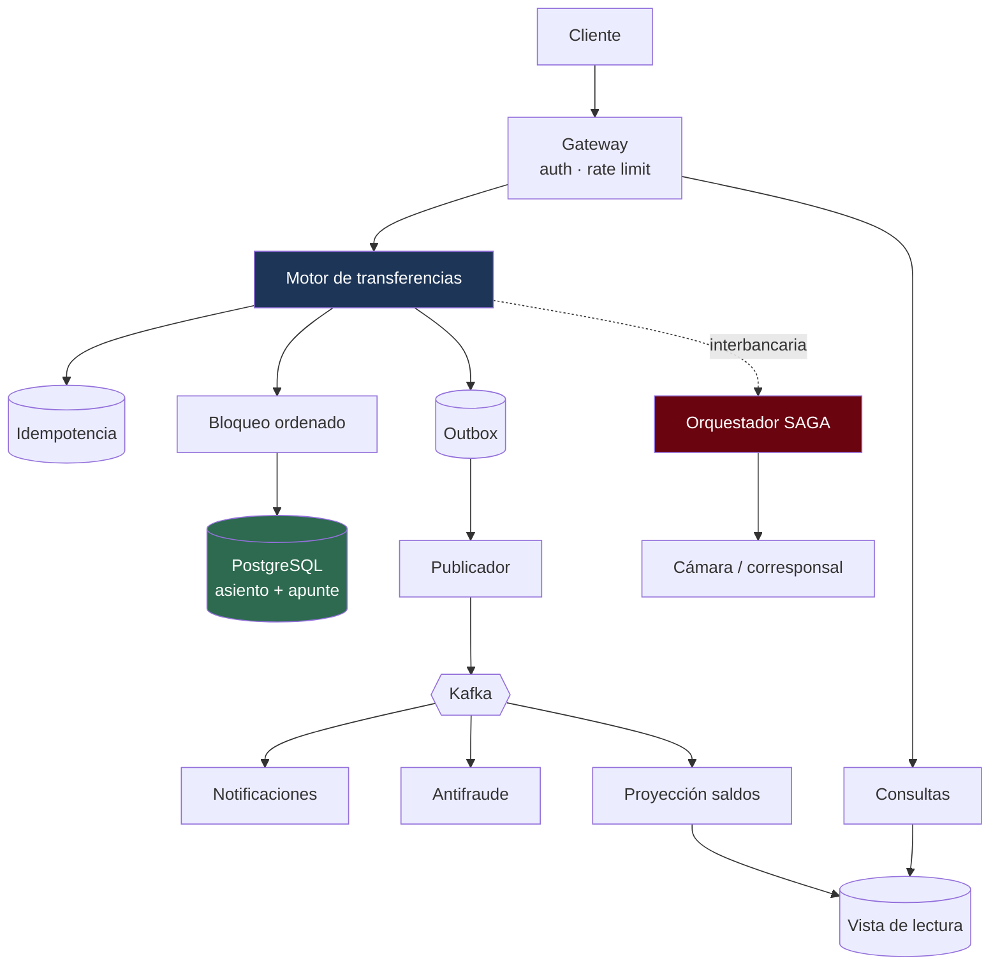

---
tags:
  - Java
  - System Design
  - Caso
  - Banca
Creado: 2026-09-08
Relacionado:
  - System Design
  - Banca y Fintech
Palabras clave:
  - transferencias, consistencia, idempotencia, ledger, bloqueo, SAGA, doble gasto
Nivel: Avanzado
---

# C5 · Motor de transferencias

> **Enunciado:** *"Diseñá el motor de transferencias de un banco: entre cuentas propias y hacia otros bancos, con garantía de que nadie pueda gastar dos veces."*

**Es el caso más importante de los nueve para tu objetivo.** Es literalmente el laboratorio `corebank` explicado en 45 minutos, y toca los tres problemas que definen el dominio: concurrencia, duplicación y consistencia distribuida.

## 1️⃣ Acotar

```
¿Transferencias internas, interbancarias, o las dos?   → las dos
¿Son inmediatas?                                        → internas sí; interbancarias no
¿Multi-moneda?                                          → fuera de alcance (lo mencionamos)
¿Hay que soportar reversas?                             → sí
¿Límites por cliente?                                    → sí
¿Retención del historial?                                → 10 años, normativa
```

```
FUNCIONALES
  1. Transferir entre cuentas del mismo banco (inmediata)
  2. Transferir a otro banco (diferida)
  3. Consultar estado de una transferencia
  4. Reversar una transferencia errónea
  5. Historial de movimientos

FUERA DE ALCANCE
  - Conversión de moneda
  - Transferencias programadas
  - Pagos de servicios

NO FUNCIONALES
  - Consistencia FUERTE del saldo: el doble gasto es inaceptable  ← define todo
  - Idempotencia: un reintento no puede duplicar
  - p99 < 500 ms en transferencias internas
  - 99,99% de disponibilidad
  - Traza de auditoría inmutable por 10 años
  - Cuadre contable verificable
```

> [!tip] Enunciar "consistencia fuerte" es el momento clave del caso
> A partir de ahí, todo lo demás se justifica solo: descarta consistencia eventual en la validación de saldo, descarta leer de réplicas para validar, y obliga a bloqueo o serialización. Si no lo decís, cualquier diseño parece defendible.

## 2️⃣ Escala

```
Clientes:                 5 M, 30% activos por día = 1,5 M
Transferencias:           750 K/día  → 7,5 QPS  → pico ×5 = 40 QPS
                                                  → pico fin de mes ×3 = 120 QPS
Consultas de saldo:       12 M/día   → 120 QPS  → pico = 600 QPS

Proporción lectura/escritura = 16:1
```

```
ALMACENAMIENTO
  750 K transferencias/día × 2 apuntes × 150 bytes = 225 MB/día
  × 365 × 10 años (retención normativa)            = 820 GB
  × 1,5 índices × 3 réplicas                       ≈ 3,7 TB
```

> **Conclusiones — y esto es lo que hay que decir en voz alta:**
> - **40-120 QPS de escritura: una instancia de PostgreSQL sobra.** No hace falta shardear, ni NoSQL, ni nada exótico. Descarto esa complejidad.
> - 16:1 → réplicas de lectura para historial y dashboards; **nunca para validar saldo**.
> - 3,7 TB en 10 años: particionado por fecha para archivado, no sharding.

> [!danger] El error más común en este caso es sobreingeniería
> Con 120 QPS de escritura, proponer Cassandra, sharding o event sourcing distribuido demuestra que no estimaste. **Los números dicen que el problema no es de volumen: es de corrección.**

## 3️⃣ API

```
POST /api/v1/transferencias
  Idempotency-Key: {uuid generado por el cliente}
  { "cuentaOrigen": "...", "cuentaDestino": "...", "monto": 1500.50,
    "moneda": "PEN", "tipo": "INTERNA", "concepto": "..." }
  → 201 { "transferenciaId", "estado": "COMPLETADA", "asientoId", "saldoResultante" }
  → 200 (misma clave, misma respuesta: no se reejecuta)
  → 409 (misma clave, aún en proceso)
  → 422 (saldo insuficiente | límite excedido | clave reutilizada con otro cuerpo)

GET  /api/v1/transferencias/{id}                 → estado y detalle
POST /api/v1/transferencias/{id}/reversas        → operador, con motivo
GET  /api/v1/cuentas/{id}/saldo                  → saldo contable y disponible
GET  /api/v1/cuentas/{id}/movimientos?cursor=    → extracto paginado por cursor
```

> [!tip] Devolver el saldo resultante evita una consulta posterior
> El cliente transfiere y ya recibe el saldo nuevo: no necesita consultar después, y desaparece el problema de leer una réplica atrasada. Es la mitigación más simple del *read-your-writes* de [[02 - CAP PACELC y Consistencia]].

## 4️⃣ Datos

**La decisión de modelado que define el sistema: ledger de partida doble.**

```sql
CREATE TABLE cuenta (
    id            UUID PRIMARY KEY,
    numero        VARCHAR(20) NOT NULL UNIQUE,
    cliente_id    UUID        NOT NULL,
    moneda        VARCHAR(3)  NOT NULL,
    estado        VARCHAR(20) NOT NULL,
    linea_credito NUMERIC(19,4) NOT NULL DEFAULT 0
);

CREATE TABLE asiento (
    id          UUID PRIMARY KEY,
    fecha       TIMESTAMPTZ  NOT NULL DEFAULT now(),
    motivo      VARCHAR(200) NOT NULL,
    referencia  VARCHAR(60),
    reversa_de  UUID REFERENCES asiento(id)
);

CREATE TABLE apunte (
    id         BIGSERIAL PRIMARY KEY,
    asiento_id UUID          NOT NULL REFERENCES asiento(id),
    cuenta_id  UUID          NOT NULL REFERENCES cuenta(id),
    monto      NUMERIC(19,4) NOT NULL CHECK (monto <> 0),   -- ⚠️ NUMERIC, no FLOAT
    moneda     VARCHAR(3)    NOT NULL
);

CREATE INDEX idx_apunte_cuenta ON apunte(cuenta_id, id DESC);

CREATE TABLE idempotencia (
    clave          VARCHAR(64) PRIMARY KEY,      -- ← la unicidad la impone la BASE
    huella_request VARCHAR(64) NOT NULL,
    estado         VARCHAR(20) NOT NULL,
    respuesta      JSONB,
    expira_en      TIMESTAMPTZ NOT NULL
);

REVOKE UPDATE, DELETE ON asiento, apunte FROM app;   -- append-only
```

> [!tip] El saldo no es una columna
> Se deriva de la suma de apuntes. Eso da historia completa, saldo a cualquier fecha pasada y **una invariante verificable**: la suma de todos los apuntes debe dar cero.
> Decir esto y explicar por qué es lo que distingue una respuesta de alguien que entiende el dominio — ver [[03 - Ledger y Partida Doble]].

## 5️⃣ Diseño



## 🔒 El núcleo: la transferencia interna

```java
@PostMapping("/api/v1/transferencias")
public TransferenciaResponse transferir(
        @RequestHeader("Idempotency-Key") String clave,
        @Valid @RequestBody TransferenciaRequest req) {

    return idempotencia.ejecutarUnaVez(clave, req, TransferenciaResponse.class,
        () -> servicio.transferir(req));
}
```

```java
@Transactional
public TransferenciaResponse transferir(TransferenciaRequest req) {

    if (req.origen().equals(req.destino()))
        throw new OperacionInvalidaException("origen y destino coinciden");

    // ⚠️ ORDEN DETERMINISTA: el UUID menor primero, siempre
    var par = bloquearEnOrden(req.origen(), req.destino());
    Cuenta origen = par.origen(), destino = par.destino();

    origen.exigirOperable();
    destino.exigirOperable();

    // Saldo DISPONIBLE (contable − retenciones + línea), leído de la PRIMARIA
    Dinero disponible = saldos.disponible(origen.id(), req.moneda());
    if (disponible.compareTo(req.monto()) < 0)
        throw new SaldoInsuficienteException(origen.id(), disponible, req.monto());

    limites.verificarYConsumir(origen, req.monto());   // misma transacción

    Asiento asiento = Asiento.de("TRANSFERENCIA",
        new Apunte(origen.id(),  req.monto().negado()),
        new Apunte(destino.id(), req.monto()));

    libro.registrar(asiento);
    outbox.encolar(new TransferenciaCompletada(asiento.id(), ...));   // misma transacción

    return TransferenciaResponse.de(asiento, saldos.contable(origen.id(), req.moneda()));
}
```

### Las tres protecciones, y por qué hacen falta las tres

| Problema | Protección | Sin ella |
|---|---|---|
| Dos peticiones simultáneas | `SELECT FOR UPDATE` | saldo negativo |
| A→B y B→A a la vez | **bloqueo en orden determinista** | deadlock intermitente |
| El cliente reintenta por timeout | `Idempotency-Key` + índice único | dinero duplicado |

```java
private ParDeCuentas bloquearEnOrden(UUID a, UUID b) {
    UUID primero = a.compareTo(b) < 0 ? a : b;
    UUID segundo = primero.equals(a) ? b : a;

    var c1 = repo.findByIdParaActualizar(primero).orElseThrow();
    var c2 = repo.findByIdParaActualizar(segundo).orElseThrow();
    return ParDeCuentas.de(c1, c2, a);
}
```

> [!danger] El deadlock de transferencias cruzadas
> Si A→B bloquea A y después B, mientras B→A bloquea B y después A, las dos transacciones se esperan. Postgres mata una y el usuario ve un error aleatorio que solo aparece bajo carga.
> **Ordenar los bloqueos por un criterio determinista lo hace imposible**, no improbable. Es de las cosas que más impresionan en una entrevista porque casi nadie la menciona.

> [!tip] Por qué pesimista y no optimista
> Con contención real sobre una cuenta (empresas, cuentas de recaudación), el bloqueo optimista genera reintentos constantes. Con bloqueo pesimista, las operaciones se serializan de forma predecible.
> Y el costo hay que decirlo: **una cuenta muy activa se convierte en un cuello de botella**. Si apareciera ese caso, iría a un modelo de reservas.

## 🌐 La transferencia interbancaria

Acá no hay transacción posible: dos bases, dos entidades.

```java
public enum EstadoTransferencia {
    INICIADA, FONDOS_RESERVADOS, DEBITADA, ENVIADA, ACREDITADA, COMPLETADA,
    COMPENSANDO, FALLIDA,
    EN_REVISION            // ← el sistema no puede decidir: interviene un humano
}
```

```java
private void acreditarEnDestino(SagaTransferencia saga) {
    try {
        var r = camara.enviar(new Instruccion(saga.destino(), saga.monto(),
                                              saga.id().toString()));  // idempotencia
        saga.acreditada(r.referencia());

    } catch (RechazoDefinitivoException e) {
        saga.pasarACompensando(e.getMessage());
        compensar(saga);

    } catch (TimeoutException e) {
        // ❌ NO compensar: pudo haberse acreditado
        // ❌ NO reintentar a ciegas: podría duplicar
        consultarEstadoReal(saga);      // ✅
    }
}
```

> [!danger] El estado desconocido es la parte difícil del caso
> Ante un timeout no sabés si la operación se ejecutó. Compensar duplicaría el efecto inverso; reintentar duplicaría hacia adelante.
> La única salida correcta es **consultar el estado por la referencia** y, si sigue sin saberse, marcar `EN_REVISION` y escalar. Que exista una cola de intervención manual no es una debilidad del diseño: es reconocer que hay casos donde ningún algoritmo puede decidir bien.

La compensación se ejecuta **en orden inverso** al de aplicación, y cada paso es idempotente — ver [[07 - Compensacion y Reversas]].

## 📤 Eventos sin dual-write

```java
// ❌ Dual-write: si Kafka falla tras el commit, el evento se perdió sin rastro
libro.registrar(asiento);
kafka.send("transferencias", evento);

// ✅ Outbox: el evento se escribe en la MISMA transacción que el asiento
libro.registrar(asiento);
outbox.encolar(evento);
```

Un publicador drena la tabla con `FOR UPDATE SKIP LOCKED`, lo que permite correr N réplicas sin duplicar — ver [[05 - Transactional Outbox]].

## 6️⃣ Profundizar

### "¿Cómo garantizás que nadie gaste dos veces?"

Tres capas, y hay que nombrar las tres:
1. **Bloqueo pesimista** sobre la cuenta origen: serializa las operaciones concurrentes.
2. **Saldo leído de la primaria**, nunca de una réplica: el lag habilitaría el doble gasto.
3. **Validación dentro de la misma transacción** que registra el asiento: no hay ventana entre validar y escribir.

### "¿Y si el cliente reintenta?"

Clave de idempotencia generada por el cliente, con restricción única en base. El primer `INSERT` gana; el segundo falla con violación de unicidad y devuelve la respuesta cacheada. **El `if` en Java no protege**: la base es el único árbitro atómico ante concurrencia.

### "¿Qué pasa si la base primaria se cae?"

Failover a la réplica síncrona (~60 s con Aurora, ~30 s). Durante ese lapso no se aceptan transferencias — es la elección **CP** de [[02 - CAP PACELC y Consistencia]], y es la correcta: rechazar es mejor que aceptar operaciones que podrían perderse.

Mientras tanto, degradación a **modo solo lectura**: los clientes pueden consultar saldos e historial desde las réplicas. Mucho mejor que una pantalla de error.

### "¿Cómo verificás que la contabilidad esté bien?"

```sql
SELECT moneda, SUM(monto) FROM apunte GROUP BY moneda HAVING SUM(monto) <> 0;
```

Cero filas = el sistema cuadra. Se ejecuta en cada cierre y **detiene el proceso** si falla. Es una invariante del dominio, no una prueba de software: si falla, se creó o destruyó dinero.

### "¿Y si una cuenta recibe mil transferencias por minuto?"

Es el cuello de botella conocido del diseño, y conviene señalarlo antes de que lo pregunten. Las salidas:
- **Modelo de reservas**: en vez de bloquear la cuenta, se reservan fondos con una fila propia; menos contención.
- **Sub-cuentas**: partir la cuenta de recaudación en N y consolidar en el cierre.
- **Cola serializada por cuenta**: las operaciones de esa cuenta se procesan de a una, sin bloquear a las demás.

### "¿Y si crece 100×?"

```
12.000 QPS de escritura
→ recién ahí una sola instancia no alcanza
→ particionar por cliente_id: las cuentas de un cliente quedan juntas
→ las transferencias entre cuentas propias siguen siendo transacción local ✅
→ las transferencias a terceros cruzan particiones → SAGA
```

La clave de partición se elige **por las consultas**, no por los datos: `cliente_id` mantiene local el caso más frecuente.

## 🎯 Qué se evalúa

| Señal positiva | Señal negativa |
|---|---|
| Estimar y **descartar** sharding con los números | proponer Cassandra sin estimar |
| Ledger de partida doble; saldo derivado | columna `saldo` con `UPDATE` |
| Las tres protecciones nombradas por separado | "uso transacciones" y listo |
| Bloqueo en orden determinista | bloquear en orden del request |
| Idempotencia con restricción única en base | `if (existe)` en Java |
| Outbox en vez de dual-write | `kafka.send()` dentro del servicio |
| Consultar ante timeout, no compensar | compensar a ciegas |
| Modelar `EN_REVISION` | asumir que todo se resuelve solo |
| Señalar el cuello de la cuenta caliente | esperar a que lo pregunten |

## 🔄 Variantes

| Variante | Qué cambia |
|---|---|
| Multi-moneda | dos asientos contra posición de cambio ([[02 - Multimoneda y Tipos de Cambio]]) |
| Transferencias programadas | planificador, estado adicional, reintentos |
| Pagos inmediatos 24×7 | sin ventana de cierre; conciliación continua |
| Límites por canal | el consumo se lleva por canal |

## 📌 Notas Rápidas
- **Este es el caso que hay que dominar.** Si podés recorrerlo entero en 45 minutos con las tres protecciones, el ledger y el manejo del estado desconocido, estás preparado para una entrevista de backend en banca.
- El momento más valioso de la respuesta es cuando decís *"con 120 QPS no necesito shardear, descarto esa complejidad"*. Demuestra que estimás para decidir, no para adornar.
- La pregunta *"¿cómo evitás una transferencia duplicada?"* tiene tres capas. Responder solo "uso transacciones" es la respuesta incorrecta más frecuente.
- Está implementado paso a paso en [[Fase 2 - Transferencias e Idempotencia]] y [[Fase 6 - Microservicios y SAGA]].

## 🔗 Relaciones
- **Módulo**: [[System Design]]
- **Anterior**: [[C4 - Carga Masiva de Archivos]]
- **Siguiente**: [[C6 - Procesador de Pagos]]
- **Teoría**: [[06 - Transferencias y Consistencia]], [[05 - Idempotencia Financiera]], [[03 - Ledger y Partida Doble]], [[06 - SAGA]]

---

## ✍️ Mis apuntes
<!-- Tus dudas, ejemplos propios, cómo lo aplicaste -->

