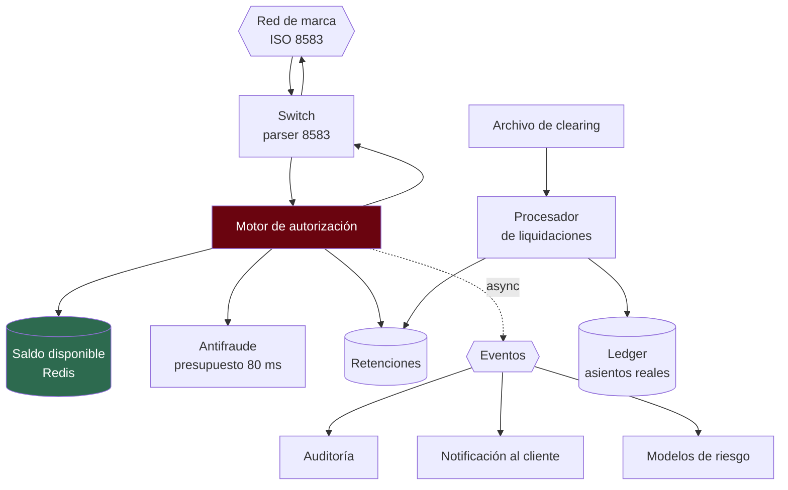

---
tags:
  - Java
  - System Design
  - Caso
  - Banca
Creado: 2026-09-08
Relacionado:
  - System Design
  - 07 - Medios de Pago y ISO 8583
Palabras clave:
  - autorizacion, clearing, settlement, retencion, reversa, timeout, latencia, ISO 8583
Nivel: Avanzado
---

# C6 · Procesador de pagos con tarjeta

> **Enunciado:** *"Diseñá el lado emisor de un procesador de tarjetas: recibe autorizaciones de la red, decide si aprobar, y después concilia las liquidaciones."*

Lo que distingue este caso de [[C5 - Motor de Transferencias]] es el **presupuesto de latencia**: la red de marca te da unos cientos de milisegundos para responder, y si no respondés, la operación se rechaza o se aprueba sin vos. Es un sistema de tiempo real duro.

## 1️⃣ Acotar

```
¿Somos emisor, adquirente o los dos?           → emisor (autorizamos con nuestras tarjetas)
¿Qué latencia exige la red?                    → ~500 ms extremo a extremo ← define todo
¿Hay que soportar contracargos?                → sí, pero fuera de alcance el flujo completo
¿Débito, crédito o los dos?                    → débito (contra saldo real)
¿Volumen en el pico?                           → fiestas y fin de mes, ×10
```

```
FUNCIONALES
  1. Autorizar o rechazar una operación (tiempo real)
  2. Retener fondos al autorizar
  3. Procesar la liquidación (clearing) y generar el asiento
  4. Manejar reversas y anulaciones
  5. Conciliar contra el archivo de la marca

FUERA DE ALCANCE
  - Emisión física de tarjetas
  - Flujo completo de contracargos
  - Programa de puntos

NO FUNCIONALES
  - Respuesta a la autorización p99 < 300 ms   ← define todo
  - Disponibilidad 99,99%: si no respondemos, perdemos ventas
  - No autorizar sobre fondos ya comprometidos
  - Cumplimiento PCI-DSS
  - Cada operación auditable
```

> [!danger] El presupuesto de latencia es la restricción dominante
> Con 300 ms de presupuesto total, el antifraude no puede tardar 200 ms, la base no puede hacer una consulta compleja y no hay lugar para dos llamadas remotas en serie. **Toda decisión de diseño se mide contra ese número.**

## 2️⃣ Escala

```
Tarjetas activas:      3 M
Operaciones:           15 M/día  → 150 QPS  → pico ×5 = 750 QPS
Pico estacional (×10): 1.500 QPS

Presupuesto de 300 ms, desglosado:
  Red y gateway              30 ms
  Validaciones de tarjeta    20 ms
  Consulta de saldo          30 ms
  Antifraude                 80 ms   ← el mayor consumidor
  Registro de la retención   40 ms
  Respuesta                  30 ms
  ─────────────────────────────────
  Total                     230 ms   → margen de 70 ms ✅
```

```
ALMACENAMIENTO
  15 M autorizaciones/día × 400 bytes = 6 GB/día
  × 365 × 7 años                      = 15 TB
  → particionado por fecha, archivado agresivo
```

> **Conclusiones:**
> - 750-1.500 QPS con presupuesto de 300 ms → **el saldo tiene que estar en memoria**, no calculado desde el ledger.
> - El antifraude va en línea pero con presupuesto estricto y política ante indisponibilidad.
> - Todo lo que no sea imprescindible para decidir, va **después** de responder.

## 3️⃣ Interfaces

El emisor no expone REST hacia la red: habla ISO 8583 — ver [[07 - Medios de Pago y ISO 8583]].

```
0100 Solicitud de autorización   → 0110 Respuesta
0200 Solicitud financiera        → 0210 Respuesta
0400 Solicitud de reversa        → 0410 Respuesta
0800 Gestión de red (echo)       → 0810 Respuesta
```

```
API interna:
POST /internal/autorizaciones        { pan, monto, moneda, comercio, terminal }
  → { decision: "APROBADA"|"RECHAZADA", codigo: "00"|"51", autorizacion: "A3F9C1" }

POST /internal/liquidaciones         (lote del clearing)
POST /internal/reversas              { rrn, adquirente, monto }
```

## 4️⃣ Datos

```sql
CREATE TABLE tarjeta (
    id            UUID PRIMARY KEY,
    pan_cifrado   BYTEA       NOT NULL,      -- cifrado con clave del HSM
    pan_hash      VARCHAR(64) NOT NULL,      -- HMAC con clave secreta, para buscar
    pan_bin       VARCHAR(6)  NOT NULL,
    pan_ultimos4  VARCHAR(4)  NOT NULL,
    cuenta_id     UUID        NOT NULL REFERENCES cuenta(id),
    estado        VARCHAR(20) NOT NULL,
    vence_en      DATE        NOT NULL
);
CREATE UNIQUE INDEX idx_tarjeta_hash ON tarjeta(pan_hash);

CREATE TABLE autorizacion (
    id              UUID PRIMARY KEY,
    tarjeta_id      UUID          NOT NULL,
    rrn             VARCHAR(12)   NOT NULL,
    adquirente      VARCHAR(11)   NOT NULL,
    stan            VARCHAR(6)    NOT NULL,
    monto           NUMERIC(19,4) NOT NULL,
    moneda          VARCHAR(3)    NOT NULL,
    codigo_respuesta VARCHAR(2)   NOT NULL,
    codigo_aprobacion VARCHAR(6),
    retencion_id    UUID,
    estado          VARCHAR(20)   NOT NULL,   -- AUTORIZADA | LIQUIDADA | REVERSADA | VENCIDA
    creada_en       TIMESTAMPTZ   NOT NULL DEFAULT now()
) PARTITION BY RANGE (creada_en);

-- Identidad de una operación: RRN + adquirente + fecha (el STAN se recicla)
CREATE UNIQUE INDEX idx_autorizacion_unica
    ON autorizacion(adquirente, rrn, (creada_en::date));
```

> [!danger] El STAN no identifica unívocamente una operación
> Son 6 dígitos que se reciclan a diario y por terminal. Usarlo como clave produce colisiones. La identidad se compone de **RRN + adquirente + fecha** — ver [[07 - Medios de Pago y ISO 8583]].

> [!danger] Datos de tarjeta: qué se puede guardar
> - PAN: sí, **ilegible** (cifrado con clave del HSM, o tokenizado).
> - CVV, PIN, track completo: **nunca**, ni cifrados.
> - Al mostrar: primeros 6 y últimos 4, máximo.
>
> Detalle en [[11 - PCI-DSS y HSM]]. Mencionarlo en la entrevista es esperado en cualquier caso de tarjetas.

## 5️⃣ Diseño



## ⚡ El camino crítico

```java
public RespuestaAutorizacion autorizar(SolicitudAutorizacion s) {
    var reloj = Stopwatch.createStarted();

    // 1 · Deduplicación: la red reintenta si no le respondemos
    var previa = autorizaciones.buscarPor(s.adquirente(), s.rrn(), s.fecha());
    if (previa.isPresent()) return RespuestaAutorizacion.de(previa.get());   // misma respuesta

    // 2 · Validaciones locales, sin E/S remota
    Tarjeta tarjeta = tarjetas.porHash(hmac(s.pan()));
    if (tarjeta == null)                 return rechazo("14");  // tarjeta inválida
    if (tarjeta.vencida())               return rechazo("54");  // vencida
    if (tarjeta.bloqueada())             return rechazo("41");  // reportada

    // 3 · Saldo disponible: desde caché, no calculado del ledger
    Dinero disponible = saldos.disponibleRapido(tarjeta.cuentaId());
    if (disponible.compareTo(s.monto()) < 0) return rechazo("51");  // fondos insuficientes

    // 4 · Antifraude con presupuesto estricto
    Decision decision = antifraude.evaluarConPresupuesto(s, Duration.ofMillis(80));
    if (decision.esBloqueo())            return rechazo("05");

    // 5 · Retener: atómico, es lo que evita el doble gasto
    Retencion retencion = retenciones.crear(tarjeta.cuentaId(), s.monto(), s.rrn());

    // 6 · Responder YA. Todo lo demás va asíncrono.
    var respuesta = aprobacion(generarCodigoAprobacion(), retencion.id());
    eventos.publicar(new AutorizacionAprobada(s, retencion.id(), reloj.elapsed()));
    return respuesta;
}
```

> [!tip] Todo lo que no decide, va después de responder
> Auditoría, notificación al cliente, alimentación de modelos de riesgo, métricas de negocio: nada de eso cambia la decisión, así que se publica como evento y se procesa fuera del camino crítico.
> Es lo que hace posible cumplir los 300 ms.

### El saldo en caché

```java
// El saldo derivado del ledger tarda demasiado para el presupuesto
public Dinero disponibleRapido(UUID cuentaId) {
    var cacheado = redis.get("saldo:" + cuentaId);
    if (cacheado != null) return cacheado;

    Dinero calculado = ledger.saldoDisponible(cuentaId);       // camino lento
    redis.setex("saldo:" + cuentaId, calculado, Duration.ofMinutes(5));
    return calculado;
}
```

> [!danger] Acá hay una contradicción aparente con C5 — y es deliberada
> En [[C5 - Motor de Transferencias]] la regla es **nunca validar contra caché**. Acá el presupuesto de latencia lo obliga. ¿Cómo se resuelve la tensión?
>
> **Con las retenciones.** El caché puede estar levemente desactualizado, pero la retención se crea de forma **atómica sobre la base**: si dos autorizaciones concurrentes intentan comprometer los mismos fondos, solo una gana.
> El caché es una **pre-validación optimista** que rechaza rápido lo obviamente insuficiente; la garantía real la da la retención.

```sql
-- La retención es el punto de serialización real
INSERT INTO retencion (id, cuenta_id, monto, rrn, estado, expira_en)
SELECT gen_random_uuid(), :cuenta, :monto, :rrn, 'ACTIVA', now() + interval '7 days'
WHERE (
    SELECT COALESCE(SUM(a.monto), 0) FROM apunte a WHERE a.cuenta_id = :cuenta
) - (
    SELECT COALESCE(SUM(r.monto), 0) FROM retencion r
    WHERE r.cuenta_id = :cuenta AND r.estado = 'ACTIVA'
) >= :monto
RETURNING id;      -- si no hay fondos, no inserta ninguna fila
```

> [!tip] La validación real ocurre dentro del `INSERT`
> No hay ventana entre validar y comprometer: la base evalúa la condición y escribe en una sola operación atómica. Si devuelve cero filas, no había fondos. Es el mismo principio que la restricción única de idempotencia — **dejar que la base sea el árbitro**.

## 🔄 Las tres fases

```
Día 0 · 14:32   AUTORIZACIÓN   → retención de S/ 200, sin asiento
Día 1 · 03:00   CLEARING       → llega el archivo con la operación presentada
Día 2           SETTLEMENT     → asiento real, se libera la retención
```

```java
@Transactional
public void liquidar(RegistroClearing registro) {
    var autorizacion = autorizaciones.buscarPor(
        registro.adquirente(), registro.rrn(), registro.fecha()).orElse(null);

    if (autorizacion == null) {
        // Se presentó algo que no autorizamos: excepción de conciliación
        partidas.registrar(FALTA_EN_PROPIO, registro);
        return;
    }

    // El monto liquidado puede diferir del autorizado (propinas, ajustes)
    Dinero montoFinal = registro.monto();

    libro.registrar(Asiento.de("CONSUMO_TARJETA",
        new Apunte(autorizacion.cuentaId(), montoFinal.negado()),
        new Apunte(CUENTA_LIQUIDACION_MARCA, montoFinal)));

    retenciones.aplicar(autorizacion.retencionId());   // aplicar ≠ liberar
    autorizacion.marcarLiquidada(montoFinal);
}
```

> [!danger] Nunca generes el asiento en la autorización
> Si lo hacés, cuando llegue el clearing lo duplicás. Y si la operación nunca se presenta (el comercio no la cobra), registraste un movimiento que no ocurrió.
> **Autorización = retención. Clearing = asiento.** Es la confusión más común al integrar medios de pago.

| Acción sobre la retención | Efecto | ¿Genera asiento? |
|---|---|---|
| **Liberar** | los fondos vuelven a estar disponibles | ❌ |
| **Aplicar** | la operación se liquidó | ✅ el asiento real |

## ⏪ Reversas y vencimientos

```java
// La red envía 0400 cuando el adquirente no recibió nuestra respuesta
public void procesarReversa(MensajeReversa r) {
    autorizaciones.buscarPor(r.adquirente(), r.rrn(), r.fecha())
        .ifPresent(a -> {
            retenciones.liberar(a.retencionId());       // sin asiento: nunca hubo dinero movido
            a.marcarReversada();
        });
    // Idempotente: reversar dos veces no hace nada la segunda
}
```

```java
@Scheduled(cron = "0 0 2 * * *")
public void liberarRetencionesVencidas() {
    retenciones.vencidas().forEach(r -> {
        retenciones.liberar(r.id());
        log.atWarn().addKeyValue("retencionId", r.id())
            .log("retención vencida sin liquidación");
    });
}
```

> [!warning] Sin vencimiento de retenciones, el cliente queda con fondos bloqueados
> Si un comercio autoriza y nunca presenta la operación, la retención vive para siempre. Es uno de los reclamos más frecuentes de los usuarios de tarjeta: *"tengo saldo pero no puedo usarlo"* — ver [[04 - Cuentas Saldos y Movimientos]].

## 6️⃣ Profundizar

### "¿Qué pasa si el antifraude no responde en 80 ms?"

Política definida **antes** del incidente, no improvisada:

```java
catch (TimeoutException e) {
    metricas.contar("antifraude.timeout");
    return s.monto().compareTo(UMBRAL_SEGURO) < 0
        ? Decision.permitir()          // fail-open: montos bajos
        : Decision.rechazar("05");     // fail-closed: montos altos
}
```

Rechazar todo cuando el antifraude cae significa perder todas las ventas; aprobar todo abre una ventana de fraude. La política mixta por monto acota ambos riesgos.

### "¿Y si Redis se cae?"

El caché de saldo desaparece, pero la retención con validación en `INSERT` sigue siendo correcta: no hay riesgo de doble gasto. Lo que se pierde es latencia — se va al camino lento. Si eso rompe el presupuesto, se aplica descarte de carga: rechazar rápido una fracción es mejor que exceder el timeout en todas.

### "¿Cómo manejás el pico ×10?"

- Escalado automático por QPS con instancias precalentadas (no `min-replicas: 0`).
- Descarte de carga en el borde si se satura ([[06 - Colas y Backpressure]]).
- Caché de saldos precalentado antes del pico previsible.
- El antifraude degrada a reglas simples si su presupuesto se agota.

### "¿Cómo conciliás?"

Contra el archivo de la marca, cruzando por RRN + adquirente + fecha. Cuatro tipos de diferencia: falta en el externo, falta en el propio, importe distinto y **duplicado** — este último es un bug, no una diferencia — ver [[09 - Conciliacion y Cuadre]].

### "¿Cómo cumplís PCI-DSS en el diseño?"

- El PAN se cifra con clave del HSM; se busca por HMAC, nunca por hash simple.
- CVV, PIN y track: no se almacenan en ninguna forma.
- Enmascarado en toda respuesta, log y métrica.
- Red segmentada: el entorno de tarjetas aislado.
- Auditoría de todo acceso a datos de tarjeta.

## 🎯 Qué se evalúa

| Señal positiva | Señal negativa |
|---|---|
| Separar autorización, clearing y settlement | generar el asiento al autorizar |
| Presupuesto de latencia desglosado | no mencionar la latencia |
| Retención con validación atómica en el `INSERT` | validar y después insertar |
| Justificar el caché de saldo **y** cómo se garantiza igual | usar caché sin explicar el riesgo |
| Política explícita ante fallo del antifraude | asumir que siempre responde |
| Identidad = RRN + adquirente + fecha | usar el STAN |
| Vencimiento de retenciones | olvidarlo |
| Mencionar PCI-DSS sin que lo pregunten | ignorar los datos sensibles |

## 🔄 Variantes

| Variante | Qué cambia |
|---|---|
| Lado adquirente | recibís del comercio, enrutás a la marca |
| Crédito en vez de débito | línea disponible en vez de saldo; ciclo de facturación |
| Tokenización (pagos móviles) | token en vez de PAN; criptograma por operación |
| Contracargos completos | flujo de disputa, plazos, evidencia |

## 📌 Notas Rápidas
- La tensión entre este caso y [[C5 - Motor de Transferencias]] —caché sí / caché no para validar— es lo más interesante de la nota. Resolverla con las retenciones demuestra que entendiste **por qué** la regla existe, no solo que existe.
- Las tres fases explican algo que todo el mundo vio como usuario: por qué un cargo aparece "pendiente" y días después cambia de monto o desaparece.
- El presupuesto de latencia desglosado en la fase de estimación es lo que más rápido demuestra que estás pensando en un sistema de tiempo real.

## 🔗 Relaciones
- **Módulo**: [[System Design]]
- **Anterior**: [[C5 - Motor de Transferencias]]
- **Siguiente**: [[C7 - Estado de Cuenta]]
- **Teoría**: [[07 - Medios de Pago y ISO 8583]], [[11 - PCI-DSS y HSM]], [[04 - Cuentas Saldos y Movimientos]]

---

## ✍️ Mis apuntes
<!-- Tus dudas, ejemplos propios, cómo lo aplicaste -->

