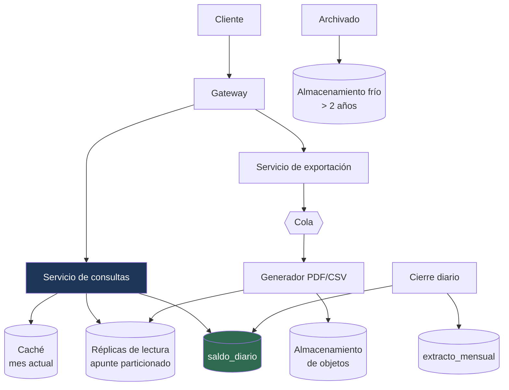

---
tags:
  - Java
  - System Design
  - Caso
  - Banca
Creado: 2026-09-08
Relacionado:
  - System Design
  - 03 - Ledger y Partida Doble
Palabras clave:
  - extracto, saldo historico, proyeccion, snapshot, cursor, PDF, retencion
Nivel: Avanzado
---

# C7 · Estado de cuenta histórico

> **Enunciado:** *"Diseñá el sistema que genera el estado de cuenta: movimientos de cualquier período de los últimos 10 años, con el saldo al inicio y al final, consultable desde la app y descargable en PDF."*

Parece el caso más simple de los bancarios y esconde tres problemas serios: **el saldo a una fecha pasada**, la paginación sobre miles de millones de filas, y una restricción que los otros casos no tienen — **el extracto de hace 5 años tiene que dar exactamente lo mismo hoy que ayer**.

## 1️⃣ Acotar

```
¿Cuánta historia?                              → 10 años, por normativa
¿Se puede consultar cualquier rango?           → sí, arbitrario
¿Formatos de descarga?                         → PDF y CSV
¿El extracto de un período cerrado puede cambiar? → ← LA pregunta
¿Cuántos movimientos tiene una cuenta activa?  → mediana 500/año, máximo 50.000/año
```

> [!danger] "¿Puede cambiar un extracto ya emitido?" define el diseño
> La respuesta correcta en banca es **no**. Un extracto de marzo emitido en abril tiene que dar lo mismo consultado en septiembre. Si aparece una operación con fecha de marzo registrada en mayo, no se mete retroactivamente: se registra en mayo con una referencia a la operación original.
> Esto descarta calcular el extracto "en vivo" sobre datos que pueden cambiar, y obliga a fijar cortes.

```
FUNCIONALES
  1. Movimientos de un rango de fechas, paginados
  2. Saldo inicial y final del período
  3. Saldo a cualquier fecha pasada
  4. Descarga en PDF y CSV
  5. Extractos mensuales precalculados

FUERA DE ALCANCE
  - Categorización automática de gastos
  - Gráficos y analítica personal

NO FUNCIONALES
  - Primera página en < 300 ms
  - Un extracto emitido NUNCA cambia   ← define el diseño
  - Retención 10 años
  - Consistencia eventual aceptable para el saldo mostrado (segundos)
```

## 2️⃣ Escala

```
Cuentas:            8 M
Movimientos:        2 M/día → 730 M/año → 7.300 M en 10 años
Consultas:          20 M/día → 200 QPS → pico ×5 = 1.000 QPS
Descargas de PDF:   500 K/día → 5 QPS (concentradas a principio de mes)

ALMACENAMIENTO
  7.300 M movimientos × 150 bytes  = 1,1 TB
  × 1,5 índices                    = 1,6 TB
  × 3 réplicas                     ≈ 5 TB
```

> **Conclusiones:**
> - **7.300 millones de filas**: el particionado por fecha no es opcional.
> - Calcular el saldo sumando 10 años de apuntes es inviable → **snapshots**.
> - 1.000 QPS de lectura pura → réplicas de lectura y caché de lo reciente.
> - Los PDF se generan asíncronos: 5 QPS de generación intensiva rompería el p99 de las consultas.

## 3️⃣ API

```
GET /api/v1/cuentas/{id}/movimientos?desde=2026-01-01&hasta=2026-01-31&cursor=&limit=50
  → 200 {
      "saldoInicial": 1500.00,
      "saldoFinal": 2340.50,
      "movimientos": [ { fecha, descripcion, monto, saldoResultante, referencia } ],
      "siguienteCursor": "eyJpZCI6..."
    }

GET  /api/v1/cuentas/{id}/saldo?al=2024-03-15       → saldo a esa fecha
GET  /api/v1/cuentas/{id}/extractos                 → mensuales disponibles
POST /api/v1/cuentas/{id}/extractos/exportar        → 202 { tareaId }
GET  /api/v1/exportaciones/{tareaId}                → { estado, urlDescarga }
```

> [!tip] La exportación es asíncrona, siempre
> Un CSV de 50.000 movimientos tarda segundos y consume memoria. Generarlo dentro de la petición HTTP agota el timeout del balanceador y degrada a todos los demás usuarios. Se devuelve `202` con un identificador y el archivo se entrega por URL prefirmada — ver [[03 - APIs a Escala]].

## 4️⃣ Datos

```sql
-- Los movimientos, particionados por mes
CREATE TABLE apunte (
    id         BIGSERIAL,
    asiento_id UUID          NOT NULL,
    cuenta_id  UUID          NOT NULL,
    monto      NUMERIC(19,4) NOT NULL,
    moneda     VARCHAR(3)    NOT NULL,
    fecha      TIMESTAMPTZ   NOT NULL,
    PRIMARY KEY (id, fecha)
) PARTITION BY RANGE (fecha);

CREATE TABLE apunte_2026_09 PARTITION OF apunte
    FOR VALUES FROM ('2026-09-01') TO ('2026-10-01');

CREATE INDEX ON apunte_2026_09 (cuenta_id, id DESC) INCLUDE (monto, moneda);
```

```sql
-- Snapshot de saldo por cierre: la clave para el saldo histórico
CREATE TABLE saldo_diario (
    cuenta_id      UUID          NOT NULL,
    fecha_corte    DATE          NOT NULL,
    moneda         VARCHAR(3)    NOT NULL,
    saldo          NUMERIC(19,4) NOT NULL,
    ultimo_apunte  BIGINT        NOT NULL,     -- desde dónde seguir sumando
    PRIMARY KEY (cuenta_id, fecha_corte, moneda)
);

-- Extracto mensual congelado: lo que se emitió, tal como se emitió
CREATE TABLE extracto_mensual (
    cuenta_id      UUID          NOT NULL,
    periodo        DATE          NOT NULL,      -- primer día del mes
    saldo_inicial  NUMERIC(19,4) NOT NULL,
    saldo_final    NUMERIC(19,4) NOT NULL,
    movimientos    INTEGER       NOT NULL,
    hash_contenido VARCHAR(64)   NOT NULL,      -- prueba de no alteración
    clave_pdf      VARCHAR(500),
    emitido_en     TIMESTAMPTZ   NOT NULL DEFAULT now(),
    PRIMARY KEY (cuenta_id, periodo)
);
```

> [!tip] El `hash_contenido` prueba que el extracto no se alteró
> Se calcula sobre los movimientos del período al emitirlo. Si alguien discute un extracto años después, el hash permite verificar que el contenido es el mismo que se emitió. Es la misma idea de la cadena de auditoría de [[12 - Auditoria y Trazabilidad]].

## 5️⃣ Diseño



## 💰 El saldo a una fecha pasada

El problema central. Tres enfoques, con sus costos:

| Enfoque | Costo | Viable |
|---|---|---|
| Sumar todos los apuntes hasta la fecha | O(n) sobre 10 años | ❌ |
| Guardar el saldo en cada apunte | denormalización pesada | ⚠️ |
| **Snapshot diario + delta** | O(1) + pocos apuntes | ✅ |

```java
public Dinero saldoAl(CuentaId cuenta, Moneda moneda, LocalDate fecha) {
    // 1 · El snapshot más cercano ANTERIOR o igual a la fecha
    var snapshot = saldoDiarioRepo.masCercanoAntesDe(cuenta, moneda, fecha)
        .orElse(SaldoDiario.cero(cuenta, moneda));

    // 2 · Los apuntes entre el snapshot y la fecha pedida
    BigDecimal delta = apunteRepo.sumarEntre(
        cuenta, moneda, snapshot.ultimoApunte(), finDelDia(fecha));

    return new Dinero(snapshot.saldo().add(delta), moneda);
}
```

```
Consulta: saldo al 2024-03-15
  → snapshot del 2024-03-14: S/ 4.320,00  (una fila, índice primario)
  → apuntes del 2024-03-15: 3 filas
  → saldo: S/ 4.320,00 + delta

Sin snapshot: sumar ~1.500 filas (3 años de movimientos). Con: 4 filas.
```

> [!danger] El snapshot es un caché, no una segunda fuente de verdad
> Tiene que poder **reconstruirse desde cero** y dar exactamente lo mismo. Un job periódico que lo regenera y compara es la red de seguridad de todo el modelo — ver [[Fase 8 - Batch y Cierre de Dia]].
> Si algún día no coincide, manda el ledger.

## 📄 Paginación con saldo corrido

El detalle que rompe las implementaciones ingenuas.

```sql
-- ❌ La función de ventana solo ve la página actual: el saldo corrido sale mal
SELECT a.*, SUM(monto) OVER (ORDER BY id) AS saldo_corrido
FROM apunte a WHERE cuenta_id = :c ORDER BY id DESC LIMIT 50 OFFSET 100;
```

```java
// ✅ Calcular el saldo base de la página y acumular desde ahí
public PaginaExtracto pagina(CuentaId cuenta, Moneda moneda, Long cursor, int limite) {

    var movimientos = apunteRepo.anterioresA(cuenta, moneda, cursor, limite);

    // Saldo justo antes del movimiento más antiguo de esta página
    Dinero saldoBase = saldoHasta(cuenta, moneda, movimientos.getLast().id() - 1);

    // Acumular hacia adelante dentro de la página
    var conSaldo = new ArrayList<MovimientoConSaldo>();
    Dinero acumulado = saldoBase;
    for (var m : movimientos.reversed()) {
        acumulado = acumulado.mas(m.importe());
        conSaldo.add(new MovimientoConSaldo(m, acumulado));
    }

    Collections.reverse(conSaldo);
    return new PaginaExtracto(conSaldo, cursorSiguiente(movimientos));
}
```

> [!warning] Cursor, nunca `OFFSET`
> `OFFSET 100000` lee y descarta 100.000 filas. Y peor: si llega un movimiento nuevo mientras el usuario pagina, los resultados se desplazan y ve registros repetidos.
> Con cursor el costo es constante y los resultados son estables — ver [[03 - APIs a Escala]].

> [!tip] La alternativa: denormalizar `saldo_resultante` en el apunte
> Es lo que hacen la mayoría de los core bancarios. Elimina el cálculo por página, a cambio de un campo derivado que hay que mantener. Sigue siendo reconstruible desde el ledger, así que la fuente de verdad no cambia.
> Es un trade-off legítimo: mencionar las dos opciones y elegir con criterio es mejor que asumir una.

## 🗄️ Datos calientes y fríos

```
Últimos 3 meses     → PostgreSQL, índices completos, caché      (95% de las consultas)
3 meses a 2 años    → PostgreSQL, particiones sin caché          (4,9%)
Más de 2 años       → almacenamiento frío (Parquet en objetos)   (0,1%)
```

```java
public PaginaExtracto consultar(CuentaId cuenta, Rango rango, ...) {
    if (rango.esCompletamenteAnteriorA(CORTE_FRIO)) {
        // Consulta al almacén analítico: más lenta, se avisa al usuario
        return archivoFrio.consultar(cuenta, rango);
    }
    return caliente.consultar(cuenta, rango, cursor, limite);
}
```

> [!tip] Mantener 10 años en la base transaccional es caro e innecesario
> El 95% de las consultas son de los últimos meses. Archivar lo viejo a formato columnar en almacenamiento de objetos reduce el tamaño de la base transaccional en un orden de magnitud, y el 0,1% de consultas históricas puede tardar segundos: el usuario que pide su extracto de 2018 lo entiende.

```sql
-- Archivar es soltar la partición, no borrar filas
ALTER TABLE apunte DETACH PARTITION apunte_2023_01;
-- exportar a Parquet, subir a almacenamiento frío, DROP
```

## 📑 La generación de documentos

```java
@KafkaListener(topics = "exportaciones")
public void generar(SolicitudExportacion s, Acknowledgment ack) {

    if (procesados.yaVisto(s.tareaId(), "exportacion")) { ack.acknowledge(); return; }

    String clave = "extractos/%s/%s.%s".formatted(s.cuentaId(), s.tareaId(), s.formato());

    // Streaming: nunca materializar 50.000 movimientos en memoria
    try (var salida = almacen.abrirEscritura(clave)) {
        var escritor = escritorPara(s.formato(), salida);
        escritor.encabezado(datosDe(s));

        apunteRepo.recorrer(s.cuentaId(), s.rango(), escritor::fila);   // cursor de base

        escritor.pie(totales);
    }

    tareas.completar(s.tareaId(), almacen.urlDeDescarga(clave, Duration.ofHours(24)));
    ack.acknowledge();
}
```

> [!danger] Generar un PDF de 50.000 filas en memoria es un `OutOfMemoryError` esperando
> Y con las descargas concentradas a principio de mes, van a ser muchos a la vez. El streaming desde un cursor de base directo al objeto mantiene el consumo constante.

> [!warning] El PDF de un período cerrado se genera una vez y se guarda
> No se regenera en cada descarga: se genera al cerrar el mes, se archiva, y las descargas posteriores devuelven el mismo archivo. Eso garantiza que el documento sea idéntico siempre, y elimina el 99% del trabajo de generación.

## 6️⃣ Profundizar

### "¿Cómo garantizás que un extracto no cambie?"

Tres mecanismos combinados:
1. El ledger es **append-only**: no se editan ni borran apuntes.
2. Un ajuste con fecha anterior se registra **en la fecha actual**, con referencia al original.
3. El extracto mensual se congela con su `hash_contenido` al emitirlo.

### "¿Y si hay un error y hay que corregir un movimiento de hace 3 meses?"

No se toca el movimiento original. Se registra un **asiento de reversa** con fecha de hoy y su compensación. El extracto de hace 3 meses sigue mostrando lo que mostró; el de este mes muestra la corrección con su explicación. Es lo correcto contable y legalmente — ver [[03 - Ledger y Partida Doble]].

### "¿Cómo consultás el extracto de una cuenta con 500.000 movimientos?"

Cursor + índice `(cuenta_id, id DESC)` con columnas incluidas. La consulta de la primera página toca ~50 filas del índice sin ir a la tabla. El particionado hace que solo se lea la partición del rango pedido.

### "¿Qué pasa si el snapshot se corrompe?"

Se regenera desde el ledger. Es la propiedad que lo vuelve seguro: **cualquier error en el snapshot es reparable**, porque los apuntes son la verdad. Un job de verificación periódico compara snapshot contra suma directa en una muestra de cuentas.

### "¿Y si crece 10×?"

```
73.000 M de movimientos
→ el particionado por fecha ya está
→ agregar particionado por hash de cuenta dentro de cada mes (subparticionado)
→ archivar más agresivo: corte frío a 1 año
→ el saldo histórico no cambia: los snapshots son O(1)
```

El diseño escala sin cambios estructurales, que es lo que se busca demostrar.

## 🎯 Qué se evalúa

| Señal positiva | Señal negativa |
|---|---|
| Snapshot + delta para el saldo histórico | sumar todos los apuntes |
| Notar que el saldo corrido rompe con paginación | ignorar el problema |
| Cursor en vez de `OFFSET` | paginar con offset |
| Particionado por fecha con archivado | todo en una tabla |
| Exportación asíncrona con streaming | generar el PDF en la petición |
| Snapshot reconstruible | tratarlo como fuente de verdad |
| Congelar el extracto emitido | recalcularlo cada vez |
| Corregir con reversa, no editando | `UPDATE` sobre el movimiento |

## 🔄 Variantes

| Variante | Qué cambia |
|---|---|
| Multi-moneda | snapshot y saldos por moneda; conversión solo para mostrar |
| Categorización de gastos | enriquecimiento asíncrono, modelo de clasificación |
| Extracto consolidado (varias cuentas) | fusión ordenada entre particiones |
| Envío automático por correo | job mensual, plantillas, gestión de rebotes |

## 📌 Notas Rápidas
- La combinación **snapshot + delta** es la respuesta esperada para el saldo histórico, y es la misma técnica que usan los core bancarios reales. Convierte una consulta O(n) en O(1).
- El problema del saldo corrido con paginación es sutil y muy real: es de esos detalles que solo conoce quien lo implementó.
- Este caso es el que más se apoya en [[03 - Ledger y Partida Doble]]: si el modelo de datos está bien, el extracto sale casi solo. Si el saldo fuera una columna actualizable, nada de esto sería posible.

## 🔗 Relaciones
- **Módulo**: [[System Design]]
- **Anterior**: [[C6 - Procesador de Pagos]]
- **Siguiente**: [[C8 - Limites y Antifraude]]
- **Teoría**: [[03 - Ledger y Partida Doble]], [[05 - Base de Datos a Escala]], [[12 - Particionado y Sharding]]

---

## ✍️ Mis apuntes
<!-- Tus dudas, ejemplos propios, cómo lo aplicaste -->

