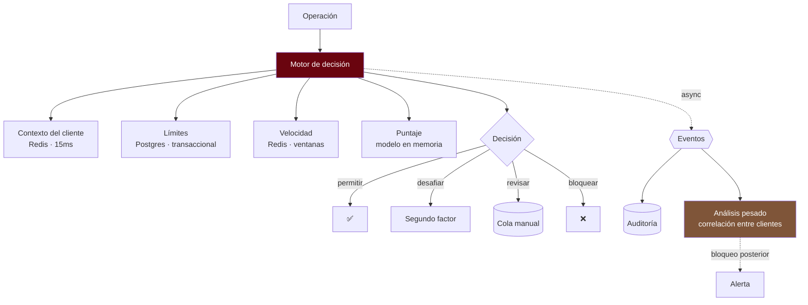

---
tags:
  - Java
  - System Design
  - Caso
  - Banca
Creado: 2026-09-08
Relacionado:
  - System Design
  - 13 - Antifraude y Limites
Palabras clave:
  - antifraude, limites, reglas, ventana deslizante, latencia, falsos positivos, scoring
Nivel: Avanzado
---

# C8 · Motor de límites y antifraude

> **Enunciado:** *"Diseñá el motor que decide, en tiempo real, si una operación se permite: valida límites y evalúa riesgo de fraude."*

Es el caso con la restricción más dura: tiene que responder en **menos de 100 ms**, consultar el comportamiento histórico del cliente, y equivocarse poco en las dos direcciones — dejar pasar fraude cuesta dinero, bloquear a un cliente legítimo cuesta el cliente.

## 1️⃣ Acotar

```
¿Límites y antifraude son el mismo servicio?    → sí, pero decisiones distintas
¿Presupuesto de latencia?                        → 100 ms p99 ← define todo
¿Las reglas las cambia el área de riesgos?       → sí, sin desplegar
¿Hay modelos de aprendizaje automático?          → sí, pero asíncronos
¿Qué pasa si el motor no responde?               → ← LA pregunta
```

> [!danger] "¿Qué pasa si el motor no responde?" hay que responderla en el diseño
> Es una decisión de negocio, no técnica: *fail-open* (dejar pasar) mantiene el servicio y abre una ventana de riesgo; *fail-closed* (rechazar) protege y rompe la operación de todos los clientes.
> La respuesta habitual es **mixta por monto**, y decirlo demuestra que pensaste el caso degradado.

```
FUNCIONALES
  1. Validar límites (operación, diario, mensual, cantidad)
  2. Evaluar riesgo y devolver una decisión
  3. Reglas configurables sin desplegar
  4. Consumir y liberar cupo
  5. Cola de revisión manual

FUERA DE ALCANCE
  - Entrenamiento de modelos
  - Investigación de casos (herramienta aparte)

NO FUNCIONALES
  - p99 < 100 ms   ← define todo
  - Disponibilidad 99,99%
  - Los límites son EXACTOS (no aproximados)
  - El antifraude es probabilístico
  - Auditable: por qué se rechazó cada operación
```

> [!tip] Separar "exacto" de "probabilístico" es la primera decisión importante
> Un límite diario de S/ 15.000 no puede permitir S/ 15.001 "por aproximación": es una regla contractual. El puntaje de fraude, en cambio, es una estimación.
> Eso implica **dos caminos con garantías distintas**: los límites necesitan consistencia fuerte y transaccionalidad; el antifraude tolera datos de hace unos segundos.

## 2️⃣ Escala

```
Operaciones evaluadas:   20 M/día (transferencias + tarjetas)
                         → 200 QPS → pico ×5 = 1.000 QPS → estacional ×10 = 2.000 QPS

Presupuesto de 100 ms, desglosado:
  Cargar contexto del cliente     15 ms   ← caché
  Evaluar límites                 20 ms   ← base, transaccional
  Reglas de velocidad             25 ms   ← Redis
  Puntaje de riesgo               30 ms   ← modelo en memoria
  Decisión y respuesta            10 ms
  ─────────────────────────────────────
  Total                          100 ms   → sin margen: hay que ser estricto
```

```
ESTADO A MANTENER
  Contadores de consumo: 8 M cuentas × 3 dimensiones × 50 B ≈ 1,2 GB  ← entra en Redis
  Ventanas de velocidad: 1,5 M clientes activos × 2 KB      ≈ 3 GB
```

> **Conclusiones:**
> - El estado entra en memoria: **Redis para todo lo caliente**.
> - No hay lugar para dos llamadas remotas en serie: lo que se pueda, en paralelo.
> - Los modelos pesados no entran en 100 ms → van asíncronos.

## 3️⃣ API

```
POST /internal/evaluar
  { "clienteId", "cuentaId", "tipo": "TRANSFERENCIA", "monto": 5000.00,
    "moneda": "PEN", "canal": "MOVIL", "destino": "...", "dispositivo": "...", "ip": "..." }
  → 200 {
      "decision": "PERMITIR" | "DESAFIAR" | "REVISAR" | "BLOQUEAR",
      "puntaje": 42,
      "motivos": ["DISPOSITIVO_NUEVO"],
      "limiteDisponible": 9500.00,
      "evaluacionId": "..."          ← para auditar y para confirmar/liberar después
    }

POST /internal/evaluaciones/{id}/confirmar   → consume el cupo definitivamente
POST /internal/evaluaciones/{id}/liberar     → devuelve el cupo (operación no se ejecutó)
```

> [!tip] Evaluar y confirmar son dos pasos
> Si el motor consume el cupo al evaluar y después la transferencia falla por otro motivo, el cliente perdió cupo por una operación que no ocurrió. El patrón de dos fases —reservar al evaluar, confirmar o liberar según el resultado— lo resuelve.
> Es la misma idea que las retenciones de [[C6 - Procesador de Pagos]].

## 4️⃣ Datos

```sql
-- Reglas configurables: van en base, no en código
CREATE TABLE limite (
    id             UUID PRIMARY KEY,
    ambito         VARCHAR(20) NOT NULL,     -- PRODUCTO | SEGMENTO | CLIENTE | CUENTA
    ambito_id      VARCHAR(60),
    tipo           VARCHAR(30) NOT NULL,     -- POR_OPERACION | DIARIO | MENSUAL | CANTIDAD_DIARIA
    canal          VARCHAR(20),
    monto          NUMERIC(19,4),
    cantidad       INTEGER,
    vigente_desde  TIMESTAMPTZ NOT NULL,
    vigente_hasta  TIMESTAMPTZ
);

CREATE TABLE regla_riesgo (
    id            UUID PRIMARY KEY,
    nombre        VARCHAR(60) NOT NULL,
    expresion     TEXT        NOT NULL,      -- DSL evaluable
    peso          SMALLINT    NOT NULL,
    activa        BOOLEAN     NOT NULL DEFAULT true,
    modo          VARCHAR(10) NOT NULL       -- SOMBRA | ACTIVA
);

-- Consumo: transaccional, exacto
CREATE TABLE consumo_limite (
    cuenta_id      UUID          NOT NULL,
    fecha          DATE          NOT NULL,
    canal          VARCHAR(20)   NOT NULL,
    monto_usado    NUMERIC(19,4) NOT NULL DEFAULT 0,
    cantidad_usada INTEGER       NOT NULL DEFAULT 0,
    PRIMARY KEY (cuenta_id, fecha, canal)
);

-- Auditoría de decisiones: append-only
CREATE TABLE evaluacion (
    id           UUID PRIMARY KEY,
    cliente_id   UUID        NOT NULL,
    decision     VARCHAR(20) NOT NULL,
    puntaje      SMALLINT    NOT NULL,
    motivos      JSONB,
    contexto     JSONB,                      -- las señales usadas
    version_reglas VARCHAR(20) NOT NULL,     -- ← reproducibilidad
    creada_en    TIMESTAMPTZ NOT NULL DEFAULT now()
) PARTITION BY RANGE (creada_en);
```

> [!tip] Guardar la versión de reglas hace reproducible la decisión
> Seis meses después, un cliente reclama que le bloquearon una operación. Con la versión de reglas y el contexto guardados, podés **reproducir exactamente** por qué se decidió así. Sin eso, la respuesta es "el sistema lo decidió", que no sirve ni para el cliente ni para el regulador.

> [!danger] El modo SOMBRA es imprescindible
> Una regla nueva se activa primero en sombra: se evalúa y se registra qué **habría** decidido, sin afectar nada. Después de unos días se mira cuántas operaciones legítimas habría bloqueado, y recién ahí se activa.
> Poner una regla directo en producción es cómo se bloquea al 5% de los clientes un lunes a la mañana.

## 5️⃣ Diseño



## ⚡ El camino crítico

```java
public Decision evaluar(SolicitudEvaluacion s) {

    // Lo independiente, en paralelo: no hay presupuesto para serializar
    var contexto  = supplyAsync(() -> contextos.cargar(s.clienteId()), pool);
    var velocidad = supplyAsync(() -> velocidades.evaluar(s), pool);

    // Límites: transaccional y exacto. No se paraleliza con lo anterior
    // porque además RESERVA el cupo.
    ResultadoLimite limite = limites.verificarYReservar(s);
    if (limite.excedido()) {
        return Decision.bloquear("LIMITE_EXCEDIDO", limite.disponible());   // explicable
    }

    int puntaje = calcularPuntaje(contexto.join(), velocidad.join(), s);

    Decision decision = switch (nivel(puntaje)) {
        case BAJO    -> Decision.permitir();
        case MEDIO   -> Decision.desafiar(OTP);
        case ALTO    -> Decision.revisar();
        case CRITICO -> Decision.bloquear("RIESGO");        // genérico, a propósito
    };

    eventos.publicar(new EvaluacionRealizada(s, decision, puntaje));   // asíncrono
    return decision;
}
```

> [!warning] El mensaje de límite explica; el de fraude no
> *"Excede su límite diario, le quedan S/ 1.500"* es útil y no ayuda a nadie a evadir nada.
> *"Bloqueado porque el monto supera 3 veces su promedio histórico"* le enseña al defraudador exactamente qué hacer. Los mensajes antifraude son genéricos a propósito — ver [[13 - Antifraude y Limites]].

## 🔒 Límites: exactitud bajo concurrencia

```sql
-- Verificar y reservar en UNA operación atómica
UPDATE consumo_limite
SET monto_usado    = monto_usado + :monto,
    cantidad_usada = cantidad_usada + 1
WHERE cuenta_id = :cuenta AND fecha = :hoy AND canal = :canal
  AND monto_usado + :monto <= :limiteDiario
  AND cantidad_usada + 1   <= :limiteCantidad
RETURNING monto_usado;
```

> [!danger] Consultar y después actualizar permite exceder el límite
> ```java
> var usado = repo.consumoDe(cuenta);        // ← otra operación puede pasar acá
> if (usado + monto <= limite) repo.acumular(cuenta, monto);
> ```
> Dos operaciones simultáneas leen el mismo consumo, ambas validan y ambas acumulan: el límite se excede.
> **La condición va dentro del `UPDATE`**: si no se cumple, afecta cero filas. Mismo principio que el `INSERT` de retenciones en [[C6 - Procesador de Pagos]].

> [!tip] Por qué los límites van en Postgres y no en Redis
> Redis es más rápido, pero es volátil: si se pierde, se pierde el consumo del día y los clientes pueden exceder sus límites sin registro. Un límite es una obligación contractual — necesita durabilidad transaccional.
> El antifraude sí va en Redis: perder ventanas de velocidad degrada la detección, no rompe una obligación.

## 🌊 Ventanas de velocidad

```java
public List<Senal> evaluar(SolicitudEvaluacion s) {
    var pipeline = redis.pipelined();       // ← una sola ida y vuelta

    pipeline.zCount(k("ops", s.clienteId()),  hace(5, MINUTES),  ahora());
    pipeline.zCount(k("dest", s.clienteId()), hace(1, HOURS),    ahora());
    pipeline.zCount(k("fail", s.clienteId()), hace(10, MINUTES), ahora());
    pipeline.get(k("ultimaGeo", s.clienteId()));

    var r = pipeline.syncAndReturnAll();
    return interpretar(r, s);
}
```

```java
private List<Senal> interpretar(List<Object> r, SolicitudEvaluacion s) {
    var senales = new ArrayList<Senal>();

    if (contar(r, 0) > 5)   senales.add(Senal.de("MUCHAS_OPERACIONES", 30));
    if (contar(r, 1) > 10)  senales.add(Senal.de("MUCHOS_DESTINOS", 40));
    if (contar(r, 2) > 3)   senales.add(Senal.de("FALLOS_PREVIOS", 25));

    if (dispositivoNuevo(s) && s.monto().compareTo(UMBRAL_ALTO) > 0)
        senales.add(Senal.de("DISPOSITIVO_NUEVO_MONTO_ALTO", 50));

    if (velocidadGeograficaImposible(r, s))
        senales.add(Senal.de("VIAJE_IMPOSIBLE", 70));      // la señal más confiable

    return senales;
}
```

> [!tip] Una sola ida y vuelta a Redis, no cinco
> Con 100 ms de presupuesto, cinco llamadas secuenciales de 2 ms cada una son 10 ms más latencia de red multiplicada. El *pipeline* agrupa todas en un solo viaje.
> Es el equivalente al N+1 de red de [[01 - Falacias de la Computacion Distribuida]], en pequeña escala.

Las ventanas se mantienen como `ZSET` con poda por tiempo:

```java
redis.zAdd(k("ops", clienteId), ahora(), UUID.randomUUID().toString());
redis.zRemoveRangeByScore(k("ops", clienteId), 0, hace(24, HOURS));
redis.expire(k("ops", clienteId), Duration.ofHours(25));
```

## 🧠 Reglas configurables

```java
@Component
public class MotorDeReglas {

    private volatile List<ReglaCompilada> reglas = List.of();

    @Scheduled(fixedDelay = 30_000)          // recarga sin desplegar
    public void recargar() {
        var nuevas = repo.activas().stream().map(this::compilar).toList();
        this.reglas = nuevas;                 // reemplazo atómico de la referencia
    }

    public Resultado evaluar(Contexto ctx) {
        int puntaje = 0;
        var motivos = new ArrayList<String>();

        for (var regla : reglas) {
            if (regla.evalua(ctx)) {
                if (regla.modo() == ACTIVA) { puntaje += regla.peso(); motivos.add(regla.nombre()); }
                else { sombra.registrar(regla, ctx); }     // solo observa
            }
        }
        return new Resultado(puntaje, motivos);
    }
}
```

> [!warning] Las reglas se compilan al cargar, no en cada evaluación
> Interpretar una expresión de texto 2.000 veces por segundo consume el presupuesto entero. Se compilan una vez al recargar y se evalúan como código.

## 🛡️ Degradación

```java
public Decision evaluarConPresupuesto(SolicitudEvaluacion s) {
    try {
        return supplyAsync(() -> evaluar(s), pool).get(100, MILLISECONDS);

    } catch (TimeoutException e) {
        metricas.contar("antifraude.timeout");

        // Los LÍMITES igual se validan: son exactos y baratos
        if (limites.excedido(s)) return Decision.bloquear("LIMITE_EXCEDIDO");

        // El riesgo se degrada según el monto
        return s.monto().compareTo(UMBRAL_SEGURO) < 0
            ? Decision.permitir()          // fail-open para montos bajos
            : Decision.revisar();          // fail-closed para altos
    }
}
```

> [!tip] Degradar por partes, no todo o nada
> Aunque el motor de riesgo no responda, los límites sí se pueden validar: son una consulta simple y transaccional. Rechazar todo porque un componente falló es peor que degradar la parte que falló.

## 6️⃣ Profundizar

### "¿Cómo evitás los falsos positivos?"

- **Modo sombra** antes de activar cualquier regla nueva.
- **Desafiar en vez de bloquear** en el rango medio: un segundo factor convierte un falso positivo en diez segundos de molestia.
- Métricas de tasa de bloqueo por segmento: si un segmento tiene una tasa anómala, la regla está mal calibrada.
- Retroalimentación: los casos revisados manualmente y marcados como legítimos alimentan la recalibración.

### "¿Cómo se comparte estado entre instancias?"

Los contadores de límite en Postgres (exactos, transaccionales) y las ventanas de velocidad en Redis (rápidas, tolerantes a pérdida). Ninguna instancia guarda estado propio: son todas intercambiables.

### "¿Y si Redis se cae?"

Se pierden las ventanas de velocidad → se degrada la detección de patrones, no los límites. La política: seguir operando con las señales que quedan, subir el umbral de desafío (más fricción, más seguridad) y alertar. La detección asíncrona posterior compensa parcialmente.

### "¿Cómo detectás fraude que solo se ve entre varios clientes?"

Fuera del camino crítico. El análisis de correlación —muchas cuentas enviando al mismo destino, patrones de mulas— se hace sobre los eventos publicados, con ventanas de minutos u horas. Si detecta algo, dispara bloqueos posteriores y alertas. **No entra en 100 ms y no tiene por qué.**

### "¿Cómo probás que las reglas funcionan?"

- Casos de prueba por regla con contexto sintético.
- Reproducción del tráfico histórico contra un conjunto de reglas nuevo: cuántos fraudes conocidos habría detectado y cuántas operaciones legítimas habría bloqueado.
- Modo sombra en producción.

## 🎯 Qué se evalúa

| Señal positiva | Señal negativa |
|---|---|
| Separar límites exactos de riesgo probabilístico | tratarlos igual |
| Verificar y reservar en un solo `UPDATE` | consultar y después acumular |
| Límites en base durable, velocidad en Redis | todo en Redis |
| Presupuesto de latencia desglosado | no mencionar la latencia |
| Pipeline en Redis | cinco llamadas secuenciales |
| Modo sombra para reglas nuevas | activar directo |
| Política explícita ante timeout | no considerarlo |
| Mensajes de fraude genéricos | explicar la regla al usuario |
| Evaluar y confirmar en dos pasos | consumir cupo al evaluar |

## 🔄 Variantes

| Variante | Qué cambia |
|---|---|
| Modelo de aprendizaje en línea | inferencia en el camino crítico: presupuesto más ajustado |
| Antilavado (AML) | ventanas de días, detección de estructuración, reporte regulatorio |
| Autenticación adaptativa | la decisión afecta qué factor se pide, no si se permite |
| Reglas por comercio | dimensión adicional, más cardinalidad |

## 📌 Notas Rápidas
- La distinción **exacto vs probabilístico** es lo que ordena todo el diseño: define qué va en Postgres y qué en Redis, qué degrada y qué no, y qué se le explica al usuario.
- El modo sombra es la práctica que más previene incidentes en este tipo de sistema, y casi nunca aparece en las respuestas de entrevista.
- El "viaje imposible" —dos operaciones presenciales a 3.000 km con una hora de diferencia— es la señal más barata de calcular y de las más confiables.
- Se relaciona con [[13 - Antifraude y Limites]] y se aplica en [[Fase 2 - Transferencias e Idempotencia]].

## 🔗 Relaciones
- **Módulo**: [[System Design]]
- **Anterior**: [[C7 - Estado de Cuenta]]
- **Siguiente**: [[C9 - Cierre de Dia]]
- **Teoría**: [[13 - Antifraude y Limites]], [[07 - Rate Limiting]], [[04 - Estrategias de Cache]]

---

## ✍️ Mis apuntes
<!-- Tus dudas, ejemplos propios, cómo lo aplicaste -->

