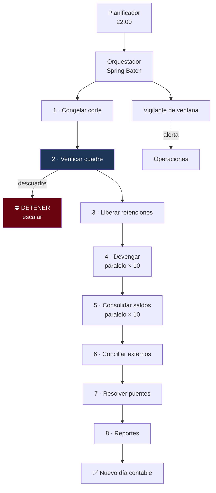

---
tags:
  - Java
  - System Design
  - Caso
  - Banca
Creado: 2026-09-08
Relacionado:
  - System Design
  - 10 - Cierre de Dia y Batch
Palabras clave:
  - cierre, EOD, batch, ventana, conciliacion, cuadre, idempotencia, contingencia
Nivel: Avanzado
---

# C9 · Cierre de día

> **Enunciado:** *"Diseñá el proceso de cierre diario de un banco: consolida saldos, calcula intereses, concilia contra terceros y verifica que la contabilidad cuadre — todo en una ventana de 4 horas."*

Es el caso menos glamoroso y el que más revela sobre criterio de ingeniería. No hay picos de tráfico ni latencias de milisegundos: hay **una ventana fija, millones de registros y cero tolerancia al error**.

## 1️⃣ Acotar

```
¿Cuál es la ventana?                          → 22:00 a 02:00 (4 h) ← restricción dura
¿El sistema sigue operando durante el cierre?  → sí, 24×7 (no hay corte)
¿Qué pasa si no cuadra?                        → ← LA pregunta
¿Se puede re-ejecutar?                          → tiene que poderse
¿Cuántas cuentas?                               → 8 millones
```

> [!danger] "¿Qué pasa si no cuadra?" define el diseño
> La respuesta correcta es **se detiene el cierre y se escala a un humano**. No se ajusta automáticamente, no se ignora, no se continúa "para no perder la ventana".
> Un cierre que termina a horario con números mal es infinitamente peor que uno que no termina. Decir esto es la señal más clara de que entendés el dominio.

```
FUNCIONALES
  1. Congelar el corte del día contable
  2. Verificar el cuadre global
  3. Liberar retenciones vencidas
  4. Devengar intereses y comisiones
  5. Consolidar saldos (snapshots)
  6. Conciliar contra archivos externos
  7. Resolver cuentas puente
  8. Generar reportes contables y regulatorios

FUERA DE ALCANCE
  - Cierre mensual y anual (misma estructura, otro alcance)
  - Reportes de gestión

NO FUNCIONALES
  - Completar en < 4 h                    ← restricción dura
  - Re-ejecutable sin duplicar efectos    ← crítico
  - Un descuadre DETIENE el proceso
  - El sistema transaccional sigue operando
  - Trazabilidad completa de cada paso
```

## 2️⃣ Escala

```
Cuentas:               8 M
Movimientos del día:   2 M
Archivos externos:     12 (adquirentes, cámara, corresponsales)

PRESUPUESTO DE 4 HORAS = 240 minutos
  Congelar corte              1 min
  Verificar cuadre            8 min    ← agregación sobre 7.300 M de apuntes
  Liberar retenciones         5 min
  Devengar intereses         45 min    ← 8 M de cuentas
  Consolidar saldos          60 min    ← 8 M de snapshots
  Conciliar externos         40 min
  Resolver puentes            5 min
  Generar reportes           30 min
  ────────────────────────────────
  Total                     194 min    → margen de 46 min (19%) ✅
```

> **Conclusiones:**
> - El margen es de solo 19%: **hay que medir la tendencia**, no solo el resultado.
> - Los dos pasos pesados (devengo y consolidación) son paralelizables: las cuentas son independientes.
> - El cuadre sobre 7.300 M de filas necesita agregados incrementales, no un `SUM` completo.

## 3️⃣ Orquestación

```
GET  /internal/cierres/{fecha}              → estado, paso actual, progreso
POST /internal/cierres/{fecha}/iniciar      → 202
POST /internal/cierres/{fecha}/reanudar     → desde el paso que falló
POST /internal/cierres/{fecha}/abortar      → con motivo, auditado
GET  /internal/cierres/{fecha}/excepciones  → partidas y descuadres
```

## 4️⃣ Datos

```sql
CREATE TABLE ejecucion_cierre (
    fecha_contable DATE PRIMARY KEY,
    estado         VARCHAR(20) NOT NULL,   -- EN_CURSO | COMPLETADO | DETENIDO | ABORTADO
    corte_en       TIMESTAMPTZ,            -- el instante congelado
    iniciado_en    TIMESTAMPTZ,
    finalizado_en  TIMESTAMPTZ,
    paso_actual    VARCHAR(40),
    motivo_parada  TEXT
);

-- La barrera de idempotencia: un paso se ejecuta UNA vez por fecha
CREATE TABLE ejecucion_paso (
    fecha_contable DATE        NOT NULL,
    paso           VARCHAR(40) NOT NULL,
    estado         VARCHAR(20) NOT NULL,
    registros      BIGINT,
    iniciado_en    TIMESTAMPTZ NOT NULL DEFAULT now(),
    finalizado_en  TIMESTAMPTZ,
    PRIMARY KEY (fecha_contable, paso)     -- ← la base impide la doble ejecución
);

CREATE TABLE excepcion_cierre (
    id             UUID PRIMARY KEY,
    fecha_contable DATE        NOT NULL,
    paso           VARCHAR(40) NOT NULL,
    tipo           VARCHAR(40) NOT NULL,
    severidad      VARCHAR(10) NOT NULL,   -- CRITICA | ALTA | MEDIA
    detalle        JSONB       NOT NULL,
    estado         VARCHAR(20) NOT NULL DEFAULT 'ABIERTA',
    resolucion     TEXT,
    resuelta_por   VARCHAR(60),
    resuelta_en    TIMESTAMPTZ
);
```

## 5️⃣ Diseño



## ❄️ Paso 1 — Congelar el corte

```java
@Transactional
public Instant congelarCorte(LocalDate fechaContable) {
    Instant corte = Instant.now();
    repo.registrarCorte(fechaContable, corte);
    return corte;
}
```

> [!danger] El sistema sigue operando durante el cierre
> No hay ventana de mantenimiento: mientras el cierre procesa, entran transferencias nuevas. Si cada paso consultara "hasta ahora", cada uno vería un universo distinto y los números no cerrarían entre sí.
> **Todos los pasos operan sobre el mismo instante de corte congelado.** Las operaciones posteriores pertenecen al día siguiente.

```java
// Todos los pasos filtran por el corte, no por "ahora"
apunteRepo.sumaPorMoneda(ejecucion.corteEn());
```

## ✅ Paso 2 — El cuadre

```sql
SELECT moneda, SUM(monto) AS descuadre
FROM apunte a JOIN asiento s ON s.id = a.asiento_id
WHERE s.fecha <= :corte
GROUP BY moneda
HAVING SUM(monto) <> 0;
```

```java
public void verificarCuadre(Instant corte) {
    List<Descuadre> descuadres = apunteRepo.sumaPorMoneda(corte);

    if (!descuadres.isEmpty()) {
        excepciones.registrar(CRITICA, "DESCUADRE_CONTABLE", descuadres);
        alertas.despertar("guardia-operaciones", descuadres);
        throw new DescuadreContableException(descuadres);      // ⛔ detiene el job
    }
}
```

> [!tip] Es la misma invariante de la Fase 0 del laboratorio
> `el_sistema_completo_siempre_cuadra_en_cero` empezó como un test unitario con tres asientos en memoria. Acá es un control contable sobre miles de millones de filas. **La invariante nunca cambió** — eso es lo que significa modelar bien el dominio desde el principio.

> [!warning] Sumar 7.300 M de filas cada noche no es viable
> Con agregados incrementales por partición sí: cada partición mensual cerrada tiene su suma precalculada e inmutable (los asientos son append-only, no cambian). Solo se suma la partición del mes en curso.
> ```sql
> SELECT SUM(total) FROM agregado_particion WHERE periodo < :mesActual
>   + (SELECT SUM(monto) FROM apunte_2026_09 WHERE fecha <= :corte);
> ```

## 💰 Pasos 4 y 5 — Los pesados

```java
@Bean
public Step consolidarSaldos(JobRepository repo, PlatformTransactionManager tx) {
    return new StepBuilder("consolidarSaldos", repo)
        .<CuentaConSaldo, SaldoDiario>chunk(500, tx)
        .reader(lectorParticionado())               // paginado, orden estable
        .processor(calculadora())
        .writer(escritorMasivo())
        .faultTolerant()
            .retryLimit(3).retry(TransientDataAccessException.class)
            .skipLimit(0)                            // ⛔ es dinero: no se saltea nada
        .taskExecutor(ejecutorParalelo())            // 10 hilos
        .build();
}
```

```java
// Particionado por rango de cuenta: 10 particiones en paralelo
@Bean
public Partitioner particionadorPorCuenta() {
    return gridSize -> IntStream.range(0, gridSize)
        .boxed()
        .collect(toMap(i -> "particion" + i, i -> {
            var ctx = new ExecutionContext();
            ctx.putInt("modulo", gridSize);
            ctx.putInt("resto", i);                   // WHERE hashtext(id::text) % 10 = :resto
            return ctx;
        }));
}
```

> [!danger] `skipLimit(0)` en todo paso que toque dinero
> Spring Batch permite saltear registros con error y continuar. En un cierre contable eso significa que el proceso termina "bien" con números mal, y nadie se entera hasta el mes siguiente.
> Es el opuesto exacto de [[C4 - Carga Masiva de Archivos]], donde saltear al validar es lo correcto. **La misma decisión, opuesta según el contexto.**

> [!warning] Lectura paginada con orden estable, nunca `findAll()`
> 8 millones de cuentas en memoria son un `OutOfMemoryError` a mitad del cierre, con la ventana consumida y el proceso a medias. Y sin `sortKeys` estable, la paginación puede repetir u omitir cuentas.

## 🔁 Idempotencia del job

```java
@Bean
public Step devengarIntereses(JobRepository repo, PlatformTransactionManager tx) {
    return new StepBuilder("devengarIntereses", repo)
        .tasklet((contribution, ctx) -> {
            LocalDate fecha = fechaContableDe(ctx);

            if (pasos.yaEjecutado("devengarIntereses", fecha)) {
                log.info("paso ya ejecutado para {}, se omite", fecha);
                return RepeatStatus.FINISHED;
            }

            devengador.calcular(fecha, corteDe(ctx));
            pasos.marcarEjecutado("devengarIntereses", fecha);   // clave primaria compuesta
            return RepeatStatus.FINISHED;
        }, tx).build();
}
```

> [!danger] Un cierre no idempotente que se relanza duplica los intereses
> Y no es hipotético: los cierres fallan a la mitad con regularidad —un archivo que no llegó, una dependencia caída, un timeout—. Relanzarlo es el procedimiento normal.
> La barrera es la **clave primaria `(paso, fecha_contable)`**: el `INSERT` del segundo intento falla. Mismo principio que la idempotencia de [[05 - Idempotencia Financiera]], aplicado a procesos batch.

## 🔍 Paso 6 — Conciliación

```java
public void conciliar(LocalDate fecha, OrigenExterno origen) {
    var archivo = almacen.buscar(origen.rutaDe(fecha));

    if (archivo.isEmpty()) {
        // NO detiene el cierre: se marca pendiente y se continúa
        excepciones.registrar(ALTA, "ARCHIVO_NO_RECIBIDO", origen);
        return;
    }

    var control = leerRegistroDeControl(archivo.get());
    var registros = leerRegistros(archivo.get());

    // Validar el archivo ANTES de procesarlo
    if (registros.size() != control.cantidad()
            || sumaDe(registros).compareTo(control.monto()) != 0) {
        excepciones.registrar(CRITICA, "ARCHIVO_INCONSISTENTE", origen);
        throw new ArchivoInconsistenteException(origen);
    }

    var resultado = matcher.conciliar(fecha, registros);
    resultado.diferencias().forEach(d -> partidas.registrar(fecha, origen, d));

    if (resultado.tieneDuplicados()) {
        excepciones.registrar(CRITICA, "DUPLICADO_DETECTADO", resultado.duplicados());
    }
}
```

> [!warning] Un archivo faltante no detiene el cierre; un descuadre sí
> Son severidades distintas. Que el corresponsal no haya subido su archivo es un problema operativo que se resuelve al día siguiente: el cierre continúa con esa conciliación pendiente.
> Un descuadre contable interno significa que **se creó o destruyó dinero**: eso sí detiene todo.

> [!danger] Un duplicado en conciliación es un bug de la Fase 2, no una diferencia
> Si la idempotencia estuviera bien implementada, no puede haber duplicados. Encontrar uno significa que existe una ruta que no pasa por la clave de idempotencia. Severidad crítica, no partida a ajustar — ver [[09 - Conciliacion y Cuadre]].

## ⏱️ Vigilancia de la ventana

```java
@Scheduled(fixedDelay = 60_000)
public void vigilar() {
    repo.enCurso().forEach(ej -> {
        Duration transcurrido = Duration.between(ej.iniciadoEn(), Instant.now());
        Duration esperado = historico.duracionMediaHasta(ej.pasoActual());

        if (transcurrido.compareTo(VENTANA_MAXIMA) > 0) {
            alertas.critica("CIERRE FUERA DE VENTANA", ej);
        } else if (transcurrido.compareTo(esperado.multipliedBy(2)) > 0) {
            alertas.advertencia("paso más lento de lo habitual", ej.pasoActual());
        }
    });
}
```

> [!tip] Medí la tendencia, no solo el resultado
> Un cierre que tardaba 90 minutos y ahora tarda 180 sigue "funcionando" — y te avisa que en unos meses no va a entrar en la ventana. Con solo 19% de margen, esa alerta llega meses antes de que se convierta en un incidente.

## 🚨 Contingencia

| Situación | Procedimiento | ¿Continúa? |
|---|---|---|
| Descuadre contable | detener, escalar a guardia | ❌ |
| Archivo externo no llegó | marcar pendiente | ✅ |
| Duplicado detectado | alerta crítica, continuar | ✅ con alerta |
| Paso falla por causa transitoria | reintentar desde ese paso | ✅ |
| Cuenta puente con saldo | investigar SAGAs colgadas | ⚠️ según monto |
| Ventana excedida | decisión del negocio | ⚠️ |
| Corrupción de datos | restaurar y reprocesar | ❌ |

```java
@Bean
public Job cierreDiario(JobRepository repo) {
    return new JobBuilder("cierreDiario", repo)
        .incrementer(new RunIdIncrementer())
        .validator(exigirFechaContable())
        .start(congelarCorte)
            .on("FAILED").end()
        .from(verificarCuadre)
            .on("FAILED").fail()             // ⛔ el cuadre NO se saltea
        .from(conciliarExternos)
            .on("FAILED").to(generarReportes)   // la conciliación sí puede fallar
        .end()
        .build();
}
```

> [!tip] Reanudar desde el paso que falló, no desde el principio
> Spring Batch no re-ejecuta los pasos completados. Con 4 horas de ventana y 194 minutos de trabajo, rehacer todo tras un fallo en el paso 7 significa perder la ventana.
> Solo funciona si cada paso es idempotente y el `JobRepository` persiste el estado — las dos cosas van juntas.

## 6️⃣ Profundizar

### "¿Qué pasa si el proceso muere a la mitad?"

Spring Batch persiste el estado por *chunk*. Al reanudar, continúa desde el último confirmado. La barrera `(paso, fecha)` impide re-ejecutar pasos completos, y el `skipLimit(0)` garantiza que no se saltearon registros. **Triple protección.**

### "¿Cómo verificás que el snapshot es correcto?"

Un job semanal lo reconstruye desde cero y compara con el vigente. Si difieren, hay un bug. Es la red de seguridad que convierte al snapshot en un caché legítimo y no en una segunda fuente de verdad — ver [[C7 - Estado de Cuenta]].

### "¿Y si el volumen crece 10×?"

```
80 M de cuentas → devengo y consolidación pasan de 105 a ~1.050 min ❌
→ más paralelismo: de 10 a 40 particiones (las cuentas son independientes)
→ escritura masiva con COPY en vez de INSERT
→ consolidar solo cuentas con movimiento del día (la mayoría no tuvo)
```

> [!tip] "Solo las cuentas con movimiento" es la optimización que más rinde
> De 8 millones de cuentas, quizá 500.000 tuvieron movimiento hoy. Las demás tienen el mismo saldo que ayer: su snapshot se puede copiar o directamente omitir, resolviendo la consulta con el snapshot anterior. **Reduce el paso más caro en un 90%.**

### "¿Cómo lo probás?"

- Conjunto de datos con volumen realista (8 M de cuentas, 2 M de movimientos).
- Test de idempotencia: ejecutar dos veces y verificar que los efectos no se dupliquen.
- Test de reanudación: matar el proceso en cada paso y verificar que continúa bien.
- Test de descuadre: introducir uno a propósito y verificar que **detiene** el cierre.
- Test de ventana: medir la duración total contra el presupuesto.

### "¿Se puede hacer sin ventana, en continuo?"

Es la tendencia con los pagos inmediatos 24×7: conciliación continua en vez de nocturna, snapshots incrementales por evento, y cierre contable como corte lógico en vez de proceso pesado. Es más complejo y elimina la restricción de ventana. Mencionarlo como evolución posible es una buena forma de cerrar el caso.

## 🎯 Qué se evalúa

| Señal positiva | Señal negativa |
|---|---|
| Congelar el corte y usarlo en todos los pasos | consultar "ahora" en cada uno |
| El cuadre detiene el proceso | continuar con descuadre |
| Idempotencia por `(paso, fecha)` | confiar solo en Spring Batch |
| `skipLimit(0)` en pasos de dinero | saltear registros |
| Distinguir severidades (archivo faltante vs descuadre) | tratar todo igual |
| Presupuesto de ventana desglosado | no estimar la duración |
| Medir la tendencia, no solo el resultado | alertar solo al fallar |
| Solo cuentas con movimiento | procesar las 8 M siempre |
| Reanudar desde el paso fallido | reiniciar todo |

## 🔄 Variantes

| Variante | Qué cambia |
|---|---|
| Cierre mensual y anual | más reportes, más validaciones, ventana mayor |
| Multi-entidad | cierre por entidad, consolidación posterior |
| Pagos inmediatos 24×7 | conciliación continua, cierre lógico |
| Multi-moneda | cuadre por moneda, valuación de posición |

## 📌 Notas Rápidas
- Es el caso que más revela criterio de ingeniería: no hay tecnología llamativa, hay **decisiones sobre qué hacer cuando las cosas salen mal**. Fallar rápido y ruidosamente es lo correcto acá.
- El contraste de `skipLimit` con [[C4 - Carga Masiva de Archivos]] es el mejor ejemplo del módulo de que las buenas prácticas dependen del contexto: la misma decisión es correcta en un caso e inaceptable en el otro.
- La invariante de cuadre atraviesa todo el material: nace en [[Fase 0 - Ledger en Java Puro]] como test unitario y termina acá como control contable sobre miles de millones de filas. **Ese hilo es la mejor demostración de que el modelo de dominio estaba bien desde el principio.**
- Con este caso se cierran los nueve. Los cinco bancarios son los que te diferencian en una entrevista del sector.

## 🔗 Relaciones
- **Módulo**: [[System Design]] — último caso
- **Anterior**: [[C8 - Limites y Antifraude]]
- **Teoría**: [[10 - Cierre de Dia y Batch]], [[09 - Conciliacion y Cuadre]], [[03 - Ledger y Partida Doble]]
- **Implementación**: [[Fase 8 - Batch y Cierre de Dia]]

---

## ✍️ Mis apuntes
<!-- Tus dudas, ejemplos propios, cómo lo aplicaste -->

