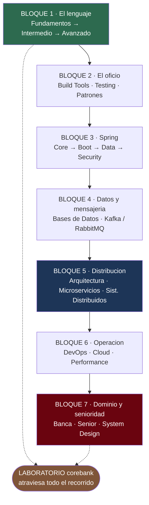

---
tags:
  - Java
Creado: 2026-05-21
Actualizado: 2026-09-08
Relacionado:
  - ESTUDIO
  - PLAN DE CAPACITACION
Categoria: Lenguaje
Nivel: Básico a Senior
---

#Principal

# Roadmap Java — de cero a backend senior en banca

Esta nota es el **mapa**. Dice qué hay, en qué orden y por qué. El detalle vive en cada módulo.

> [!tip] Cómo se recorre
> Los módulos se estudian, el **laboratorio se construye en paralelo**. Cada bloque teórico cierra aplicándose sobre el mismo producto: un core bancario que crece fase por fase → [[Proyectos Java]].
> Estudiar sin construir no deja evidencia; construir sin estudiar deja código que no sabés defender.

---

## 🗺️ El camino



---

## 📚 Módulos

### Bloque 1 · El lenguaje
*Sin esto, todo lo demás es copiar y pegar.*

| # | Módulo | Estado | Nota |
|---|--------|--------|------|
| 01 | Fundamentos | ⬜ | [[Java Fundamentos]] |
| 02 | Intermedio | ⬜ | [[Java Intermedio]] |
| 03 | Avanzado | ⬜ | [[Java Avanzado]] |

### Bloque 2 · El oficio
*Lo que separa a quien programa de quien entrega software.*

| # | Módulo | Estado | Nota |
|---|--------|--------|------|
| 04 | Build Tools | ⬜ | [[Build Tools]] |
| 05 | Testing | ⬜ | [[Testing en Java]] |
| 06 | Patrones de diseño | ⬜ | [[Patrones de Diseño]] |

### Bloque 3 · Spring
*El framework donde vas a vivir.*

| # | Módulo | Estado | Nota |
|---|--------|--------|------|
| 07a | Spring Core | ⬜ | [[Spring Core]] |
| 07b | Spring Boot | ⬜ | [[Spring Boot]] |
| 07c | Spring Data | ⬜ | [[Spring Data]] |
| 07d | Spring Security | ⬜ | [[Spring Security]] |

### Bloque 4 · Datos y mensajería
*De dónde sale y por dónde viaja la información.*

| # | Módulo | Estado | Nota |
|---|--------|--------|------|
| 08 | Bases de datos para Java | ⬜ | [[Bases de Datos Java]] |
| 09 | Mensajería (Kafka / RabbitMQ) | ⬜ | [[Mensajeria]] |

### Bloque 5 · Distribución y arquitectura
*Cómo se parte un sistema y qué se rompe al partirlo.*

| # | Módulo | Estado | Nota |
|---|--------|--------|------|
| 11 | Arquitectura Java | ⬜ | [[Arquitectura Java]] |
| 10 | Microservicios | ⬜ | [[Microservicios]] |
| 18 | Sistemas Distribuidos 🆕 | ⬜ | [[Sistemas Distribuidos]] |

### Bloque 6 · Operación
*Un sistema que no se puede desplegar, observar ni medir, no está terminado.*

| # | Módulo | Estado | Nota |
|---|--------|--------|------|
| 12 | DevOps con Java | ⬜ | [[DevOps con Java]] |
| 19 | Cloud para Java (Azure ↔ AWS) 🆕 | ⬜ | [[Cloud para Java]] |
| 13 | Performance y JVM | ⬜ | [[Performance Java]] |

### Bloque 7 · Dominio y senioridad
*Lo que te vuelve contratable en banca, y no solo empleable.*

| # | Módulo | Estado | Nota |
|---|--------|--------|------|
| 17 | Banca y Fintech 🆕 | ⬜ | [[Banca y Fintech]] |
| 14 | Senioridad técnica | ⬜ | [[Senior Java Engineer]] |
| 20 | System Design y entrevistas 🆕 | ⬜ | [[System Design]] |

### Transversales

| # | Módulo | Estado | Nota |
|---|--------|--------|------|
| 15 | **Laboratorio `corebank`** — atraviesa todo | ⬜ | [[Proyectos Java]] |
| 16 | Quarkus (alternativa cloud-native, opcional) | ⬜ | [[Quarkus]] |

---

## 🧭 Ruta recomendada

1. **Aprendé Java puro antes de tocar Spring.** Spring esconde complejidad; si no sabés qué esconde, no podés depurarlo.
2. **Testing desde temprano, no al final.** Escribir tests sobre código que ya existe es diez veces más caro.
3. **Entrá a Spring Boot recién con IoC, DI, HTTP y SQL claros.** Si no, memorizás anotaciones.
4. **Estudiá arquitectura cuando puedas hacer una API CRUD sin mirar tutorial.** Antes de eso, no tenés con qué contrastar.
5. **Distribuí solo después de dominar el monolito.** Microservicios resuelve problemas de organización, no de código.
6. **El dominio bancario entra en paralelo desde la Fase 2 del laboratorio**, no al final: es lo que le da sentido a la idempotencia y a la auditoría.
7. **Cerrá cada bloque con una fase del laboratorio.** Sin eso, no hay evidencia.

---

## ⏱️ Orden mínimo si tenés poco tiempo

Si tuvieras que llegar a una entrevista de backend Java en banca con lo mínimo indispensable:

```
Fundamentos → Intermedio → Spring Boot → Spring Data → Testing
→ Arquitectura → Banca y Fintech → Sistemas Distribuidos → System Design
```

Todo lo demás suma, pero **eso** es el esqueleto.

---

## 🏁 Base personal

[[Bases java]] · [[Java-cheatsheet]] · [[Java-errores-comunes]]

---

## ✅ Checkpoint senior

### Lenguaje y JVM
- [ ] Puedo explicar JVM, heap, stack, GC, classpath y module-path.
- [ ] Entiendo el modelo de memoria de Java y por qué `volatile` no es un candado.
- [ ] Puedo modelar dominio con clases, records, enums, value objects y excepciones propias.
- [ ] Conozco el contrato `equals`/`hashCode` y las consecuencias de romperlo.

### Construcción
- [ ] Puedo crear APIs REST limpias con validación, errores consistentes y pruebas.
- [ ] Puedo usar JPA sin caer en N+1, transacciones mal ubicadas ni entidades anémicas.
- [ ] Escribo tests de unidad, integración y arquitectura, y sé cuál corresponde en cada caso.
- [ ] Puedo asegurar una API con JWT/OAuth2, roles y permisos por recurso.

### Distribución
- [ ] Puedo hacer idempotente cualquier operación que cruce la red.
- [ ] Sé por qué el dual-write está roto y puedo implementar Outbox.
- [ ] Puedo diseñar una SAGA con sus compensaciones y explicar cuándo *no* usarla.
- [ ] Entiendo qué garantía pierdo al distribuir y qué gano a cambio.

### Operación
- [ ] Puedo dockerizar, desplegar, observar, medir y diagnosticar una app Java.
- [ ] Puedo instrumentar logs, métricas y trazas correlacionadas.
- [ ] Puedo llevar una app Spring a la nube sin credenciales en el código.
- [ ] Puedo diagnosticar un memory leak y un GC mal configurado.

### Dominio y senioridad
- [ ] Puedo representar dinero sin perder un centavo y explicar por qué `double` no sirve.
- [ ] Puedo diseñar un ledger de partida doble que cuadre.
- [ ] Puedo diseñar servicios mantenibles con Clean Architecture, Hexagonal o DDD ligero.
- [ ] Puedo revisar código ajeno y detectar riesgos de performance, seguridad y mantenibilidad.
- [ ] Puedo conducir una entrevista de diseño de 45 minutos y defender mis trade-offs.

---

## 🔗 Relaciones
- **Plan general de estudio**: [[PLAN DE CAPACITACION]]
- **Otro eje backend**: [[NET]]
- **Se conecta con**: [[ARQUITECTURA]], [[KUBERNETES]], [[Azure]]

## 📌 Notas Rápidas
- Los módulos marcados 🆕 se agregaron el 2026-09-08 para cubrir dominio bancario, sistemas distribuidos, nube y diseño de sistemas: eran los huecos entre "sé Java" y "puedo trabajar de senior en un banco".
- El estado de cada módulo se marca acá y en su índice. Si divergen, manda el índice del módulo.
- Quarkus es opcional: sirve si apuntás a serverless o arranque en frío, no es prerequisito de nada.

---

## ✍️ Mis apuntes
> 📓 Todos tus apuntes → [[Mis Apuntes]]

<!-- Anotaciones generales del roadmap -->

