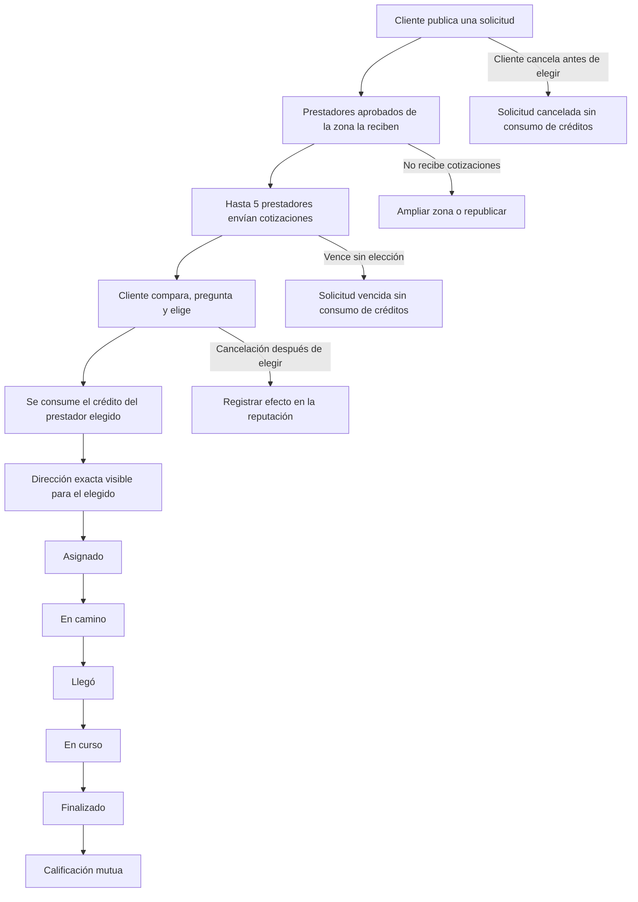

# Visión y alcance

Volver a [[NeedDoer]].

## Problema y propuesta

NeedDoer busca simplificar la contratación de reparaciones domésticas. El cliente describe el problema y publica la solicitud gratis, recibe cotizaciones de técnicos verificados, compara perfiles y elige a uno. Después de aceptar la cotización, puede conversar con el prestador mientras el servicio está activo. El prestador necesita créditos disponibles para participar, pero el crédito solo se consume cuando el cliente acepta su cotización.

## Actores y plataformas

| Actor | Necesidad principal | Plataforma |
| --- | --- | --- |
| Cliente | Publicar un problema, comparar técnicos y contratar con confianza. | App Android e iOS. |
| Prestador | Encontrar solicitudes relevantes, cotizar y construir reputación profesional. | La misma app, mediante el modo prestador. |
| Equipo de NeedDoer | Verificar técnicos, resolver reclamos y administrar el marketplace. | Panel web. |

Todo usuario entra con su celular y empieza como cliente. El modo prestador se activa por separado y requiere aprobación.

## Categorías iniciales

- Gasfitería.
- Electricidad.
- Electrodomésticos.
- Cerrajería.

## Ciclo principal de una solicitud

Este diagrama reconstruye el flujo descrito en el mapa funcional. Debe validarse durante la revisión del producto, porque el archivo de origen incluía una referencia a contenido incrustado que no llegó dentro del Markdown.

## Requisitos transversales

- **Datos personales:** DNI y selfie son datos sensibles según la Ley 29733. Se requiere consentimiento expreso, acceso restringido y un plazo de conservación definido.
- **Ubicación:** la dirección exacta solo se revela al prestador elegido.
- **Rendimiento:** la app debe funcionar bien en celulares de gama media o baja y con datos móviles; las fotos se comprimen antes de subirlas.
- **Accesibilidad y lenguaje:** textos grandes, buen contraste y palabras de uso cotidiano.
- **Notificaciones:** el ciclo depende de avisos confiables y de un historial dentro de la app.

## Fuera del alcance inicial

- Cobrar el servicio técnico dentro de la app mediante pago retenido.
- Seguimiento GPS del prestador en tiempo real.
- Empleos formales con postulaciones.
- Cuentas de empresa.
- Verificación automática de identidad y antecedentes.
- Contraoferta del cliente.
- Versión web para clientes.

## Referencias

- Inventario detallado: [[02 - Mapa de funcionalidades]].
- Parámetros operativos: [[03 - Reglas de negocio]].
- Temas abiertos: [[04 - Decisiones pendientes]].
