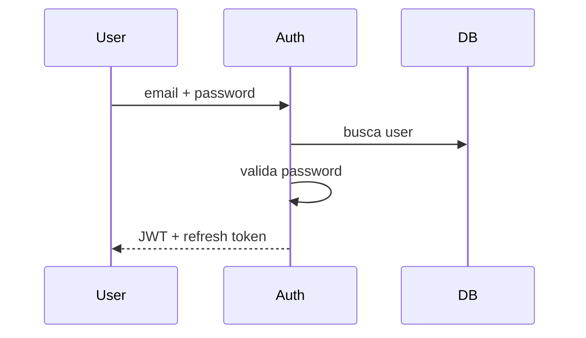

## Jerarquia de Encabezados


Se crean con #
# H1 
## H2
### H3
separacion de line con "---"

---
## Citas, Bloques de codigo y matematicos

>"Prueba de una cita"

Click derecho e insertar bloque de codigo:
```
print("Hola")
```

## Esconder encabezado y ajusta el ancho de lienzo

1. Plantilla
	1. En ajustes -> Plantilla : Definir ruta de donde estan las plantillas
	2. En atajos definir la combinación de teclas para llamar a una plantilla
2. Editor
	1. Desactivar longitud de linea legible

## Mostrar vista previa
[[Funcionalidades Obsidian#H1#Citas, Bloques de codigo y matematicos]]



